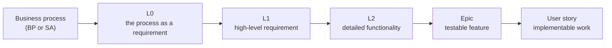

# Simpl-Open requirements: proof of concept

This folder shows a small set of Simpl-Open requirements and backlog items as pages that a reader can understand without help. It is a counter proposal to the first publication attempt in [`simpl/pso/jira-test-issues`](https://code.europa.eu/simpl/pso/jira-test-issues), using the same ten items. It is a one-off mock-up for internal PSO review. The final publication will be built by PSO once the requirements for it are agreed.

## What you find here

Simpl-Open is the open-source software of the Simpl programme: the software that lets organisations set up and run a data space. What Simpl-Open must do is written down at several levels, from business process down to user story. Each level has its own purpose and its own way of writing, and each item has a key such as `SIMPL-31425`.

The items sit in folders that follow the levels, from business process down to user story: a child item is a folder inside its parent. Each folder is named after the item key, and the item page is the `README.md` inside, for example [`items/no-business-process/SIMPL-31424/SIMPL-31425/`](items/no-business-process/SIMPL-31424/SIMPL-31425/README.md). Each page tells you:

- **what kind of item it is** and what that level means,
- **where it sits**: the business process it serves and its parent and children,
- **what it says**: the requirement, user story and acceptance criteria, cleaned up but not reworded,
- **its status**,
- **what is wrong with it in the source**, if anything, under "Notes on the source".

## How the levels fit together

Read the arrow as "is broken down into". The first four levels say **what** Simpl-Open must do. Only the user story says **how**. [What the levels mean](levels.md) gives the full definitions and the linking rules.

## Where to start

You can start anywhere. Pick the view that matches your question.

| Your question | Start at |
| --- | --- |
| What does this business process require from Simpl-Open? | [By business process](processes.md) |
| Which items are there, and what is their status? | [All items](all-items.md) |
| How are the items nested, level by level? | [Items by folder](items/README.md) |
| What do L0, L1, L2, Epic and Story mean? | [What the levels mean](levels.md) |
| Which items do not trace back to a business process? | [Trace gaps](trace-gaps.md) |
| What does this proof of concept change compared with the first attempt? | [The proposal](proposal.md) |

## Scope and limits

- **Ten items**: the nine published in `jira-test-issues` on 10 November 2026, plus one cancelled item kept for history.
- **Source of the content**: the markdown export in `jira-test-issues`, not the source system itself. Texts are kept as written. Typos are not corrected in the text but listed under "Notes on the source".
- **Item keys are plain text.** The source system needs a login, so keys link only to pages in this folder.
- **Business process links** go to the public [business-processes](https://code.europa.eu/simpl/simpl-open/foundations/business-processes) repository and to the public requirements site [simpl-programme.ec.europa.eu](https://simpl-programme.ec.europa.eu).
- **Status** is the status at the time of the export. It is not kept up to date here.
