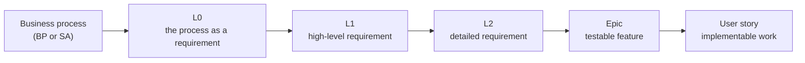

# Simpl-Open requirements: proof of concept

This folder shows Simpl-Open requirements and backlog items as pages that a reader can understand without help. It is a counter proposal to the first publication attempt in [`simpl/pso/jira-test-issues`](https://code.europa.eu/simpl/pso/jira-test-issues). It starts from the same ten items and adds the full tree they belong to: 683 items in six business processes. It is a one-off mock-up for internal PSO review. The final publication will be built by PSO once the requirements for it are agreed.

## What you find here

Simpl-Open is the open-source software of the Simpl programme: the software that lets organisations set up and run a data space. What Simpl-Open must do is written down at several levels, from business process down to user story. Each level has its own purpose and its own way of writing, and each item has a key such as `SIMPL-31425`.

The items sit in folders that follow the levels, from business process down to user story: a child item is a folder inside its parent. Each folder is named after the level and the item key, such as `L1-SIMPL-31424`, and the item page is the `README.md` inside, for example [`items/BP13/L0-SIMPL-10783/L1-SIMPL-31424/L2-SIMPL-31425/`](items/BP13/L0-SIMPL-10783/L1-SIMPL-31424/L2-SIMPL-31425/README.md). Each page tells you:

- **what kind of item it is** and what that level means,
- **where it sits**: the business process it serves and its parent and children,
- **what it says**: the requirement, user story and acceptance criteria, cleaned up but not reworded, if the item is published,
- **its status**,
- for the ten items of PSO's export: **what is wrong with it in the source or the export**, under "Notes on the source".

## How the levels fit together

Read the arrow as "is broken down into". The first four levels say **what** Simpl-Open must do. Only the user story says **how**. [What the levels mean](levels.md) gives the full definitions and the linking rules.

## Where to start

You can start anywhere. Pick the view that matches your question.

| Your question | Start at |
| --- | --- |
| What does this business process require from Simpl-Open? | [By business process](processes.md) |
| Which items are there, and what is their status? | [All items](all-items.md) |
| How are the items nested, level by level? | [Items by folder](items/README.md) |
| What do L0, L1, L2, Epic and Story mean? | [What the levels mean](levels.md) |
| Does every item trace back to a business process? | [Trace gaps](trace-gaps.md) |
| What does this proof of concept change compared with the first attempt? | [The proposal](proposal.md) |

## Scope and limits

- **Items**: the ten items of `jira-test-issues` on 10 November 2026, and every L0, L1, L2, Epic and user story in the trees they belong to. Tasks, tests and bugs are left out. The ten are marked ★ in [All items](all-items.md).
- **Source of the content**: the requirements source on 10 November 2026, not PSO's export. PSO's export left out parent links and children; the [trace gaps](trace-gaps.md) page shows what it lost.
- **Published items only.** An item's text is shown only when the item is published on the requirements website. For an Epic or user story, the L2, L1 or L0 above it decides. The ten items of PSO's export are shown in full, as PSO already made them public. Other items show only key, level, title and status.
- **Cancelled items are left out.** They are not part of the requirements.
- **Texts are kept as written.** The words are not changed and typos are not corrected. Only the layout of user stories and acceptance criteria is made the same everywhere (see [the levels page](levels.md#how-user-stories-and-acceptance-criteria-are-written)). Links to internal pages are replaced by "(internal page)", and names of people and email addresses are removed.
- **Item keys are plain text.** The source system needs a login, so keys link only to pages in this folder.
- **Business process links** go to the public [business-processes](https://code.europa.eu/simpl/simpl-open/foundations/business-processes) repository and to the public requirements site [simpl-programme.ec.europa.eu](https://simpl-programme.ec.europa.eu).
- **Status** is the status on 10 November 2026. It is not kept up to date here.
