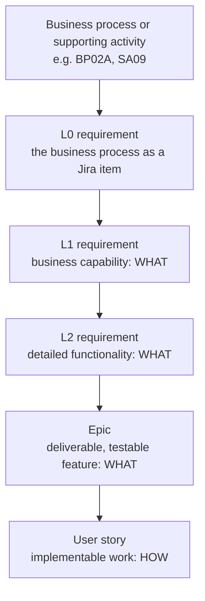

# What the levels mean

> Part of the [Simpl-Open requirements proof of concept](README.md).

Simpl-Open requirements are written top-down in five levels. Each level is a Jira issue type. The definitions below are summarised from the Simpl Development Handbook V1.8, chapter "Requirements elicitation and management" (internal Confluence).

## The levels

| Level | Describes | In one sentence | Written as |
| --- | --- | --- | --- |
| **Business process (BP) or supporting activity (SA)** | A business process | What the actors of a data space do, step by step, for example BP02A "Configure ID/Trust security solution". | A process page with steps such as BP02A.02. |
| **L0** | The business process in Jira | The Jira item that stands for one BP or SA, so lower levels can hang under it. | The BP name, for example "BP02A - Configure ID/Trust security solution". |
| **L1** | A business capability | What Simpl-Open must enable to support one step, or a few related steps, of a business process. | Title: actor, verb, object. Text: "Simpl-Open shall allow ...". |
| **L2** | A detailed functionality | A concrete and testable function that makes part of an L1 real. | "Simpl-Open shall ..." for one actor and one function. |
| **Epic** | A deliverable feature | A testable feature seen from a business actor. It bridges the requirements (L2) and the implementation work (stories). | "As a ... I want ... so that ...", with acceptance criteria in Given / When / Then. |
| **User story** | Implementable work | A piece of work a team can build and test in a sprint, often split into a UI story and an API story. | "As a ... I want ... so that ...", with acceptance criteria. |

## Example from the handbook

| Level | Title |
| --- | --- |
| BP | Resource Publishing and Access Control |
| L1 | Provider defines and manages access policies for catalogue resources |
| L2 | Provider defines initial access policy for catalogue resources |
| L2 | Provider updates existing access policy for catalogue resources |
| Epic | Provider manages access policies for catalogue resources |
| User story | [UI] Provider creates access policy for catalogue resources |
| User story | [API] Provider creates access policy for catalogue resources |

## Linking rules

The handbook sets these rules. The [trace gaps](trace-gaps.md) page checks the items in this folder against them.

- An **L1** must be linked to **exactly one** business process.
- An **L2** must be linked to **exactly one** parent L1.
- An **Epic** must be linked to **at least one** L2.
- A **user story** sits under an Epic (level 4 under level 3 in the handbook hierarchy). The handbook does not state the rule as a "must".

An item that does not meet its rule is tagged **⚠ Trace gap** on its page.

## Status

Status is the Jira workflow status. The ones you see in this folder, roughly in order:

| Status | Meaning |
| --- | --- |
| Defined, PBI Defined | Written and approved after elicitation. The handbook keeps the key fields stable from PBI Defined on. |
| In Progress | Being worked on. |
| Internal QA check | A review step in the Jira workflow. The handbook page "Jira SDLC implemented definitions and flows" defines it. |
| Cancelled | Dropped. Kept for history. |
