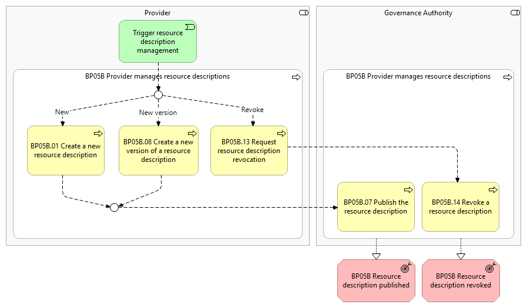
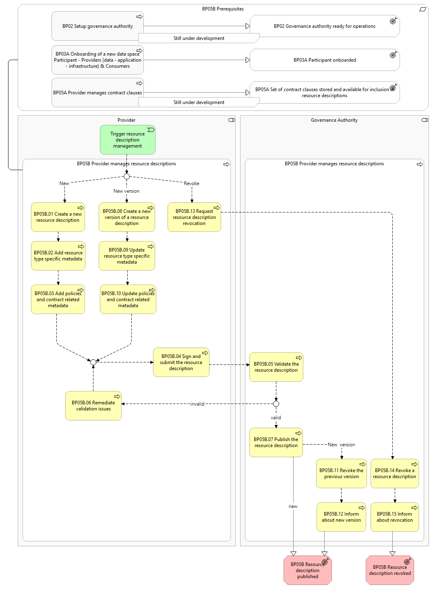

📍 You are here [🏠 Home](https://code.europa.eu/simpl/simpl-open) / [Foundations](https://code.europa.eu/simpl/simpl-open/foundations) / [Business Processes](https://code.europa.eu/simpl/simpl-open/foundations/business-processes) / BP05B - Provider manages resource descriptions

# BP05B - Provider manages resource descriptions

## Canonical source
[https://simpl-programme.ec.europa.eu/book-page/bp05b-provider-manages-resource-descriptions](https://simpl-programme.ec.europa.eu/book-page/bp05b-provider-manages-resource-descriptions)

> **See also: [Dynamic view](./bp05b-dynamic-view.md)** - sequence diagram showing how this business process executes at runtime, with links to each participating solution.
> **See also: [TCV dynamic view](./bp05b-tcv-dynamic-view.md)** - sequence diagrams of the technology components supporting resource-description management.

> **See also: [SA08 - Application orchestration used by a Participant](https://code.europa.eu/simpl/simpl-open/foundations/business-processes/-/blob/main/sa08-application-orchestration/README.md)** - an application workflow is linked and parameterised against an application resource description published through this business process (SA08.04).

## Overview

This business process covers the management of resource descriptions in the data space catalogue by both a _Provider_ and the _Governance Authority_. It includes the following main steps:

- **Create a new resource description** - the _Provider_ creates a new resource description with the required and optional contents, signs and submits it to the _Governance Authority_ for publication in the data space catalogue.
- **Create a new version of a resource description** - the _Provider_ creates a new version of an existing resource description, updates the contents, signs and submits it to the _Governance Authority_. This corresponds to an update; resource descriptions are immutable and cannot be changed in place.
- **Request resource description revocation** - the _Provider_ sends a request to revoke a resource description from the data space catalogue to the _Governance Authority_.
- **Publish a resource description** - having received a request to create a new resource description (or a new version), the _Governance Authority_ validates the received resource description and publishes it in the data space catalogue if valid. Consumers of an existing resource description are informed about the new version, and the old version is revoked by the _Governance Authority_.
- **Revoke a resource description** - having received a request to revoke a resource description, the _Governance Authority_ revokes it from the data space catalogue. Consumers of the resource description are informed about the revocation.

## Actors

- _Governance Authority_
- _Provider_

## Assumptions

- The creation of a new resource description, or a new version of one, always uses the latest version of a schema.
- If a new version of a resource description is created, usage contracts based on the old version continue without alteration.
- The revocation of a resource description does not alter or terminate usage contracts based on that resource description, which can still be inspected by the _Consumer_. Only new usage contracts are no longer possible with the revoked resource description, since it is no longer available in the data space catalogue.

## Prerequisites

- **Data space is configured** - the _Governance Authority_ has configured the data space catalogue with the corresponding vocabulary and schemas (containing quality rules) to have the general structure of a resource description (BP02). Data-space-specific configurations such as contract templates must also be defined.
- **Provider onboarded** - the _Provider_ must be successfully onboarded (BP03A).
- **Contract clauses stored and available for inclusion in resource descriptions** - the _Provider_ must have created and stored at least one set of contract clauses so they can be included in the resource description (BP05A).

*BP05B figure 1 - high-level diagram*

*BP05B figure 2 - detailed-level diagram*

## Process steps

### Trigger - resource description management

The _Provider_ decides whether to create a new resource description, create a new version of an existing one, or revoke an existing one. This initiates resource description management.

### BP05B.01 Create a new resource description

The _Provider_ selects the resource type (data, application, or infrastructure) and enters required and optional common metadata.

### BP05B.02 Add resource type specific metadata

Depending on the selected resource type, the _Provider_ adds the resource type specific required and optional metadata.

### BP05B.03 Add policy and contract related metadata

For access and usage control, the _Provider_ configures the policies that shall be applied to the new resource. The _Provider_ also adds required and optional metadata related to the usage contract for the specific resource.

### BP05B.04 Sign and submit the resource description

The _Provider_ signs the new resource description with the _Provider_'s credentials and submits it to the _Governance Authority_.

### BP05B.05 Validate the resource description

When receiving a request to publish a new resource description (or a new version), the _Governance Authority_ performs syntactic validation, semantic validation against schema and vocabulary, and quality-rules validation.

### BP05B.06 Remediate validation issues

In case of validation issues, the _Governance Authority_ informs the _Provider_. The _Provider_ must remediate and resubmit the resource description for publication.

### BP05B.07 Publish the resource description

Upon successful validation, the new (or new version of the) resource description is published in the data space catalogue.

### BP05B.08 Create a new version of a resource description

The _Provider_ selects a previously published resource description and initiates the creation of a new version, updating required and optional metadata.

### BP05B.09 Update resource type specific metadata

Resource-type-specific metadata can be updated for a new version of a resource description.

### BP05B.10 Update policies and contract related metadata

Policies and contract-related metadata can be updated for a new version of a resource description. After this step, creation of a new version continues with signing and submission, identical to the new-resource flow.

### BP05B.11 Revoke the previous version of the resource description

If the new version of the resource description is valid, the _Governance Authority_ revokes the current (previous) resource description version.

### BP05B.12 Inform about new version

If a resource description is updated, the _Consumers_ of this resource are informed about the new version in the data space catalogue.

### BP05B.13 Request resource description revocation

The _Provider_ selects a previously published resource description and initiates the revocation of this resource description.

### BP05B.14 Revoke a resource description

Upon receiving a request for revocation, the _Governance Authority_ revokes the resource description from the data space catalogue.

### BP05B.15 Inform about revocation

If a resource description is revoked, the _Consumers_ of this resource are informed about the revocation.

## High-level requirements

The requirements of BP05B, from the high-level requirements down to the user stories, are in [functional-requirements / bp05b-provider-manages-resource-descriptions](../../functional-requirements/bp05b-provider-manages-resource-descriptions/README.md). Each requirement has its own page there, with its text, its status and its place in the tree.

| ID | High-level requirement | Status | Items under it | Process steps | Dynamic view | Requirements site |
| --- | --- | --- | --- | --- | --- | --- |
| 5B.1 | [A Provider consults its own Resource descriptions](../../functional-requirements/bp05b-provider-manages-resource-descriptions/L0-SIMPL-10768/L1-SIMPL-12897/README.md) | Defined | 20 | - | [Retrieve SD metadata](bp05b-dynamic-view.md#retrieve-sd-metadata), [Retrieve full self-description](bp05b-dynamic-view.md#retrieve-full-self-description) | [tbp-5b1-…](https://simpl-programme.ec.europa.eu/book-page/tbp-5b1-provider-consults-its-own-resource-descriptions) |
| 5B.2 | [A Provider creates a new Resource description](../../functional-requirements/bp05b-provider-manages-resource-descriptions/L0-SIMPL-10768/L1-SIMPL-14688/README.md) | In Progress | 103 | [01](#bp05b01-create-a-new-resource-description), [02](#bp05b02-add-resource-type-specific-metadata), [03](#bp05b03-add-policy-and-contract-related-metadata) | [Define and publish self-description](bp05b-dynamic-view.md#define-and-publish-self-description), [TCV](bp05b-tcv-dynamic-view.md) | [tbp-5b2-…](https://simpl-programme.ec.europa.eu/book-page/tbp-5b2-provider-creates-new-resource-description) |
| 5B.3 | [A Provider creates a new version of a Resource description](../../functional-requirements/bp05b-provider-manages-resource-descriptions/L0-SIMPL-10768/L1-SIMPL-14728/README.md) | In Progress | 38 | [08](#bp05b08-create-a-new-version-of-a-resource-description), [09](#bp05b09-update-resource-type-specific-metadata), [10](#bp05b10-update-policies-and-contract-related-metadata) | [Define and publish self-description](bp05b-dynamic-view.md#define-and-publish-self-description) | [tbp-5b3-…](https://simpl-programme.ec.europa.eu/book-page/tbp-5b3-provider-creates-new-version-resource-description) |
| 5B.4 | [A Provider signs and submits a new Resource description or a new version](../../functional-requirements/bp05b-provider-manages-resource-descriptions/L0-SIMPL-10768/L1-SIMPL-14729/README.md) | Defined | 17 | [04](#bp05b04-sign-and-submit-the-resource-description) | [Define and publish self-description](bp05b-dynamic-view.md#define-and-publish-self-description), [TCV](bp05b-tcv-dynamic-view.md) | [tbp-5b4-…](https://simpl-programme.ec.europa.eu/book-page/tbp-5b4-provider-signs-and-submits-new-resource-description-or-new-version-resource) |
| 5B.5 | [The Governance Authority publishes a Resource description](../../functional-requirements/bp05b-provider-manages-resource-descriptions/L0-SIMPL-10768/L1-SIMPL-14687/README.md) | In Progress | 47 | [05](#bp05b05-validate-the-resource-description), [06](#bp05b06-remediate-validation-issues), [07](#bp05b07-publish-the-resource-description) | [Define and publish self-description](bp05b-dynamic-view.md#define-and-publish-self-description), [TCV](bp05b-tcv-dynamic-view.md) | [tbp-5b5-…](https://simpl-programme.ec.europa.eu/book-page/tbp-5b5-governance-authority-publishes-resource-description) |
| 5B.6 | [A Provider notifies Consumers about a new version of a Resource description](../../functional-requirements/bp05b-provider-manages-resource-descriptions/L0-SIMPL-10768/L1-SIMPL-21118/README.md) | In Progress | 3 | [11](#bp05b11-revoke-the-previous-version-of-the-resource-description), [12](#bp05b12-inform-about-new-version) | - | [5b6-…](https://simpl-programme.ec.europa.eu/book-page/5b6-provider-notifies-consumers-about-new-version-resource-description) |
| 5B.7 | [A Provider requests the revocation of a Resource description](../../functional-requirements/bp05b-provider-manages-resource-descriptions/L0-SIMPL-10768/L1-SIMPL-14699/README.md) | Defined | 4 | [13](#bp05b13-request-resource-description-revocation) | [Revoke a self-description](bp05b-dynamic-view.md#revoke-a-self-description-sd) | [5b7-…](https://simpl-programme.ec.europa.eu/book-page/5b7-provider-requests-revocation-resource-description) |
| 5B.8 | [The Governance Authority revokes a resource description](../../functional-requirements/bp05b-provider-manages-resource-descriptions/L0-SIMPL-10768/L1-SIMPL-14640/README.md) | Defined | 4 | [14](#bp05b14-revoke-a-resource-description) | [Revoke a self-description](bp05b-dynamic-view.md#revoke-a-self-description-sd) | [5b8-…](https://simpl-programme.ec.europa.eu/book-page/5b8-governance-authority-revokes-resource-description) |
| 5B.9 | [The Provider notifies Consumers about the revocation of a resource description](../../functional-requirements/bp05b-provider-manages-resource-descriptions/L0-SIMPL-10768/L1-SIMPL-21117/README.md) | In Progress | 4 | [15](#bp05b15-inform-about-revocation) | - | [5b9-…](https://simpl-programme.ec.europa.eu/book-page/5b9-provider-notifies-consumers-about-revocation-resource-description) |

The process steps per requirement are a proposal of this example: the items have no field for the step yet.

