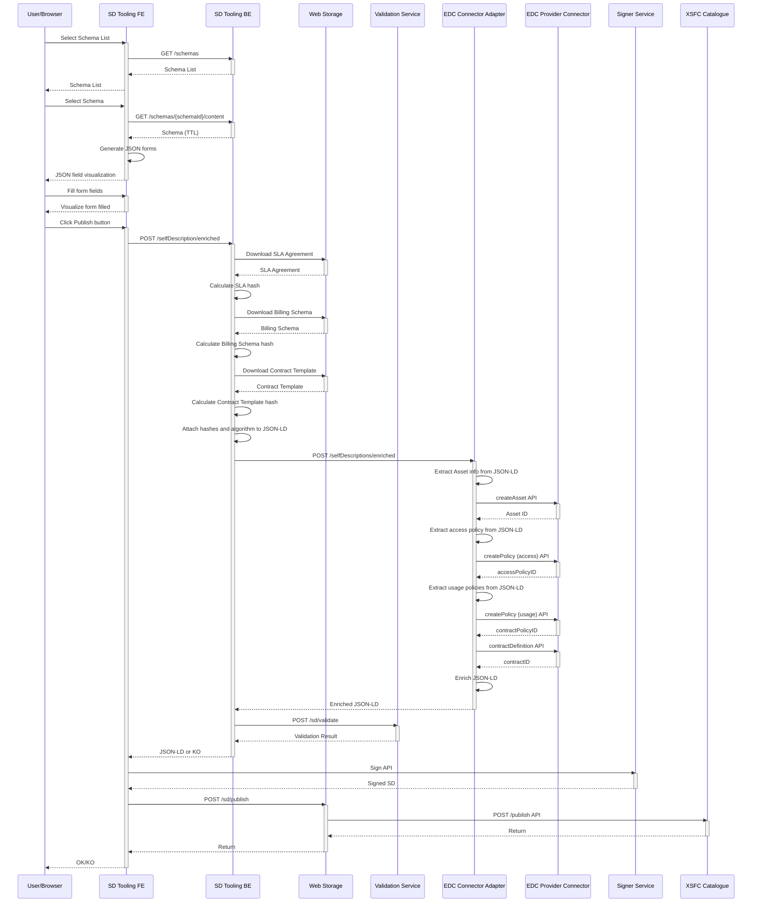
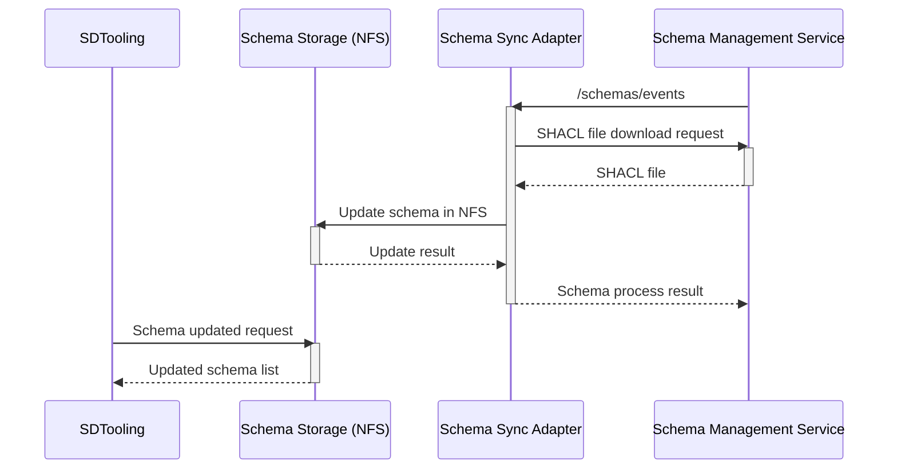

# TCV Dynamic - BP 05B - Provider manages resource descriptions

> **Requirements:** [5B.2 A Provider creates a new Resource description](../../functional-requirements/bp05b-provider-manages-resource-descriptions/L0-SIMPL-10768/L1-SIMPL-14688/README.md) · [5B.4 A Provider signs and submits a new Resource description or a new version](../../functional-requirements/bp05b-provider-manages-resource-descriptions/L0-SIMPL-10768/L1-SIMPL-14729/README.md) · [5B.5 The Governance Authority publishes a Resource description](../../functional-requirements/bp05b-provider-manages-resource-descriptions/L0-SIMPL-10768/L1-SIMPL-14687/README.md)

This perspective illustrates the interactions and the flows between all the technological components.

## Schema Synchronization

The figure illustrates the role of the *schema-sync-adapter* component. This component receives notifications from the *Schema Management Service* when a schema is published, versioned, or revoked. It then retrieves the schema from the *Schema Management Service* and stores it in the schema storage (NFS), making it available for use by the *SD-Tooling*.

