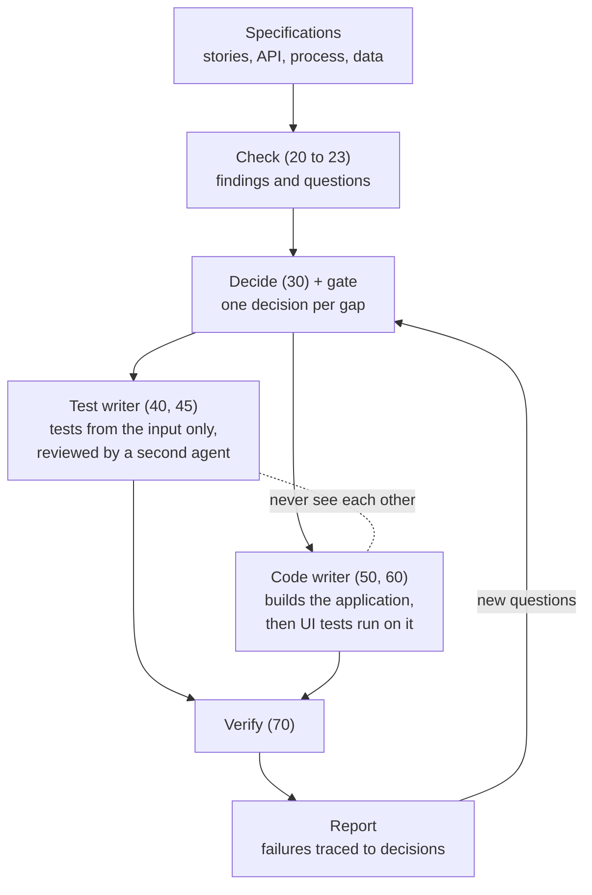

# The spec factory: how it works, what it can do, where it falls short

Status on 23 Nov 2026. Written for readers without a technical background.

## In short

The spec factory checks if a set of software specifications is good enough to build from. It reads them like a builder would, lists every gap, closes each gap with a written decision, and then lets AI agents build and test the software from that input. If the result does what the specifications say, they were clear enough. If it does not, the failures point back to the specifications.

It was tried on one Simpl-Open component, the Vocabulary Manager. After 13 runs, the latest build passed 551 of 552 tests. A run takes about 2 hours and costs about 58 USD in AI usage.

This is a personal project for learning and experiment. It is not commissioned by DG Connect or by a Simpl contractor, and it does not speak for them. The code and the results are public.

## The idea: the specifications are the product

In the usual way of working, a contractor reads the specifications, fills the gaps on their own, and delivers code. The choices they made are hidden in that code. Nobody sees them until something goes wrong.

The spec factory turns this around:

- **Every gap becomes a visible decision.** It is written down with the options, the reason and a question for the owner of the specification.
- **Two builders who never meet.** One AI agent writes the tests, another writes the code. They only share the specifications and the decisions. When the tests pass, both understood the input the same way. When they disagree, the input was not clear enough.
- **The code can be thrown away.** The specifications, the decisions, the rules and the tests are what people maintain. The code can be generated again from them. A change starts in a specification or a decision, never in the code.

So a build here is mainly a test of the specifications, not a product. The question each run answers is: is this input enough for someone else to build the right thing?

## The steps, one by one

There are four phases: prepare the input, check it, decide on the gaps, then build and verify. The first three phases run once per change in the specifications. The last phase is one command and can be repeated as often as wanted.

Three kinds of workers appear below. A **script** is a normal program: it always does the same thing. An **AI agent** is a language model (Claude) that gets a short written brief and may read only the files the brief allows. The **operator** is the person who runs the factory and approves the decisions.

| Step | What happens | Done by | What comes out |
| --- | --- | --- | --- |
| 10 Collect | The input is fetched and frozen: user stories with acceptance criteria from Jira, the API definition (OpenAPI), the business process and the data models (CDM), each at a fixed version. | Script; stories are converted by an AI model that runs locally on the laptop | One fixed input set per component |
| 11 Rules | The programme's guidelines are turned into numbered rules that can be checked, plus 177 general rules of the factory (API design, security from OWASP, microservices, quality targets, reuse). | AI agent, then fixed | 405 rules for this component |
| 12 Inventory | Every story, criterion, operation, process step and data class gets a stable id, with the links between them. | Script | A list that the later steps can refer to |
| 20 to 23 Check | The input is checked in four ways: the acceptance criteria (complete, testable, not ambiguous), the API against the API rules, the business process against the stories and the API, and the words used in API, data model and stories against each other. A script finds candidates, an agent judges them. | Script, then AI agent | Findings with a severity and a question |
| 29 Feedback | The findings are put in one report for the owners of the specifications. | Script | A readable report with questions |
| 30 Decide | Every finding that blocks a build gets a decision: what to build, the options, the reason, and the question for the owner. A gate checks that no blocking finding is left open. | AI agent drafts, operator approves | The decision list; the gate passes or not |
| 40 Test writer | Writes the test suite from the specifications and decisions only. It never sees the code. | AI agent | About 450 to 550 test scenarios |
| 45 Suite review | A second reader checks every test against the decisions: does it test too much, too little, or something else? The test writer fixes or rejects each point. | AI agent | A reviewed suite |
| 50 Code writer | Builds the software from the same input. It never sees the tests, earlier runs or the existing Simpl code. | AI agent, at the same time as step 40 | A running application: backend, user interface, database, login server |
| 60 UI tests | Writes and runs browser tests against the running user interface, including an accessibility check. | AI agent | Browser test results |
| 70 Verify | Runs the whole suite, attacks the API with random input (fuzzing), runs a load test against the speed targets, scans for known security flaws, and lets an independent agent review the design against the rules. Then it writes the report. | Scripts and two AI agents | A final report with every failure traced to a decision or a rule |
| Feedback | New questions from the report go back to step 30 as findings. The operator decides on them, and the next run uses the new decisions. | Operator with AI agent | New decisions for the next run |

The key point is in steps 40 and 50. The test writer and the code writer are kept apart on purpose. Each can read only what its brief allows, and the factory blocks the rest. So a passing test means two independent readers understood the input the same way.

## Where things live

Everything runs on one laptop, except the AI model, which is used as an online service. Both code repositories are public on GitHub.

| Part | What it holds | Where |
| --- | --- | --- |
| Engine | The steps, the scripts, the written briefs for the AI agents, the 177 general rules. It knows nothing about Simpl. | [spec-factory](https://github.com/barrynauta/spec-factory) |
| Simpl instance | The Simpl settings, the Simpl guidelines as rules, a frozen copy of the data models, and per component: the input, the findings, the decisions and the results of every run | This folder, [`simpl-spec-factory`](./README.md) |
| Run workspace | The two separate work folders of a run (tests and build), and the running application in Docker containers | The laptop only; the results are copied into this folder after each run |
| Input sources | Stories in the Simpl Jira, API definitions and data models in the public Simpl-Open code on code.europa.eu | Read only, at a fixed version |
| AI model | Claude, through the Claude Code command line tool | Online service of Anthropic |

The instance pins one version of the engine. Every generated file names the engine version that made it, so each result can be traced back to the exact tools and input.

## Results so far: the Vocabulary Manager

The latest run built a working Vocabulary Manager that passed 551 of 552 tests. The one failure was a real bug in the build, and the report named the decision it broke.

| Run | Date | Tests | Failed | Decisions in force | AI cost (USD) |
| --- | --- | --- | --- | --- | --- |
| [Run 13](./components/vocabulary-manager/runs/run13/report/REPORT.md) | 21 Nov 2026 | 552 | 1 | 180 | 57.98 |
| [Run 12](./components/vocabulary-manager/runs/run12/report/REPORT.md) | 20 Nov 2026 | 470 | 4 | 180 | 59.83 |
| [Run 11](./components/vocabulary-manager/runs/run11) | 20 Nov 2026 | 549 | 2 | 154 | 55.57 |
| [Run 10](./components/vocabulary-manager/runs/run10) | 20 Nov 2026 | 530 | 3 | 130 | 57.30 |
| [Run 9](./components/vocabulary-manager/runs/run9) | 19 Nov 2026 | 479 | 3 | 112 | 35.68 |
| [Run 8](./components/vocabulary-manager/runs/run8) | 19 Nov 2026 | 465 | 2 | 100 | 44.60 |
| [Run 7](./components/vocabulary-manager/runs/run7) | 19 Nov 2026 | 424 | 4 | 94 | 50.62 |
| [Run 6](./components/vocabulary-manager/runs/run6) | 19 Nov 2026 | 432 | 4 | 68 | 35.66 |
| [Run 5](./components/vocabulary-manager/runs/run5) | 18 Nov 2026 | 468 | 5 | 68 | not recorded |
| [Run 4](./components/vocabulary-manager/runs/run4) | 17 Nov 2026 | 386 | 7 | 52 | not recorded |

Runs 12 and 13 had exactly the same input: the difference between them is chance.

What the runs show:

- **A first prototype** (27 Oct 2026) already built the component from 30 written decisions. On the same test suite it passed 74 of 74 API tests, where the existing Simpl build passed 58 of 74. The differences were exactly on the points where the specifications leave room.
- **The full pipeline** (runs 4 to 13, 17 to 21 Nov 2026) added the checks, the rules, the independent review, fuzzing, load tests and security scans. Each run raised new questions. Answering them grew the decision list from about 50 to 180, and to 221 after runs 12 and 13.
- **Cost and time:** since run 6 a run is one command. It takes about 2 hours and costs 36 to 60 USD in AI usage. Most of the work is unattended.
- **Security:** run 4 had 17 critical findings in the scans. Since run 5 the component's own parts have no critical findings, and in runs 12 and 13 no high ones either. The remaining high findings sit in the reused Keycloak login server, which the build cannot patch itself.
- **Run 13 repeated run 12** with exactly the same input, to see how much results vary by chance. The test writer wrote 470 tests in one run and 552 in the other. The same multipart bug came back in both. A speed target was met in one run and missed in the other. So one run alone is not enough to judge a change.

## What it can do

The main value is not the generated code. It is what the factory makes visible about the specifications, early and in writing.

- **Check specifications before a contract or a sprint.** For the Vocabulary Manager the checks found 94 points, 14 of them blocking: things a builder cannot build without guessing. Each comes with a concrete question for the owner.
- **Turn hidden choices into a decision list.** Today a contractor makes these choices silently in the code. Here they are written down, with options and reasons, and can be reviewed, accepted or changed.
- **An independent reference build.** A build from the specifications alone can be compared with what a contractor delivers. In the first prototype the same tests passed 74 of 74 on the factory build and 58 of 74 on the existing build. Each difference pointed at a spot where the specifications allow two readings.
- **A test suite as acceptance check.** The suite is written from the specifications, not from the code, so it can be run against any build of the same component.
- **Cheap to repeat.** When a specification changes, the whole build and verification runs again with one command, in about 2 hours.
- **Not tied to Simpl.** The engine is generic. A new programme needs its own settings, guidelines and input.

## Problems and limits

These are the limits as they stand today. They matter for how far the results can be trusted.

- **The decisions are not the owners' decisions.** All 221 decisions were drafted by an AI agent and approved by one operator. 207 of them are marked provisional: they wait for an answer from the owners of the specifications. So the results show that *specifications plus these decisions* are buildable, not the specifications alone.
- **Results vary by chance.** With the same input, run 12 and run 13 gave 470 and 552 tests, and a speed target was met once and missed once. One run is not enough to judge a change. Comparisons need several runs, which multiplies cost and time.
- **The AI also makes mistakes in the tests.** Before the tests are used, the suite review finds errors in them: 18 in run 13, of which 15 were fixed. A reviewer can also be too lenient: in run 13 it widened one test so far that it hid a real problem.
- **The questions keep coming.** Each of the last three runs raised 23 to 26 new questions, mostly about edge cases. Some were already answered in the decision list, but the agents did not find them among 180 decisions. A long list is hard to use, for agents and people alike.
- **One AI vendor on both sides.** The test writer and the code writer are kept apart by file access, but they are the same model and may share blind spots. A second build in another language (Rust, in the prototype) helped to catch one such gap.
- **Only one component went through the full pipeline.** Schema Manager, Catalogue and Contract Management were only tried in the early prototype in October 2026.
- **Not production software.** The build runs on a laptop. Encryption in transit and at rest, a build pipeline, alerting and limits on failed logins are left to the platform and listed as open points.
- **Data leaves the laptop.** The specifications and decisions are sent to an online AI service (Anthropic). For public Simpl-Open material that is acceptable. Confidential specifications would need an approved AI service.
- **Cost and people's time.** Runs 6 to 13 cost about 400 USD in AI usage. Not counted: the AI use for the decision rounds and the operator's time to review every decision.

## What comes next, and what would help

- **Run 14** on the new decisions, to see if the two problems that keep coming back (multipart upload limits and list speed) are solved.
- **A second component** through the full pipeline: Schema Manager, Catalogue or Contract Management.
- **Answers from the owners of the specifications.** This is what would help most. The [decision list](./components/vocabulary-manager/decisions/decisions.md) ends with the open questions, sorted by impact. Every answer turns a provisional decision into a real one, or corrects it.
- **Feedback on the approach.** What is unclear, what is missing, where the factory could be useful.
