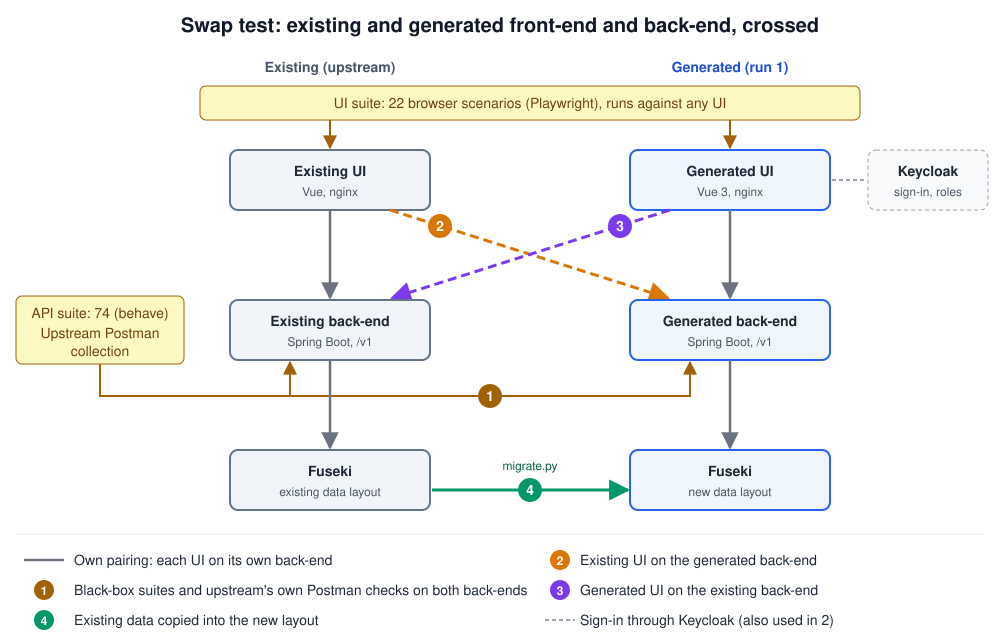

# simpl-spec-factory

An experiment: how far can we get generating a complete Simpl-Open component **from its specifications alone**? Not just the code, but the full test suite and the documentation too. In other words, a software factory driven by specs.

Status: **run 1 done** (2026-10-27): the generated build passes 74 of 74 black-box API scenarios (upstream: 58 of 74). UI: 22 of 22 browser scenarios (upstream: 9 of 22). **Run 2** (2026-10-28): a Rust backend from the same specs, also 74 of 74 after one spec clarification (D18), and both UIs run on it. **Second candidate, Schema Manager** (2026-10-28, less well documented): 63 decisions instead of 30, build 291 of 291 API and 36 of 36 UI scenarios, and each UI works on the other backend in the swap tests; see [`schema-manager/`](./schema-manager/README.md). See [`spec-digest.md`](./spec-digest.md) and [`findings.md`](./findings.md). Candidate: Vocabulary Manager. Input set: [`specs/`](./specs/README.md).

**Personal test project.** This is a personal experiment, for testing purposes only. It is not commissioned by, endorsed by or speaking for the European Commission, the Simpl programme or any of its contractors. **Purpose:** see how feasible spec-driven generation is, and learn which parts of the specs could be made more precise. It is not meant to show what is wrong with Simpl. Every gap found is a pointer to where the specs can be improved.

## Summary

- **What:** the Simpl-Open Vocabulary Manager (backend and UI) was generated from its specifications only: the OpenAPI, 32 user stories with acceptance criteria and the business process. No upstream source code was used. It starts with one `docker compose up`.
- **How:** first a written list of 30 decisions where the specs are silent or disagree ([`spec-digest.md`](./spec-digest.md)). Then two separate AI agents: a test writer and a code writer, neither seeing the other's work.
- **Result:** the generated build passes 74 of 74 API scenarios and 22 of 22 UI scenarios. The same suite on the local upstream stack: 58 of 74 and 9 of 22. Upstream differs mostly on the points where the specs leave room, which is exactly what the decision list settles.
- **Main lesson:** the specs are close to buildable. What they need is the decision list written down: structure and semantic validation rules, how a vocabulary references a version of another, vocabulary vs version status, 401 and 403 in the OpenAPI, and a few UI wordings. See [`findings.md`](./findings.md).
- **Caveat:** both writers used the same decision list, so the result shows that "specs plus decisions" is buildable, not the raw specs alone. See [How realistic is this?](#how-realistic-is-this).
- **Swap test:** either UI runs on either backend, and upstream's own Postman checks give the same result on both. Existing data needs a migration (one SPARQL update, tested on 306 vocabularies). See [`findings.md`](./findings.md), step 5, and the [diagram below](#test-setup-at-a-glance).
- **Second language:** a Rust backend built from the same specs and decisions also passes 74 of 74, and both UIs and upstream's Postman checks run on it unchanged. Its first pass was 33 of 74, all from one gap in D18 that the Java build had hidden: a second independent build is a cheap spec review. See [`findings.md`](./findings.md), step 3b.
- **Effort:** one working day, of which about 30 minutes for the code writer and about 45 minutes for the UI test steps. Hardware needs are close to upstream (see [Hardware](#hardware-compared-with-upstream)).

## Test setup at a glance

Both implementations, the existing one (upstream) and the generated one, run side by side. The same black-box suites test each of them. The swap test then crosses them: the existing UI on the generated back-end (2), the generated UI on the existing back-end (3), and the existing data migrated into the new layout (4).



## The 30 decisions

Where the specs are silent or disagree, the factory made one written decision, used by both the test writer and the code writer. Full rows, with what each source says, are in [`spec-digest.md`](./spec-digest.md#3-decisions). Decisions marked *open* are also questions for the spec owners.

**[API and access](./spec-digest.md#api-and-access)**
- D1: follow the OpenAPI paths and payloads; the older draft API in the tech description is superseded.
- D2: every endpoint needs a token, except `/health`. *Open:* should downloads be public?
- D3: the viewer role may read and search; the admin role may do everything.
- D4: 401 without a valid token, 403 without the role, both as Problem Details. The OpenAPI defines neither.
- D5: errors follow the OpenAPI Problem schema. *Open:* should the API guidelines be part of the input?
- D6: a local identity provider with three test users and the roles in a `roles` claim (environment choice).

**[Lifecycle and versioning](./spec-digest.md#lifecycle-and-versioning)**
- D7: version numbers are whole numbers, starting at 1.
- D8: a request that sets a version number itself is rejected with 400.
- D9: a new version becomes active and deprecates all older versions, in one step.
- D10: deprecating a vocabulary deprecates all its versions; re-activating it re-activates only the latest. *Open.*
- D11: no new version on a deprecated vocabulary (409). *Open.*
- D12: the UI sends "Initial version" as the change log on creation.
- D13: a duplicate name gives 409, shown as a field error in the UI.
- D14: no separate publish step: a valid stored version is "Active".

**[Validation](./spec-digest.md#validation)**
- D15: Turtle only; anything else gives 415.
- D16: syntax means the file parses; structure means it declares an ontology or concept scheme. *Open.*
- D17: the semantic checks: unknown, deprecated or missing referenced terms, and one IRI as both class and property. *Open, the largest gap.*
- D18: a vocabulary references a version of another by namespace IRI, `{base}/{Name}/{n}#`; a vocabulary's own namespace is not a reference (clarified after the Rust run). *Open.*
- D19: a missing reference is 400, not 404.
- D20: warnings do not block; they come back with the 201 response.

**[UI](./spec-digest.md#ui)**
- D21: no Figma design was available, so the UI uses a plain component library.
- D22: the list shows the columns the story names, no file format column.
- D23: the name filter is a case-insensitive "contains". *Open:* the OpenAPI pattern and the UI example do not fit.
- D24: "full details" download means the Turtle file of that version.
- D25: deprecation warnings show everywhere a deprecated vocabulary appears.
- D26: viewers do not see admin actions; the API still refuses them with 403.

**[Other](./spec-digest.md#other)**
- D27: Apache Jena Fuseki as the store.
- D28: the API response is the validation report; no separate notification.
- D29: page size at most 100. *Open.*
- D30: upload limit 10 MB, configurable.

---

## The question

Simpl-Open has user stories, acceptance criteria, functional requirements and API definitions for its components. If those specs are good enough, a generator (Claude Code, driven by a repeatable prompt pipeline) should be able to produce a working component that behaves like the upstream one. Where it cannot, the gaps tell us something about the specs.

So the experiment answers two things at once:

1. **The factory:** how good is spec-driven generation of code, tests and docs today?
2. **The specs:** are Simpl's specifications complete and precise enough to build from?

## The goal

The end result is **one service, or a small combination of services, including a UI**, that runs with a plain:

```
docker compose up
```

No manual setup steps, no clone-and-patch scripts, no external accounts. Seed data and mocks are part of the compose file.

## An honest assessment

This is an assessment, not a demo. The write-up reports what actually happened:

- what the factory got right first time, and what needed human correction (and how much);
- where the specs were missing, ambiguous or contradicted the upstream behaviour;
- what does not work at the end, stated plainly;
- no cherry-picking: every run is kept in `findings.md`, including the failed ones.

A result that shows large gaps in the specs is a valid and useful outcome, as long as the evidence shows it: it tells us where to invest.

## Inputs

| Input | Source | Notes |
|-------|--------|-------|
| User stories + acceptance criteria | Jira (SIMPL project) | Primary behavioural source |
| Functional requirements | FTA, component functional descriptions | What the component is for |
| API definitions | OpenAPI specs in the upstream repo | The contract to match |
| Existing tests | Upstream repo | **Use with care, maybe not at all.** They describe what the code does, not what the spec says, so they can carry the implementation's bugs into the generated result. If used, keep them out of generation and use them only as a check afterwards. |

The upstream **source code is not an input**. Generation works from specs only.

## Outputs

- **Code:** the backend service(s) and the UI, started together with `docker compose up`.
- **Unit tests.**
- **Functional tests in Gherkin** (Given/When/Then), derived from the acceptance criteria, with step definitions.
- **Integration tests with mocks** for every external dependency (Kafka, Keycloak, other Simpl services).
- **Documentation:** README, architecture overview, API docs, and how to run it.
- **A traceability matrix:** each acceptance criterion linked to the code and tests that cover it.

## Choosing the candidate

A good candidate is reasonably isolated and well specified:

- clear user stories with acceptance criteria;
- an OpenAPI definition;
- a UI that belongs to it;
- few dependencies on other Simpl services;
- already running locally in this repo, so the generated version can be compared side by side with upstream.

Stacks here that may fit: `simpl-vocabulary-manager` (backend + UI, one backing service: Fuseki), `simpl-schema-manager` (backend + UI, adds Kafka), `simpl-sd-tooling` (UI + two backends, no datastore, peers mocked). `simpl-notification-service` has no UI and `simpl-files` is too small to say much.

### Candidate scan (2026-10-27)

| Component | Live Jira stories | With Given/When/Then ACs | OpenAPI | Backing services | UI |
|-----------|-------------------|--------------------------|---------|-----------------|----|
| **Vocabulary Manager** | 35 (3 cancelled) | 33 | `vocabulary_openapi.yaml`, 13 paths | Fuseki | yes |
| Schema Manager | 55 (36 cancelled) | most | `schema_openapi.yaml`, 9 paths | Fuseki + Kafka | yes |
| SD Tooling | 32 (15 cancelled) | most | 4 specs across 2 backends, v1 to v3 | none, but many peers to mock | yes |
| Contract | 44 (11 cancelled) | all | `openapi3-v1.yaml` | Postgres + Kafka, signer, wallet, EDC | stub upstream |

**Pick: Vocabulary Manager.** Each feature comes as a pair of stories, one "via API" and one "via UI" (create, new version, status, validate syntax, validate semantics, history, filter and sort, RBAC). That gives the backend and the UI their own specs. The stories link to the R07.02 tech description, the BP02B functional description and a Figma design. Status: 24 "Ready for DG Acceptance", 10 "ready for implementation check" (mostly UI), so not everything is built upstream yet.

Known gaps to check: the `/external-vocabularies` endpoints seem to have no story of their own; RBAC needs a mocked identity in place of Keycloak.

Natural second step: add Schema Manager on the same Fuseki (the vocabulary stories say "use same persistence layer as Schema Management").

## Approach

**Run 1: Spring Boot + Vue 3**, the same stack as upstream, so size, complexity and behaviour can be compared directly.

Rules for the factory, to keep the result honest:

1. **Test writer and code writer are separate.** One agent writes the tests from `specs/` only; another writes the code from `specs/` only. Neither sees the other's output before the tests run. Otherwise the tests check what was built instead of what was specified.
2. **One black-box test suite** at the API and UI level (Gherkin scenarios with HTTP and browser steps), independent of the implementation language. It runs against the generated build **and** against upstream. Unit tests are per implementation.
3. **Spec decisions are logged.** Where the specs are silent or contradict each other (for example R07.02 draft API vs OpenAPI), the factory picks one, and the choice goes into `findings.md` as a spec gap.
4. **Contamination check.** Upstream is public, so the model may have seen it. After the run, compare naming and structure with upstream; strong similarity means we measured memory, not specs.

**Run 2 (optional): a second, independent stack**, built from the same `specs/` without seeing run 1, against the same black-box suite. Where both builds pass, the spec was clear; where they differ on the same criterion, the spec left room. Only worth doing if run 1 shows enough ambiguity.

## How we judge the result

- Does `docker compose up` on a clean machine give a working service and UI?
- Do the generated tests pass against the generated code?
- Do they also pass against the **upstream** component? Differences are either generator errors or spec ambiguities, and both are findings.
- How many acceptance criteria are covered, and how many could not be generated because the spec was unclear or missing?
- How much human correction was needed, and where?

## Modularity: what can be changed or replaced

There are two levels: the factory itself, and the component it built.

### The factory

Each step hands over to the next through plain files, so each part can be changed on its own.

| Part | What it hands over | How to change or replace it |
|---|---|---|
| Input set (`specs/`) | Markdown stories, OpenAPI, functional description | Another component: a new `specs/` folder, then the same steps. The candidate scan already lists the next ones (Schema Manager, SD Tooling). |
| Spec digest | One table of numbered decisions | Change a decision and rerun the writers. Every test scenario carries the decision it depends on (`@Dnn`), so a change shows which scenarios it touches. |
| Test suite (`tests/`) | Gherkin scenarios over HTTP and a browser, configured by environment variables | Runs unchanged against any implementation; it already runs against two (the build and upstream). Another Gherkin runner can reuse the `.feature` files. |
| Code writer | A `docker compose` stack | Another stack (run 2), another model, or a human team. The same suite judges the result. |
| Identity provider for the tests | Contract D6: password grant, three users, a `roles` claim | Any OIDC issuer set up that way. |

Limits today:

- The prompts are stored in [`pipeline/`](./pipeline/README.md). Steps 3 and 4 are the prompts as used; steps 1 and 2 ran in the main session and are reconstructed briefs. A rerun from them has not been tried yet.
- The UI steps follow the story wording. A UI with other labels fails by design, so a change of wording in a story means a change in the steps.
- The UI steps assume a single page application on a JSON API and a standard login page.
- One component only. Flows across components (for example Schema Manager on the same Fuseki) are not tried yet.

### The generated component

The containers talk through standard interfaces, so each one can be swapped.

| Part | Interface | How to change or replace it |
|---|---|---|
| Identity (Keycloak) | OIDC and JWT: issuer, JWKS, a configurable roles claim | Any OIDC provider, for example the Simpl Tier 1 Keycloak, by configuration. The UI reads its issuer and client from `config.json` at runtime, without a rebuild. |
| Storage (Fuseki) | SPARQL 1.1 over HTTP | Any SPARQL store, by URL. A non-RDF database is more work: the services use the Jena store class directly, so `store/` would need an interface and a new implementation. |
| UI and API | The OpenAPI, under `/v1` | Either side can be replaced on its own. Running the upstream UI on the generated API, or the other way round, is not tested yet. |
| Rules inside the backend | `domain/` (lifecycle as pure functions, no I/O) and one validator class each for syntax, structure and semantics | When the spec owners answer the open questions on structure and semantic rules (D16, D17), the change lands in one class each. |

Limit: the backend serialises writes with a lock inside the process, so it assumes one instance. Running several needs another way to handle concurrent writes.

## Hardware compared with upstream

Measured on 27 Oct 2026 on one laptop (Docker, no memory limits set), at rest and at the peak of a full run of the 74 API scenarios. Both stacks were already built.

| Container | Upstream, rest / peak | Build, rest / peak |
|---|---|---|
| UI (nginx) | 14 / 13 MiB | 17 / 17 MiB |
| Backend (Java) | 236 / 295 MiB | 406 / 464 MiB |
| Fuseki | 226 / 387 MiB | 221 / 321 MiB |
| **Total without Keycloak** | **476 / 695 MiB** | **644 / 802 MiB** |
| Keycloak | not in the local stack (bypassed) | 1,428 / 1,521 MiB |

| | Upstream | Build |
|---|---|---|
| Images | backend 251 MB, UI 178 MB, Fuseki 324 MB | backend 382 MB, UI 50 MB, Fuseki 324 MB, Keycloak 443 MB |
| Start time (images built) | 9 s | 22 s, mostly Keycloak |
| Code, without tests | Java 5,474 lines, UI 6,962 lines | Java 2,889 lines, UI 1,374 lines |
| CPU | short peaks during uploads, idle otherwise | the same |

How to read this:

- Without the identity provider the two are close: the build uses about 15 to 35% more memory, mostly in the backend. The Java memory figures depend on the JVM's defaults; neither side was tuned.
- Keycloak is the biggest item, but it is there only to make the build self-contained. In Simpl the identity provider is shared (Tier 1), so it does not count against the component. The local upstream stack skips it altogether.
- The upstream Helm chart reserves 250m CPU and 2 GiB memory each for the backend and Fuseki. The build fits inside that same envelope.
- Upstream does more in places, for example an OWL reasoner during validation. That explains part of its larger code size.
- To run the build on a laptop: about 2.5 GB free memory for Docker with Keycloak, under 1 GB without.

## How realistic is this?

Honest answer: realistic as a **spec check and a reference build**, not yet as a replacement for a development team.

What made it work here:

- **A good candidate.** The Vocabulary Manager is small, has one backing service, a detailed OpenAPI and stories with Given/When/Then criteria. The specs were in good shape to start with, which is a credit to the people who wrote them.
- **Decisions made up front.** The 30 decisions in the digest did most of the work. Making them took judgement, and in a real project they belong to the product owner and the architects, not to a model or a single person.
- **A comparison point.** Upstream existed, so every difference could be checked.

What a real project still needs, and this experiment does not show:

- **Simpl integration:** the Tier 1 gateway, the shared Keycloak, Helm charts and the deployment pipeline. Here everything runs in one compose file.
- **Production qualities:** scaling beyond one instance, security review, performance, accessibility, translations, monitoring, and data migration from an existing installation.
- **The design:** the Figma files were not available, so the UI follows the story text only.
- **Maintenance:** how the generated code holds up through a year of change requests is the real test, and it is not tried here.
- **Independence:** the test writer and the code writer are the same model family, so they may share blind spots. A human review of the scenarios, or a second stack (run 2), would reduce that.
- **Memory instead of specs:** upstream is public, so the model may have seen it. The contamination check found little overlap, but it cannot rule this out.
- **Scale:** one component of about 30 stories. Components with Kafka, several peers or cross-component flows are harder.

Where it is useful today:

- **Checking specs before development starts.** Writing the decision list and the scenarios is quick and points straight at what is unclear.
- **Acceptance tests from the stories.** The black-box suite runs against any implementation, including the upstream one.
- **A reference implementation** to compare against when a behaviour is disputed.

## Layout

```
specs/       collected input specs (stories, ACs, FRs, OpenAPI)
generated/   the factory output: code, tests, docs
pipeline/    the prompts that drive each step, so a run can be repeated
findings.md  what worked, what did not, spec gaps found
```
