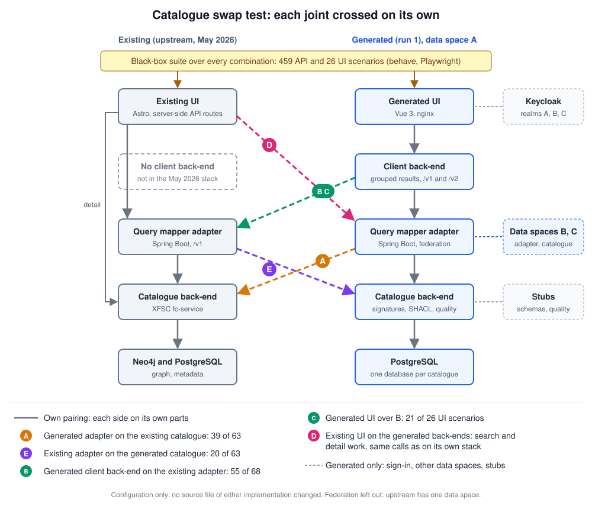

# Catalogue: third factory candidate

Status: **run 1 done** (2026-10-28). The generated build passes 458 of 459 black-box API scenarios and 26 of 26 UI scenarios. The local upstream stack (May 2026): 55 of 459 API (federation, client backend, quality skipped) and 0 of 26 UI. Swap tests: quick search, advanced search and the description cross every joint between build and upstream; the main contract difference is the case of the status values. Details: [`findings.md`](./findings.md).

## Why this candidate

Chosen as the biggest one: the whole catalogue, with three backends (catalogue-be, query mapper adapter, catalogue client backend), a UI and federated search across data spaces. Its core has no user stories; the 33 live stories describe 2026 features.

## Layout

| Path | What |
|---|---|
| [`specs/`](./specs/README.md) | Frozen input set and story index |
| [`spec-digest.md`](./spec-digest.md) | Step 1: component map, scope, decisions D1 to D83, notes N1 to N13, environment contract |
| [`tests/`](./tests/README.md) | Step 2: 459 API and 26 UI scenarios (behave, requests), signing helper, fixtures, reports |
| [`pipeline/`](./pipeline/) | The briefs for steps 1 to 3 as used |
| [`generated/run1/`](./generated/run1/) | Step 3: the build (backends, UI, stubs, Keycloak realms, federation and seed files), with `TRACEABILITY.md`, `BUILD-LOG.md` and `docs/`. The keys, passwords and client secrets in it are the throwaway test values of the digest (D23, section 5) |
| [`experiments/swap/`](./experiments/swap/README.md) | Step 5: swap experiments per joint |
| [`findings.md`](./findings.md) | Findings per step |

Run the build with `cd generated/run1 && docker compose -p simpl-catalogue-factory up -d --build --wait`.
