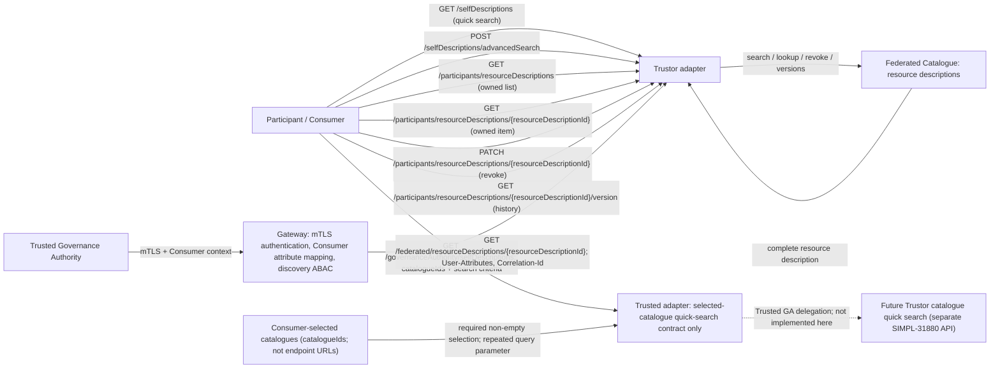

# Adapter API resource relationships

The active API is [`adapter_openapi.yaml`](adapter_openapi.yaml), served under `/v1`.
The diagram includes every path and method in that composed specification.
The selected-catalogue quick-search flow is specification-only; dashed edges
show future delegation rather than an implemented runtime route.

`/governanceAuthority/selfDescriptions` is a collection searched through the
Consumer's Trusted Governance Authority with an explicit catalogue selection.
It is distinct from local `/selfDescriptions` and has no request body. Catalogue
IDs select catalogue resources; they are not caller-supplied endpoint URLs.
Its search result uses the existing resource-description collection response,
including pagination and an empty result. SIMPL-31880 defines the downstream
delegation API separately; this diagram does not prescribe routing, aggregation,
or partial-failure behavior. The Tier-1 advanced-search draft is not composed
into the root and is not added as a runtime route by this change.

The gateway authorizes federated discovery before forwarding the required
`User-Attributes` and `Correlation-Id` headers; the adapter does not reauthorize
this operation. Gateway authentication/ABAC failures are outside its response
contract. The federated JSON response includes the complete catalogue resource
description only, without a separate schema. `Correlation-Id` is echoed in
the response header, not the body. Participant ownership behavior is unchanged.

The Common Data Model linkage and traceability update are deferred to
SIMPL-30887; this diagram does not replace that deliverable.
