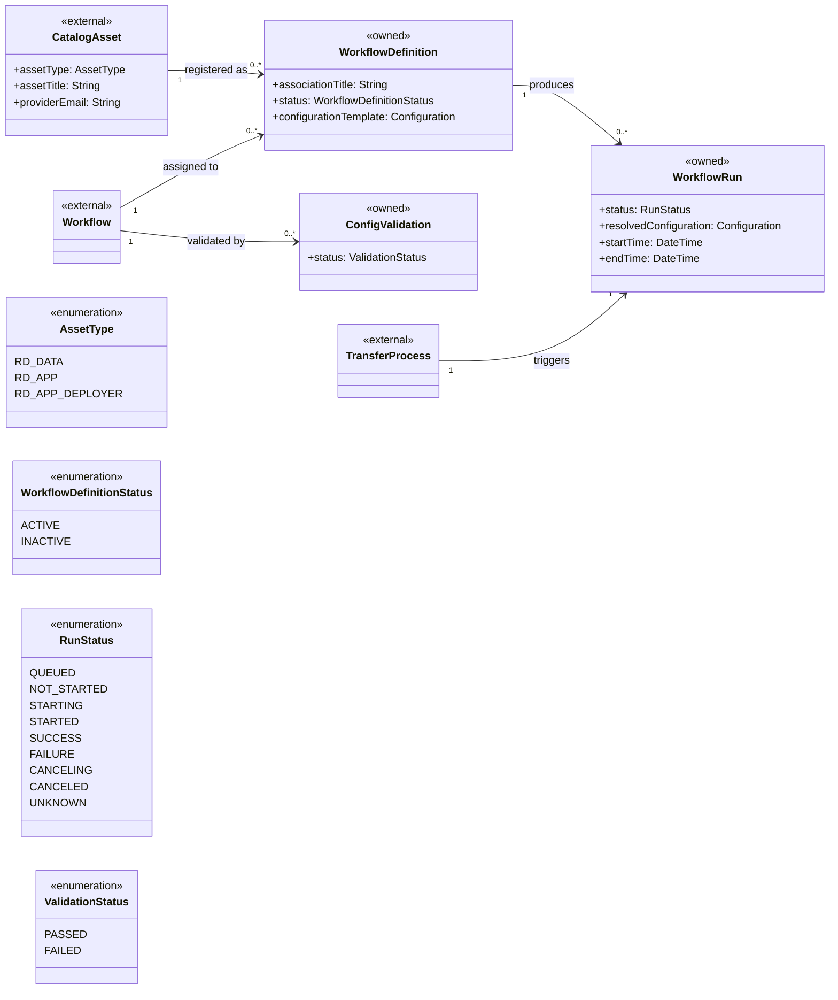

# Conceptual Data Model — Asset Orchestrator

## Purpose

The Asset Orchestrator acts as the integration bridge between the provider-side connector and the Workflow Engine within the SIMPL-Open orchestration platform. Its business scope covers:

- **Workflow Definition management** — registering and maintaining associations between catalog assets and workflow pipelines, including the configuration templates that parameterise those pipelines.
- **Workflow configuration validation** — pre-flight checks that verify a configuration against the schema of a target workflow before it is committed.
- **Workflow execution (Runs)** — receiving consumption events from the connector, resolving configuration variables, submitting jobs to the Workflow Engine, and tracking execution status and history.

The service serves three key actor groups: **Providers** (register assets and define workflow associations), **Provider Workflow Designers** (author workflows and default configurations), and **Consumers** (trigger workflow execution when they consume a resource).

The service API definition is available in the [OpenAPI specification](../../../openapi/openapi-asset-orchestrator-v1.yaml).

---

## Service Boundary

### Owned within asset-orchestrator CDM boundary

| Concept | Nature |
|---|---|
| WorkflowDefinition | Core aggregate — association between a catalog asset and a workflow, owned by this service |
| WorkflowRun | Execution record — created by this service; tracks lifecycle and outcome of each workflow execution |
| ConfigValidation | Validation result — produced by this service when validating a configuration against a workflow schema |

### Referenced external concepts

| Concept | Source system |
|---|---|
| CatalogAsset | Provider Connector / Data Catalogue — provides `assetType` and `assetTitle` |
| Workflow | Workflow Engine — the available pipeline definitions |
| TransferProcess | Connector / EDC Transfer subsystem — the data-transfer event that triggers workflow execution upon resource consumption |

---

## Conceptual Model

---

## State/value sets used in this model

### AssetType
Classifies the type of the catalog asset that a workflow definition is registered for.

| Value | Meaning |
|---|---|
| `RD_DATA` | A data resource (dataset) |
| `RD_APP` | An application resource |
| `RD_APP_DEPLOYER` | An application deployer resource |

### WorkflowDefinitionStatus
Represents whether a workflow definition can be used for execution.

| Value | Meaning |
|---|---|
| `ACTIVE` | The workflow definition is available for execution |
| `INACTIVE` | The workflow definition is not available for execution |

### RunStatus
Represents the lifecycle state of a workflow execution run, as reported by the Workflow Engine.

| Value | Meaning |
|---|---|
| `QUEUED` | Execution is queued, not yet submitted to the engine |
| `NOT_STARTED` | Submitted but not yet started by the engine |
| `STARTING` | Engine is initialising the job |
| `STARTED` | Job is actively running |
| `SUCCESS` | Job completed successfully |
| `FAILURE` | Job terminated with an error |
| `CANCELING` | Cancellation has been requested |
| `CANCELED` | Execution was cancelled before completion |
| `UNKNOWN` | Status cannot be determined |

### ValidationStatus
Represents the outcome of a configuration validation.

| Value | Meaning |
|---|---|
| `PASSED` | The configuration satisfied the workflow schema |
| `FAILED` | The configuration did not satisfy the workflow schema |

---

## Concept Descriptions

| Entity | Description | Ownership |
|---|---|---|
| WorkflowDefinition | An association linking a catalog asset to a specific workflow pipeline, together with the configuration template that will be used each time the asset is consumed. A definition can be active or inactive; only active definitions are used for execution. | Owned |
| WorkflowRun | A single execution instance of a workflow definition. Created when a consumer consumes a resource; captures the resolved configuration, the execution status, and timing. | Owned |
| ConfigValidation | A transient result produced when a configuration is validated against the schema of a targeted workflow before a workflow definition is created. Contains a status indicating whether validation passed or failed. | Owned |
| CatalogAsset | A data or application resource published by a provider in the catalogue. Provides classification, descriptive title, and provider contact information. | External |
| Workflow | A pipeline definition available in the Workflow Engine. Provides the executable logic and the default configuration schema that a workflow definition customises. | External |
| TransferProcess | A data-transfer process initiated by the connector when a consumer consumes a catalog asset. | External |

---

## Relationship Notes

- **CatalogAsset → WorkflowDefinition (1 to 0..*)**: A catalog asset may have zero or more workflow definitions registered against it. Typically only one definition is active at a time; the service enforces that only the active definition is used for execution. All definitions for an asset can be retrieved or deleted as a group via the asset's identifier.

- **Workflow → WorkflowDefinition (1 to 0..*)**: A workflow pipeline may be referenced by multiple workflow definitions across different assets, but each definition targets exactly one workflow. When a workflow definition is created, the target workflow must already exist in the engine.

- **WorkflowDefinition → WorkflowRun (1 to 0..*)**: Each workflow definition may produce zero or more execution runs over its lifetime. Every run is produced from exactly one definition. The definition's configuration template is resolved at execution time to produce the run's resolved configuration.

- **TransferProcess → WorkflowRun (1 to 1)**: A workflow run is always initiated by exactly one transfer process. The run is correlated back to the consumer's data-transfer event.

- **Workflow → ConfigValidation (1 to 0..*)**: A configuration validation is performed against a specific workflow's schema. The relationship is transient — each validation exists only for the duration of the pre-flight check interaction.

## Assumptions and Open Questions

- Validation outcomes and run-level execution errors are treated as out of scope for the conceptual model unless a business-level error concept is defined later.
- The workflow concept is modelled at the business level; its technical addressing fields remain outside the conceptual model in this document.
- Retry and re-execution semantics for transfer-triggered workflow runs are not defined in this CDM and need follow-up clarification if they must be modelled explicitly.
- The requested feature branch rename is a delivery concern outside this Markdown document and is not addressed here.

---

## Alignment to API Endpoints

| Endpoint | Concepts | Short Description |
|---|---|---|
| `GET /workflows` | Workflow | Retrieves all workflow pipelines available in the Workflow Engine, optionally filtered by tag, for selection when building a workflow definition |
| `GET /workflows/{repositoryName}/{codeLocation}/{jobName}/defaultConfig` | Workflow | Retrieves the default configuration schema for a specific workflow pipeline, to be used as a starting point when authoring a workflow definition |
| `POST /workflows/configValidation` | Workflow, ConfigValidation | Validates a candidate configuration against the schema of a targeted workflow, returning a ConfigValidation result |
| `GET /workflowDefinitions` | WorkflowDefinition, CatalogAsset | Retrieves all workflow definitions, optionally filtered by asset identifier or active status |
| `POST /workflowDefinitions` | WorkflowDefinition, CatalogAsset, Workflow | Creates a new workflow definition associating a catalog asset with a workflow pipeline and a configuration template |
| `DELETE /workflowDefinitions` | WorkflowDefinition, CatalogAsset | Deletes all workflow definitions for a given catalog asset identified by its asset identifier |
| `POST /runs` | WorkflowRun, WorkflowDefinition, CatalogAsset, TransferProcess | Executes the active workflow definition for a catalog asset, substituting consumer-supplied runtime variables into the configuration template and submitting the job to the Workflow Engine |
| `GET /runs/{runId}` | WorkflowRun | Retrieves the status, timing, and resolved configuration of a specific workflow execution run by its run identifier |