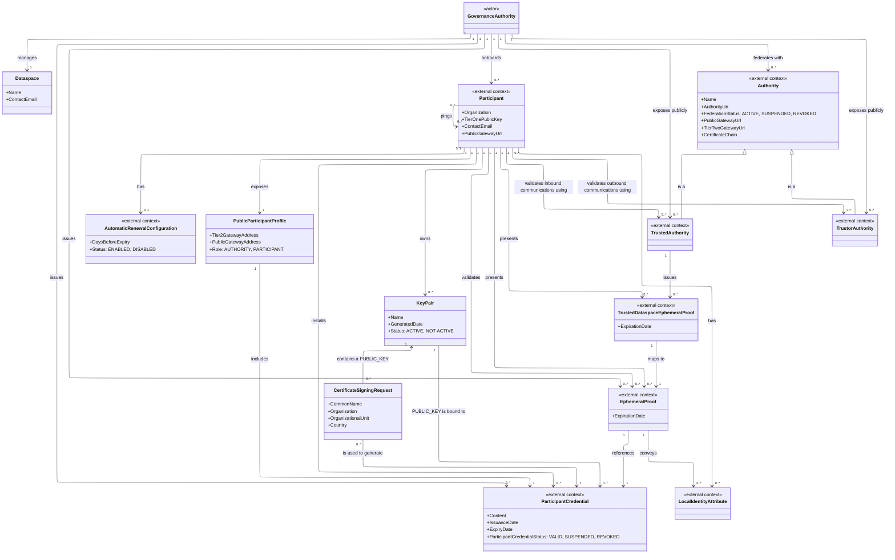

## Purpose

This document defines the Conceptual Data Model (CDM) for the Authentication Provider component.

Business scope includes:
- Management of keypair, Certificate Signing Requests (CSRs), and credentials (X.509 Certificates) for the participant agent
- Retrieval and storage that let dataspace participants securely authenticate and establish trusted Tier 2 communications with one another, including across federated dataspaces.

- API definitions:
  - [authenticationprovider-tier1-v2](../../../openapi/authenticationprovider-tier1-v2.yaml)
  - [authenticationprovider-tier2-v2](../../../openapi/authenticationprovider-tier2-v2.yaml)
  - [authenticationprovider-tier1-v3](../../../openapi/authenticationprovider-tier1-v3.yaml)
  - [authenticationprovider-tier2-v3](../../../openapi/authenticationprovider-tier2-v3.yaml)

## Service boundary and CDM traceability

### Owned concepts

- Dataspace
- PublicParticipantProfile
- KeyPair
- CertificateSigningRequest

### Referenced concepts, by owning CDM

| Owning CDM | Concepts used here |
|---|---|
| [Security Attribute Provider](https://code.europa.eu/simpl/simpl-open/security/access-control-and-trust/security-attribute-provider-federation/security-attributes-provider/security-attributes-provider-be/-/blob/develop/documents/architecture/cdm/security-attributes-provider-cdm.md?ref_type=heads) | LocalIdentityAttribute, EphemeralProof, TrustedDataspaceEphemeralProof |
| [Identity Provider](https://code.europa.eu/simpl/simpl-open/security/access-control-and-trust/identity-provider-federation/identity-provider/identity-provider-be/-/blob/develop/documents/architecture/cdm/identity-provider-cdm.md?ref_type=heads) | Participant, ParticipantCredential, Authority, TrustedAuthority, TrustorAuthority, AutomaticRenewalConfiguration |

### CDMs that reference this one

- [Identity Provider](https://code.europa.eu/simpl/simpl-open/security/access-control-and-trust/identity-provider-federation/identity-provider/identity-provider-be/-/blob/develop/documents/architecture/cdm/identity-provider-cdm.md?ref_type=heads)

## Conceptual Data Model

_NOTE: some labels may not render correctly in GitLab. Please open the link below in Mermaid Live for a better rendering._

Open in [Mermaid live](https://mermaid.live/view#pako:eNq1V21v4jgQ_iuWP94CIsDSNqoqUeB6qF1AECrtCunkJiZYF2zOcdpme_3vN3klgZiXPd232Jl5PPP4mbH9gW3hUGzier2-lEtuC75irhl9IuSRUATKRNT7K5rITDzi-wNGXEk2iZ3DJLUVExxZ99FMMhvboQfxSiUn3Ka9QK2FZCpEH4kBQre3xFZC3t0lE5_7zgOiiL8lNt25fBmTDc0HfcEVQAw3hHkajCmRitlsS7gqLkzfVRSXhyBjBYMsBgCdSJdw9pNEGeWTFqNywuk0ePGY_UjDIyHAZGL2QBR9I-FC6mIDSsQG1rFnlIOl14_ZD2S89JnRDkjo39OVkHT4vmVyF9hcERX4JhqOe_dPw0ENDUbz-KsQDEIlquKoC4RNpVgxr8h-REMrzavnOJL6fnXS-z9nwqMm6i2sPyazkfW9hqa9mTXqj6a9saUPaBdKX1KHcsWAg_N4ifYFHPLxyPeDSIagqZ1-EspKU5VrZlw-955GwOR8MZ8Ox4OI1NnwefJ4hFOQypQwqRPwA2w8bDd1SjFky_X61uh5WEPjiZV-a9fpUwh7xWyAmTOXM-7O6N8B9QuiB0o2G8FL61dqvThJvAVnqgARcJWJrBRGMZgnYRNvFHOnwp5Skr0Eip6zcRWZWTLwgaDK9nEpjJD_FeYi__3dzp0XkuWTv4PIkorf33adzLQNJi1Q601U_CkopL8mjGtTHG7XdAMheVD-YnVmnnElxVnslKzfzLyx_z9rVR06S2wsMarX79Kv3dliog3hxKVpsyoeGPtO2g4Jh-T7Vvg5hs7uALCyw5mIwTEbOKdCajYavx0F8RXxvEqQ1LWEoylbE62JDqMUSzQ4fqQVoE7tURrTQfXnTKNtTLIXXo5XbAM6vBOcV8T1SjzmgCB9IP4F-qQD0t1sAh6VHCTvo8CHtnw-ejnKHTrcyU7Bn0nGXvWBYuCQzER3kKGeBV05VwLqjPdLo_w7KtKtj5RIsI74nhIz9JNXGp5dFEULE22B4ssEXNzDVdLqYQ_fmFonMLv_t__U6wesRxQiojctiKRoeoJbXceQdEUlhZTOyVFDkQDxE-n8KkK5gxXkc6JkDqS3hfsnAP2id15ul3QDfR1cFEx2ZwQu33jqks1d0P6ni_unUf_Px-H3SBhJy8jqJ4NL8W5BTjme_ioZF4-CuwPorACfQOrd9grr6LkXtTEaxYnc9GqMaxiohOeVA8_Uj_iQxyqid4lN-PSYu1ZLvOSfYEjg9JmH3MamkgGtYSkCd43NFfF8GAXbaEfTp2tmAiH8ECIfUodBTX1LHsXx27iGXRmtnSJSDjUcX4Ox2WrG_tj8wO_YNNqdRrtrtJqdjmG0je51t4ZDbN40mu1O12jfGC2j1WpedT9r-Ge8YrNxc9W8NjqdZvf6yri6-fr181_8RzbQ)

## Concept descriptions

| Entity                             | Description                                                                                                                                                                                                                                                                                                                                                                                                                                                                                                                                                                            |
|------------------------------------|----------------------------------------------------------------------------------------------------------------------------------------------------------------------------------------------------------------------------------------------------------------------------------------------------------------------------------------------------------------------------------------------------------------------------------------------------------------------------------------------------------------------------------------------------------------------------------------|
| **GovernanceAuthority**            | *(actor)* Within a dataspace, it is responsible for onboarding participants, issuing and managing identity attributes, credentials, and ephemeral proofs, and maintaining federation relationships with external dataspaces.                                                                                                                                                                                                                                                                                                                                                           |
| **Dataspace**                      | Represents the local dataspace, including its identifying name and contact information, managed by its Governance Authority.                                                                                                                                                                                                                                                                                                                                                                                                                                                           |
| **Participant**                    | *(external context, see [Identity Provider](https://code.europa.eu/simpl/simpl-open/security/access-control-and-trust/identity-provider-federation/identity-provider/identity-provider-be/-/blob/develop/documents/architecture/cdm/identity-provider-cdm.md?ref_type=heads))* An organisation onboarded into the dataspace, identified by its own participant data (name, tier-one public key, and contact email addresses), credentials, key pairs, and assigned identity attributes; presents ephemeral proofs to establish sessions with other participants.                       |
| **PublicParticipantProfile**       | The publicly discoverable profile of a participant, exposing its identifier, tier 2 and public gateway addresses, and active credential, used by peer participants to establish communication.                                                                                                                                                                                                                                                                                                                                                                                         |
| **ParticipantCredential**          | *(external context, see [Identity Provider](https://code.europa.eu/simpl/simpl-open/security/access-control-and-trust/identity-provider-federation/identity-provider/identity-provider-be/-/blob/develop/documents/architecture/cdm/identity-provider-cdm.md?ref_type=heads))* A certificate issued to and installed by a participant, used to authenticate the participant during mTLS-based communication and bound to one of its key pairs.                                                                                                                                         |
| **KeyPair**                        | A cryptographic key pair generated and owned by a participant, used to request and bind credentials.                                                                                                                                                                                                                                                                                                                                                                                                                                                                                   |
| **CertificateSigningRequest**      | A formal request structure containing X.509 Distinguished Name (DN) components used for credential issuance or renewal, including common name, organization, organizational unit, and country code.                                                                                                                                                                                                                                                                                                                                                                                    |
| **LocalIdentityAttribute**         | *(external context, see [Security Attribute Provider](https://code.europa.eu/simpl/simpl-open/security/access-control-and-trust/security-attribute-provider-federation/security-attributes-provider/security-attributes-provider-be/-/blob/develop/documents/architecture/cdm/security-attributes-provider-cdm.md?ref_type=heads))* A definition of an identity attribute recognised by the dataspace (e.g. Consumer, Data Provider), assignable to participants to specify and control their functional roles and access rights during Tier 2 communication.                          |
| **Authority**                      | *(external context, see [Identity Provider](https://code.europa.eu/simpl/simpl-open/security/access-control-and-trust/identity-provider-federation/identity-provider/identity-provider-be/-/blob/develop/documents/architecture/cdm/identity-provider-cdm.md?ref_type=heads))* An external Governance Authority of another dataspace with which a federation relationship is established, identified by its authority URI and signing credentials.                                                                                                                                     |
| **TrustedAuthority**               | *(external context, see [Identity Provider](https://code.europa.eu/simpl/simpl-open/security/access-control-and-trust/identity-provider-federation/identity-provider/identity-provider-be/-/blob/develop/documents/architecture/cdm/identity-provider-cdm.md?ref_type=heads))* A federated authority whose ephemeral proofs are trusted and accepted for inbound communication; maintains a mapping from its identity attributes to those recognised locally.                                                                                                                          |
| **TrustorAuthority**               | *(external context, see [Identity Provider](https://code.europa.eu/simpl/simpl-open/security/access-control-and-trust/identity-provider-federation/identity-provider/identity-provider-be/-/blob/develop/documents/architecture/cdm/identity-provider-cdm.md?ref_type=heads))* A federated authority that trusts this dataspace's Governance Authority, allowing this participant's ephemeral proofs to be validated for outbound communication.                                                                                                                                       |
| **EphemeralProof**                 | *(external context, see [Security Attribute Provider](https://code.europa.eu/simpl/simpl-open/security/access-control-and-trust/security-attribute-provider-federation/security-attributes-provider/security-attributes-provider-be/-/blob/develop/documents/architecture/cdm/security-attributes-provider-cdm.md?ref_type=heads))* A short-lived, verifiable proof issued by the Governance Authority to a participant, conveying its identity attributes and used to establish sessions for attribute-based access control (ABAC) enforcement.                                       |
| **TrustedDataspaceEphemeralProof** | *(external context, see [Security Attribute Provider](https://code.europa.eu/simpl/simpl-open/security/access-control-and-trust/security-attribute-provider-federation/security-attributes-provider/security-attributes-provider-be/-/blob/develop/documents/architecture/cdm/security-attributes-provider-cdm.md?ref_type=heads))* An ephemeral proof issued by a Trusted Authority; during Tier 2 communication it is exchanged for a locally valid EphemeralProof containing the mapped identity attributes.                                                                        |
| **AutomaticRenewalConfiguration**  | *(external context, see [Identity Provider](https://code.europa.eu/simpl/simpl-open/security/access-control-and-trust/identity-provider-federation/identity-provider/identity-provider-be/-/blob/develop/documents/architecture/cdm/identity-provider-cdm.md?ref_type=heads))* Configuration entity managing automated credential renewals for a participant, defining the threshold period in advance of expiration (DaysBeforeExpiry) and the current operational status (ENABLED or DISABLED). If a custom configuration is not defined, the default configuration is used instead. |

## Assumptions and open questions

- A participant can determine that a pinged participant is part of another dataspace during Tier 2 communication by checking whether the presented ephemeral proof was issued by a Trusted Authority.