## Purpose

This document defines the Conceptual Data Model (CDM) for the Federated Catalogue Service (simpl-fc-service).

API definitions: [Tier 1](../../../openapi/tier1-gateway/t1-fc-openapi.yaml) and [Tier 2](../../../openapi/tier2-gateway/t2-fc-openapi.yaml)

Business scope included:
- Resource Description lifecycle management: publishing, listing, retrieval, versioning, revocation, and deletion.
- Resource Description discovery and search capability.
- Quality score recalculation management: receiving schema lifecycle events from Schema Manager, triggering bulk quality score recalculation for Resource Descriptions when a Metadata Quality Profile changes, and persisting Quality Assessment Records.
- Quality Assessment Record retrieval: retrieving the Quality Assessment Record associated with a specific Resource Description.

### Service Boundary

Owned within Federated Catalogue CDM boundary:
- ResourceDescription
- ResourceDescriptionResult
- ResourceDescriptionVersion
- VerificationResult
- RecalcQualityScoreJob
- GeneralServiceProperties

Referenced external concepts:
- QueryMapper (external adapter submitting search requests to the catalogue's quick and advanced search endpoints)
- SearchQuery (Catalogue Client BE concept submitted through QueryMapper)
- Schema (Schema Management Domain — the schema a Resource Description conforms to; `schemaName` belongs to the schema, not the version)
- SchemaVersion (Schema Management Domain — the specific schema version used during validation and metadata resolution)
- SchemaEvent (Schema Manager — lifecycle signal emitted for a schema action such as publication or revocation)
- MetadataQualityProfile (Schema Manager — the governance template referenced by profile version in recalculation requests and Quality Assessment Records)
- MetadataQualityProfileVersion (Schema Manager — immutable profile snapshot for the active version used in quality evaluation)
- QualityAssessmentRecord (Quality Scoring Domain concept; persisted by Federated Catalogue)

### External Actors

| Actor | Role |
|---|---|
| Provider | External actor representing a Provider organization that issues Resource Descriptions to the catalogue. |

### External Service Dependencies

| Service | Role |
|---|---|
| QueryMapper | Calls the catalogue's quick and advanced self-description search endpoints on behalf of catalogue clients. |
| SchemaManager | Provides schemas, schema events, and metadata quality profiles consumed by the catalogue. |
| QualityScoringService | Produces quality assessments persisted by the catalogue. |

## CDM Traceability

### External CDMs referenced

| External CDM | Referenced concepts |
|---|---|
| [Query Mapper CDM](https://code.europa.eu/simpl/simpl-open/integration/resource-discovery/search-engine/catalogue-search/query-mapper-adapter-be/-/blob/feature/add-cdm/documents/architecture/cdm/query-mapper-cdm.md?ref_type=heads) | QueryMapper |
| [Catalogue Client BE CDM](https://code.europa.eu/simpl/simpl-open/integration/resource-discovery/search-engine/catalogue-search/catalogue-client-be/-/blob/feature/add-cdm/documents/architecture/cdm/xfsc-advsearch-be.md?ref_type=heads) | SearchQuery |
| [Schema Manager CDM](https://code.europa.eu/simpl/simpl-open/data/semantics-and-vocabulary/schema-management/schema-manager/schema-manager-be/-/blob/feature/add-cdm/documents/architecture/cdm/simpl-schema-manager-cdm.md?ref_type=heads) | Schema, SchemaVersion, SchemaEvent, MetadataQualityProfile, and MetadataQualityProfileVersion |
| [Quality Scoring Service CDM](https://code.europa.eu/simpl/simpl-open/data/data-governance/data-quality-rules/-/blob/feature/add-cdm/documents/architecture/cdm/quality-scoring-service-cdm.md?ref_type=heads) | QualityAssessmentRecord |

### CDMs referencing this CDM

| Referencing CDM | Referenced relationship |
|---|---|
| [Query Mapper CDM](https://code.europa.eu/simpl/simpl-open/integration/resource-discovery/search-engine/catalogue-search/query-mapper-adapter-be/-/blob/feature/add-cdm/documents/architecture/cdm/query-mapper-cdm.md?ref_type=heads) | SearchQuery discovers ResourceDescription; GeneralServiceProperties and ResourceDescriptionVersion are referenced in search and resource discovery |
| [Schema Manager CDM](https://code.europa.eu/simpl/simpl-open/data/semantics-and-vocabulary/schema-management/schema-manager/schema-manager-be/-/blob/feature/add-cdm/documents/architecture/cdm/simpl-schema-manager-cdm.md?ref_type=heads) | The FederatedCatalogue component, modelled as an external service that consumes and stores published schemas to enable resource description validation and discovery |
| [Quality Scoring Service CDM](https://code.europa.eu/simpl/simpl-open/data/data-governance/data-quality-rules/-/blob/feature/add-cdm/documents/architecture/cdm/quality-scoring-service-cdm.md?ref_type=heads) | ResourceDescription as the payload being assessed |
| [Consent Management BE CDM](https://code.europa.eu/simpl/simpl-open/governance/consent-management/consent-management-service/consent-management-be/-/blob/feature/add-cdm/documents/architecture/cdm/consent-management-cdm.md?ref_type=heads) | ResourceDescription, referenced as external context — a consent assertion of type RESOURCE may be linked to zero or more Resource Descriptions governed by that assertion |
| [SD Tooling BE CDM](https://code.europa.eu/simpl/simpl-open/governance/resource-management/metadata-description/resource-description-tooling/sd-tooling-be/-/blob/feature/add-cdm/documents/architecture/cdm/sdtooling-api-be.md?ref_type=heads) | ResourceDescription and ResourceDescriptionVersion, published to the Federated Catalogue for hosting and discovery |
| [SD Validation BE CDM](https://code.europa.eu/simpl/simpl-open/development/data1/sdtooling-validation-api-be/-/blob/feature/add-cdm/documents/architecture/cdm/sdtooling-validation-api-be.md?ref_type=heads) | ResourceDescription, referenced as the overarching catalogue concept whose lifecycle is managed by the Federated Catalogue; submitted here only for validation, not stored |
| [Catalogue Client BE CDM](https://code.europa.eu/simpl/simpl-open/integration/resource-discovery/search-engine/catalogue-search/catalogue-client-be/-/blob/feature/add-cdm/documents/architecture/cdm/xfsc-advsearch-be.md?ref_type=heads) | ResourceDescription and GeneralServiceProperties, exposed read-only for keyword and structured search and result display |
| [Infrastructure BE CDM](https://code.europa.eu/simpl/simpl-open/infrastructure/provisioning/infrastructure-provisioning/infrastructure-provisioning/infrastructure-be/-/blob/feature/add-cdm/documents/architecture/cdm/infrastructure-be-cdm.md) | ResourceDescription, created when a Deployment Script is published to the Catalogue and linked to that script |
| [Asset Orchestrator CDM](https://code.europa.eu/simpl/simpl-open/data/supporting-data-services/data-orchestration/orchestration-platform/asset-orchestrator-be/-/blob/feature/add-cdm/documents/architecture/cdm/asset-orchestrator-cdm.md?ref_type=heads) | ResourceDescription, associated with a workflow definition whose execution can be triggered by resource consumption |

## Conceptual Model

```mermaid
classDiagram

class Provider {
  providerIdentifier
}

class ResourceDescription {
  resourceIdentifier
  lifecycleStatus
  uploadDate
  statusChangeDate
  currentVersion
}

class ResourceDescriptionResult {
  content
}

class GeneralServiceProperties {
  offeringType
  serviceName
  serviceDescription
  serviceLanguage
  serviceAccessPoint
}

class ResourceDescriptionVersion {
  versionNumber
  publicationDate
}

class SearchQuery

class QueryMapper

class MetadataQualityProfile {
  profileName
  resourceType
  lifecycleStatus
}

class MetadataQualityProfileVersion {
  versionNumber
  changelog
  lifecycleStatus
}

class SchemaEvent {
  eventType
}

class Schema {
  schemaName
  resourceType
  lifecycleStatus
}

class SchemaVersion {
  versionNumber
  lifecycleStatus
  description
}

class QualityAssessmentRecord

class VerificationResult {
}

class RecalcQualityScoreJob {
  status
  estimatedAffectedResourceDescriptionCount
}

<<external_actor>> Provider
<<owned_entity>> ResourceDescription
<<owned_entity>> ResourceDescriptionResult
<<owned_entity>> GeneralServiceProperties
<<owned_entity>> ResourceDescriptionVersion
<<external_entity>> SearchQuery
<<external_service>> QueryMapper
<<external_entity>> MetadataQualityProfile
<<external_entity>> MetadataQualityProfileVersion
<<external_entity>> Schema
<<external_entity>> SchemaVersion
<<external_entity>> SchemaEvent
<<external_entity>> QualityAssessmentRecord
<<owned_entity>> VerificationResult
<<owned_entity>> RecalcQualityScoreJob

Provider "1" --> "0..*" ResourceDescription : issues
ResourceDescription "1" --> "0..*" ResourceDescriptionVersion : has versions
ResourceDescription "1" --> "1" ResourceDescriptionResult : is represented as
ResourceDescription "1" --> "1" GeneralServiceProperties : is summarized by
ResourceDescription "1" --> "0..1" QualityAssessmentRecord : has quality assessment
ResourceDescription "1" --> "0..1" VerificationResult : is verified with
ResourceDescription "1" --> "1" SchemaVersion : validates against
Schema "1" --> "0..*" ResourceDescription : is used by
Schema "1" --> "1..*" SchemaVersion : has versions
SchemaVersion "1" --> "0..1" MetadataQualityProfile : resolves active profile
MetadataQualityProfile "1" --> "1..*" MetadataQualityProfileVersion : has versions
QualityAssessmentRecord "0..*" --> "1" MetadataQualityProfile : uses
Schema "1" --> "0..*" SchemaEvent : emits
RecalcQualityScoreJob "1" --> "1" Schema : is triggered for
RecalcQualityScoreJob "1" --> "1" MetadataQualityProfile : applies profile
RecalcQualityScoreJob "1" --> "0..*" ResourceDescription : targets for recalculation
QueryMapper "1" --> "0..*" SearchQuery : submits
SearchQuery "1" --> "0..*" ResourceDescription : discovers
```

This model captures Resource Description lifecycle management, Resource Description discovery and search, and the asynchronous bulk recalculation of quality scores triggered when a Metadata Quality Profile is updated in the Schema Manager.

Recalculation trigger flow: Schema Manager updates profile → Federated Catalogue triggers recalculation → Quality Scoring evaluates targeted ResourceDescriptions → Federated Catalogue persists QualityAssessmentRecord.

### State/value sets used in this model

- Schema.lifecycleStatus: defined by Schema Manager (*PUBLISHED*, *REVOKED*)
- SchemaVersion.lifecycleStatus: inherited from Schema Manager (*PUBLISHED*, *REVOKED*)
- ResourceDescription.lifecycleStatus: *active*, *revoked*
- SchemaEvent.eventType: *SchemaPublished*, *SchemaRevoked*
- RecalcQualityScoreJob.status: *ACCEPTED*
- MetadataQualityProfile.lifecycleStatus: defined by Schema Manager (*PUBLISHED*, *REVOKED*)
- MetadataQualityProfileVersion.lifecycleStatus: defined by Schema Manager (*PUBLISHED*, *REVOKED*)
- GeneralServiceProperties.offeringType: *data*, *infrastructure*, *application*

## Concept Descriptions

| Entity | Description | Ownership |
|---|---|---|
| Provider | External system representing a Provider organization that issues Resource Descriptions to the catalogue. | External actor |
| ResourceDescription | Business artifact describing a Service Offering, managed through a defined lifecycle. Can represent a Service Offering (generic) or a Resource (versioned offering). The schema it conforms to and the specific schema version used for validation are represented by the `validates against` relationship to SchemaVersion, which is used to resolve the applicable Metadata Quality Profile and the schema in force for the description. Core attributes are `resourceIdentifier` (business identifier), `lifecycleStatus` (current lifecycle state), `uploadDate` (date first published in the catalogue), `statusChangeDate` (date of the latest lifecycle transition), and `currentVersion` (current version number for versioned resources). | Federated Catalogue |
| ResourceDescriptionResult | Composite view of a Resource Description returned by the catalogue, pairing the metadata record with the full JSON-LD payload content. | Federated Catalogue |
| GeneralServiceProperties | Service-offering summary properties used for discovery and result display, including offering type, service name, description, language, and access point. | Federated Catalogue |
| ResourceDescriptionVersion | Historical version snapshot for a versioned Resource Description, including its version number and publication date. | Federated Catalogue |
| VerificationResult | Result of a verification request for a JSON-LD ResourceDescription. It records the verification timestamp, derived lifecycle status, issuer, issued date, and validator DIDs. This is returned by the catalogue verification endpoint and reflects the catalogue’s validation of the supplied resource description against the available schema. | Federated Catalogue |
| SearchQuery | Consumer-facing search intent owned by Catalogue Client BE and submitted through QueryMapper to discover active ResourceDescriptions through the catalogue's quick or advanced search endpoint. | External (Catalogue Client BE) |
| QueryMapper | External adapter that submits search requests to the Federated Catalogue's quick and advanced search endpoints on behalf of catalogue clients. | External (Query Mapper) |
| Schema | The schema definition owned by Schema Manager. The `schemaName` is part of the schema identity and the `resourceType` identifies the applicable validation and assessment domain. The catalogue uses the linked schema to resolve the versioned schema content and the related resource descriptions. | External (Schema Management Domain) |
| SchemaVersion | Specific version of a schema in the Schema Manager domain. The catalogue uses the linked schema name and version to resolve validation context and active profile applicability. | External (Schema Management Domain) |
| SchemaEvent | Lifecycle signal emitted for a schema action such as publication or revocation. | External (Schema Management Domain) |
| MetadataQualityProfile | Governance template defining quality rules, weighting, thresholds, and score-to-classification mapping. It is owned by Schema Manager and referenced by recalculation jobs and Quality Assessment Records. | External (Schema Manager) |
| MetadataQualityProfileVersion | Immutable version snapshot of the MetadataQualityProfile, owned by Schema Manager and used to resolve the applicable profile for a Resource Description and quality scoring execution. | External (Schema Manager) |
| RecalcQualityScoreJob | Business record representing a triggered bulk quality score recalculation for all Resource Descriptions conforming to a given schema. Captures the recalculation status and the estimated count of affected Resource Descriptions. Processing occurs asynchronously out-of-band. | Federated Catalogue |
| QualityAssessmentRecord | Quality scoring result for a specific Resource Description computed against a given Metadata Quality Profile version. Its internal rating structure (DimensionRating, OverallQualityRating, RuleOutcome) is defined in the Quality Scoring Service CDM and persisted by the Federated Catalogue. | External (Quality Scoring Domain) |

### Relationship Notes

- A Provider may issue zero or more ResourceDescriptions over time.
- A ResourceDescription has zero or more ResourceDescriptionVersion entries; Resource-type ResourceDescriptions carry version history while other types may have none.
- Revocation transitions a ResourceDescription lifecycle status to *revoked*. Deletion removes it entirely from the catalogue.
- QueryMapper submits SearchQuery requests to the catalogue's quick and advanced search endpoints.
- A SearchQuery discovers zero or more active ResourceDescriptions, matching the relationship modelled in the Query Mapper CDM.
- A ResourceDescription validates against exactly one SchemaVersion, which resolves to the external Schema managed by Schema Manager and the applicable schema content used for validation.
- A SchemaVersion resolves to at most one active MetadataQualityProfile; when that profile changes a RecalcQualityScoreJob is created.
- The Federated Catalogue receives SchemaManager lifecycle notifications via the `/webhooks/schema-events` callback to refresh the versioned schema in use for catalogue validation and discovery; it is not the trigger for recalculation of quality scores.
- A RecalcQualityScoreJob targets zero or more ResourceDescriptions grouped by their shared schema; each targeted ResourceDescription receives an asynchronous recalculation event.
- A ResourceDescription may be associated with at most one QualityAssessmentRecord carrying its overall quality score and classification.
- A ResourceDescription may also be submitted to the catalogue verification endpoint, which returns a VerificationResult summarising schema, as well as the lifecycle status that would result from cataloguing the resource description.
- A QualityAssessmentRecord is persisted by the Federated Catalogue; its internal rating structure follows the Quality Scoring Service CDM.
- Each QualityAssessmentRecord uses exactly one MetadataQualityProfile; a profile may be used by zero or more records.

### Alignment to API Endpoints

| Endpoint | Concepts | Short Description |
|---|---|---|
| GET /self-descriptions | ResourceDescription | Lists Resource Description metadata with optional filtering by upload time, status time, issuer, validator, status, id, hash, provider. Returns paged metadata (and optionally content). |
| GET /selfDescriptions/quickSearch | SearchQuery, ResourceDescription, QualityAssessmentRecord | Searches active Resource Descriptions by keyword, with optional quality thresholds and pagination. |
| POST /selfDescriptions/advancedSearch | SearchQuery, ResourceDescription, QualityAssessmentRecord | Searches active Resource Descriptions using structured criteria, with optional quality thresholds and pagination. |
| POST /self-descriptions | Provider, ResourceDescription, QualityAssessmentRecord | Adds a new Service-Offering type Resource Description to the catalogue. Triggers quality evaluation and returns the created resource metadata. |
| POST /self-descriptions/resource | Provider, ResourceDescription, ResourceDescriptionVersion | Adds a new versioned Resource Description or a new version of an existing one. Validates schema version, version number integrity, and provider ownership. |
| GET /self-descriptions/{selfDescriptionId} | ResourceDescription | Retrieves the full content of a single Resource Description by its business identifier. |
| GET /self-descriptions/{selfDescriptionId}/versions | ResourceDescription, ResourceDescriptionVersion | Retrieves the version history for a versioned Resource Description with pagination. |
| GET /self-descriptions/{selfDescriptionId}/qualityAssessmentRecord | ResourceDescription, QualityAssessmentRecord, MetadataQualityProfile | Retrieves the full Quality Assessment Record for a given Resource Description.|
| DELETE /self-descriptions/{self_description_hash} | ResourceDescription | Permanently removes a Resource Description identified by its content hash. |
| POST /self-descriptions/{selfDescriptionId}/revoke | ResourceDescription | Transitions a Resource Description lifecycle status to *revoked*. |
| POST /self-descriptions/{selfDescriptionId}/qualityAssessmentRecord | ResourceDescription, QualityAssessmentRecord, MetadataQualityProfile | Creates or replaces the quality assessment record for a given Resource Description and profile version. Called by the Quality Scoring component after asynchronous recalculation.|
| POST /webhooks/schema-events | Schema, SchemaVersion, SchemaEvent, MetadataQualityProfile, RecalcQualityScoreJob, ResourceDescription | Receives schema lifecycle notifications from the separate Schema Manager component. A `SchemaPublished` or `SchemaRevoked` event triggers recalculation for all affected ResourceDescriptions. |
| POST /schemas/{schemaName}/recalcQualityScore | SchemaVersion, MetadataQualityProfile, RecalcQualityScoreJob, ResourceDescription | Initiates a bulk quality-score recalculation for the Resource Descriptions associated with the schema and profile, creating a RecalcQualityScoreJob that tracks the affected set. |
| GET /verification | VerificationResult | Displays the HTML-based verification interface for manual validation of a ResourceDescription. |
| POST /verification | ResourceDescription, VerificationResult | Verifies a JSON-LD ResourceDescription against the catalogue’s schema and returns a VerificationResult. |

## Assumptions and Open Questions

### Assumptions

- The catalogue does not own schema management. Schema creation, versioning, publication, revocation, and lifecycle governance are handled by the external Schema Manager component. The original OSS catalogue included embedded schema-management endpoints, but this was replaced by the external Schema Manager in the SIMPL architecture.
- The Federated Catalogue exposes `/selfDescriptions/quickSearch` and `/selfDescriptions/advancedSearch` as its own search endpoints. `FederatedCatalogueClient` calls these paths directly.
- The Federated Catalogue uses the schema management component and the Simpl IAA stack for authentication, it excludes legacy schema-management and session-management endpoints that were part of the original OSS implementation. Session attributes and internal auth/session concepts are considered replaced by the external SIMPL IAA solution and therefore not modeled as catalogue-owned concepts in this CDM.
- The webhook callback at `/webhooks/schema-events` is part of the catalogue integration boundary with the Schema Manager. It is the mechanism used to receive lifecycle notifications for schema publication and revocation, and it is the trigger path for downstream recalculation logic rather than a catalogue-owned schema-management function.

### Open Questions

- **Ownership of ResourceDescription is split across its lifecycle stages.** SD Tooling BE is where the Provider authors the Resource Description — its content, policies, and resource address — before publication. The Federated Catalogue takes ownership from publication onward: it hosts the published Resource Description in the data space, manages its lifecycle status (including revocation), and is the system of record for its storage and retrieval. This CDM models ResourceDescription as owned here because that is the scope of this service, but the two CDMs should agree on a single authoritative statement of this split.

