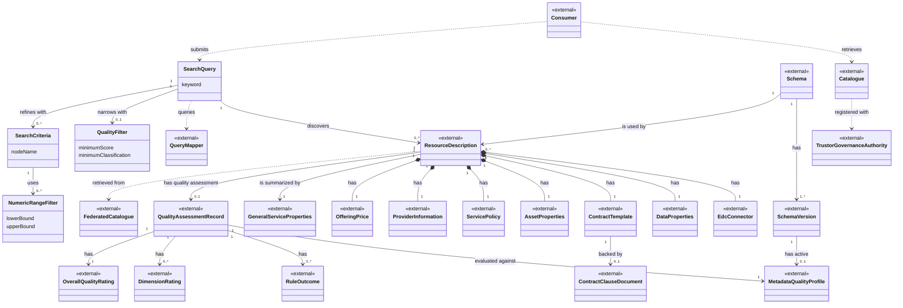

# xfsc-advsearch-be — Conceptual Data Model

## Purpose

The **xfsc-advsearch-be** (Advanced Search Backend) is the catalog discovery service of the SIMPL federated data ecosystem. Its business scope covers the search and retrieval of **Resource Descriptions** — structured metadata documents published by data, infrastructure, and application providers in a federated catalog. The service enables consumers to discover offerings through two complementary search modes:

- **Simple keyword search** — free-text query evaluated across all resource description fields.
- **Advanced structured search** — attribute-level filtering across named resource description node types, supporting text equality and numeric range constraints.

Both search modes additionally support optional **quality filters** — a minimum overall quality score and/or a minimum overall quality classification — allowing consumers to narrow results to Resource Descriptions that meet a required quality bar, as assessed against the active MetadataQualityProfile.

The service also exposes:

- a **schema catalogue** (API v2) allowing consumers to retrieve the governance-published SHACL validation shapes that define the structure of resource descriptions, and the active MetadataQualityProfile of a schema;
- the **Quality Assessment Record** of a resource description (API v1);
- the list of **Catalogues** registered with any Trustor Governance Authority (API v1);
- the same search and retrieval operations scoped to the **Governance Authority** (API v1, `/governanceAuthority/...`).

**API definition:** the service is split across two tier-1 contracts — [openapi-xfscadvsearch-tier1-v1.yaml](../../openapi/openapi-xfscadvsearch-tier1-v1.yaml) (search, quality assessment record, catalogues, contract clause documents, Governance Authority operations) and [openapi-xfscadvsearch-tier1-v2.yaml](../../openapi/openapi-xfscadvsearch-tier1-v2.yaml) (schemas and active quality profile).

> **Note — API contract alignment:** `GET /catalogues` and `GET /contractClauses/documents/{documentId}`, previously described as proposals, are now defined in `openapi-xfscadvsearch-tier1-v1.yaml`. The `Catalogue`, `TrustorGovernanceAuthority` and `ContractClauseDocument` concepts are therefore no longer flagged as proposed.

---

## CDM Traceability

### External CDMs referenced

| External CDM | Referenced concepts |
|---|---|
| [Federated Catalogue CDM](https://code.europa.eu/simpl/simpl-open/integration/resource-discovery/resource-catalogue/federated-catalogue/catalogue-be/-/blob/feature/add-cdm/documents/architecture/cdm/federated-catalogue-cdm.md?ref_type=heads) | ResourceDescription, GeneralServiceProperties; CDM of the FederatedCatalogue service |
| [Query Mapper CDM](https://code.europa.eu/simpl/simpl-open/integration/resource-discovery/search-engine/catalogue-search/query-mapper-adapter-be/-/blob/feature/add-cdm/documents/architecture/cdm/query-mapper-cdm.md?ref_type=heads) | QueryMapper service (queried for simple and advanced search) |
| [SD Tooling BE CDM](https://code.europa.eu/simpl/simpl-open/governance/resource-management/metadata-description/resource-description-tooling/sd-tooling-be/-/blob/feature/add-cdm/documents/architecture/cdm/sdtooling-api-be.md?ref_type=heads) | OfferingPrice, ProviderInformation, AssetProperties, DataProperties as sub-components of ResourceDescription |
| [Schema Manager CDM](https://code.europa.eu/simpl/simpl-open/data/semantics-and-vocabulary/schema-management/schema-manager/schema-manager-be/-/blob/feature/add-cdm/documents/architecture/cdm/simpl-schema-manager-cdm.md?ref_type=heads) | Schema, SchemaVersion, MetadataQualityProfile |
| [Quality Scoring Service CDM](https://code.europa.eu/simpl/simpl-open/data/data-governance/data-quality-rules/-/blob/feature/add-cdm/documents/architecture/cdm/quality-scoring-service-cdm.md?ref_type=heads) | QualityAssessmentRecord, OverallQualityRating, DimensionRating, RuleOutcome |

### CDMs referencing this CDM

| Referencing CDM | Referenced relationship |
|---|---|
| [Query Mapper CDM](https://code.europa.eu/simpl/simpl-open/integration/resource-discovery/search-engine/catalogue-search/query-mapper-adapter-be/-/blob/feature/add-cdm/documents/architecture/cdm/query-mapper-cdm.md?ref_type=heads) | Takes `SearchQuery`, `SearchCriteria` and `QualityFilter` from this CDM, which is their source of truth. |
| [Federated Catalogue CDM](https://code.europa.eu/simpl/simpl-open/integration/resource-discovery/resource-catalogue/federated-catalogue/catalogue-be/-/blob/feature/add-cdm/documents/architecture/cdm/federated-catalogue-cdm.md?ref_type=heads) | Takes `SearchQuery` from this CDM, which is its source of truth. |

---

## Service Boundary

### Owned within xfsc-advsearch-be CDM boundary

- **SearchQuery** — the search intent expressed by a consumer (keyword or structured criteria).
- **SearchCriteria** — one or more structured attribute filters targeting a named resource description node type.
- **NumericRangeFilter** — a range expression used within structured criteria for numeric metadata fields.
- **QualityFilter** — the optional minimum quality score and/or minimum quality classification thresholds applied on top of a SearchQuery to narrow results to sufficiently well-assessed Resource Descriptions.

### Referenced external concepts

- **ResourceDescription** — the structured metadata describing a federated offering (data, application, or infrastructure), carrying typed sub-components. Owned by the Federated Catalogue CDM; xfsc-advsearch-be exposes it read-only.
- **QualityAssessmentRecord** — the quality evaluation outcome associated with a ResourceDescription, carrying an overall quality score and a `qualityClassification` ranked according to the active MetadataQualityProfile. Owned by the Quality Scoring Service CDM; xfsc-advsearch-be exposes it read-only.
- **OverallQualityRating**, **DimensionRating**, **RuleOutcome** — the overall, per-dimension and per-rule results returned within a QualityAssessmentRecord. Owned by the Quality Scoring Service CDM.
- **GeneralServiceProperties** — human-readable identification and access metadata of an offering. Owned by the Federated Catalogue CDM, consistent with ResourceDescription's own ownership.
- **OfferingPrice** — the price terms of an offering (currency, price, price type, license). Owned by the SD Tooling BE CDM.
- **ProviderInformation** — contact, identity and signature information of the provider. Owned by the SD Tooling BE CDM.
- **ServicePolicy** — the access/usage policy pair attached to an offering. Sub-component of ResourceDescription, owned by the Provider.
- **AssetProperties** — an asset-level sub-component of ResourceDescription; its shape declares no properties. Owned by the SD Tooling BE CDM.
- **ContractTemplate** — the contract document binding associated with a data offering, referenced by URL with a cryptographic integrity hash. Sub-component of ResourceDescription, owned by the Provider.
- **DataProperties** — technical data format characteristics of a data offering. Owned by the SD Tooling BE CDM.
- **EdcConnector** — the provider's Eclipse Dataspace Connector endpoint URL for data exchange. Sub-component of ResourceDescription, owned by the Provider.
- **ContractClauseDocument** — the binary document (e.g., PDF) backing a ContractTemplate, retrievable as a downloadable stream by its identifier.
- **Schema** — a SHACL shape defining the structural constraints for a given resource type. Owned by the Schema Manager CDM; the Governance Authority is the external role that "creates, versions, and revokes schemas and metadata quality profiles" against that ownership.
- **SchemaVersion** — a published version of a Schema. Owned by the Schema Manager CDM.
- **MetadataQualityProfile** — the quality profile (dimensions, rules, classification ranking) applicable to a schema; its active version defines the quality classification labels. Owned by the Schema Manager CDM.
- **Consumer** — the contract's Key Actor: "Searches the catalog, filters results, and retrieves detailed descriptions of data offerings."
- **QueryMapper** — the external service actually queried for both the simple and the advanced search (`CatalogueAdapterTier2Client`), as implemented in `SearchServiceImpl` and `GovernanceAuthorityServiceImpl`. Its CDM is the Query Mapper CDM.
- **FederatedCatalogue** — the external service queried only for retrieval of a single resource description by identifier (`FederatedCatalogueTier2Client.getSelfDescription`), not for search. Its CDM is the Federated Catalogue CDM.
- **Catalogue** — a catalogue registered with a Trustor Governance Authority, exposing only the information required to be displayed in the UI application: catalogue identifier, catalogue name, authority URL and whether its federation status is active. Owned externally by the Trustor Governance Authority; xfsc-advsearch-be exposes it read-only via `GET /catalogues`.
- **TrustorGovernanceAuthority** — the external authority that registers and governs one or more Catalogues, identified by its authority URL.

> **Assumption — corrected boundary:** the previous version of this document listed `ResourceDescription`, `QualityAssessmentRecord`, `GeneralServiceProperties`, `ContractTemplate`, `DataProperties`, `EdcConnector`, `ContractClauseDocument` and `Schema` as owned while describing several of them as owned elsewhere. All are "Referenced external concepts" above, since none of them is created, stored or lifecycle-managed by this service; only the search-mechanics concepts (`SearchQuery`, `SearchCriteria`, `NumericRangeFilter`, `QualityFilter`) are owned here.
>
> **Assumption — API mechanics removed:** `SearchResultSet`, `CatalogueSearchResult` and `SelfDescription` are removed. The first two are response envelopes (pagination, counts), i.e. API mechanics rather than business concepts; `SelfDescription` is not a concept of the Federated Catalogue CDM, which owns the resource description as `ResourceDescription`. All references use `ResourceDescription`.
>
> **Assumption — external systems:** `SearchServiceImpl` shows both `performQuickSearch` and `performAdvancedSearch` calling `CatalogueAdapterTier2Client`; only `getSelfDescriptions` (single-resource retrieval by identifier) calls `FederatedCatalogueTier2Client`. The former is named `QueryMapper`, as in the Query Mapper and Federated Catalogue CDMs.
>
> **Assumption — GeneralServiceProperties ownership aligned with ResourceDescription:** `GeneralServiceProperties` is one of ResourceDescription's own mandatory sub-components and is owned, like its parent, by the Federated Catalogue CDM.
>
> **Assumption — Consumer added:** the contract's Key Actor, `Consumer`, is modelled as an external actor.
>
> **Assumption — Schema ownership:** `Schema` is owned by the Schema Manager CDM and referenced here read-only.

---

## Conceptual Data Model

> **Assumption — Catalogue concepts:** `Catalogue` and `TrustorGovernanceAuthority`, with the `Consumer ..> Catalogue` and `Catalogue ..> TrustorGovernanceAuthority` relationships, are introduced by the `GET /catalogues` endpoint of `openapi-xfscadvsearch-tier1-v1.yaml`. The paginated envelope `CatalogueSearchResult` is an API mechanic and is not modelled.
>
> **Assumption — owner's lines:** `ResourceDescription → QualityAssessmentRecord` ("has quality assessment"), `ResourceDescription → GeneralServiceProperties` ("is summarized by"), `Schema → ResourceDescription` ("is used by") and `SearchQuery → ResourceDescription` ("discovers") use the label and cardinality of the CDM that owns them (Quality Scoring Service, Federated Catalogue and Query Mapper CDMs respectively). `GeneralServiceProperties` is therefore an association, not a composition.
>
> **Assumption — quality assessment and profile lines:** the lines among `QualityAssessmentRecord`, `OverallQualityRating`, `DimensionRating`, `RuleOutcome`, and among `Schema`, `SchemaVersion` and `MetadataQualityProfile`, are derived from the structure returned by `GET /selfDescriptions/{selfDescriptionId}/qualityAssessmentRecord` and `GET /schemas/{schemaName}/qualityProfiles/active`. The Quality Scoring Service and Schema Manager CDMs were not available for comparison: labels and cardinalities must be verified against them.
>
> **Assumption — sub-components:** `data/schemas/DataSchema.ttl` (`gax-validation:DataOfferingShape`) declares nine mandatory (`sh:minCount 1`, `sh:maxCount 1`) sub-components of a resource description. `OfferingPrice`, `ProviderInformation`, `ServicePolicy`, `AssetProperties`, `ContractTemplate`, `DataProperties` and `EdcConnector` are modelled as `1 : 1` compositions of ResourceDescription. `EdcRegistration` is technical (marked `hiddenInFrontend`) and excluded.
>
> **Assumption — advanced search subject:** `simpl:price` (inside `OfferingPrice`) is the only property in the shape with a numeric datatype (`xsd:decimal`), and it is the property the contract's advanced-search example filters with a range (`op1: >=, value1: 15, op2: <, value2: 150`).

---

## State/value sets used in this model

| Value Set | Values | Applied To |
|-----------|--------|------------|
| **OfferingType** | `application`, `data`, `infrastructure` (per the shape's own example `'application, data, infrastructure'`) | GeneralServiceProperties.offeringType — **assumption on placement:** the detail response carries `rdf:type` pointing at `simpl:DataOffering`, and the shape places `offeringType` inside `GeneralServiceProperties`, not on `ResourceDescription` itself. **Assumption on values:** the shape's own example string is `'application, data, infrastructure'`, the Schema Manager CDM calls the same attribute an "open value set", and the Query Mapper CDM uses upper-case values. Which representation (and whether it is open or closed) is authoritative is not defined. |
| **InLanguage** | `bg`, `hr`, `cs`, `da`, `nl`, `en`, `et`, `fi`, `fr`, `de`, `el`, `hu`, `ga`, `it`, `lv`, `lt`, `mt`, `pl`, `pt`, `ro`, `sk`, `sl`, `es`, `sv` | GeneralServiceProperties.inLanguage — closed set restricted by `sh:in` to the twenty-four official EU languages. |
| **ContractTemplateDocument** | `Contract Template 1`, `Contract Template 2`, `Contract Template 3` | ContractTemplate.contractTemplateDocument — closed set restricted by `sh:in`. |
| **DataFormat** | `csv`, `xml`, `json` (open-ended, per shape example `'csv, xml'`) | DataProperties.format |
| **OperatorType** | `>=`, `<` (the two operators present in the contract's advanced-search example) | NumericRangeFilter operators — **assumption:** only these two appear in the contract's own example; whether other operators are accepted by the service is not defined. |
| **QualityClassification** | Ranked labels defined by the active MetadataQualityProfile, e.g. `Good`, `Medium` (open-ended, profile-defined) | QualityFilter.minimumClassification; QualityAssessmentRecord.qualityClassification |

---

## Concept Descriptions

| Entity | Description | Ownership |
|--------|-------------|-----------|
| SearchQuery | The search intent submitted by a Consumer: either a free-text keyword (simple search) or, when combined with SearchCriteria, structured attribute filters (advanced search). | Owned |
| SearchCriteria | A single structured filter targeting a named resource description node (e.g., the `GeneralServiceProperties` node). Contains one or more property-value conditions that must match the targeted node. Advanced searches are composed of one or more SearchCriteria. | Owned |
| NumericRangeFilter | A range constraint (lower bound, upper bound) for a numeric property within a SearchCriteria — the only such property in the shape being `OfferingPrice.price`. | Owned |
| QualityFilter | The optional pair of quality thresholds (minimumScore, minimumClassification) that a Consumer may attach to a SearchQuery, either independently or together, to narrow results to Resource Descriptions meeting a required quality bar. When at least one threshold is set, Resource Descriptions without a QualityAssessmentRecord are excluded from the results. | Owned |
| ResourceDescription | The structured metadata describing a federated offering, composed of nine mandatory sub-components: GeneralServiceProperties, OfferingPrice, ProviderInformation, ServicePolicy, AssetProperties, ContractTemplate, DataProperties, EdcConnector, and the technical EdcRegistration (excluded from this model). | External — Federated Catalogue CDM |
| QualityAssessmentRecord | The quality evaluation outcome associated with a ResourceDescription, carrying an overall quality score and a `qualityClassification` ranked according to the active MetadataQualityProfile. Present only when the Resource Description has undergone quality assessment. | External — Quality Scoring Service CDM |
| OverallQualityRating | The overall score computed for a ResourceDescription within a QualityAssessmentRecord. | External — Quality Scoring Service CDM |
| DimensionRating | The score computed for a single quality dimension (e.g. Completeness) within a QualityAssessmentRecord. | External — Quality Scoring Service CDM |
| RuleOutcome | The result of the evaluation of a single quality rule within a QualityAssessmentRecord. | External — Quality Scoring Service CDM |
| GeneralServiceProperties | Identification and access metadata of an offering: name, description, serviceAccessPoint, keywords, inLanguage, offeringType, sharingMethodId, identifier, version. All nine are mandatory per the shape. | External — Federated Catalogue CDM |
| OfferingPrice | Price terms of the offering: license, currency, price, priceType. All four are mandatory and marked `useForAdvancedSearch`; `price` is the only numeric property in the whole shape and the subject of the contract's NumericRangeFilter example. | External — SD Tooling BE CDM |
| ProviderInformation | Provider contact, identity and signature information attached to the offering. | External — SD Tooling BE CDM |
| ServicePolicy | The access and usage policy pair (ODRL) attached to the offering. | External — Provider |
| AssetProperties | An asset-level sub-component of ResourceDescription; its shape declares no properties of its own. | External — SD Tooling BE CDM |
| ContractTemplate | The legal/contractual document associated with a data offering: contractTemplateDocument (closed set), plus contractTemplateHashValue, contractTemplateHashAlg and contractTemplateURL, all three marked `hiddenInFrontend` in the shape — security/integrity information, not searchable business content. | External — Provider |
| DataProperties | Technical characteristics of a data offering: format, dataQuality, encryption, anonymization, producedBy, openApi, additionalInfo, relatedDatasets, targetUsers. Nine properties per the shape; only `format` and `producedBy` are mandatory. | External — SD Tooling BE CDM |
| EdcConnector | The provider's Eclipse Dataspace Connector (EDC) endpoint URL, marked `hiddenInFrontend`. | External — Provider |
| ContractClauseDocument | The binary document (e.g., PDF) that materialises a ContractTemplate's content, identified by documentId and retrievable as a stream together with its content type. | External — Provider |
| Schema | A SHACL shape uniquely identified by schemaId, scoped to a resourceType and versioned. Defines the validation constraints applicable to ResourceDescriptions of that type. | External — Schema Manager CDM (Governance Authority creates, versions and revokes schemas and metadata quality profiles) |
| SchemaVersion | A published version of a Schema; the latest published version is the one for which the active MetadataQualityProfile is resolved. | External — Schema Manager CDM |
| MetadataQualityProfile | The profile of quality dimensions, rules and classification ranking applicable to a schema. Its active version defines the classification labels usable in QualityFilter.minimumClassification. | External — Schema Manager CDM |
| Consumer | The data-space actor that searches the catalog, filters results, and retrieves detailed descriptions of data offerings — the contract's Key Actor. | External |
| QueryMapper | The external service actually invoked (`CatalogueAdapterTier2Client`) for both the simple and the advanced search operations. | External — Query Mapper CDM |
| FederatedCatalogue | The external service invoked (`FederatedCatalogueTier2Client`) only for retrieval of a single resource description by identifier. | External — Federated Catalogue CDM |
| Catalogue | A catalogue registered with a Trustor Governance Authority, simplified to only the information required to be displayed in the UI application: catalogue id, catalogue name, authority URL and active federation status. | External — Trustor Governance Authority |
| TrustorGovernanceAuthority | The external authority that registers and governs one or more Catalogues, identified by its authority URL. | External |

> **Assumption — attribute typing removed:** per the CDM Action Plan guidance ("CDM should be maintained with granularity at the level of business entities and business attributes only. It should contain no types or keys and naming conventions"), the diagram shows external concepts without typed attribute lists; attribute-level detail is described in prose in this table instead.
>
> **Assumption — pagination is not business content:** `page` and `pageSize` are the contract's query parameters and response envelope fields, not business attributes of the search domain. Accordingly the response envelopes (`SearchResultSet`, `CatalogueSearchResult`) are not modelled, in line with the guideline "Do not include API mechanics (such as ...Request, ...Response, DTOs)".

---

## Relationship Notes

- **Consumer → SearchQuery**: The Consumer, the contract's Key Actor, submits a SearchQuery — either a simple keyword or an advanced structured query.
- **SearchQuery → SearchCriteria (0..*)**: A SearchQuery may be refined with zero or more SearchCriteria when executing an advanced search. A simple keyword search carries no SearchCriteria. Each criterion targets a distinct resource description node.
- **SearchCriteria → NumericRangeFilter (0..*)**: A SearchCriteria may contain zero or more NumericRangeFilter constraints for numeric properties within the targeted node — in practice, `OfferingPrice.price`, the only numeric property in the shape. Text properties use direct equality matching.
- **SearchQuery → QualityFilter (0..1)**: A SearchQuery may optionally be narrowed with a single QualityFilter carrying a minimum quality score and/or a minimum quality classification. Both thresholds may be combined (logical AND); when neither is set, quality filtering is ignored.
- **SearchQuery → QueryMapper**: Both the simple search (`GET /selfDescriptions`) and the advanced search (`POST /selfDescriptions/advanced`), as well as their Governance Authority counterparts, are executed against `CatalogueAdapterTier2Client`.
- **ResourceDescription → FederatedCatalogue**: Retrieval of a single resource description by identifier (`GET /selfDescriptions/{selfDescriptionId}`) is executed against `FederatedCatalogueTier2Client.getSelfDescription`, a different external service than the one used for search.
- **SearchQuery → ResourceDescription (0..*)**: A SearchQuery discovers zero or more ResourceDescriptions. In search results only identifying and headline attributes are returned; full detail requires a subsequent single-resource retrieval.
- **ResourceDescription → QualityAssessmentRecord (0..1)**: A ResourceDescription has at most one QualityAssessmentRecord ("has quality assessment") carrying its overall quality score and `qualityClassification`. When a QualityFilter is applied to the SearchQuery, only ResourceDescriptions with a QualityAssessmentRecord satisfying the threshold(s) are included in the results.
- **QualityAssessmentRecord → OverallQualityRating / DimensionRating / RuleOutcome / MetadataQualityProfile**: The record returned by `GET /selfDescriptions/{selfDescriptionId}/qualityAssessmentRecord` carries the overall rating, the per-dimension ratings and the per-rule outcomes, and refers to the MetadataQualityProfile it was evaluated against.
- **ResourceDescription → GeneralServiceProperties (1 : 1)**: A ResourceDescription is summarized by exactly one GeneralServiceProperties (Federated Catalogue CDM's relationship).
- **ResourceDescription *-- OfferingPrice / ProviderInformation / ServicePolicy / AssetProperties / ContractTemplate / DataProperties / EdcConnector (1 : 1 each)**: Composition — the shape sets `sh:minCount 1` and `sh:maxCount 1` on all sub-components. Each is an integral part of the ResourceDescription, hence composition rather than a plain association.
- **Consumer → Catalogue**: The Consumer retrieves the paginated list of catalogues via `GET /catalogues`, which carries no filter criteria beyond pagination (`page`, `pageSize`).
- **Catalogue → TrustorGovernanceAuthority**: Each Catalogue is registered with exactly one Trustor Governance Authority, identified in the response by its `authorityURL`.
- **ContractTemplate → ContractClauseDocument (0..1)**: A ContractTemplate may be backed by a ContractClauseDocument, the actual binary file (e.g., PDF) whose content is downloadable by its documentId; the integrity of the document is verified against the ContractTemplate's hash algorithm and value.
- **Schema → ResourceDescription (0..*)**: A Schema (SHACL shape) "is used by" zero or more ResourceDescriptions of the corresponding resource type (Federated Catalogue CDM's relationship). Consumers retrieve schemas to drive resource description authoring and validation.
- **Schema → SchemaVersion (1..*) / SchemaVersion → MetadataQualityProfile (0..1)**: A Schema has one or more published versions; the active MetadataQualityProfile is resolved for the latest published SchemaVersion.

---

## Alignment to API Endpoints

### v1 — `openapi-xfscadvsearch-tier1-v1.yaml`

| Endpoint | Concepts | Short Description |
|----------|----------|-------------------|
| `GET /selfDescriptions` | SearchQuery, QualityFilter, ResourceDescription, QualityAssessmentRecord | Executes a simple keyword search across the catalog via QueryMapper, optionally narrowed by minimum quality score and/or classification; returns the paginated matching ResourceDescriptions |
| `POST /selfDescriptions/advanced` | SearchQuery, SearchCriteria, NumericRangeFilter, QualityFilter, ResourceDescription, QualityAssessmentRecord | Executes an advanced structured search via QueryMapper; the request body maps to a SearchQuery with one or more SearchCriteria (each optionally carrying a NumericRangeFilter on a numeric property such as `OfferingPrice.price`) plus optional root-level quality filter fields |
| `GET /selfDescriptions/{selfDescriptionId}` | ResourceDescription, GeneralServiceProperties, ContractTemplate, DataProperties, EdcConnector, and (per shape) OfferingPrice, ProviderInformation, ServicePolicy, AssetProperties | Retrieves the full detail of a single ResourceDescription by its identifier from FederatedCatalogue, including all sub-components |
| `GET /selfDescriptions/{selfDescriptionId}/qualityAssessmentRecord` | ResourceDescription, QualityAssessmentRecord, OverallQualityRating, DimensionRating, RuleOutcome, MetadataQualityProfile | Returns the full JSON-LD Quality Assessment Record associated with the specified ResourceDescription (204 if none is available). `SelfDescriptionScore`, `DimensionScore` and `RuleEvaluation` of the response are `OverallQualityRating`, `DimensionRating` and `RuleOutcome` in the Quality Scoring Service CDM |
| `GET /governanceAuthority/selfDescriptions` | SearchQuery, QualityFilter, ResourceDescription, QualityAssessmentRecord | Governance Authority simple keyword search across one or more catalogues (`catalogueIds`), with optional quality filters, via QueryMapper; the response holds one result group per requested catalogue |
| `POST /governanceAuthority/selfDescriptions/advanced` | SearchQuery, SearchCriteria, NumericRangeFilter, QualityFilter, ResourceDescription, QualityAssessmentRecord | Governance Authority advanced structured search across one or more catalogues (`catalogueIds` root field), with optional quality filters, via QueryMapper |
| `GET /governanceAuthority/selfDescriptions/{selfDescriptionId}` | ResourceDescription, GeneralServiceProperties, ContractTemplate, DataProperties, EdcConnector, OfferingPrice, ProviderInformation, ServicePolicy, AssetProperties | Retrieves the full detail of a single ResourceDescription belonging to the catalogue identified by `catalogueId` |
| `GET /catalogues` | Catalogue, TrustorGovernanceAuthority | Returns a paginated list of all catalogues from any Trustor Governance Authority, exposing the identifier, name, authority URL and active status required to be displayed in the UI application |
| `GET /contractClauses/documents/{documentId}` | ContractClauseDocument, ContractTemplate | Returns the binary content of the contract clause document identified by documentId as a stream, together with the appropriate content type header |

### v2 — `openapi-xfscadvsearch-tier1-v2.yaml`

| Endpoint | Concepts | Short Description |
|----------|----------|-------------------|
| `GET /schemas` | Schema | Lists all available schemas, filterable by the `resourceType` query parameter; not paginated |
| `GET /schemas/{schemaId}/content` | Schema | Returns the raw TTL content of a specific schema by its identifier |
| `GET /schemas/{schemaId}/{version}` | Schema, SchemaVersion | Retrieves the content of a specific version of a schema, identified by schema id and version |
| `GET /schemas/{schemaName}/qualityProfiles/active` | Schema, SchemaVersion, MetadataQualityProfile | Returns the active MetadataQualityProfile resolved for the latest published SchemaVersion of the provided schema name. Lines: Schema has SchemaVersion; SchemaVersion has active MetadataQualityProfile |

---

## Assumptions and Open Questions

- **Ownership of `SearchQuery` / `SearchCriteria` / `QualityFilter`:** this CDM is their source of truth; the Query Mapper CDM takes all three and the Federated Catalogue CDM takes `SearchQuery` (see CDMs referencing this CDM).
- **Ownership of `OfferingPrice` / `ProviderInformation` / `AssetProperties` / `DataProperties`:** these are owned by the SD Tooling BE CDM, as sub-components of `ResourceDescription`.
- **`GeneralServiceProperties` ownership aligned with `ResourceDescription`:** both are owned by the Federated Catalogue CDM.
- **Quality concepts:** `QualityAssessmentRecord`, `OverallQualityRating`, `DimensionRating` and `RuleOutcome` are owned by the Quality Scoring Service CDM; `MetadataQualityProfile`, `Schema` and `SchemaVersion` by the Schema Manager CDM. Relationship labels and cardinalities among them must be verified against those CDMs.
- **Query Mapper CDM link:** the URL points to the `query-mapper-adapter-be` repository, inferred from the Federated Catalogue CDM's location; it must be verified.
- **Governance Authority endpoints:** `/governanceAuthority/...` operations are served by the same concepts as their non-Governance-Authority counterparts, with the addition of the `catalogueIds` / `catalogueId` scoping; no additional concept is introduced.

