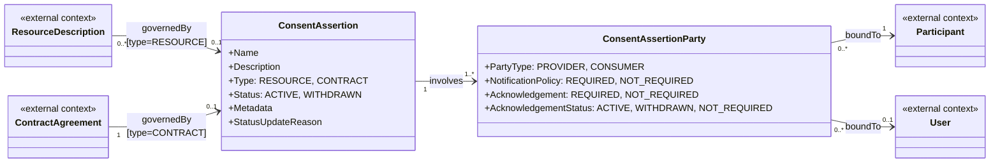

## Purpose

This document defines the Conceptual Data Model (CDM) for the Consent Management component.

Business scope includes:
- Data Provider creating consent assertions of type RESOURCE, linked to a resource description, or of type CONTRACT, linked to a specific contract established with a Consumer
- Data Provider withdrawing and reactivating consent assertions

See OpenAPI definitions files:
- [Tier 1 v1](../../../openapi/consentmanager-tier1-v1.yaml)

## Service boundary and CDM traceability

### Owned concepts

- ConsentAssertion
- ConsentAssertionParty

### Referenced concepts, by owning CDM

| Owning CDM | Concepts used here |
|---|---|
| [Contract Manager](https://code.europa.eu/simpl/simpl-open/governance/contract-management/contract-lifecycle-management/contract-manager/contract-manager-be/-/blob/develop/documents/architecture/cdm/contract-cdm.md?ref_type=heads) | ContractAgreement |
| [Federated Catalogue](https://code.europa.eu/simpl/simpl-open/integration/resource-discovery/resource-catalogue/federated-catalogue/catalogue-be/-/blob/feature/add-cdm/documents/architecture/cdm/federated-catalogue-cdm.md?ref_type=heads) | ResourceDescription |
| [Identity Provider](https://code.europa.eu/simpl/simpl-open/security/access-control-and-trust/identity-provider-federation/identity-provider/identity-provider-be/-/blob/develop/documents/architecture/cdm/identity-provider-cdm.md?ref_type=heads) | Participant | 
| [Users and Roles](https://code.europa.eu/simpl/simpl-open/governance/participant-management/user-roles/user-roles/users-roles-be/-/blob/develop/documents/architecture/cdm/users-roles-cdm.md?ref_type=heads) | User | 

### CDMs that reference this one

None. 

## Conceptual Data Model
 

 
## Concept descriptions
 
| Entity | Description |
|--------|-------------|
| ConsentAssertion | A consent assertion is an entity that holds the status (ACTIVE, WITHDRAWN) of the dataset in terms of consent status of the Data Subjects. |
| ConsentAssertionParty | An entity that is involved in the lifecycle of a consent assertion. The acknowledgement status of a party influences the status of the assertion. If all the parties with acknowledgement required are active, the assertion is ACTIVE. If at least one party with acknowledgement required is WITHDRAWN, the assertion is WITHDRAWN. |
| ResourceDescription | *(external context, see [Federated Catalogue](https://code.europa.eu/simpl/simpl-open/integration/resource-discovery/resource-catalogue/federated-catalogue/catalogue-be/-/blob/feature/add-cdm/documents/architecture/cdm/federated-catalogue-cdm.md?ref_type=heads))* A consent assertion of type RESOURCE can be linked to zero or more data resource descriptions, each describing a dataset subject to consent obligations. A resource description may have at most one resource consent assertion governing it. Consent assertions are available only for data resource description. |
| ContractAgreement | *(external context, see [Contract Manager](https://code.europa.eu/simpl/simpl-open/governance/contract-management/contract-lifecycle-management/contract-manager/contract-manager-be/-/blob/develop/documents/architecture/cdm/contract-cdm.md?ref_type=heads))* A contract established between a Data Provider and a Consumer is optionally linked to a consent assertion of type CONTRACT. Each contract may have at most one contract consent assertion, enabling the Data Provider to independently control dataset consumption for that specific participant. |
| Participant | *(external context, see [Identity Provider](https://code.europa.eu/simpl/simpl-open/security/access-control-and-trust/identity-provider-federation/identity-provider/identity-provider-be/-/blob/develop/documents/architecture/cdm/identity-provider-cdm.md?ref_type=heads))* An organisation onboarded into the dataspace. In the current implementation, a consent assertion of type RESOURCE is bound to only the data provider participant that creates the assertion. The consent assertion of type CONTRACT is also bound to the consumer involved in the linked contract. |
| User | *(external context, see [Users and Roles](https://code.europa.eu/simpl/simpl-open/governance/participant-management/user-roles/user-roles/users-roles-be/-/blob/develop/documents/architecture/cdm/users-roles-cdm.md?ref_type=heads))* The user who creates the consent assertion |

## Assumptions and open questions

- The `linkedResourceURL`, whose goal is to link to the contract manager or the catalog component UI, is deliberately not modelled as it is presentation information rather than business data. 
- The `metadata` is a free key-value metadata to facilitate search and retrieval of the assertion within the system.
- The usage of consent assertions in Contract Manager and the Federated Catalogue has not been implemented yet. A reference to consent assertions in those services is not applicable at the moment.