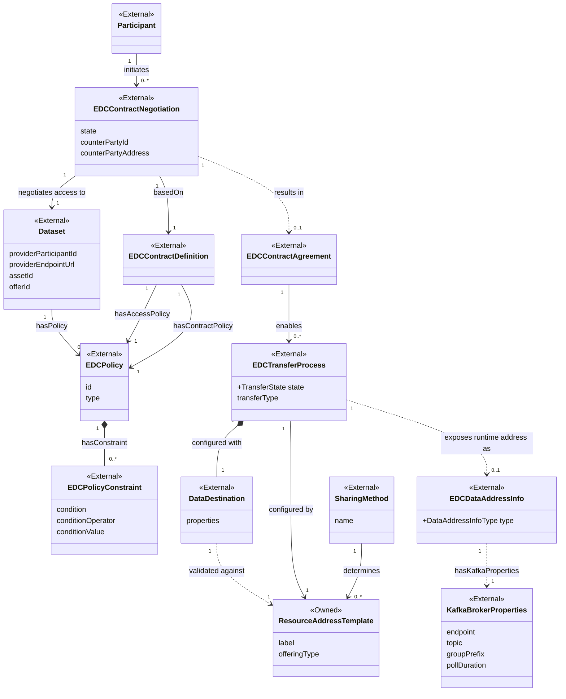

# Contract & Consumption BE — Conceptual Data Model

## 1. Purpose

This CDM describes the consumer-side orchestration backend responsible for the full data-contract lifecycle: discovering available dataset offers from remote connectors, negotiating contract terms, initiating and tracking data transfers, and managing destination resource-address templates. It serves as the authoritative reference for business concepts owned or consumed by the `contract-consumption-be` service.

The service API definition is available in the [OpenAPI specification](../../../openapi/openapi-contract-consumption-be-tier1-v1.yaml), which includes the data-address operation and its associated schemas.

---

## CDM Traceability

### External CDMs referenced

| Owning context | Referenced concepts |
|---|---|
| [Identity Provider CDM](https://code.europa.eu/simpl/simpl-open/security/access-control-and-trust/identity-provider-federation/identity-provider/identity-provider-be/-/blob/develop/documents/architecture/cdm/identity-provider-cdm.md) | `Participant` |
| [SD Tooling BE CDM](https://code.europa.eu/simpl/simpl-open/governance/resource-management/metadata-description/resource-description-tooling/sd-tooling-be/-/blob/feature/add-cdm/documents/architecture/cdm/sdtooling-api-be.md?ref_type=heads) | `SharingMethod` |
| EDC Connector *(no owning CDM exists)* | `EDCPolicy`, `EDCPolicyConstraint`, `EDCContractDefinition`, `EDCContractNegotiation`, `EDCContractAgreement`, `EDCTransferProcess`, `EDCDataAddressInfo`, `KafkaBrokerProperties` |
| Remote provider EDC | `Dataset` |
| Consumer infrastructure | `DataDestination` |

### CDMs referencing this CDM

| Referencing CDM | Referenced relationship |
|---|---|
| [EDC Connector Adapter CDM](https://code.europa.eu/simpl/simpl-open/integration/resource-sharing/resource-sharing-runtime/connector/edc-connector-adapter-be/-/blob/feature/add-cdm/documents/architecture/cdm/edcconnectoradapter.md?ref_type=heads) | DataDestination is supplied by Consumer infrastructure and validated against ResourceAddressTemplate, owned by Contract Consumption BE |

---

## 2. Service Boundary

> **Revised ownership (see §8):** a prior revision of this CDM declared `ContractNegotiation`, `TransferProcess` and `DataAddressInfo` as entities **Owned** by this service, in apparent "dual-tracking" with the EDC Connector Adapter CDM, which declared the same names as its own Owned concepts. On review, neither claim holds: these are EDC/DSP protocol artefacts whose state and lifecycle are created, persisted and advanced **natively by the underlying EDC Connector runtime** (via the Dataspace Protocol and/or its Management API); the EDC Connector Adapter only mediates/relays them, and this service only orchestrates and displays them. They have been reclassified below as **External**, owned by the **EDC Connector** (the runtime itself — out of scope of any adapter/service CDM, including this one), and renamed with an **`EDC` prefix** (`EDCContractDefinition`, `EDCContractNegotiation`, `EDCContractAgreement`, `EDCTransferProcess`, `EDCDataAddressInfo`) to distinguish connector-owned protocol artefacts from business concepts of the same unprefixed name. See §8 for the full rationale per entity.

### Owned concepts
Entities whose lifecycle (create / update / delete) is fully controlled by this service.

| Entity | Responsibility |
|--------|---------------|
| `ResourceAddressTemplate` | Templates that describe where and how data should be delivered to the consumer. This is domain data genuinely authored and mastered by this service (not an EDC artefact). |

### External / referenced concepts
Concepts owned outside this service. It may initiate runtime processes or validate and relay payloads without mastering those concepts.

| Entity | Owning context |
|--------|---------------|
| `Participant` | Identity Provider — a legal entity or organization onboarded into the dataspace |
| `SharingMethod` | SD Tooling BE — named protocol or transfer mechanism through which a resource is delivered to consumers |
| `Dataset` | Remote provider EDC — catalog offer passed through by EDC Connector Adapter |
| `EDCPolicy` *(wire: `Policy`)* | EDC Connector — connector-side policy derived from SD Tooling's AccessPolicy or UsagePolicy |
| `EDCPolicyConstraint` *(wire: `PolicyConstraint`)* | EDC Connector — atomic connector-side policy constraint |
| `DataDestination` | Consumer infrastructure — caller-supplied destination parameters, validated against ResourceAddressTemplate; validation and relay do not confer ownership |
| `KafkaBrokerProperties` | EDC Connector — Kafka transfer access data projected from the runtime's Endpoint Data Reference (EDR), not mastered by either adapter |
| `EDCContractDefinition` *(wire: opaque `contractDefinitionId` only)* | EDC Connector — an artefact of the **EDC Management API** that binds an asset to an access/contract policy, configuring an executable offer; the EDC Connector Adapter exposes it but does not master it (see §2, §8). |
| `EDCContractNegotiation` *(wire: `ContractNegotiation`)* | EDC Connector — an EDC/DSP process whose state and lifecycle are created and persisted by the EDC Connector runtime, not by this service or the adapter (see §8). |
| `EDCContractAgreement` *(wire: opaque `contractAgreementId` only)* | EDC Connector — operational agreement produced by EDC negotiation finalization, distinct from the business ContractAgreement owned by [Contract Manager BE](https://code.europa.eu/simpl/simpl-open/governance/contract-management/contract-lifecycle-management/contract-manager/contract-manager-be/-/blob/develop/documents/architecture/cdm/contract-cdm.md). This service relays only the runtime agreement reference. |
| `EDCTransferProcess` *(wire: `TransferProcess`)* | EDC Connector — a technical transfer process executed and persisted by the EDC Connector runtime; this service orchestrates and polls it but does not master its state (see §8). |
| `EDCDataAddressInfo` *(wire: `DataAddressInfo`)* | EDC Connector — runtime access information projected from its Endpoint Data Reference (EDR) through EDC Connector Adapter, not mastered by either adapter |

---

## 3. Conceptual Model

`<<Owned>>` classes are controlled by this service; `<<External>>` classes are owned elsewhere. Initiating processes, validating payloads or displaying projections does not transfer ownership (§2).

*Relationships instead of duplicate attributes:* Dataset.policy is represented only by hasPolicy, EDCPolicy.policyConstraints only by hasConstraint, and EDCDataAddressInfo.properties only by hasKafkaProperties (for KafkaBroker). The wire fields remain unchanged.

*Kafka schema abstraction:* the conceptual fields endpoint, topic, groupPrefix and pollDuration are a subset of the upstream schema. Security fields accessToken, accessTokenExpiresIn, saslMechanism and securityProtocol are intentionally omitted under the CDM guidelines because no explicit business value is established here. Technical routing data is likewise not modeled. The wire schema and runtime behavior are unchanged.

---

## 4. State / Value Sets

### NegotiationState
`EDCContractNegotiation.state` is declared as an unconstrained `string` in the contract (no `enum`). The API example uses `state: CONFIRMED`, whose mapping to the values below is unresolved (see §8). The list here is aligned with the EDC Connector Adapter CDM's `NegotiationState` (the actual protocol state machine this service proxies) rather than derived from the contract, which does not close this enum today.

| Value | Meaning |
|-------|---------|
| `INITIAL` | Negotiation created, not yet sent. |
| `REQUESTED` | Consumer has submitted a negotiation request. |
| `OFFERED` | Provider has responded with a counter-offer. |
| `ACCEPTED` | Consumer has accepted the provider's offer. |
| `AGREED` | Both parties have agreed; agreement is being finalised. |
| `VERIFIED` | Agreement verified by both connectors. |
| `FINALIZED` | Contract agreement persisted; negotiation closed successfully. |
| `TERMINATED` | Negotiation ended without agreement. |

### PartyRole
The role a party assumes per interaction; it is not an attribute of `Participant`. Remote provider references are carried inline on Dataset and EDCContractNegotiation, not as local participant instances.

| Value | Meaning |
|-------|---------|
| `CONSUMER` | The party requesting access to data. |
| `PROVIDER` | The party offering data. |

### PolicyType
| Value | Meaning |
|-------|---------|
| `ACCESS` | Controls who may see/query the dataset. |
| `USAGE` | Controls how the dataset may be used after transfer. |

### TransferState
`EDCTransferProcess.state` is likewise declared as an unconstrained `string` in the contract (no `enum`). The list here is aligned with the EDC Connector Adapter CDM's `TransferState` for the same reason given above for `NegotiationState`.

| Value | Meaning |
|-------|---------|
| `INITIAL` | Transfer created. |
| `PROVISIONING` | Resources being allocated. |
| `PROVISIONED` | Resources ready. |
| `REQUESTING` | Transfer request being sent. |
| `REQUESTED` | Transfer request submitted to the provider connector. |
| `STARTED` | Data transfer is in progress. |
| `SUSPENDED` | Transfer paused (e.g., back-pressure or policy check). |
| `COMPLETING` | Finalizing handshake. |
| `COMPLETED` | Transfer finished successfully. |
| `TERMINATING` | Abort in progress. |
| `TERMINATED` | Transfer ended prematurely. |

### SharingMethod
Values for `SharingMethod.name`, aligned with the SD Tooling BE CDM and the Contract Consumption API contract.

| Value | Meaning |
|-------|---------|
| `HTTPDATA_PUSH` | Provider pushes data to a consumer-provided HTTP endpoint. |
| `IONOS_S3` | Data delivered to an IONOS S3-compatible object-store bucket. |

### TransferType
EDCTransferProcess.transferType retains the wire TransferProcess.transferType field as an open string, not an enum. [EDC's transfer-type decision record](https://github.com/eclipse-edc/Connector/blob/v0.17.0/docs/developer/decision-records/2023-11-20-transfer-type/README.md) ties it to data-plane selection; its [parser](https://github.com/eclipse-edc/Connector/blob/v0.17.0/core/control-plane/control-plane-transfer/src/main/java/org/eclipse/edc/connector/controlplane/transfer/flow/TransferTypeParserImpl.java) uses `<destinationType>-<PUSH|PULL>`, optionally followed by a response-channel type.

The upstream adapter's [implementation](https://code.europa.eu/simpl/simpl-open/integration/resource-sharing/resource-sharing-runtime/connector/edc-connector-adapter-be/-/blob/develop/src/main/java/eu/europa/ec/simpl/edcconnectoradapter/service/consumer/transferprocess/TransferProcessServiceImpl.java) derives these values from dataDestination.type:

| Value / pattern | Meaning |
|---|---|
| `KafkaBroker-PULL` | Kafka destination kind; outbound EDC request omits dataDestination and connection information is obtained through the EDR |
| `<destinationType>-PUSH` | Other destination kinds; outbound EDC request carries destination parameters |

These are implementation rules, not a closed API value set. TransferProcess.type is separately the local connector role (`CONSUMER`/`PROVIDER`), as defined by [EDC](https://github.com/eclipse-edc/Connector/blob/v0.17.0/spi/control-plane/transfer-spi/src/main/java/org/eclipse/edc/connector/controlplane/transfer/spi/types/TransferProcess.java) and used by connector-be's [TransferListener](https://code.europa.eu/simpl/simpl-open/integration/resource-sharing/resource-sharing-runtime/connector/connector-be/-/blob/develop/src/main/java/eu/europa/ec/simpl/transferprocess/listener/TransferListener.java) and [TransferPendingGuard](https://code.europa.eu/simpl/simpl-open/integration/resource-sharing/resource-sharing-runtime/connector/connector-be/-/blob/develop/src/main/java/eu/europa/ec/simpl/transferprocess/listener/TransferPendingGuard.java). DataAddressInfo.type comes from EDR transferTypeDestination (KafkaBroker in the Kafka case), not from the process role or the full transferType.

### OfferingType
Used as a query parameter to select `ResourceAddressTemplate`s by the kind of offering being shared.

| Value | Meaning |
|-------|---------|
| `APPLICATION` | A software service offered via API. |
| `DATA` | A static or streaming dataset. |
| `INFRASTRUCTURE` | A compute or storage resource. |

### DataAddressInfoType
The upstream DataAddressInfo.type schema is an unconstrained string (no enum). KafkaBroker is the documented example, not the only possible implementation value: the adapter also returns unknown EDR destination kinds as generic properties (see TransferType above).

| Value | Meaning |
|-------|---------|
| `KafkaBroker` | The runtime data address exposes Kafka transfer access data; the conceptual view retains endpoint, topic, consumer group prefix and poll duration, not security information. |

---

## 5. Concept Descriptions

| Entity | Description | Ownership |
|--------|-------------|-----------|
| `Participant` | A legal entity or organization onboarded into the dataspace. In this deployment, the EDC Connector participant identity is configured from the Identity Provider's participant identifier and exposed by the adapter. | External — Identity Provider |
| `Dataset` | A logical unit of data made available by a provider connector, exposed via a `providerParticipantId`/`providerEndpointUrl` and identified by `assetId`/`offerId`; it may include one offer policy. This service does not own or interpret any further Dataset shape (e.g., title, catalog origin) beyond what the catalog response returns. | External — see §2 |
| `EDCPolicy` | The connector-side rule set governing access (`ACCESS`) or usage (`USAGE`), derived from SD Tooling's business policies. Wire schema Policy carries id, type and policyConstraints; zero constraints are allowed. | External — EDC Connector |
| `EDCPolicyConstraint` | An atomic connector-side constraint carried as condition, conditionOperator and conditionValue (wire: PolicyConstraint). | External — EDC Connector |
| `EDCContractDefinition` | The provider-side binding of an asset to an access policy and a contract policy, configuring an executable offer in the EDC Connector's Management API; referenced by the negotiation via `contractDefinitionId`, which the consumer must supply to start a negotiation or a catalog asset search. ⚠ *Conceptual — no named schema; wire: opaque `contractDefinitionId`.* | External — EDC Connector (see §2, §8) |
| `EDCContractNegotiation` | Runtime negotiation carrying state and inline counterPartyId/counterPartyAddress references. This service submits requests and polls the connector's state machine. Wire ContractNegotiation.createdAt is creation metadata, not a start event, and is omitted rather than renamed. | External — EDC Connector |
| `EDCContractAgreement` | The EDC/DSP operational agreement referenced by contractAgreementId/contractId, distinct from ContractAgreement owned by Contract Manager BE (§2). | External — EDC Connector |
| `EDCTransferProcess` | Runtime transfer carrying state and wire transferType, which describes transfer mode relevant to address availability (§4). Executed and persisted by the EDC Connector. Its configured ResourceAddressTemplate determines the applicable sharing method. No start timestamp is inferred; destination configuration is expressed by the DataDestination association. | External — EDC Connector |
| `DataDestination` | Caller-supplied destination parameters identifying the consumer-side sink, submitted as TransferRequest.dataDestination and validated against ResourceAddressTemplate. A payload/value object, not an independently managed entity; validation and relay do not confer ownership. | External — Consumer infrastructure |
| `ResourceAddressTemplate` | A labeled template that defines the structure of destination parameters the consumer must supply when initiating a transfer. Its SharingMethod and offering type characterize its use. | **Owned** |
| `SharingMethod` | A named protocol or transfer mechanism through which a resource is delivered to consumers; it determines which ResourceAddressTemplates apply. | External — SD Tooling BE |
| `EDCDataAddressInfo` | Runtime connection information projected from the connector's EDR through EDC Connector Adapter. Its type is derived from EDR transferTypeDestination, distinct from transferType and process role. The adapter contract's 404/409 descriptions differ from the inspected EDR-lookup implementation (§4). | External — EDC Connector |
| `KafkaBrokerProperties` | Kafka transfer access data carried in EDCDataAddressInfo.properties when type is KafkaBroker, sourced from the EDC Connector's EDR. The conceptual subset comprises endpoint, topic, groupPrefix and pollDuration; security information is omitted (§3). API projection or relay does not establish adapter ownership. | External — EDC Connector |

---

## 6. Relationship Notes

| # | Relationship | Cardinality | Notes |
|---|-------------|-------------|-------|
| 1 | `Dataset` → `EDCPolicy` | 1 to 0..1 | A dataset may carry an offer policy; the API schema does not require `Dataset.policy` and defines it as a single object rather than a collection. |
| 2 | `EDCPolicy` ◆→ `EDCPolicyConstraint` | 1 to 0..* | Composition: a constraint belongs to its policy; zero constraints are allowed (`policyConstraints` has no minItems, and the catalog example returns `policyConstraints: []`). |
| 3 | Dataset remote provider reference | Inline reference | providerParticipantId/providerEndpointUrl identify the remote provider, not the local Participant. |
| 4 | `EDCContractDefinition` → `EDCPolicy` (access) | 1 to 1 | Each contract definition references one access policy. |
| 5 | `EDCContractDefinition` → `EDCPolicy` (contract) | 1 to 1 | Each contract definition references one contract/usage policy. |
| 6 | `EDCContractNegotiation` → `Dataset` | 1 to 1 | Each negotiation targets exactly one dataset; a consumer may open multiple negotiations for the same dataset. |
| 7 | `EDCContractNegotiation` → `EDCContractDefinition` | 1 to 1 | Every negotiation is anchored to the provider's contract definition (`contractDefinitionId`), not to a policy directly; the negotiation request/response carries no policy payload. |
| 8 | `Participant` → `EDCContractNegotiation` | 1 to 0..* | A dataspace participant initiates negotiations; counterPartyId/counterPartyAddress identify each negotiation's remote provider inline. |
| 9 | `EDCContractNegotiation` ⇢ `EDCContractAgreement` | 1 to 0..1 | Only negotiations that reach `FINALIZED` produce an agreement; terminated negotiations produce none. |
| 10 | `EDCContractAgreement` → `EDCTransferProcess` | 1 to 0..* | An agreement may authorize zero, one, or multiple sequential/parallel transfers (e.g., repeated pulls); nothing obliges an agreement to produce a transfer. |
| 11 | `EDCTransferProcess` ◆→ `DataDestination` | 1 to 1 | Composition: the destination address supplied in `TransferRequest.dataDestination` has no meaning outside the transfer it configures. |
| 12 | `DataDestination` ⇢ `ResourceAddressTemplate` | 1 to 1 | The supplied destination parameters are configured against the template selected for the transfer. |
| 13 | `EDCTransferProcess` → `ResourceAddressTemplate` | 1 to 1 | Each transfer is configured by exactly one template; the template's SharingMethod association determines the applicable transfer mechanism. |
| 14 | `EDCTransferProcess` ⇢ `EDCDataAddressInfo` | 1 to 0..1 | The upstream adapter resolves runtime address data from a stored EDR. `transferType` identifies the transfer mode (KafkaBroker-PULL); KafkaBroker is the address kind. `TransferProcess.type` identifies the connector role (CONSUMER/PROVIDER), not the transfer mode. The documented not-started/non-Kafka 409 gate is not explicitly enforced by the inspected implementation (§4). |
| 15 | `EDCDataAddressInfo` ⇢ `KafkaBrokerProperties` | 1 to 1 | For KafkaBroker, properties exposes EDC Connector access data. The conceptual subset retains endpoint, topic, groupPrefix and pollDuration, not security information. The upstream schema does not declare type, properties or individual Kafka fields required. |
| 16 | `SharingMethod` → `ResourceAddressTemplate` | 1 to 0..* | Each sharing method determines the templates available for configuring a destination. |

---

## 7. Alignment to API Endpoints

| Endpoint | Method | Primary concept(s) touched | Purpose |
|----------|--------|---------------------------|---------|
| `/connectorCatalog/assets` | `POST` | `Dataset`, `EDCPolicy`, `EDCContractDefinition` | Queries a remote connector's catalog (`providerEndpoint`) for a given `contractDefinitionId`/`assetId`; returns datasets with their offer policies and inline provider references. |
| `/contracts` | `POST` | `EDCContractNegotiation`, `EDCContractDefinition`, `Participant` | The local participant initiates negotiation with a remote provider for an asset under a contract definition. |
| `/contracts/{id}` | `GET` | `EDCContractNegotiation`, `EDCContractAgreement` | Retrieves the current state, inline remote counterparty references and agreement reference if finalized. |
| `/transfers` | `POST` | `EDCTransferProcess`, `EDCContractAgreement`, `ResourceAddressTemplate`, `DataDestination` | Starts a transfer against a remote provider under an agreement, using caller-supplied destination parameters validated against the template. |
| `/transfers/{id}` | `GET` | `EDCTransferProcess` | Returns the current state and metadata of a running or completed transfer. |
| `/transfers/{transferProcessId}/dataAddress` | `GET` | `EDCTransferProcess`, `EDCDataAddressInfo`, `KafkaBrokerProperties` | Exposes EDC Connector runtime data-address information for a transfer. |
| `/resourceAddresses/sharingMethods/{id}/templates` | `GET` | `SharingMethod`, `ResourceAddressTemplate`, `OfferingType` | Lists available destination templates for the specified sharing method (`sharingMethodId`, path) and the required `offeringType` query parameter. |
| `/resourceAddresses/templates/{id}/schema` | `GET` | `ResourceAddressTemplate` | Returns the schema associated with a specific destination template. |
| `/resourceAddresses/templates/{id}/uiSchema` | `GET` | `ResourceAddressTemplate` | Returns the UI schema associated with a specific destination template. |

---

## 8. Assumptions and Open Questions

- **Ownership hypothesis validated — EDC Connector, not this service nor the EDC Connector Adapter, masters the protocol artefacts.** `ContractNegotiation`, `TransferProcess`, `EdcContractAgreement` (formerly `ContractAgreement`) and `DataAddressInfo` were previously declared **Owned** here, in apparent dual-tracking with the EDC Connector Adapter CDM (which declared the same names as its own Owned concepts). Neither claim is accurate: these are EDC/DSP protocol and Management-API artefacts whose state, identity and lifecycle are created and persisted **natively by the underlying EDC Connector runtime**; the EDC Connector Adapter only relays/mediates them over its REST API, and this service only orchestrates (submits requests, polls status) and displays them. All four have been reclassified as **External**, owned by **EDC Connector** (the runtime itself, out of scope of any service-level CDM including this one and the adapter's). This resolves the former "dual-tracking" footnotes as a modeling inaccuracy rather than an accepted pattern.
- **EDC Connector ownership:** EDCPolicy, EDCPolicyConstraint, EDCContractDefinition, EDCContractNegotiation, EDCContractAgreement, EDCTransferProcess, EDCDataAddressInfo and KafkaBrokerProperties are External — EDC Connector. The EDC Connector has no owning CDM; its concepts are listed in §1. Participant is owned by Identity Provider, and Dataset is owned by the remote provider EDC. Wire schema names remain unchanged.
- **`ContractNegotiation` → `EDCContractNegotiation`:** an EDC/DSP process. Its `NegotiationState` state machine (§4) is driven by the Dataspace Protocol message exchange between the two connectors, not by any business logic in this service; this service's role is limited to initiating (`POST /contracts`) and polling (`GET /contracts/{id}`) it.
- **Contract agreement distinction:** EDCContractAgreement is the runtime agreement reference relayed by this service. The business ContractAgreement exists and is owned by Contract Manager BE (linked in §2). These are distinct concepts; no direct integration or identifier equivalence is implied.
- **`TransferProcess` → `EDCTransferProcess`:** a technical transfer process (its `TransferState` state machine, §4) executed and persisted by the EDC Connector runtime once `POST /transfers` is called; this service polls `GET /transfers/{id}` for status but does not drive the state machine itself.
- **DataDestination ownership:** Consumer infrastructure supplies and controls the destination parameters. This service validates the payload against its owned ResourceAddressTemplate and relays it; neither validation nor embedding it in a transfer makes the destination service-owned.
- **EDR and Kafka projection:** EDCDataAddressInfo and KafkaBrokerProperties represent access data projected from the EDC Connector's runtime Endpoint Data Reference. Both are External — EDC Connector; reshaping or relaying them does not confer ownership. Security fields are intentionally excluded (§3). The current Contract Consumption OpenAPI specification defines the data-address endpoint and associated schemas.
- **Negotiation state mapping:** the OpenAPI contract leaves `ContractNegotiation.state` unconstrained and its example uses `CONFIRMED`, which is not among the `NegotiationState` values listed in §4. Confirm whether `CONFIRMED` is a valid protocol value and how it maps to the documented state set before extending that set.
- **`ContractDefinition` → `EDCContractDefinition`:** confirmed as an artefact of the EDC Connector's **Management API** (it binds an asset to an access policy and a contract policy, configuring an executable offer); owning context corrected from "EDC Connector Adapter" to **EDC Connector**, since the adapter only exposes/relays it (e.g., as a side effect of `POST /selfDescriptions/enriched` in the adapter's own CDM) rather than mastering it.
- **Enumerations unaffected:** `NegotiationState`, `TransferState` and `DataAddressInfoType` (§4) remain documented here as they describe states/values this service's API surfaces and reacts to, even though the entities they're attached to are now classified External — the value sets themselves are still useful reference material for API consumers of this service.
- **Participant versus remote references:** Participant is the onboarded legal entity or organization owned by Identity Provider. Dataset.providerParticipantId/providerEndpointUrl and EDCContractNegotiation.counterPartyId/counterPartyAddress identify remote providers inline. PartyRole is an interaction role, not a Participant attribute. EDCPolicy and EDCPolicyConstraint use the wire schemas Policy and PolicyConstraint, respectively.

---
