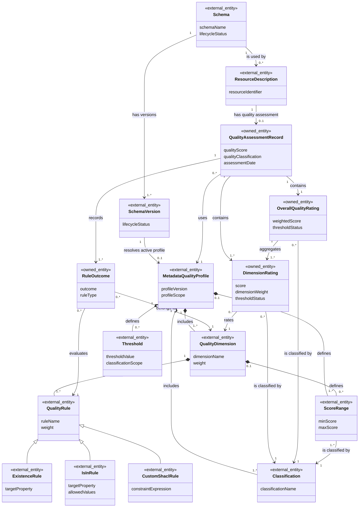

## Purpose

This document defines the Conceptual Data Model (CDM) for the Quality Scoring Service.

API definition: [openapi/tier2-gateway/t2-quality-scoring-service_openapi.yaml](../../../openapi/tier2-gateway/t2-quality-scoring-service_openapi.yaml)

Business scope included:
- Stateless validation of resource descriptions against the applicable metadata quality profile (dimensions, rules, thresholds, score ranges, and classifications governed and owned by Schema Manager).
- Quality Assessment Record (QAR) generation (rule outcomes, dimension ratings, overall rating).

### Service Boundary

Owned within Quality Scoring Service CDM boundary:
- QualityAssessmentRecord
- RuleOutcome
- DimensionRating
- OverallQualityRating

Referenced external concepts:
- Schema
- ResourceDescription (owned by Federated Catalogue; payload submitted for validation)
- SchemaVersion (owned by Schema Manager; used to resolve profile applicability)
- MetadataQualityProfile (owned by Schema Manager; referenced to determine the active profile for a schema)
- QualityDimension (owned by Schema Manager; groups quality rules in a profile)
- QualityRule and rule specializations (ExistenceRule, IsInRule, CustomShaclRule) (owned by Schema Manager; define profile evaluation criteria)
- Threshold (owned by Schema Manager; defines profile decision boundaries)
- ScoreRange (owned by Schema Manager; maps scores to classifications)
- Classification (owned by Schema Manager; labels quality outcomes)

### External Service Dependencies

| Service | Role |
|---|---|
| SchemaManager | Owns schemas and metadata quality profiles consumed during scoring. |
| FederatedCatalogue | Owns the ResourceDescription payload submitted for scoring and persists quality assessments. |

## CDM Traceability

### External CDMs referenced

| External CDM | Referenced concepts |
|---|---|
| [Federated Catalogue CDM](https://code.europa.eu/simpl/simpl-open/integration/resource-discovery/resource-catalogue/federated-catalogue/catalogue-be/-/blob/feature/add-cdm/documents/architecture/cdm/federated-catalogue-cdm.md?ref_type=heads) | ResourceDescription |
| [Schema Manager CDM](https://code.europa.eu/simpl/simpl-open/data/semantics-and-vocabulary/schema-management/schema-manager/schema-manager-be/-/blob/feature/add-cdm/documents/architecture/cdm/simpl-schema-manager-cdm.md?ref_type=heads) | Schema, SchemaVersion, MetadataQualityProfile, QualityDimension, QualityRule, ExistenceRule, IsInRule, CustomShaclRule, Threshold, ScoreRange, and Classification |

### CDMs referencing this CDM

| Referencing CDM | Referenced concepts from this CDM |
|---|---|
| [Query Mapper CDM](https://code.europa.eu/simpl/simpl-open/integration/resource-discovery/search-engine/catalogue-search/query-mapper-adapter-be/-/blob/feature/add-cdm/documents/architecture/cdm/query-mapper-cdm.md?ref_type=heads) | QualityAssessmentRecord for quality-filtered discovery |
| [Federated Catalogue CDM](https://code.europa.eu/simpl/simpl-open/integration/resource-discovery/resource-catalogue/federated-catalogue/catalogue-be/-/blob/feature/add-cdm/documents/architecture/cdm/federated-catalogue-cdm.md?ref_type=heads) | QualityAssessmentRecord for persisted catalogue quality assessments |
| [Search Client BE CDM](https://code.europa.eu/simpl/simpl-open/integration/resource-discovery/search-engine/catalogue-search/catalogue-client-be/-/blob/feature/add-cdm/documents/architecture/cdm/xfsc-advsearch-be.md?ref_type=heads) | QualityAssessmentRecord associated with a ResourceDescription in search results |
| [Schema Manager CDM](https://code.europa.eu/simpl/simpl-open/data/semantics-and-vocabulary/schema-management/schema-manager/schema-manager-be/-/blob/feature/add-cdm/documents/architecture/cdm/simpl-schema-manager-cdm.md?ref_type=heads) | The QualityScoringService component, referenced as the external service used by the metadata quality profile for scoring. |

## Conceptual Model

### State/value sets used in this model

- RuleOutcome.ruleType: EXISTENCE, IS_IN, CUSTOM_SHACL
- RuleOutcome.outcome: PASSED, FAILED
- DimensionRating.thresholdStatus: PASSED, FAILED
- OverallQualityRating.thresholdStatus: PASSED, FAILED
- Threshold.classificationScope: overall, dimension
- Schema.lifecycleStatus: PUBLISHED, REVOKED
- SchemaVersion.lifecycleStatus: PUBLISHED, REVOKED
- MetadataQualityProfile.profileScope: dynamically defined by the active MetadataQualityProfile (default bundled profile example: Offering)
- Classification.classificationName: dynamically defined by the active MetadataQualityProfile

## Concept descriptions

| Entity | Description | Ownership |
|---|---|---|
| Schema | A Resource Description Schema owned and managed by Schema Manager. It defines structural constraints and semantic rules for a specific resource type and is versioned through a PUBLISHED or REVOKED lifecycle. | Referenced (Schema Manager) |
| SchemaVersion | External schema reference used to resolve the applicable metadata quality profile by schema name; lifecycle status is managed in the Schema Manager domain. | Referenced |
| MetadataQualityProfile | Governance template defined and owned by Schema Manager; the Quality Scoring Service resolves the applicable profile instance for validation and scoring, but does not own the profile lifecycle itself. | Referenced |
| QualityDimension | Quality perspective owned by Schema Manager that groups rules and contributes weighted impact to the overall rating. | Referenced (Schema Manager) |
| QualityRule | Abstract quality expectation owned by Schema Manager and evaluated during validation. | Referenced (Schema Manager) |
| ExistenceRule | Schema Manager rule specialization requiring the target property path to be present. | Referenced (Schema Manager) |
| IsInRule | Schema Manager rule specialization requiring the target property path value to belong to an approved value set. | Referenced (Schema Manager) |
| CustomShaclRule | Schema Manager rule specialization expressed through a custom constraint expression. | Referenced (Schema Manager) |
| Threshold | Schema Manager decision boundary declared at profile level and scoped by classificationScope (overall or specific dimension). | Referenced (Schema Manager) |
| ScoreRange | Schema Manager score interval mapped to a Classification. Scope is determined by the owning relationship: profile-level ranges are defined directly by the MetadataQualityProfile, dimension-level ranges by a QualityDimension. | Referenced (Schema Manager) |
| Classification | Schema Manager quality label assigned from score ranges. Labels are dynamically defined by the active MetadataQualityProfile and are scoped (for example in the default bundled profile: dimension = Green/Yellow/Red, overall = Poor/Medium/Good). | Referenced (Schema Manager) |
| ResourceDescription | Resource description payload owned by Federated Catalogue and submitted for metadata quality assessment. | Referenced (Federated Catalogue) |
| QualityAssessmentRecord | Assessment artifact (report root) that references the profile and contains rule, dimension, and overall scoring outcomes. `qualityScore` is the overall numeric score, `qualityClassification` is the resulting profile-defined quality label, and `assessmentDate` is the date of the assessment. | Owned |
| RuleOutcome | Per-rule evaluation result for a specific validation execution. | Owned |
| DimensionRating | Aggregated dimension-level rating computed from rule outcomes, including thresholdStatus (PASSED/FAILED) when a dimension threshold is defined. | Owned |
| OverallQualityRating | Aggregated overall rating computed from weighted dimension ratings, including thresholdStatus (PASSED/FAILED) for publication gating. | Owned |

### Relationship Notes

- A SchemaVersion resolves the applicable MetadataQualityProfile by schema name.
- A MetadataQualityProfile includes one or more QualityDimension concepts.
- A MetadataQualityProfile defines zero or more Threshold entries and one or more profile-level ScoreRange entries; a QualityDimension may additionally define zero or more dimension-level ScoreRange entries.
- A QualityDimension groups one or more QualityRule concepts.
- QualityRule is specialized into ExistenceRule, IsInRule, and CustomShaclRule.
- Each ScoreRange is classified by exactly one Classification; each Classification classifies one or more ScoreRange entries. A range references a profile-owned label rather than owning it.
- Each ScoreRange is defined by exactly one of MetadataQualityProfile or QualityDimension, never both. The two optional owner multiplicities are mutually exclusive and collectively required.
- ScoreRange scope (profile-level or dimension-level) is determined by which concept defines it, not by an attribute on ScoreRange itself. Threshold scoping is driven by classificationScope (overall or a dimension).
- A ResourceDescription may be associated with at most one QualityAssessmentRecord carrying its overall quality score and classification.
- A QualityAssessmentRecord contains rule evaluations in parallel with dimension and overall ratings.
- A MetadataQualityProfile may be used by zero or more QualityAssessmentRecord entries. A QualityRule or QualityDimension may have zero or more RuleOutcome entries, and a QualityDimension may have zero or more DimensionRating entries.
- A Classification may classify zero or more DimensionRating entries and zero or more OverallQualityRating entries, subject to the applicable score-range scope. An overall-only label need not classify any DimensionRating.
- Each DimensionRating is mapped to one Classification and tied to one QualityDimension.
- Each OverallQualityRating aggregates one or more DimensionRating entries and is mapped to one Classification.
- DimensionRating and OverallQualityRating each carry thresholdStatus (PASSED/FAILED) when a corresponding threshold is defined.
- Overall thresholdStatus is PASSED only when the overall threshold condition is met and no dimension threshold status is FAILED.
- Threshold scoping rule: thresholds are declared at profile level and applied by classificationScope, where `overall` gates publication and a dimension gates that specific dimension.

## Assumptions and Open Questions

### Assumptions

- The [quality profile vocabulary](../../../quality-profile-model/metadata_quality_profile_vocabulary.ttl) and [SHACL shapes](../../../quality-profile-model/metadata_quality_profile.shacl.ttl) define profile concepts and validate profile structure, not assessment results. They specify no inverse result-count constraints for the six profile/rule/dimension/classification associations above. Their `0..*` result-side cardinalities express optional, repeatable use in this CDM, rather than a SHACL-enforced constraint. The [example profile](../../../quality-profile-model/example_mqp.ttl) distinguishes dimension-scoped and overall-scoped classifications.
- The active MetadataQualityProfile is resolved from the Schema Manager model using the schema's resource type and current published profile state.
- Classification labels, Thresholds, and score ranges are profile-defined and can vary by active profile, even though the model uses generic concepts.
- Thresholds and score ranges are evaluated by the Quality Scoring Service at validation time, they are stored in the `QualityAssessmentRecord`.
- Access-policy scoping is applied by the platform at the gateway layer using the participant identity in the access token; the CDM records only the interaction concept required for the quality scoring service domain.

## Alignment to API Endpoints

API definition: [openapi/tier2-gateway/t2-quality-scoring-service_openapi.yaml](../../../openapi/tier2-gateway/t2-quality-scoring-service_openapi.yaml)

| Endpoint | Concepts | Short Description |
|---|---|---|
| POST /qualityscoring/validate | Schema, ResourceDescription, MetadataQualityProfile, QualityDimension, QualityRule, RuleOutcome, DimensionRating, OverallQualityRating, Threshold, ScoreRange, Classification, QualityAssessmentRecord | Validates one resource description against the resolved metadata quality profile and returns a QAR graph containing rule-level and aggregated ratings. |

