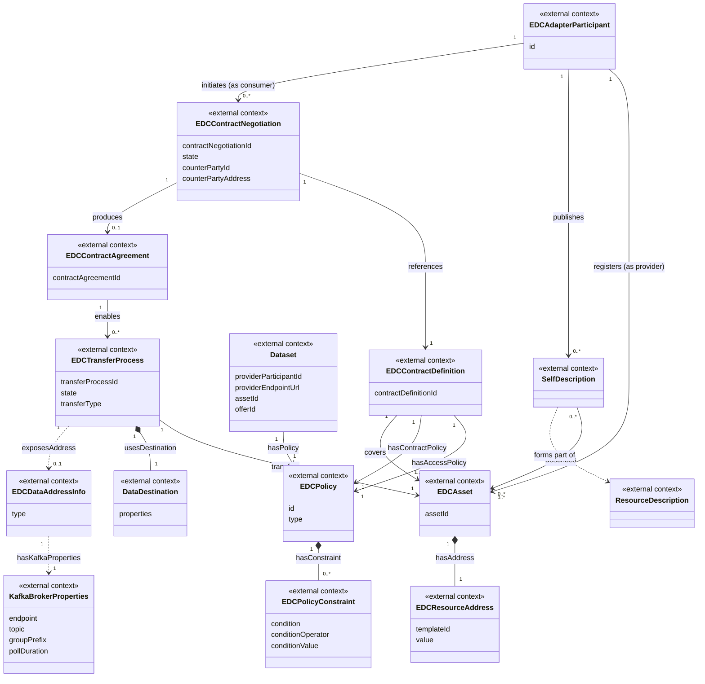

# Conceptual Data Model — EDC Connector Adapter

## 1. Purpose

The **EDC Connector Adapter** acts as a mediator between provider/consumer
applications and the underlying Eclipse Dataspace Components (EDC) Connector.
It abstracts the EDC protocol surface and exposes a stable, business-oriented
API that:

- publishes **Self-Descriptions** (`POST /selfDescriptions/enriched`), which as a side effect drives the EDC connector to register the underlying **Asset** and its physical address, define the **Policies**, and bind them into a **Contract Definition** — these are outbound calls this adapter makes *to* the EDC connector, not endpoints it exposes to its own callers,
- exposes the full **data-sharing lifecycle** as first-class endpoints: catalog lookup (`POST /connectorCatalog/assets`) → contract negotiation (`POST /contracts`, `GET /contracts/{contractNegotiationId}`) → transfer initiation and status (`POST /transfers`, `GET /transfers/{transferProcessId}`) → data address lookup for an already-started transfer (`GET /transfers/{transferProcessId}/dataAddress`) → resource address and participant configuration lookup (`GET /resourceAddresses/{assetId}`, `GET /configs/participant`).

The service API definition is split across two files: [v1](../../../openapi/openapi-edc-connector-adapter-v1.yaml), which holds all 9 operations above, and [v2](../../../openapi/openapi-edc-connector-adapter-v2.yaml), whose only path is `POST /selfDescriptions/enriched` (self-description registration is present in both files, deprecated in v1). `GET /transfers/{transferProcessId}/dataAddress` retrieves the Kafka broker connection details exposed by an already-started `KafkaBroker` transfer process. Its response schema `DataAddressInfo` is modeled under the conceptual name `EDCDataAddressInfo`, with `KafkaBrokerProperties` describing its connection properties (see §2's naming note).

> **Naming convention (see §8):** every class in this CDM that represents a **technical artefact actually registered in / mastered by the underlying EDC Connector runtime** is now prefixed `EDC` (e.g. `EDCAsset`, `EDCPolicy`, `EDCContractDefinition`) to avoid semantic collisions with the **business** concepts of the same name that may be authored upstream by other domains (SD Tooling, Provider, Federated Catalogue) and merely *registered into* the connector through this adapter. The real OpenAPI wire schema names are **unprefixed** (e.g. `Policy`, `ContractNegotiation`, `DataAddressInfo`) and are called out per class in §3/§5 — exactly as already done for `EDCAdapterParticipant` (wire schema `Participant`) before this revision. This is a purely conceptual/documentation rename; no code or contract changes are implied.

## CDM Traceability

### External CDMs referenced

| External CDM | Referenced concepts |
|---|---|
| [Federated Catalogue CDM](https://code.europa.eu/simpl/simpl-open/integration/resource-discovery/resource-catalogue/federated-catalogue/catalogue-be/-/blob/feature/add-cdm/documents/architecture/cdm/federated-catalogue-cdm.md?ref_type=heads) | ResourceDescription (owner — see Service Boundary) |
| [SD Tooling BE CDM](https://code.europa.eu/simpl/simpl-open/governance/resource-management/metadata-description/resource-description-tooling/sd-tooling-be/-/blob/feature/add-cdm/documents/architecture/cdm/sdtooling-api-be.md?ref_type=heads) | ResourceAddress, AccessPolicy, UsagePolicy (owner — see Service Boundary); ResourceDescription (authoring; ownership disputed with Federated Catalogue) |
| [SD Validation BE CDM](https://code.europa.eu/simpl/simpl-open/governance/resource-management/metadata-description/validation/validation-be/-/blob/feature/add-cdm/documents/architecture/cdm/sdtooling-validation-api-be.md?ref_type=heads) | SelfDescription (external Provider-composed document), ResourceDescription (containing catalogue concept) |
| [Contract Manager BE CDM](https://code.europa.eu/simpl/simpl-open/governance/contract-management/contract-lifecycle-management/contract-manager/contract-manager-be/-/blob/develop/documents/architecture/cdm/contract-cdm.md?ref_type=heads) | ContractAgreement (owner of the business contract, distinct from EDCContractAgreement) |

[catalogue-cdm]: https://code.europa.eu/simpl/simpl-open/integration/resource-discovery/resource-catalogue/federated-catalogue/catalogue-be/-/blob/feature/add-cdm/documents/architecture/cdm/federated-catalogue-cdm.md
[sd-tooling-cdm]: https://code.europa.eu/simpl/simpl-open/governance/resource-management/metadata-description/resource-description-tooling/sd-tooling-be/-/blob/feature/add-cdm/documents/architecture/cdm/sdtooling-api-be.md
[validation-cdm]: https://code.europa.eu/simpl/simpl-open/governance/resource-management/metadata-description/validation/validation-be/-/blob/feature/add-cdm/documents/architecture/cdm/sdtooling-validation-api-be.md
[contract-cdm]: https://code.europa.eu/simpl/simpl-open/governance/contract-management/contract-lifecycle-management/contract-manager/contract-manager-be/-/blob/develop/documents/architecture/cdm/contract-cdm.md

The EDC Connector runtime masters the connector-side concepts but has no separate CDM referenced here. The remote provider's catalog supplies Dataset; Consumer infrastructure supplies DataDestination. The linked CDMs identify upstream business owners and validation context. These systems are ownership contexts, not additional domain classes in this diagram. Peer CDMs reference this adapter-facing view without assigning ownership to the adapter.

### CDMs referencing this CDM

| Referencing CDM | Referenced relationship |
|---|---|
| [Contract Consumption BE CDM](https://code.europa.eu/simpl/simpl-open/integration/resource-sharing/resource-sharing-runtime/resource-consumption/contract-consumption-adapter-be/-/blob/feature/add-cdm/documents/architecture/cdm/contract-consumption-be.md?ref_type=heads) | EDCAdapterParticipant, EDCPolicy, EDCPolicyConstraint, EDCContractDefinition, EDCContractNegotiation, EDCContractAgreement, EDCTransferProcess, EDCDataAddressInfo, KafkaBrokerProperties (External — EDC Connector); Dataset (External — remote provider EDC); DataDestination (External — Consumer infrastructure) |
| [Asset Orchestrator CDM](https://code.europa.eu/simpl/simpl-open/data/supporting-data-services/data-orchestration/orchestration-platform/asset-orchestrator-be/-/blob/feature/add-cdm/documents/architecture/cdm/asset-orchestrator-cdm.md?ref_type=heads) | EDCTransferProcess triggers WorkflowRun (External — EDC Connector runtime; this CDM documents the adapter-facing view, not ownership) |

## 2. Service Boundary

> **Ownership (see §8):** the `EDC`-prefixed classes represent technical artefacts mastered by the underlying EDC Connector runtime, not this adapter. Their business sources are external: [SD Tooling BE][sd-tooling-cdm] owns `ResourceAddress`, `AccessPolicy` and `UsagePolicy`; [Federated Catalogue][catalogue-cdm] owns `ResourceDescription` and its publication lifecycle. `SelfDescription` follows the exact external concept in [SD Validation BE][validation-cdm]: a Provider-composed JSON-LD document that forms part of `ResourceDescription`. The business `ContractAgreement` owned by [Contract Manager BE][contract-cdm] is distinct from `EDCContractAgreement`. This adapter accepts the self-description and drives connector registration, negotiation and transfer without mastering those external concepts.

### Owned concepts

None. This adapter mediates external concepts; defining or reshaping an API response does not confer ownership.

### External references

| Concept | Owned by |
|---|---|
| EDCAdapterParticipant *(wire: `Participant`)* | EDC Connector — configured local connector participant identity, exposed by this adapter through `GET /configs/participant` |
| Dataset | Remote provider EDC — catalog offer passed through by this adapter |
| KafkaBrokerProperties | EDC Connector — Kafka transfer access data projected from the runtime's Endpoint Data Reference (EDR), not mastered by either adapter |
| EDCAsset *(wire: opaque `assetId` only, no named schema)* | EDC Connector — the technical registration record actually persisted in the connector once self-description publishing completes; the **business metadata** describing the asset (name, description, type) is authored upstream by the data owner via **SD Tooling**, not by this adapter or the connector itself (see §8) |
| EDCResourceAddress *(wire: `ResourceAddress`)* | EDC Connector — technical, stored location record registered from the business [ResourceAddress][sd-tooling-cdm] owned by SD Tooling BE |
| EDCPolicy *(wire: `Policy`)* / EDCPolicyConstraint *(wire: `PolicyConstraint`)* | EDC Connector — technical rule set and atomic constraints derived from [AccessPolicy and UsagePolicy][sd-tooling-cdm] owned by SD Tooling BE |
| EDCContractDefinition *(wire: opaque `contractDefinitionId` only, no named schema)* | EDC Connector — Management API artefact that binds EDCAsset(s) + access/contract EDCPolicy into an executable offer; registered as a side effect of self-description publishing, but mastered by the runtime, not this adapter (see §8) |
| EDCContractNegotiation *(wire: `ContractNegotiation`)* | EDC Connector — EDC/DSP process; state and lifecycle are maintained natively by the connector runtime's DSP state machine (see §8) |
| EDCContractAgreement *(wire: opaque `contractAgreementId` only, no named schema)* | EDC Connector — the operational artefact produced when a negotiation finalizes; distinct from the business [ContractAgreement][contract-cdm] owned by Contract Manager BE. This adapter relays the opaque `contractAgreementId` assigned by the connector (see §8) |
| EDCTransferProcess *(wire: `TransferProcess`)* | EDC Connector — technical transfer process executed and persisted by the connector runtime (see §8) |
| EDCDataAddressInfo *(wire: `DataAddressInfo`)* | EDC Connector — technical/runtime access information; a projection of the connector's Endpoint Data Reference (EDR), not mastered by this adapter (see §8) |
| [SelfDescription][validation-cdm] | External — Provider-composed document, authored through SD Tooling and validated by SD Validation; part of ResourceDescription, not mastered by this adapter |
| [ResourceDescription][catalogue-cdm] | Federated Catalogue — overarching catalogue concept; authored through SD Tooling. SD Tooling's CDM records an ownership conflict with Federated Catalogue (see §8) |
| [ResourceAddress][sd-tooling-cdm] | SD Tooling BE — business source of EDCResourceAddress |
| [AccessPolicy][sd-tooling-cdm] / [UsagePolicy][sd-tooling-cdm] | SD Tooling BE — business sources of EDCPolicy and its constraints |
| [ContractAgreement][contract-cdm] | Contract Manager BE — business contract, referenced to distinguish it from EDCContractAgreement; no direct integration implied |
| DataDestination | Consumer infrastructure — caller-supplied destination parameters; neither adapter owns the destination by validating or relaying them |

---

## 3. Conceptual Model

*All classes below are marked `<<external context>>`: this adapter owns none of them. `KafkaBrokerProperties` represents EDC Connector access data, not adapter-owned domain data. `SelfDescription` and its containing `ResourceDescription` follow the external concepts in [SD Validation BE][validation-cdm], without adding attributes. DataDestination is the caller-supplied transfer destination. The business sources ResourceAddress, AccessPolicy, UsagePolicy and ContractAgreement are identified in §2 and CDM Traceability rather than duplicated as diagram classes. §5 describes exactly the classes shown here.*

*Relationships instead of duplicate attributes:* Dataset.policy is represented only by hasPolicy, EDCPolicy.policyConstraints only by hasConstraint, and EDCDataAddressInfo.properties only by hasKafkaProperties. The wire fields remain unchanged. SelfDescription has no attributes; its publication and described-resource relationships are shown only as associations.

*Note on DataDestination:* `POST /transfers` requires `dataDestination` in TransferRequest. It contains caller-supplied destination parameters, represented as properties rather than invented schema fields. The `usesDestination` association replaces the redundant dataDestinationRef attribute. Its composition describes the embedded transfer configuration, not adapter ownership of Consumer infrastructure.

*Note on data-address schema coverage:* `DataAddressInfo.properties` references `KafkaBrokerProperties`, which extends `DataAddressProperties`. The Kafka class retains the schema names `endpoint`, `topic`, `groupPrefix` and `pollDuration`, not the example's `bootstrapServers`. The security fields `accessToken`, `accessTokenExpiresIn`, `saslMechanism` and `securityProtocol` are intentionally omitted from the conceptual model under the CDM guidelines: no explicit business value is established for them here. The inherited, write-only `transferTypeDestination` is also omitted as technical routing data. This is a conceptual subset of the schema, not its complete wire shape; the API contract is unchanged.

*Note on `EDCAdapterParticipant` and roles:* the local `EDCAdapterParticipant` (returned by `GET /configs/participant`) is a single connector deployment that can act as provider (`registers` EDCAssets) in one interaction and as consumer (`initiates` EDCContractNegotiations) in another — `PartyRole` (§4) describes the role assumed *per interaction*, not a fixed attribute of `EDCAdapterParticipant`, which is why the class no longer carries a static `role` field (also absent from the real `Participant` schema, which has only `id`). The **remote counterparty** on the other side of a negotiation or catalog offer is intentionally *not* modeled as a second `EDCAdapterParticipant` instance — this adapter does not master its identity or lifecycle — but its reference is now captured inline where the real API carries it: `EDCContractNegotiation.counterPartyId` / `counterPartyAddress`, and `Dataset.providerParticipantId` / `providerEndpointUrl`. See §8 for the reconciliation of this gap.

*Note on `EDCResourceAddress` and `EDCPolicyConstraint` field names:* both classes now use the exact wire attribute names from the OpenAPI contract rather than a paraphrased/idealized shape. `EDCResourceAddress.value` (wire: `ResourceAddress.value`) is an opaque, type-dependent **serialized JSON string** (e.g. `{"type":"MinioS3","endpoint":...,"bucketName":...,"objectName":...}` for a Minio S3 address) keyed by `templateId`, not a structured `baseUrl`/`authType`/`properties` triple — the connection details only become a typed object after the caller parses `value` according to the template it references. Similarly, `EDCPolicyConstraint`'s three fields are literally named `condition`/`conditionOperator`/`conditionValue` in the contract (wire schema `PolicyConstraint`), not the more ODRL-idiomatic `leftOperand`/`operator`/`rightOperand`. See §8 for the reconciliation of this gap.

*Note on schema coverage:* named API schemas are the source for the retained attributes of EDCAdapterParticipant (wire: Participant), EDCResourceAddress (ResourceAddress), EDCPolicyConstraint (PolicyConstraint), EDCPolicy (Policy), EDCContractNegotiation (ContractNegotiation), EDCTransferProcess (TransferProcess) and Dataset. These are conceptual subsets, not complete wire shapes. EDCAsset, EDCContractDefinition and EDCContractAgreement have no named API schema and retain only the assetId, contractDefinitionId and contractAgreementId references actually exchanged by the contract; no additional attributes are inferred. Negotiation and transfer identifiers conceptually name the wire @id (§5). No creation timestamp is interpreted as a start event. SelfDescription and ResourceDescription remain attribute-free external CDM references; POST /selfDescriptions/enriched exchanges free-form JSON-LD.

*Note on `EDCContractAgreement`'s ownership:* `EDCContractAgreement` is an external, pass-through EDC/DSP artefact mastered by the EDC Connector runtime. `GET /contracts/{contractNegotiationId}` surfaces its opaque `contractAgreementId`. It is distinct from [ContractAgreement][contract-cdm], the business contract owned by Contract Manager BE, whose CDM includes consumer/provider signature dates and contract status. Referencing that business concept does not imply a direct Contract Manager integration or an API mapping between the two agreements.

*Note on `EDCContractDefinition`, `EDCContractNegotiation` and `EDCTransferProcess` ownership (revised):* these three, along with `EDCDataAddressInfo`, were previously classified **Owned** by this adapter (unprefixed). On review they are EDC/DSP protocol and EDC Management API artefacts whose state and identity are created and persisted **natively by the underlying EDC Connector runtime** — this adapter only drives them (registers an `EDCContractDefinition` as a side effect of self-description publishing; initiates/polls an `EDCContractNegotiation`; starts/polls an `EDCTransferProcess`) without mastering their data. All four are now classified **External — EDC Connector**, consistent with `Dataset` and `EDCContractAgreement`'s existing pass-through treatment; see §2 and §8.

*Note on business sources:* [SD Tooling BE][sd-tooling-cdm] owns `ResourceAddress`, `AccessPolicy` and `UsagePolicy`. These are the business sources of the connector's `EDCResourceAddress`, `EDCPolicy` and `EDCPolicyConstraint`, not alternative names for those runtime artefacts. [SD Validation BE][validation-cdm] references `SelfDescription` as a Provider-composed document forming part of `ResourceDescription`; the latter's catalogue lifecycle is owned by [Federated Catalogue][catalogue-cdm]. This adapter accepts the document for connector registration and does not own its authoring, validation or catalogue lifecycle.

*Note on `EDCContractDefinition`'s removed FK-style attributes:* `accessPolicyId`, `contractPolicyId`, and `assetIds` were dropped from the class box because they only restated, as plain string/ID attributes, information already expressed by the named associations drawn from `EDCContractDefinition` (`hasAccessPolicy` → `EDCPolicy`, `hasContractPolicy` → `EDCPolicy`, `covers` → `EDCAsset`). In a conceptual model the association *is* the relationship; carrying the same fact a second time as a foreign-key-shaped attribute is redundant and belongs in a logical/physical data model, not here. `EDCContractDefinition` is therefore left with only its identifying `contractDefinitionId`; see §8.

*Note on Dataset's attributes:* providerParticipantId, providerEndpointUrl, assetId and offerId come from the Dataset schema. Its embedded wire policy is expressed only by the Dataset → EDCPolicy hasPolicy association, not duplicated as a class attribute.

*Note on notation — no implementation types/markers, and identifiers named for what they designate:* attributes are now listed as bare names, without a UML `+` visibility marker or an implementation type (`String`, `Instant`, `List~T~`, `Object`, `Map~K,V~`, or an enum type) — this is a conceptual model, not a logical/physical one, and typing belongs to the latter; the enums that used to be inlined as types (`OfferingType`, `PolicyType`, `NegotiationState`, `TransferState`) remain fully documented in §4 and still apply to the identically-named attribute, just without repeating the type annotation on the attribute itself. Separately, generic `id` attributes have been renamed to match what the contract actually calls each identifier, wherever that could be verified or reasonably inferred: `EDCAsset.id → assetId`, `EDCContractDefinition.id → contractDefinitionId`, `EDCContractNegotiation.id → contractNegotiationId`, `EDCContractAgreement.id → contractAgreementId`, `EDCTransferProcess.id → transferProcessId` (all consistent with how these same identifiers are named everywhere else they appear on the wire — e.g. `ContractNegotiationRequest.assetId`/`contractDefinitionId`, the `ContractNegotiationId`/`TransferProcessId` wrapper schemas, and the `{contractNegotiationId}`/`{transferProcessId}` path parameters — even though the raw `ContractNegotiation`/`TransferProcess` response schemas literally key it as `@id`, a JSON-LD-style field name kept out of this conceptual model as an implementation detail). `EDCAdapterParticipant.id` and `EDCPolicy.id` were left as `id`, since that is literally the field name the contract uses for both. Finally, the relationship labels have been normalized to a single convention — active, present-tense verb phrases read source→target (`hasAddress`, `hasConstraint`, `hasPolicy`, `references`, `produces`, `enables`, `exposesAddress`, `hasKafkaProperties`, alongside the already-active `registers`/`publishes`/`advertises`/`covers`/`initiates`/`transfers`) — replacing the previous mix of passive/participial forms (`locatedAt`, `constrainedBy`, `basedOn`, `resultsIn`, `enabledBy`). The `EDCDataAddressInfo → KafkaBrokerProperties` edge's applicability condition (`type = KafkaBroker`) has moved from the edge label into this note, keeping every label a plain verb phrase. See §8 for the full reconciliation.

---

## 4. State / Value Sets

### `OfferingType`
| Value | Meaning |
|---|---|
| `APPLICATION` | A software service offered via API |
| `DATA` | A static or streaming dataset |
| `INFRASTRUCTURE` | A compute or storage resource |

### `PolicyType`
| Value | Meaning |
|---|---|
| `ACCESS` | Controls who may see/query the asset |
| `USAGE` | Controls how the asset may be used after transfer |

### `NegotiationState`
EDCContractNegotiation.state is an unconstrained string in the contract, not an enum. Its only negotiation example uses `CONFIRMED`, which is absent from the eight values below. This list describes illustrative EDC lifecycle states, matching the Contract Consumption CDM; it is not a closed set of API values. The contract/example discrepancy remains unresolved.

| Value | Meaning |
|---|---|
| `INITIAL` | Negotiation created, not yet sent |
| `REQUESTED` | Offer sent to counterparty |
| `OFFERED` | Counter-offer received |
| `ACCEPTED` | Both parties agreed |
| `AGREED` | Agreement signed |
| `VERIFIED` | Agreement verified by both connectors |
| `FINALIZED` | Negotiation completed |
| `TERMINATED` | Negotiation ended without agreement |

### `TransferState`
EDCTransferProcess.state is also an unconstrained string in the contract. The lifecycle states below are illustrative, not an exhaustive API enum.

| Value | Meaning |
|---|---|
| `INITIAL` | Transfer created |
| `PROVISIONING` | Resources being allocated |
| `PROVISIONED` | Resources ready |
| `REQUESTING` | Transfer request sent |
| `REQUESTED` | Request acknowledged |
| `STARTED` | Data flow active |
| `SUSPENDED` | Transfer paused |
| `COMPLETING` | Finalizing handshake |
| `COMPLETED` | Data received successfully |
| `TERMINATING` | Abort in progress |
| `TERMINATED` | Transfer ended without completion |

### `DataAddressInfoType`
EDCDataAddressInfo.type is an unconstrained string, not an enum. The data-address response example provides the following value; additional values are not ruled out by the schema.

| Value | Meaning |
|---|---|
| `KafkaBroker` | Kafka transfer access data, represented by the KafkaBrokerProperties association |

### `TransferType`
EDCTransferProcess.transferType retains the wire TransferProcess.transferType field because transfer mode determines data-plane selection and push/pull behavior. The schema leaves it as an open string, not an enum. [EDC's transfer-type decision record](https://github.com/eclipse-edc/Connector/blob/v0.17.0/docs/developer/decision-records/2023-11-20-transfer-type/README.md) distinguishes transfer type from DataAddress.type; its [parser](https://github.com/eclipse-edc/Connector/blob/v0.17.0/core/control-plane/control-plane-transfer/src/main/java/org/eclipse/edc/connector/controlplane/transfer/flow/TransferTypeParserImpl.java) uses `<destinationType>-<PUSH|PULL>`, optionally followed by a response-channel type.

The adapter's [transfer implementation](../../../src/main/java/eu/europa/ec/simpl/edcconnectoradapter/service/consumer/transferprocess/TransferProcessServiceImpl.java) derives the following values from the caller's dataDestination.type; these are implementation rules, not a closed API enum:

| Value / pattern | Meaning |
|---|---|
| `KafkaBroker-PULL` | Selected when dataDestination.type is KafkaBroker; the outbound EDC request omits dataDestination, and the consumer obtains connection information through the EDR |
| `<destinationType>-PUSH` | Selected for other destination types; the outbound EDC request carries the destination parameters |

**Three distinct type fields:** transferType describes destination kind plus flow direction. TransferProcess.type is the local process role (`CONSUMER` or `PROVIDER`), as defined by [EDC TransferProcess](https://github.com/eclipse-edc/Connector/blob/v0.17.0/spi/control-plane/transfer-spi/src/main/java/org/eclipse/edc/connector/controlplane/transfer/spi/types/TransferProcess.java) and used by connector-be's [TransferListener](https://code.europa.eu/simpl/simpl-open/integration/resource-sharing/resource-sharing-runtime/connector/connector-be/-/blob/develop/src/main/java/eu/europa/ec/simpl/transferprocess/listener/TransferListener.java) and [TransferPendingGuard](https://code.europa.eu/simpl/simpl-open/integration/resource-sharing/resource-sharing-runtime/connector/connector-be/-/blob/develop/src/main/java/eu/europa/ec/simpl/transferprocess/listener/TransferPendingGuard.java). DataAddressInfo.type is instead copied from the EDR's transferTypeDestination (KafkaBroker for the Kafka case). The adapter preserves transferType and process type separately in [ModelUtil](../../../src/main/java/eu/europa/ec/simpl/edcconnectoradapter/util/ModelUtil.java); they must not be equated.

### `PartyRole`
*Describes the role a local `EDCAdapterParticipant` assumes **per interaction** — e.g. it registers EDCAssets while acting as `PROVIDER` and initiates EDCContractNegotiations while acting as `CONSUMER` — not a fixed, permanent attribute of the `EDCAdapterParticipant` record itself (see the note under §3's diagram).*

| Value | Meaning |
|---|---|
| `PROVIDER` | Exposes assets and accepts negotiations |
| `CONSUMER` | Discovers, negotiates, and receives data |

---

## 5. Concept Descriptions

| Entity | Description | Ownership |
|---|---|---|
| **EDCAdapterParticipant** | The local connector's configured participant identity, capable of acting as provider or consumer per interaction (§4). The wire Participant schema defines only id, so no connector URL attribute is modeled. Remote counterparty references remain inline on Dataset and EDCContractNegotiation. | External — EDC Connector |
| **EDCAsset** | The connector's registration record for a shared resource. No named Asset schema or owner CDM is available; only assetId is retained, sourced from Dataset and contract-negotiation request fields. The diagram does not infer descriptive metadata for this external concept. | External — EDC Connector |
| **EDCResourceAddress** | The technical, template-keyed location record used to retrieve the asset payload, expressed as `templateId` plus a template-specific serialized JSON `value` string (§3). Registered from the business [ResourceAddress][sd-tooling-cdm] owned by SD Tooling BE. *Wire schema: `ResourceAddress`.* | External — EDC Connector |
| **EDCPolicy** | The connector's ODRL-aligned rule set, carried as `{id, type, policyConstraints}`. Its business sources are [AccessPolicy and UsagePolicy][sd-tooling-cdm], owned by SD Tooling BE. ODRL JSON-LD is carried separately in the free-form `sdJson` payload of `POST /selfDescriptions/enriched`. *Wire schema: `Policy`.* | External — EDC Connector |
| **EDCPolicyConstraint** | An atomic constraint within EDCPolicy, carried as `condition`, `conditionOperator` and `conditionValue`. Its business terms originate in [AccessPolicy and UsagePolicy][sd-tooling-cdm]. *Wire schema: `PolicyConstraint`.* | External — EDC Connector |
| **EDCContractDefinition** | Binds one or more EDCAssets to an access policy and a contract policy, forming an offering unit — expressed purely through the `hasAccessPolicy`/`hasContractPolicy`/`covers` associations (§3), with no separate FK-style attributes duplicating them (see §8). An artefact of the **EDC Management API**, registered as a side effect of self-description publishing but mastered by the connector runtime, not by this adapter (revised — see §8). ⚠ *Conceptual — no named schema exists for `ContractDefinition`/`EDCContractDefinition` in the contract (see §3 note); the API only exchanges its opaque `contractDefinitionId`.* | External — EDC Connector (see §2, §8) |
| **Dataset** | A remote asset offer discovered in a provider catalog during a catalog request, identified by `assetId`/`offerId` and carrying an embedded `policy` (the terms under which it is offered) plus `providerParticipantId`/`providerEndpointUrl` as an inline reference to the remote counterparty (see §3 note) — without this adapter mastering that counterparty's own EDCAdapterParticipant record. | External — Remote provider EDC (pass-through) |
| **[SelfDescription][validation-cdm]** | A Provider-composed JSON-LD document representing a Resource Description, following the exact external concept in SD Validation BE. It forms part of ResourceDescription and is submitted to this adapter for connector registration. No attributes are added here: the referenced CDM defines none. `POST /selfDescriptions/enriched` exchanges free-form JSON-LD. | External — Provider-composed; authored through SD Tooling |
| **[ResourceDescription][catalogue-cdm]** | The overarching catalogue concept combining a Self-Description and a Resource Address, as described by SD Validation BE. SD Tooling describes it as the provider's self-description of a data, application or infrastructure resource to be published in the federated catalogue. Referenced without attributes here. | External — Federated Catalogue; SD Tooling ownership conflict noted in §8 |
| **EDCContractNegotiation** | Runtime negotiation carrying state and inline counterPartyId/counterPartyAddress references. contractNegotiationId is the conceptual name for wire @id, also used in the ID wrapper and path parameter. Wire ContractNegotiation.createdAt is creation metadata, not evidence of a start event, and is omitted rather than renamed. | External — EDC Connector |
| **EDCContractAgreement** | Runtime agreement surfaced only as contractAgreementId on the ContractNegotiation status response; only this reference is modeled because no named agreement schema or owner CDM supplies further attributes. Distinct from the business [ContractAgreement][contract-cdm] owned by Contract Manager BE. | External — EDC Connector (pass-through) |
| **EDCTransferProcess** | Runtime transfer carrying state and the schema's transferType, retained to describe transfer mode and its relevance to address availability (§4). transferProcessId conceptually names wire TransferProcess.@id, also used in the ID wrapper and path parameter. No start-event attribute is declared; destination configuration is expressed by the DataDestination association. | External — EDC Connector |
| **DataDestination** | Caller-supplied parameters identifying the consumer-side sink, required as dataDestination in POST /transfers. Embedded in the transfer configuration; validation or relay does not confer ownership on either adapter. | External — Consumer infrastructure |
| **EDCDataAddressInfo** | The runtime data address (type + properties) exposing where/how to reach the transferred data once an EDCTransferProcess is active. A **projection** of the connector runtime's Endpoint Data Reference (EDR), not an entity mastered by this adapter (revised — see §8). *Wire schema in released v1: `DataAddressInfo`.* | External — EDC Connector (see §2, §8) |
| **KafkaBrokerProperties** | Kafka transfer access data carried in EDCDataAddressInfo.properties when type is KafkaBroker, sourced from the EDC Connector's EDR. The conceptual subset comprises endpoint, topic, groupPrefix and pollDuration, using the schema's names. Security and technical routing fields are omitted (§3). Reshaping this data for an API response does not make it adapter-owned. | External — EDC Connector |

---

## 6. Relationship Notes

| Relationship | Cardinality | Business Meaning |
|---|---|---|
| EDCAdapterParticipant → EDCAsset | 1 : 0..* | A participant, while acting as provider (`PartyRole = PROVIDER`), registers zero or more assets; an asset belongs to exactly one participant. Both the asset's business metadata (SD Tooling) and its technical registration (EDC Connector) are external to this adapter — see §8. |
| EDCAsset ◆→ EDCResourceAddress | 1 : 1 | Every asset has exactly one physical address; the address has no meaning without its asset (composition). Both are EDC-Connector-mastered technical records, originally authored upstream by SD Tooling (see §8). |
| EDCPolicy ◆→ EDCPolicyConstraint | 1 : 0..* | A policy may carry zero or more constraints: `policyConstraints` has no `minItems`, and the catalog example returns `policyConstraints: []`. Each constraint belongs to its policy; both are EDC-Connector-mastered technical records derived from SD Tooling's business policies. |
| EDCContractDefinition → EDCPolicy (access) | 1 : 1 | Each definition references one access policy. |
| EDCContractDefinition → EDCPolicy (contract) | 1 : 1 | Each definition references one contract/usage policy (may be the same EDCPolicy instance). |
| EDCContractDefinition → EDCAsset | 1 : 1..* | A definition covers at least one asset; assets may appear in multiple definitions. |
| EDCAdapterParticipant → SelfDescription | 1 : 0..* | A participant may publish zero or more Provider-composed self-descriptions, authored through SD Tooling rather than this adapter. |
| SelfDescription → EDCAsset | 0..* : 0..* | The submitted document describes the provider's registered assets, not datasets discovered from a remote provider catalog. This conceptual relationship does not assume a resource-ID attribute in the source CDM. |
| SelfDescription ⇢ ResourceDescription | Not specified by source CDM | A SelfDescription forms part of ResourceDescription, following the dependency in [SD Validation BE][validation-cdm]; no multiplicity or source attributes are invented here. |
| Dataset → EDCPolicy | 1 : 1 | Each catalog offer embeds exactly one policy, the terms under which the remote provider is offering that `assetId`/`offerId`; see §8 for the correction that added this. |
| EDCContractNegotiation → EDCContractDefinition | 1 : 1 | Every negotiation is anchored to one contract definition; both are EDC-runtime-mastered artefacts this adapter drives but does not persist (see §8). |
| EDCContractNegotiation → EDCContractAgreement | 1 : 0..1 | A finalized negotiation produces exactly one agreement, mastered by the **EDC Connector** runtime itself (see §8, revised from a prior "Contract Manager" assumption); terminated negotiations produce none. |
| EDCContractAgreement → EDCTransferProcess | 1 : 0..* | An agreement, mastered by the EDC Connector runtime, may authorize zero or more transfer processes (e.g., partial or retry transfers). |
| EDCAdapterParticipant → EDCContractNegotiation | 1 : 0..* | A participant, while acting as consumer (`PartyRole = CONSUMER`), initiates negotiations; a participant tracks all negotiations it is party to. The negotiation's counterparty (remote provider) is referenced inline via `counterPartyId`/`counterPartyAddress`, not as a second `EDCAdapterParticipant` relationship — see §8. |
| EDCTransferProcess → EDCAsset | 1 : 1 | Each transfer moves exactly one asset. |
| EDCTransferProcess ◆→ DataDestination | 1 : 1 | Each transfer request supplies one destination configuration (`TransferRequest.dataDestination` is required). The parameters belong to Consumer infrastructure and are embedded in the transfer payload, not mastered by this adapter. |
| EDCTransferProcess ⇢ EDCDataAddressInfo | 1 : 0..1 | Runtime address information is retrieved from the connector's stored EDR. KafkaBroker-PULL is the adapter's Kafka transfer mode; the returned address kind is KafkaBroker, not the process role. The contract's not-started/non-Kafka 409 wording is not explicitly enforced by the inspected implementation (§4). |
| EDCDataAddressInfo ⇢ KafkaBrokerProperties | 1 : 1 | For KafkaBroker, properties exposes Kafka access data provided by the EDC Connector. The conceptual subset retains endpoint, topic, groupPrefix and pollDuration; security information is not modeled. Individual fields are not declared required by the schema. |

---

## 7. Alignment to API Endpoints

*This table lists only the operations this service itself exposes (per its own OpenAPI contracts, §1) — not the outbound EDC Management API calls it makes as a client (see §8 for that distinction and the verification behind this table).*

| HTTP Method & Path | Primary Concept(s) Touched | Operation |
|---|---|---|
| `POST /v1/selfDescriptions/enriched` *(deprecated)* | SelfDescription | Accept an SD-Tooling-authored Self-Description; as a side effect, registers the underlying EDCAsset/EDCResourceAddress, EDCPolicy/EDCPolicyConstraint, and EDCContractDefinition into the EDC connector (v1, `deprecated: true` in the contract) |
| `POST /v2/selfDescriptions/enriched` | SelfDescription | Accept an SD-Tooling-authored Self-Description; same side effects as the v1 operation above (current, non-deprecated version) |
| `POST /v1/connectorCatalog/assets` | Dataset, EDCPolicy | Search the provider's catalog for offers matching an asset/contract-definition filter (`searchCatalogOffers`) |
| `POST /v1/contracts` | EDCContractNegotiation | Initiate a contract negotiation for a selected catalog offer (`startContractNegotiation`) |
| `GET /v1/contracts/{contractNegotiationId}` | EDCContractNegotiation, EDCContractAgreement | Poll negotiation status; once finalized, the response's `contractAgreementId` field surfaces the resulting agreement, mastered by the **EDC Connector** runtime (`getContractNegotiationStatus`) |
| `POST /v1/transfers` | EDCTransferProcess, EDCContractAgreement, DataDestination | Start a data transfer for a negotiated contract using the required caller-supplied destination parameters (`startTransfer`) |
| `GET /v1/transfers/{transferProcessId}` | EDCTransferProcess | Poll transfer process status (`getTransferStatus`) |
| `GET /v1/transfers/{transferProcessId}/dataAddress` | EDCTransferProcess, EDCDataAddressInfo, KafkaBrokerProperties | Retrieve runtime address information from the EDR (`getTransferDataAddress`). The contract documents 200, 404 for an unknown process and 409 for not-started/non-Kafka transfers; implementation instead resolves the EDR, returns generic unknown address kinds, and maps an EDR ObjectNotFound to 404. The documented gate and process-not-found interpretation require reconciliation (§4). |
| `GET /v1/resourceAddresses/{assetId}` | EDCAsset, EDCResourceAddress | Retrieve the resource address registered for an asset (`getResourceAddress`) |
| `GET /v1/configs/participant` | EDCAdapterParticipant | Retrieve the configured EDC participant, used as the ODRL assigner (`getParticipant`) |

---

## 8. Assumptions and Open Questions

- **Open contract inconsistency:** the `kafkaDataAddress` response example uses `bootstrapServers`, although the `KafkaBrokerProperties` schema declares `endpoint`. This CDM follows the schema; the example needs correction in the API contract.
- **Ownership hypothesis validated (round 1) — EDC/DSP protocol artefacts are EDC Connector runtime data, not adapter- or service-owned.** `ContractDefinition`, `ContractNegotiation`, `TransferProcess` and `DataAddressInfo` were previously declared **Owned** by this adapter; `ContractAgreement` was already External but attributed to an assumed external **Contract Manager**. On review: all five are EDC/DSP protocol and EDC Management API artefacts whose identity, state and lifecycle are created and persisted **natively by the EDC Connector runtime**. This adapter drives them but masters none of their data. All five are now classified **External — EDC Connector**, consistent with `Dataset`'s existing pass-through treatment, and renamed with an `EDC` prefix (see the dedicated naming bullet below). This also resolves the "dual-tracking" footnote previously shared with the Contract Consumption BE CDM: both CDMs now agree on a single true owner, the EDC Connector runtime.
- **External sources of truth:** [SD Tooling BE][sd-tooling-cdm] owns `ResourceAddress`, `AccessPolicy` and `UsagePolicy`; their technical connector representations remain `EDCResourceAddress`, `EDCPolicy` and `EDCPolicyConstraint`. `SelfDescription` reuses the exact external name and attribute-free shape from [SD Validation BE][validation-cdm], including its relationship to `ResourceDescription`. Resource Description is a concept, not a separate service.
- **ResourceDescription ownership conflict in source CDMs:** [Federated Catalogue][catalogue-cdm] lists `ResourceDescription` as owned and exposes its lifecycle through `/self-descriptions`. [SD Tooling BE][sd-tooling-cdm] describes provider-side authoring but records an unresolved ownership conflict with Federated Catalogue. This adapter references the catalogue concept without adding attributes or claiming ownership; resolution of the upstream conflict remains with those domains.
- **Naming convention:** the `EDC` prefix distinguishes connector-side artefacts from upstream business concepts: EDCAsset, EDCResourceAddress, EDCPolicy, EDCPolicyConstraint, EDCContractDefinition, EDCContractNegotiation, EDCContractAgreement, EDCTransferProcess and EDCDataAddressInfo. Wire schema names are unchanged. KafkaBrokerProperties retains its shared schema name in both adapter CDMs, but is External — EDC Connector; its lack of a prefix does not imply adapter ownership.
- **Contract agreement distinction:** `EDCContractAgreement` denotes the EDC/DSP runtime artefact surfaced as `contractAgreementId`; [ContractAgreement][contract-cdm] denotes the business contract owned by Contract Manager BE. Both exist and have different owners. No direct integration or mapping between them is established by this adapter's API.
- **Dataset ownership:** Dataset is listed only as External, owned by the remote provider EDC. Defining its pass-through response does not confer ownership on this adapter.
- **`ODRL Policy Document` reference corrected:** previously described as referenced by `Policy.odrlExpression`, a field this same document's §3 note states was removed from the `Policy`/`EDCPolicy` schema (`{id, type, policyConstraints}`). Corrected in §5 to point to the free-form `sdJson` payload of `POST /selfDescriptions/enriched`, the actual carrier of the ODRL expression.
- **Participant ownership and naming:** both adapter CDMs use `EDCAdapterParticipant` for the configured local connector identity, owned by the EDC Connector runtime. The wire schema remains `Participant`; the adapter's `GET /configs/participant` exposes this identity without mastering it. Remote provider references are represented inline rather than conflated with the local connector.
- **`EDCAdapterParticipant` and remote counterparty:** the local `EDCAdapterParticipant` has no static `role` attribute; `PartyRole` (§4) is assumed per interaction, not stored. The remote counterparty in a negotiation or catalog offer is not modelled as a second `EDCAdapterParticipant` instance — this adapter does not master its identity — but is captured inline via `EDCContractNegotiation.counterPartyId`/`counterPartyAddress` and `Dataset.providerParticipantId`/`providerEndpointUrl`.
- **`EDCResourceAddress.value` and `EDCPolicyConstraint` fields use wire-verified names, not idealized ones:** `EDCResourceAddress.value` is an opaque, template-typed serialized JSON string, not a structured `baseUrl`/`authType`/`properties` triple; `EDCPolicyConstraint` fields are literally `condition`/`conditionOperator`/`conditionValue` on the wire, not the more ODRL-idiomatic `leftOperand`/`operator`/`rightOperand`.
- **External attribute sources:** EDCAsset, EDCContractDefinition and EDCContractAgreement retain only identifier references exchanged by the contract, not inferred metadata. EDCAdapterParticipant retains only the Participant schema's id. No negotiation creation timestamp is relabeled as a start event, and no transfer start timestamp is invented. DataDestination is expressed by an association rather than a redundant reference attribute. Retained identifier naming and omissions are explained in §5.
- **`EDCContractDefinition`'s FK-style attributes removed:** `accessPolicyId`, `contractPolicyId` and `assetIds` were dropped since they only restated, as attributes, facts already expressed by the `hasAccessPolicy`/`hasContractPolicy`/`covers` associations in §3.
- **Relationship-only representation:** Dataset's embedded policy, EDCPolicy's constraints and EDCDataAddressInfo's Kafka properties are expressed by hasPolicy, hasConstraint and hasKafkaProperties, without duplicate attributes. SelfDescription remains attribute-free. These are conceptual modeling changes, not wire-schema changes.
- **EDR projection ownership:** EDCDataAddressInfo and KafkaBrokerProperties represent access data from the EDC Connector's runtime EDR. Both are External — EDC Connector in both adapter CDMs; API projection or relay does not establish a second owner. The security fields omitted in §3 remain API concerns, not conceptual attributes.
- **Shared concepts have one owner:** EDCAdapterParticipant, EDCPolicy, EDCPolicyConstraint, EDCContractDefinition, EDCContractNegotiation, EDCContractAgreement, EDCTransferProcess, EDCDataAddressInfo and KafkaBrokerProperties are External — EDC Connector in both adapter CDMs. The runtime has no separate CDM referenced here; this CDM documents its adapter-facing view without claiming runtime ownership. DataDestination is External — Consumer infrastructure in both. Policy constraints have cardinality `0..*`. Asset Orchestrator references EDCTransferProcess under the same name and runtime owner.
- **No `CDM Traceability` section previously present** — added in a prior revision, updated here to reflect SD Tooling/Federated Catalogue findings.