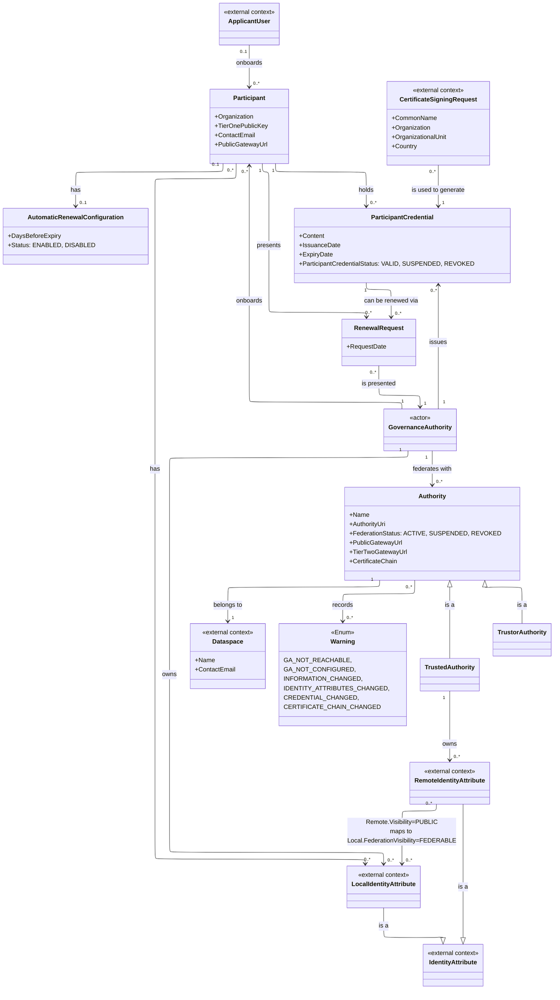

## Purpose

This document defines the Conceptual Data Model (CDM) for the Identity Provider component.

Business scope includes:
- Managing participants onboarded in the dataspace
- Issuing and managing credentials (X.509 certificates) for participants
- Managing trust relationships with external Governance Authorities (Trustor and Trusted Authorities)

See OpenAPI definition files:
- [Tier 1 APIs](../../../openapi/identityprovider-tier1-v2.yaml)
- [Tier 2 APIs](../../../openapi/identityprovider-tier2-v2.yaml)

## Service boundary and CDM traceability

### Owned concepts

- Participant
- ParticipantCredential
- Warning
- Authority
- TrustedAuthority
- TrustorAuthority
- RenewalRequest
- AutomaticRenewalConfiguration

### Referenced concepts, by owning CDM

| Owning CDM | Concepts used here |
|---|---|
| [Security Attribute Provider](https://code.europa.eu/simpl/simpl-open/security/access-control-and-trust/security-attribute-provider-federation/security-attributes-provider/security-attributes-provider-be/-/blob/develop/documents/architecture/cdm/security-attributes-provider-cdm.md?ref_type=heads) | IdentityAttribute, LocalIdentityAttribute, RemoteIdentityAttribute |
| [Authentication Provider](https://code.europa.eu/simpl/simpl-open/security/access-control-and-trust/authentication-provider-federation/authentication-provider/authentication-provider-be/-/blob/develop/documents/architecture/cdm/authentication-provider-cdm.md?ref_type=heads) | Dataspace, CertificateSigningRequest |
| [Onboarding](https://code.europa.eu/simpl/simpl-open/governance/participant-management/onboarding/onboarding/onboarding-be/-/blob/develop/documents/architecture/cdm/onboarding-cdm.md?ref_type=heads) | ApplicantUser

### CDMs that reference this one

- [Security Attribute Provider](https://code.europa.eu/simpl/simpl-open/security/access-control-and-trust/security-attribute-provider-federation/security-attributes-provider/security-attributes-provider-be/-/blob/develop/documents/architecture/cdm/security-attributes-provider-cdm.md?ref_type=heads)
- [Authentication Provider](https://code.europa.eu/simpl/simpl-open/security/access-control-and-trust/authentication-provider-federation/authentication-provider/authentication-provider-be/-/blob/develop/documents/architecture/cdm/authentication-provider-cdm.md?ref_type=heads)
- [Onboarding](https://code.europa.eu/simpl/simpl-open/governance/participant-management/onboarding/onboarding/onboarding-be/-/blob/develop/documents/architecture/cdm/onboarding-cdm.md?ref_type=heads)
- [Consent Management](https://code.europa.eu/simpl/simpl-open/governance/consent-management/consent-management/consent-management-service/consent-management-be/-/blob/develop/documents/architecture/cdm/consent-management-cdm.md?ref_type=heads)

## Conceptual Data Model

_NOTE: some labels may not render correctly in GitLab. Please open the link below in Mermaid Live for a better rendering._

Open in [Mermaid live](https://mermaid.live/view#pako:eNqtV21v4jgQ_iuWP94SBAVKG_WQQghctCxUEHq6E1JlEgPWBZtznC1sl_--diCQgEPb6-WT45l55n1sv0KfBRia0DCMKZ9Sn9E5WZhqCUCItiwWJsDhP2ojZQlRFHUIWnC02vMBEBCOfUEYBV473Uv4QI99x5wi6mMrFkvGidiC15RFfQ8PyBeMt1rp5k4t8iCPiAvikzWiIi_8ZcgXiJIfSOnOETyC-ZDix3gWEv8r3uaINqNCanVWiIQ5wp69hwR-QdsJD6_YJN1hK6nXH2EquUM7iVzME1POrOygbdTGc8axs1kTnjdmLJCIIxM4A6vddzol0HHHyepCeWFQbI4DTAVB4Zli5agk5PbcKIpVPjrSyxxhb9vFtlZPavST1XelyePJ-NEZdJT1I-dp-FVj_MlwG0vAOfGlojFZUEIXI_xvjCNxXhh4I1TthMBXbmzEqUYOzq1WjA7QCr-vJLIEFE4oEWdwMRWn3OzSRd54GR4UrZGPP2jshZm6GizQ-SfiKkrnGh0ar_JaetbzYOg9jxzL_kOVUElDtIeDrtubjGSuslR30B2OvlmeOxw8S-FB75zecQae6_31bHneyG1PPGes5bMlsOK0-nqyM_LcrmtbnqPo7lHZGyHweBwJHGhmyDUBxt8vUDCeLhN3ZJxwkiN0ZXPs2z_tDsv23CfnWntcnTrHQea9sAJqppfsJSL0DScPs0rbb18Ou9kBUADjJlNAbC0hOJnF4gPNUIDYZz4K_3_YEV4xgT-Le1Yo67XMlpyGkwjzT1ioOxmnsDqFwDBaclUpl3-TP_rImIC90CiFyp6PR8F3oAATLNERpYDHMH62gMYAEgGUihbF-TOyH3RkD1N-IhGZkVASf3-ctPuu_TDjLbBC6wgIBpKfBKJ86taMSFcOr5GanKlxF3NHk6EiB_I5Kk43yMMdySaY723EEXghYvnBwtGe2yr0kexyfeW8F2PJwuAIUXycn2WwWgQIkoKIIxyoHC3kjOKZGaQX0eYhN9xMIJsUzDDgal9ifyfov4dQZZPOGOInx0-iDz8N46JU8lWuY84cT0XMWaPU6nT9MKVrIaMLVdc6OV3zHC4SpgyJzzKeXMyPXCSq-6K8ctvNjZE3SuoiS2uOI5nU6DQPcgyaItJlLwngAQoHx4DkZvWla2dJPuUYluAKc3k3C-Tb6FWBTaFYYnkVgKZcyjqMN4bPQsancEp3kh3JCI231Iem4DEuQc7ixRKacxRG8i9eB7KkD6-mlEWq_Jux4y8OiCyJb_v3WPIsK8EFVxYcEDGV4yC5pkKzWknkofkKN9Cs1evl2v1Npdm8vbmv3shFCW6hadyWG7XKTb3RaN41a_VGpborwR-Jykr57u6-cdusVRWxfltp7n4BTKV4Vg)

## Concept Descriptions

| Entity                            | Description                                                                                                                                                                                                                                                                                                                                                                                                                                                                                                                                                                                                                                                                                                                                                               |
|-----------------------------------|---------------------------------------------------------------------------------------------------------------------------------------------------------------------------------------------------------------------------------------------------------------------------------------------------------------------------------------------------------------------------------------------------------------------------------------------------------------------------------------------------------------------------------------------------------------------------------------------------------------------------------------------------------------------------------------------------------------------------------------------------------------------------|
| **GovernanceAuthority**           | *(actor)* The Governance Authority that onboards participants and holds the identity attributes of a dataspace.                                                                                                                                                                                                                                                                                                                                                                                                                                                                                                                                                                                                                                                           |
| **Participant**                   | A legal entity or organization onboarded into the dataspace, identified by its organizational name, contact email, tier-one public key, and associated public gateway URL; holds zero or more credentials and identity attributes, and manages cryptographic operations for dataspace participation.                                                                                                                                                                                                                                                                                                                                                                                                                                                                      |
| **ParticipantCredential**                    | A digital X.509 certificate issued to a participant for authentication and authorization within the dataspace; identified by its credential ID, contains the PEM-encoded certificate content, and tracks issuance and expiry dates with current lifecycle status (VALID, SUSPENDED, or REVOKED).                                                                                                                                                                                                                                                                                                                                                                                                                                                                          |
| **CertificateSigningRequest**     | *(external context, see [Authentication Provider](https://code.europa.eu/simpl/simpl-open/security/access-control-and-trust/authentication-provider-federation/authentication-provider/authentication-provider-be/-/blob/develop/documents/architecture/cdm/authentication-provider-cdm.md?ref_type=heads))* A formal request structure containing X.509 Distinguished Name (DN) components used for credential issuance or renewal, including common name, organization, organizational unit, and country code.                                                                                                                                                                                                                                                          |
| **Warning**                       | Used to detect anomalies or changes in the federation relationship with a trusted or trustor authority, including connectivity issues, configuration mismatches, or changes in identity attributes or credentials.                                                                                                                                                                                                                                                                                                                                                                                                                                                                                                                                                        |
| **Authority**                     | An external Governance Authority of another dataspace with which a federation relationship is established, identified by its authority URI and signing credentials.                                                                                                                                                                                                                                                                                                                                                                                                                                                                                                                                                                                                       |
| **TrustedAuthority**              | An external Governance Authority or federation partner whose certificates are trusted for validating inbound communications and certificate chains; maintains authority URI and certificate chain for validation operations.                                                                                                                                                                                                                                                                                                                                                                                                                                                                                                                                              |
| **TrustorAuthority**              | A federated Governance Authority designated as trusted for issuing and signing credentials for participants; identified by authority URI, associated dataspace, and current federation status (ACTIVE, SUSPENDED, or REVOKED).                                                                                                                                                                                                                                                                                                                                                                                                                                                                                                                                            |
| **RenewalRequest**                | A request submitted by a participant to renew an expiring credential, tracking the exact submission timestamp (RequestDate).                                                                                                                                                                                                                                                                                                                                                                                                                                                                                                                                                                                                                                              |
| **Dataspace**                     | *(external context, see [Authentication Provider](https://code.europa.eu/simpl/simpl-open/security/access-control-and-trust/authentication-provider-federation/authentication-provider/authentication-provider-be/-/blob/develop/documents/architecture/cdm/authentication-provider-cdm.md?ref_type=heads))* A logical namespace representing a federated dataspace ecosystem with its own trust governance, identified by name and contact email, and managed by its associated Governance Authority.                                                                                                                                                                                                                                                                    |
| **IdentityAttribute**             | *(external context, see [Security Attribute Provider](https://code.europa.eu/simpl/simpl-open/security/access-control-and-trust/security-attribute-provider-federation/security-attributes-provider/security-attributes-provider-be/-/blob/develop/documents/architecture/cdm/security-attributes-provider-cdm.md?ref_type=heads))* A security or capability attribute assigned to a participant representing roles, permissions, or organizational context within the dataspace (e.g., CONSUMER, DATA_PROVIDER); defines authorization scope for dataspace participation.                                                                                                                                                                                                |
| **LocalIdentityAttribute**        | *(external context, see [Security Attribute Provider](https://code.europa.eu/simpl/simpl-open/security/access-control-and-trust/security-attribute-provider-federation/security-attributes-provider/security-attributes-provider-be/-/blob/develop/documents/architecture/cdm/security-attributes-provider-cdm.md?ref_type=heads))*An identity attribute defined and owned by the Governance Authority. Can be mapped to one or more remote identity attributes during federation setup.                                                                                                                                                                                                                                                                                  |
| **RemoteIdentityAttribute**       | *(external context, see [Security Attribute Provider](https://code.europa.eu/simpl/simpl-open/security/access-control-and-trust/security-attribute-provider-federation/security-attributes-provider/security-attributes-provider-be/-/blob/develop/documents/architecture/cdm/security-attributes-provider-cdm.md?ref_type=heads))* An identity attribute owned by a trusted authority, mapped to one or more local identity attributes. This component keeps track of the status of the remote identity attributes. If the Trusted Authority updates, removes or creates a remote identity attribute, this component keeps track of them and the attribute is labelled as `CHANGED`, `REMOVED`, `NEW`. If nothing has changed, the attribute is labelled as `NO_CHANGE`. |
| **AutomaticRenewalConfiguration** | Configuration entity managing automated credential renewals for a participant, defining the threshold period in advance of expiration (DaysBeforeExpiry) and the current operational status (ENABLED or DISABLED). If a custom configuration is not defined, the default configuration is used instead.                                                                                                                                                                                                                                                                                                                                                                                                                                                                   |
| **ApplicantUser** | *(external context, see [Onboarding](https://code.europa.eu/simpl/simpl-open/governance/participant-management/onboarding/onboarding/onboarding-be/-/blob/develop/documents/architecture/cdm/onboarding-cdm.md?ref_type=heads))* The individual who manages onboarding requests and comments on behalf of their organisation. After onboarding approval, their data is passed to the identity provider. |

## Assumptions and open questions

- EXPIRED is not listed among the credential statuses: a credential is expired when its ExpiryDate has passed.
- To avoid naming conflicts with other Simpl-Open components, Credential has been renamed to ParticipantCredential