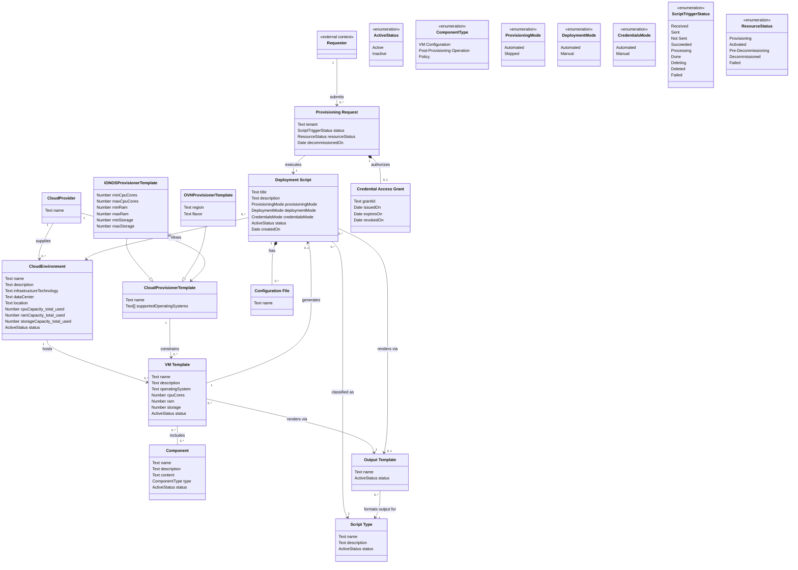

## Purpose

This document defines the Conceptual Data Model (CDM) for the Infrastructure Script Management component, maintained per the [V1.8 Conceptual Data Model (CDM) Guidelines](https://confluence.simplprogramme.eu/spaces/SPCK/pages/137236888/V1.8+Conceptual+Data+Model+CDM+Guidelines).

Business scope includes:
- A Requester submitting a Provisioning Request to execute a Deployment Script, which runs in a Cloud Environment and is built from a VM Template
- Defining and maintaining the provisioning building blocks: Cloud Environments, Cloud Provisioner Templates, VM Templates, Components, Script Types and Output Templates
- Tracking a Provisioning Request through its request and resource lifecycles, from submission to decommissioning
- Issuing and revoking Credential Access Grants for provisioned resources

See [OpenAPI definition file](../../../openapi/infrastructure-provisioning-api.yaml).

## Conceptual Data Model

## Concept descriptions

| Entity | Description |
|--------|-------------|
| Requester | *(external context)* The party who submits a Provisioning Request. Owned outside this service's boundary — the service references it only by unique ID and email, and does not manage requester identity itself. |
| Cloud Provider | The external infrastructure provider (e.g. IONOS, OVH) available to the service. Supplies Cloud Environments and defines the Cloud Provisioner Templates available on its infrastructure. |
| Cloud Environment | A deployable region/datacenter offered by a Cloud Provider, tracked for infrastructure technology, location and compute capacity (CPU/RAM/storage, total and used). Hosts VM Templates and is where Deployment Scripts run. |
| Cloud Provisioner Template | The reusable, provider-specific blueprint (Terraform/Crossplane) used to provision a VM, along with the operating systems it supports. Constrains the VM Templates built from it. Specialised into IONOS Provisioner Template (min/max CPU, RAM, storage) and OVH Provisioner Template (region, flavor). |
| VM Template | The business definition of a virtual machine to provision — name, description, OS, and CPU/RAM/storage sizing. Hosted in one Cloud Environment, constrained by one Cloud Provisioner Template, includes zero or more reusable Components, may generate a Deployment Script, and renders its output via an Output Template. |
| Component | A reusable building block attached to VM Templates — a VM configuration, a post-provisioning operation, or a policy. The same Component can be included in many VM Templates. |
| Deployment Script | The script that provisions or decommissions infrastructure for a Cloud Environment. Carries three independent business flags: provisioningMode (is cloud provisioning actually performed), deploymentMode (deployed automatically or manually), and credentialsMode (are access credentials issued automatically or handled manually). Classified by one Script Type, optionally renders via an Output Template, owns its Configuration Files, and can be executed by any number of Provisioning Requests. |
| Script Type | Classifies Deployment Scripts (e.g. "VM"). Determines which Output Template formats a script's result. |
| Configuration File | A configuration artifact belonging to exactly one Deployment Script; deleted with it. |
| Output Template | Defines how a Deployment Script's execution result is rendered back to the requester. Formats output for one Script Type and can be reused across VM Templates and Deployment Scripts. |
| Provisioning Request | A single request, submitted by a Requester, to execute a Deployment Script — from submission through resource decommissioning. Carries two independent business states: status (request lifecycle: Received, Sent, Not Sent, Succeeded, Processing, Done, Deleting, Deleted, Failed) and resourceStatus (provisioned-resource lifecycle: Provisioning, Activated, Pre-Decommissioning, Decommissioned, Failed). Executes exactly one Deployment Script and, if credentials need to be issued, owns exactly one Credential Access Grant. |
| Credential Access Grant | The time-bounded authorization allowing a requester to retrieve credentials for a provisioned resource, owned by (and deleted with) the Provisioning Request that authorized it. |
