## Purpose

This document defines the Conceptual Data Model (CDM) for the Onboarding component.

Business scope includes:
- Configurable documentation requirements: The governance authority can define, per onboarding procedure, which documents are mandatory or optional for a given participant type, ensuring applicants are guided towards providing the correct evidence and that validation is applied consistently across all onboarding requests.
- Applicant-initiated onboarding: The API enables applicants to submit an onboarding request on behalf of the organisation they represent, capturing the applicant's identity, the organisation name, and the intended participant type (or applicable onboarding procedure) as part of a single, structured request.
- Governance-led validation: Once submitted, the onboarding request is subject to review and validation by the governance authority, who assess submitted documents against defined validation rules, track the request's progress through its lifecycle (in progress, under evaluation, in review), and ultimately approve or reject it with a documented rationale where applicable.
- Automated validation: Define onboarding validation rule to support the Governance Authority in the validation

See OpenAPI definition files:
- [Tier1 V1](../../../openapi/onboarding-v1.yaml)
- [Tier1 V2](../../../openapi/onboarding-tier1-v2.yaml)

## Service boundary and CDM traceability

### Owned concepts

- OnboardingRequest
- ApplicantUser
- OnboardingTemplate
- OnboardingDocumentTemplate
- OnboardingDocument
- OnboardingComment
- OnboardingValidationRuleExecution
- ValidationRule
- PresenceCheckRule
- EidasRule
- ContentCheckRule
- CompositeRule
- Remark

### Referenced concepts, by owning CDM

| Owning CDM | Concepts used here |
|---|---|
| [Identity Provider](https://code.europa.eu/simpl/simpl-open/security/access-control-and-trust/identity-provider-federation/identity-provider/identity-provider-be/-/blob/develop/documents/architecture/cdm/identity-provider-cdm.md?ref_type=heads) | Participant, ParticipantCredential | 
| [Security Attributes Provider](https://code.europa.eu/simpl/simpl-open/security/access-control-and-trust/security-attribute-provider-federation/security-attributes-provider/security-attributes-provider-be/-/blob/feature/add-cdm/documents/architecture/cdm/security-attributes-provider-cdm.md) | IdentityAttribute |

### CDMs that reference this one

None.   

## Conceptual Data Model

```mermaid
---
config:
  layout: elk
--- 
classDiagram
    direction LR
  class OnboardingRequest {
    +ExpirationTimeframe
    +ExpirationTimeframeTimeUnit: HOUR, DAY, YEAR
    +ParticipantType: CONSUMER, DATA_PROVIDER, INFRASTRUCTURE_PROVIDER, APPLICATION_PROVIDER
    +Status: IN_PROGRESS, EVALUATING, IN_REVIEW, REJECTED, APPROVED
    +RejectionCause
    +OrganisationName
    +OrganisationContactEmail
  }

  class ParticipantCredential {
     <<external context>>
    
  }

  class Participant  {
    <<external context>>
  }

  class ApplicantUser {
    +FirstName
    +LastName
    +Email
    +AuthenticationProvider: SIMPL_AUTH, EIDAS
  }

  class Notary {
    <<actor>>
  }

  class OnboardingTemplate {
    +Description
    +ApplicationInstructions
    +ExpirationTimeframe
    +ExpirationTimeframeTimeUnit: HOUR, DAY, YEAR
    +ParticipantType: CONSUMER, DATA_PROVIDER, INFRASTRUCTURE_PROVIDER, APPLICATION_PROVIDER
  }

  class OnboardingDocumentTemplate {
    +Name
    +Description
    +Necessity: MANDATORY, OPTIONAL
    +OnboardingDocumentType: UPLOAD, EIDAS
    +MimeType
  }

  class OnboardingDocument {
    +Description
    +Filename
    +Type: UPLOAD, EIDAS
    +MimeType
  }

  class OnboardingComment {
    +Content
  }

  class IdentityAttribute {
    <<external context>>
    +Code
    +Name
    +Description
  }

  class ValidationRule {
    +Name
    +Description
    +Necessity: MANDATORY, OPTIONAL
    +ApprovalMode: AUTOMATIC, MANUAL
    +ValidityInterval
  }

  class OnboardingValidationRuleExecution {
    +Name
    +Description
    +Status: NOT_EXECUTED, IN_PROGRESS, SUCCESS, REJECTED, FAULT
  }

  class Remark {
    +Code
    +Message
  }

  class PresenceCheckRule {
    
  }

  class EidasRule {
    +EidasAttribute
    +EidasAttributeCondition: IS_PRESENT, CONTAINS
    +EidasPersonType: NATURAL_PERSON, LEGAL_PERSON
  }

  class ContentCheckRule {
    +ValidationURI
  }

  class CompositeRule {
    +Strategy: ALL, AT_LEAST_ONE
  }

  OnboardingRequest "1" --> "0..1" ParticipantCredential : references
  OnboardingRequest "1" --> "0..1" Participant : bound to

  ApplicantUser "1" --> "0..*" OnboardingRequest : manages
  OnboardingTemplate "0..1" --> "0..*" OnboardingRequest : template for
  OnboardingRequest "1" --> "0..*" OnboardingDocument : includes
  OnboardingRequest "1" --> "0..*" OnboardingComment : includes
  OnboardingRequest "1" --> "0..*" IdentityAttribute : includes
  OnboardingTemplate "1" --> "0..*" OnboardingDocumentTemplate : includes
  OnboardingTemplate "1" --> "0..*" IdentityAttribute : includes
  OnboardingDocumentTemplate "1" --> "0..*" OnboardingDocument : template for
  OnboardingDocument "1" --> "0..*" OnboardingValidationRuleExecution : validated by
  OnboardingValidationRuleExecution "1" --> "0..*" Remark : produces

  ValidationRule "1" --> "0..*" OnboardingDocumentTemplate : applies to
  OnboardingTemplate "1" --> "0..*" ValidationRule : contains
  CompositeRule "1" --> "2..*" ValidationRule : composedOf
  ValidationRule "1" --> "0..*" OnboardingValidationRuleExecution : executedAs
  ApplicantUser "0..1" --> "0..*" OnboardingComment : creates
  Notary "0..1" --> "0..*" OnboardingComment : creates
  Notary "0..*" --> "0..*" OnboardingRequest: reviews and manages
  Participant "1" --> "0..*" ParticipantCredential : holds
  Participant "0..*" --> "0..*" IdentityAttribute : has

  CompositeRule --|> ValidationRule : is a
  ContentCheckRule --|> ValidationRule : is a
  PresenceCheckRule --|> ValidationRule : is a
  EidasRule --|> ValidationRule : is a
```
 

Open using [Mermaid Live](https://mermaid.live/view#pako:eNrVWFtv4jgU_itWHmdCBaW0JRpVioLbySokKJfuzgoJuYkBb0PCOk63bLf_fY_DLQECtJp92Cdi-5zP5_rZ5k0J04gqmtJoNIZ8mIRpMmYTTX4iFJNFmgsN0fhZToAIKmRikmU9RiaczJaCCEWM01CwNEGWu5wrpJCTPKWERyyZuPTPnGYCva1VvuLXOeNEKvlsRseARo-tyY8gYWDPdydwVdTTf6joB9bdjdKAcMFCNieJ8BdzqiHDsb2gjwthXx8NXOfR7Mmhad-7uue7geEHLi4t6IOBZRq6bzr2ZnaD7wki8kwDbbn24GLPUxF-1K0AFOwHCTty8aOJf1WRi3_Bho97BSQA4d4GxqV_LGNlkDzbuuzwCUlYVjhtl2NRXjDSRJBQ4Blh8VLgXf6UQ16KgsFpRBPBSLwNO_r2jb4KyhOYhGwLGNzdrRdPQ6ItUj3QHoA-n8csBPUgo7xUAveMZ6LirEV2JkquwkjPxVR6FBbRGPD0hUWUa8gz-wNrpAf-d8iI2dO9GkPsVBC-KPsA0Ux5reHb-vXpbB4TQUvW92gWcjaXlmwNXHoq58wkEzwvMp39T4v-SDx6aZjPIBUH4lLJ36Eg2TSkWcbEQkN93QYzHRfccgbSAt3aFv7-ZoWHwcBy9F4l0SDdh1DJ9bMtP5HJexbTpOzJT9ncSGc7e8uWhpkaTbNoYLHQheDsKS_H-VgjA2pEz0zI3p6PJGZRUYduHv8XiYUmgc4lcR-M1BB0rdOH6jNUqRSU5ApDAM0E7zjIn4xu1XL8SsO8OJQ-4MKa5G3HH-HfsBEUJF6hfC8wjOJjS_L3emD5Nea5dEb4cyXjpdz0IWBkUlc4A04zmoTUmNLwuZqNGg0MAch28lbMbSqoZhrqEGINoYADzgNvsYdtX5V04uum7VW1BpRnQFNFR9g68IlujQbY9RxbRRZ-2IxqjFzV_AGvvm5TGLhmrfpsnkKZ0R1dTwB90glUn25ZwGv-yMLAeCPHxntI-zeTodIaKqjRuIOv5sWFHBw-SzXE6ZhymZfsc2AA8ZTmSYREurWoekjuAHyBwf4uGpqRBKpnz4wNK292P4kk1irjlJ_pVRVqw6saYnBJzKOzo1PFWVPkp2D2-bIephSkM9zaSH8O8COG7W15btyP5XAjdhSsjkE19LJcoRF6Wuxi12kd2GrFhhqCIyDKVx20xNs5dz6aFSL7h2arnjo3LzubasVZStj6ylalmrL-Za2-1KCRM_64V_XRp8U3jfTsMFkc7_JtS4WcQiBWIKvb8E_Q_nKSYSRpvjD6V4YI8F6FtsrEeCA8dSQ8TePoIMIhew6135SUiq-a6Ebjn7v91DIwfi29c4CdUtg_yE9pbA_yeklFVWaUwwspgif8m9QaKvBAgiuOosFnzCZTMVSGyTsIklyk3iIJFQ1eJVRVeJpPpoo2JnEGo3wue3v1ql-LQDx_T9PyUNHelFdFa1x1Ltqt63a7e3lze9nuXndUZaFonc5Fs3nVubm5bHab153bVuddVf4uEFoXrdbtVfuq3ex2O92rVutaVSjcN1LeX_4BUfwPoSoTLn1ZWUgTeNwZcFAKwH7_F3GcguQ).
 
## Concept descriptions

| Entity | Description |
|---|---|
| **OnboardingRequest** | An instance of an onboarding procedure, submitted by an applicant on behalf of an organisation seeking to join the dataspace. Tracks the organisation's details, requested participant type, current status, and — if rejected — the reason why. |
| **ParticipantCredential** | *(external context, see [Identity Provider](https://code.europa.eu/simpl/simpl-open/security/access-control-and-trust/identity-provider-federation/identity-provider/identity-provider-be/-/blob/develop/documents/architecture/cdm/identity-provider-cdm.md?ref_type=heads))* The credential issued to a participant once onboarding is approved, referenced from an onboarding request and owned by a participant. Managed outside this domain. |
| **Participant** | *(external context, see [Identity Provider](https://code.europa.eu/simpl/simpl-open/security/access-control-and-trust/identity-provider-federation/identity-provider/identity-provider-be/-/blob/develop/documents/architecture/cdm/identity-provider-cdm.md?ref_type=heads))* An organisation that has completed onboarding and is bound to an onboarding request, owning a credential and holding identity attributes. Managed outside this domain. |
| **ApplicantUser** | The individual who manages onboarding requests and comments on behalf of their organisation, authenticating via an identity provider. |
| **Notary** | *(actor)* The user who reviews onboarding requests created by Applicants. They can add comments, reject, request a revision and delete onboarding requests. |
| **OnboardingTemplate** | A template that defines, for a given participant type, the document templates, identity attributes, and validation rules required to complete onboarding, along with its own expiration rules. |
| **OnboardingDocumentTemplate** | Defines a type of document that may be required by an onboarding template, including whether it's mandatory, what document type it expects, and its MIME type. |
| **OnboardingDocument** | An instance of a document uploaded by an applicant as part of an onboarding request, based on a document template. |
| **OnboardingComment** | A note added to an onboarding request by an applicant user or a Governance Authority user, used to record communication during the onboarding process. |
| **IdentityAttribute** | *(external context, see [Security Attributes Provider](https://code.europa.eu/simpl/simpl-open/security/access-control-and-trust/security-attribute-provider-federation/security-attributes-provider/security-attributes-provider-be/-/blob/feature/add-cdm/documents/architecture/cdm/security-attributes-provider-cdm.md))* A Tier 2 identity attribute, declared on an onboarding request, required by an onboarding template, or held by a participant. |
| **ValidationRule** | A definition of the parameters required to validate a document or an onboarding request, including whether it's mandatory, whether approval is automatic or manual, and its period of validity. Specialised into CompositeRule, ContentCheckRule, PresenceCheckRule, and EidasRule. |
| **CompositeRule** | *(specialisation of ValidationRule)* A rule made up of two or more other validation rules, combined according to a strategy (all must pass, or at least one). |
| **ContentCheckRule** | *(specialisation of ValidationRule)* A rule that validates a document's content against an external validation service. |
| **PresenceCheckRule** | *(specialisation of ValidationRule)* A rule that simply checks whether a required document has been provided. |
| **EidasRule** | *(specialisation of ValidationRule)* A rule that checks a specific eIDAS identity attribute — for a natural or legal person — against a condition such as presence or content match. |
| **OnboardingValidationRuleExecution** | A record of the outcome of a validation rule run against a document, capturing its status (not executed, in progress, success, rejected, or fault). |
| **Remark** | A finding produced by a validation rule execution, made up of a code and a message. |

## Assumptions and open questions

- `OnboardingStatus` and `MimeType` are kept as value sets rather than entities, for readability.
- `AuthenticationProvider` entity lists only `SIMPL_AUTH` and `EIDAS`: in Onboarding, an applicant who logs in with OID4VP is handled as SIMPL_AUTH.
- The actual name of `OnboardingDocument`, `OnboardingDocumentTemplate` and `OnboardingComment` in the OpenAPI specification is `Document`, `DocumentTemplate` and `Comment`. In this CDM they have been renamed to avoid conflicts with other Simpl-Open CDMs.