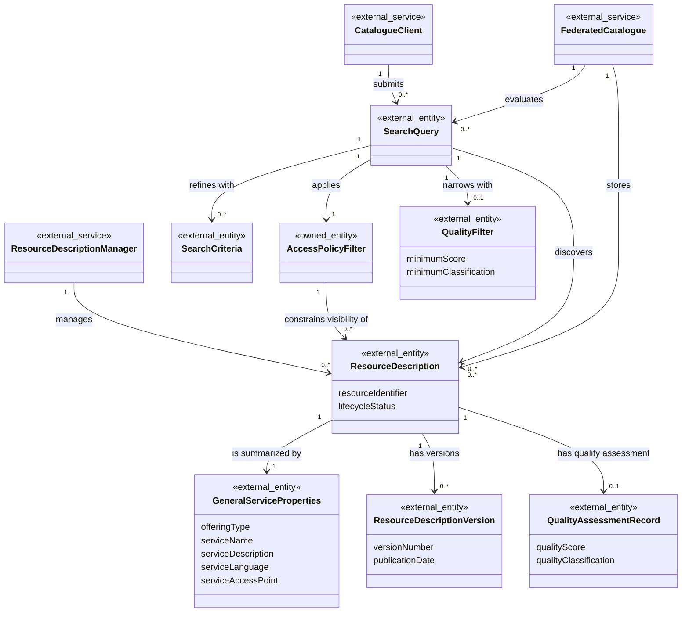

## Purpose

This document defines the Conceptual Data Model (CDM) for the Query Mapper component.

API definition: [openapi/adapter_openapi.yaml](../../../openapi/adapter_openapi.yaml)
T1 API definition: [openapi/tier1-gateway/t1-adapter-openapi.yaml](../../../openapi/tier1-gateway/t1-adapter-openapi.yaml)
T2 API definition: [openapi/tier2-gateway/t2-adapter-openapi.yaml](../../../openapi/tier2-gateway/t2-adapter-openapi.yaml)

Business scope included:
- Participant Quick and Advanced discovery of resource descriptions.
- Provider scoped resource description management (list, get details, revoke, version history).

### Service Boundary

Owned within Query Mapper CDM boundary:
- AccessPolicyFilter

Referenced external concepts:
- SearchQuery (Catalogue Client BE)
- SearchCriteria (Catalogue Client BE)
- QualityFilter (Catalogue Client BE)
- CatalogueClient (Service of the Consumer and Provider to search in the catalogue and start consumption)
- ResourceDescriptionManager (the SD Tooling BE service that calls Query Mapper resource-management operations)
- FederatedCatalogue (Service storing resource descriptions and evaluating search requests)
- ResourceDescription (Federated Catalogue)
- GeneralServiceProperties (Resource Description Summary, Federated Catalogue)
- ResourceDescriptionVersion (Federated Catalogue)
- QualityAssessmentRecord (Quality Scoring Service)

### External Service Dependencies

| Service | Role |
|---|---|
| CatalogueClient | Consumer and Provider service that calls QueryMapper. |
| ResourceDescriptionManager | SD Tooling BE service that calls QueryMapper resource-management operations. |
| FederatedCatalogue | Stores ResourceDescriptions and evaluates catalogue search requests. |

## CDM Traceability

### External CDMs referenced

| External CDM | Referenced concepts |
|---|---|
| [Catalogue Client BE CDM](https://code.europa.eu/simpl/simpl-open/integration/resource-discovery/search-engine/catalogue-search/catalogue-client-be/-/blob/feature/add-cdm/documents/architecture/cdm/xfsc-advsearch-be.md?ref_type=heads) | SearchQuery, SearchCriteria, and QualityFilter; this CDM is their source of truth. |
| [SD Tooling BE CDM](https://code.europa.eu/simpl/simpl-open/governance/resource-management/metadata-description/resource-description-tooling/sd-tooling-be/-/blob/feature/add-cdm/documents/architecture/cdm/sdtooling-api-be.md?ref_type=heads) | ResourceDescriptionManager, the service responsible for provider-side resource-description lifecycle management. |
| [Federated Catalogue CDM](https://code.europa.eu/simpl/simpl-open/integration/resource-discovery/resource-catalogue/federated-catalogue/catalogue-be/-/blob/feature/add-cdm/documents/architecture/cdm/federated-catalogue-cdm.md?ref_type=heads) | ResourceDescription, GeneralServiceProperties, and ResourceDescriptionVersion |
| [Quality Scoring Service CDM](https://code.europa.eu/simpl/simpl-open/data/data-governance/data-quality-rules/-/blob/feature/add-cdm/documents/architecture/cdm/quality-scoring-service-cdm.md?ref_type=heads) | QualityAssessmentRecord |

### CDMs referencing this CDM

| Referencing CDM | Referenced relationship |
|---|---|
| [Catalogue Client BE CDM](https://code.europa.eu/simpl/simpl-open/integration/resource-discovery/search-engine/catalogue-search/catalogue-client-be/-/blob/feature/add-cdm/documents/architecture/cdm/xfsc-advsearch-be.md?ref_type=heads) | References QueryMapper as the adapter service invoked for simple and advanced catalogue search. |
| [Federated Catalogue CDM](https://code.europa.eu/simpl/simpl-open/integration/resource-discovery/resource-catalogue/federated-catalogue/catalogue-be/-/blob/feature/add-cdm/documents/architecture/cdm/federated-catalogue-cdm.md?ref_type=heads) | QueryMapper as the external query-submitting system |

## Conceptual Model

### State and Value Sets

- GeneralServiceProperties.offeringType: *data*, *infrastructure*, *application*
- ResourceDescription.lifecycleStatus: *active*, *revoked*

## Concept Descriptions

| Entity | Description | Ownership |
|---|---|---|
| CatalogueClient | External System on the Participant Agent to call the Query Mapper. | Referenced — Catalogue Client BE CDM |
| ResourceDescriptionManager | SD Tooling BE service that calls participant resource-management endpoints of Query Mapper. | Referenced — SD Tooling BE CDM |
| QualityFilter | Optional minimum quality score and/or classification threshold defined by Catalogue Client BE and forwarded by Query Mapper to Federated Catalogue. | Referenced — Catalogue Client BE CDM |
| QualityAssessmentRecord | Quality assessment result for a resource description, providing its `qualityScore` and `qualityClassification` computed by the Quality Scoring Service. Owned by the Quality Scoring Service. | Referenced |
| SearchQuery | A Catalogue Client BE search request passed through Query Mapper as a search string or advanced-search payload. | Referenced — Catalogue Client BE CDM |
| SearchCriteria | Structured attribute filters targeting a named resource-description node, as defined by Catalogue Client BE. Query Mapper passes the advanced-search payload through without modelling its criteria as separate business attributes. | Referenced — Catalogue Client BE CDM |
| AccessPolicyFilter | Access-policy filtering context used by Query Mapper to determine visible resource descriptions in discovery flows. Interaction concept only (not persisted as business record). | Owned |
| FederatedCatalogue | External system of record that evaluates search requests and stores resource descriptions. | Referenced — Federated Catalogue CDM |
| ResourceDescription | Business description of a published offering discoverable in the catalogue and manageable by its owner ResourceDescriptionManager. Owned by the Federated Catalogue. | Referenced |
| GeneralServiceProperties | High-level summary properties used for discovery and result display (name, description, language, type, access point). Owned by the Federated Catalogue. | Referenced |
| ResourceDescriptionVersion | Historical snapshot/version lineage for a resource description. Owned by the Federated Catalogue. | Referenced |

### Relationship Notes

- A CatalogueClient may submit many SearchQuery instances over time.
- A SearchQuery may be refined with zero or more SearchCriteria when executing an advanced search. A simple keyword search carries no SearchCriteria. Each criterion targets a distinct resource description node.
- AccessPolicyFilter is interaction-only and constrains what ResourceDescription entries are visible in discovery flows.
- General access context and enforcement are handled by gateway and are out of scope for this CDM.
- Participant endpoints invoke Federated Catalogue operations through the Federated Catalogue client.
- ResourceDescriptionManager invokes the participant resource-management endpoint group for list, details, revoke, and version history.
- ResourceDescription has one conceptual summary view via GeneralServiceProperties for search/listing (1..1).
- A ResourceDescription may have zero or more ResourceDescriptionVersion entries; Resource-type descriptions may have version history, while other types may have none.
- SearchQuery and SearchCriteria are owned by Catalogue Client BE; Query Mapper receives a search string or passes through the advanced-search payload and does not define separate attributes for these concepts.
- QualityFilter is owned by Catalogue Client BE and may be included in a SearchQuery. Query Mapper forwards its optional quality thresholds to Federated Catalogue.
- QualityAssessmentRecord classification labels are defined by the active MetadataQualityProfile owned by Schema Manager and used by Quality Scoring Service. Query Mapper receives the resulting record and does not consume the profile directly.

### Alignment to API Endpoints

| Endpoint | Concepts | Short Description |
|---|---|---|
| GET /selfDescriptions | SearchQuery, QualityFilter, AccessPolicyFilter, ResourceDescription, QualityAssessmentRecord | Executes keyword search with optional minimum quality score and/or classification thresholds; returns matching resource descriptions and their overall quality assessment results, subject to access-policy filtering. |
| POST /selfDescriptions/advancedSearch | SearchQuery, SearchCriteria, QualityFilter, AccessPolicyFilter, ResourceDescription, QualityAssessmentRecord | Passes structured search criteria and optional minimum quality thresholds to Federated Catalogue; returns matching resource descriptions and their overall quality assessment results, subject to access-policy filtering. |
| GET /participants/resourceDescriptions | ResourceDescriptionManager, ResourceDescription | Lists resource descriptions with ordering and pagination, scoped to the participant in the access token and resolved via Federated Catalogue calls. |
| GET /participants/resourceDescriptions/{resourceDescriptionId} | ResourceDescriptionManager, ResourceDescription | Returns one resource description by id, scoped to the participant in the access token and resolved via Federated Catalogue calls. |
| PATCH /participants/resourceDescriptions/{resourceDescriptionId} | ResourceDescriptionManager, ResourceDescription | Revokes one resource description by id, scoped to the participant in the access token and resolved via Federated Catalogue calls. |
| GET /participants/resourceDescriptions/{resourceDescriptionId}/version | ResourceDescriptionManager, ResourceDescriptionVersion | Returns version history for one resource description, scoped to the participant in the access token and resolved via Federated Catalogue calls. |

## Assumptions and Open Questions

- Assumption: access-policy scoping is applied by the platform at the gateway layer using the participant identity in the access token; the CDM records only the interaction concept required for the Query Mapper domain.
- ResourceDescriptionManager is the SD Tooling BE service; its source-of-truth CDM is linked in the External CDMs referenced table.
- Query Mapper models only the active quality assessment result for a ResourceDescription, as exposed by its search contract. The Federated Catalogue and Quality Scoring Service CDMs model the full set of assessment records across profile versions.

