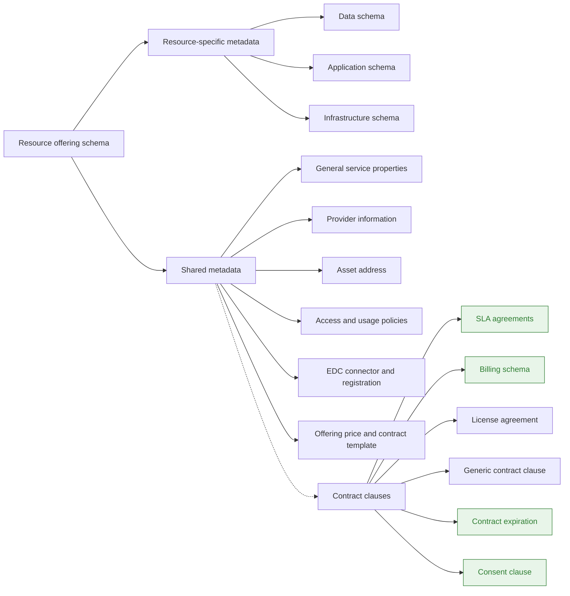

# Default Properties

## Schema Structure

High-level overview: shared groups apply to all three resource types. Contract clauses include the business-defined extensions. Green marks clauses not yet implemented as specified.

## Scope And Interpretation

- "Default properties" means the baseline property definitions, not automatically populated values. Examples below are illustrative and are not defaults.
- `String`, `Decimal`, and `URI` mean `xsd:string`, `xsd:decimal`, and `xsd:anyURI`. Object means a node validated through `sh:node`; it does not imply a JSON object or a particular RDF node kind unless stated.

### Constraint Key

The following names abbreviate repeated regex constraints. Patterns are shown after Turtle string unescaping. A pipe written as `\|` in a Markdown table represents the regex alternation character.

| Key | Exact pattern or rule |
| --- | --- |
| TEXT | `^(.\|\s)*[a-zA-Z]+(.\|\s)*$`: must contain at least one ASCII letter. |
| ALNUM | `^[a-zA-Z0-9][a-zA-Z0-9\s]*$`: starts with an ASCII letter/digit; remaining characters are ASCII letters, digits, or whitespace. |
| HTTP | `^([Hh][Tt][Tt][Pp][Ss]?):\/\/(?:www\.)?[A-Za-z0-9][-A-Za-z0-9@:%_\+~#=\.]{0,255}\.[A-Za-z0-9()]{1,6}\b(?:[-A-Za-z0-9()@:%_\+.~#?&/=]*)$` |
| EMAIL | `^[\w\-\.]+@([\w-]+\.)+[\w-]{2,4}$` |
| TOKEN | `[:,\{\}\[\]]\|(".*?")\|('.*?')\|[-\w.]+`; not anchored and not a JSON-validation rule. |
| ODRL | Blank node or IRI with at least one of these RDF classes: `odrl:Policy`, `odrl:Set`, `odrl:Offer`, `odrl:Agreement`, `odrl:Request`, `odrl:Privacy`, `odrl:Assertion`, `odrl:Ticket`. `odrl:` is `http://www.w3.org/ns/odrl/2/`. |

## 1. Shared Properties Across All Types

### 1.1 Shared Offering Structure

All three offering roots declare these eight links. The fields inside each object are listed in the following categories.

| Attribute | Description | datatype | cardinality | Example | constraint |
| --- | --- | --- | --- | --- | --- |
| General service properties (`generalServiceProperties`) | Common identification and discovery metadata. | Object | 1..1 | General service metadata node | `GeneralServicePropertiesShape` |
| Asset properties (`assetProperties`) | Provider-side asset address metadata. | Object | 1..1 | Asset metadata node | `AssetPropertiesShape` |
| Provider information (`providerInformation`) | Provider identification, contact, and signature. | Object | 1..1 | Provider metadata node | `ProviderInformationShape` |
| Offering price (`offeringPrice`) | Licensing and pricing metadata. | Object | 1..1 | Pricing metadata node | `OfferingPriceShape` |
| Service policy (`servicePolicy`) | Access, usage, and data-protection policies. | Object | 1..1 | Policy metadata node | `ServicePolicyShape` |
| Contract template (`contractTemplate`) | Contract-template document and integrity metadata. | Object | 1..1 | Contract template node | `ContractTemplateShape` |
| EDC registration (`edcRegistration`) | EDC registration identifiers. | Object | 1..1 | Registration metadata node | `EdcRegistrationShape`; hidden in frontend |
| EDC connector (`edcConnector`) | Provider connector endpoint metadata. | Object | 1..1 | Connector metadata node | `EdcConnectorShape`; hidden in frontend |

### 1.2 General Service Metadata

Container: `generalServiceProperties` / `GeneralServicePropertiesShape`.

| Attribute | Description | datatype | cardinality | Example | constraint |
| --- | --- | --- | --- | --- | --- |
| Name (`name`) | Short title of the dataset, application, or infrastructure. | String | 1..1 | European transport dataset | TEXT; length 1..255 |
| Description (`description`) | Description of the offered resource. | String | 1..1 | Transport observations across Europe | TEXT; length 1..1000 |
| Service access point (`serviceAccessPoint`) | Location or endpoint where the resource can be found. | URI | 1..1 | https://provider.example.eu/resource | HTTP |
| Keywords (`keywords`) | Discovery keywords. | String | 0..16 | transport | TEXT; length 1..50 per value |
| Metadata language (`inLanguage`) | Language of metadata such as title and description. | String | 1..1 | en | One of `bg`, `hr`, `cs`, `da`, `nl`, `en`, `et`, `fi`, `fr`, `de`, `el`, `hu`, `ga`, `it`, `lv`, `lt`, `mt`, `pl`, `pt`, `ro`, `sk`, `sl`, `es`, `sv` |
| Offering type (`offeringType`) | Offering classification used in search. | String | 1..1 | data | One of `application`, `data`, `infrastructure`; hidden in frontend |
| Sharing method ID (`sharingMethodId`) | Sharing-method identifier used for the Resource Address Template. | String | 0..1 | method123 | No additional value constraint; hidden in frontend |
| Identifier (`dcterms:identifier`) | Identifier of the resource description; described as a UUID in the source. | String | 1..1 | urn:uuid:550e8400-e29b-41d4-a716-446655440000 | `^[a-zA-Z][a-zA-Z0-9+.-]*:.+$`; hidden in frontend |
| Version (`schema:version`) | Version of the resource description. | String | 1..1 | 1.0.0 | `^[0-9]+(\.[0-9]+)*$` |

### 1.3 Asset Address

Container: `assetProperties` / `AssetPropertiesShape`.

| Attribute | Description | datatype | cardinality | Example | constraint |
| --- | --- | --- | --- | --- | --- |
| Provider data address (`providerDataAddress`) | Provider-side data address, represented as a string. | String | 0..1 | `{"type":"HttpData"}` | `requiredOnFrontendOnly`; no JSON structure is enforced by this SHACL field |

### 1.4 Provider Information

Container: `providerInformation` / `ProviderInformationShape`.

| Attribute | Description | datatype | cardinality | Example | constraint |
| --- | --- | --- | --- | --- | --- |
| Provided by (`providedBy`) | Reference to the resource provider's identifier. | String | 1..1 | 123 | No additional value constraint; hidden in frontend |
| Contact (`contact`) | Contact for questions or issues. | String | 1..1 | support@example.eu | EMAIL |
| `signature` | Digital signature identifying the provider that uploaded the description. | String | 1..1 | signature123 | ALNUM; no cryptographic verification is expressed by this field |

### 1.5 Policies

Container: `servicePolicy` / `ServicePolicyShape`.

| Attribute | Description | datatype | cardinality | Example | constraint |
| --- | --- | --- | --- | --- | --- |
| Access policy (`access-policy`) | Defines who can access the resource. | RDF node | 1..* | Node typed `odrl:Offer` | ODRL / `PolicyShape`; not a string containing a policy |
| Usage policy (`usage-policy`) | Defines how the resource can be used. | RDF node | 1..* | Node typed `odrl:Agreement` | ODRL / `PolicyShape`; not a string containing a policy |
| `dataProtectionRegime` | Relevant data-protection regulations and standards. | String | 0..* | GDPR | TOKEN |

### 1.6 EDC Integration

Containers: `edcConnector` / `EdcConnectorShape` and `edcRegistration` / `EdcRegistrationShape`. All fields below are hidden in the frontend.

| Attribute | Description | datatype | cardinality | Example | constraint |
| --- | --- | --- | --- | --- | --- |
| Provider endpoint URL (`providerEndpointURL`) | Provider connector endpoint. | String | 1..1 | https://connector.example.eu/protocol | String only; no URI regex |
| Contract definition ID (`contractDefinitionId`) | Identifier of the EDC contract definition. | String | 1..1 | contract123 | No additional value constraint |
| Service policy ID (`servicePolicyId`) | Identifier of the service policy. | String | 1..1 | policy123 | No additional value constraint |
| Access policy ID (`accessPolicyId`) | Identifier of the access policy. | String | 1..1 | access123 | No additional value constraint |
| Asset ID (`assetId`) | Identifier of the asset. | String | 1..1 | asset123 | No additional value constraint |

## 2. Contract Clauses

### Contract-Clause Bundle

**Bold clause names** indicate clauses not yet implemented as specified: Billing schema, Contract expiration, and Consent clause.

| Attribute | Description | Data type | Cardinality | Example |
| --- | --- | --- | --- | --- |
| **SLA agreements** (`slaAgreements`) | Service-level agreement bundle. | Object | 0..* | SLA agreement node |
| **Billing schema** (`billingSchema`) | Billing terms and payment endpoints. | Object | 0..1 | Billing schema node |
| License agreement (`licenseAgreement`) | License agreement document metadata. | Object | 0..1 | License agreement node |
| Generic contract clause (`genericContract`) | One document containing information for all contract clauses. | Object | 0..1 | Generic contract document node |
| **Contract expiration** | Duration and duration unit defining when the usage contract expires. | Object | 1..1 | Duration 4, unit Months |
| **Consent clause** | Defines the effects of resource consent, contract consent, or an intended purpose. | Object | 0..* | Resource consent |

### Billing Schema

| Attribute | Description | Data type | Cardinality | Example | Constraint / Business condition |
| --- | --- | --- | --- | --- | --- |
| Title (`dcterms:title`) | Human-readable billing schema name. | String | 1..1 | Standard Billing | `^(?!\s*$).+`; required |
| Billing model (`billingModel`) | Basis for billing. | String | 1..1 | subscription | `^(subscription\|pay-per-use\|one-off)$`; required |
| Billing model details (`billingModelDetails`) | Details of the billing model. | String | 1..1 | subscription: fixed monthly payment of 10 EUR; pay-per-use: 5 EUR per data transfer; one-off: fixed payment of 50 EUR at the start of consumption | `^(?!\s*$).+`; required |
| Payment terms | Time the Consumer has to pay an invoice, starting from the invoice date. | String | 0..1 | 15 days | `^(?!\s*$).+`; optional |
| Source (`dcterms:source`) | Controlled reference to an external or stored document under the approved document access model; not a public unauthenticated download URL. | URI | 0..1 | https://provider.example.com/pricing.pdf | `^https?://.+`; optional for one-off and subscription; required for pay-per-use when no billing unit price amount is provided |
| Hash (`hash`) | Cryptographic hash of the source document. | String | 0..1 | `sha256:0123456789abcdef0123456789abcdef0123456789abcdef0123456789abcdef` | `^sha256:[a-fA-F0-9]{64}$`; optional |
| Hash algorithm | Algorithm used to calculate the document hash. | String | 0..1 | SHA-256 | `^SHA-256$`; conditional for document mode |
| Document name | Original uploaded or referenced document name. | String | 0..1 | standard-pricing.pdf | `^(?!\s*$).+`; required when a document is uploaded |
| Document ID | Technical identifier of the stored document, if provided by the document storage capability. | String | 0..1 | cc-billing-12345 | `^(?!\s*$).+`; required when a document is uploaded |
| Media type | Standard label identifying the uploaded file format; generated for uploaded documents. | String | 0..1 | billingschema/pdf | `^(?!\s*$).+`; required when a document is uploaded |
| Billing unit (`billingUnit`) | Unit used to calculate or describe the bill. | String | 0..1 | data-transfers | `^[a-z][a-z0-9-]*$`; required for pay-per-use |
| Billing unit price currency | Three-letter currency code for the price amount. | String | 0..1 | EUR | `^[A-Z]{3}$`; required if a billing unit price is provided |
| Billing unit price amount | Numeric price amount per measured unit. | Decimal | 0..1 | 10.00 | `^\d+(\.\d{1,2})?$`; required for one-off and subscription; required for pay-per-use when no source document is provided |
| Billing information point (`billingInformationPoint`) | Endpoint where the actual consumption of billing units is calculated. | URI | 0..1 | https://provider.example.com/billing/usage | `^https?://.+`; required for pay-per-use |
| Billing schedule (`billingSchedule`) | Definition of the billing schedule that determines the billing trigger. | String | 0..1 | Monthly - First day of the month | `^(?!\s*$).+`; required when time-based billing is chosen for subscription or pay-per-use |
| Billing frequency | Amount of time before a bill is sent for time-based billing. | Integer | 0..1 | 3 | No additional constraint specified; required when time-based billing is chosen |
| Billing frequency unit | Unit of the time before a bill is sent. | String | 0..1 | Months | `^(Days\|Weeks\|Months)$`; required when time-based billing is chosen |
| First billing date | Date of the first bill, maintained as the reference for subsequent bills. | Date | 0..1 | 02/11/2026 | Date; required when time-based billing is chosen; source example uses day/month/year |
| Consumption based billing trigger | Maximum consumed billing units before a bill is triggered. | Decimal | 0..1 | 5 | `^\d+(\.\d{1,2})?$`; required when consumption-based billing is chosen; only available for pay-per-use |
| Maximum time before bill | Maximum elapsed time before a consumption-based bill is sent. | Integer | 0..1 | 3 | No additional constraint specified; required when consumption-based billing is chosen; only available for pay-per-use |
| Maximum time before bill unit | Unit of the maximum elapsed time before a bill is sent. | String | 0..1 | Months | `^(Days\|Weeks\|Months)$`; required when consumption-based billing is chosen; only available for pay-per-use |
| Payment information point (`paymentInformationPoint`) | Endpoint from the billing system that provides the usage contract's credit status, indicating whether overdue invoices have been paid. | URI | 0..1 | https://provider.example.com/billing/payment-status | `^https?://.+`; optional |
| Payment action (`paymentAction`) | Predefined action requested when payment compliance fails. | URI | 0..1 | suspend-usage-contract | `^https?://.+`; optional |

### Contract Expiration

| Attribute | Description | Data type | Cardinality | Example | Constraint |
| --- | --- | --- | --- | --- | --- |
| Contract duration | Duration of the usage contract before it expires. | Decimal | 1..1 | 4 | N/A; no numeric range specified |
| Contract duration unit | Unit expressing the usage contract duration. | String | 1..1 | Months | `^(Days\|Weeks\|Months\|Years)$` |

### Consent Clause

| Attribute | Description | Data type | Cardinality | Example | Constraint / Business condition |
| --- | --- | --- | --- | --- | --- |
| Title | Consent contract clause name. | String | 1..1 | Effect of resource consent withdrawal on data consumption | `^(?!\s*$).+`; required |
| Type | Type of consent contract clause. | String | 1..1 | Resource consent | `^(Resource consent\|Contract consent\|Intended purpose)$`; required |
| Source | Reference to a publicly available document. | URL | 0..1 | https://resourceconsent.example.org/ncr-v1 | HTTP (normalised source URL pattern); optional |
| Hash | Cryptographic hash of the document. | String | 1..1 | `sha256:0123456789abcdef0123456789abcdef0123456789abcdef0123456789abcdef` | `^sha256:[a-fA-F0-9]{64}$`; required |
| Hash algorithm | Algorithm used to calculate the document hash. | String | 1..1 | SHA-256 | `^SHA-256$`; required |
| Document name | Original uploaded document name; generated for uploaded documents. | String | 0..1 | Effect_resource_consent_withdrawal.pdf | `^(?!\s*$).+`; required when a document is uploaded |
| Document ID | Stored-document identifier supplied by the storage capability; generated for uploaded documents. | String | 0..1 | cc-consent-12345 | `^(?!\s*$).+`; required when a document is uploaded |
| Media type | Format label for the uploaded file; generated for uploaded documents. | String | 0..1 | consent/pdf | `^(?!\s*$).+`; required when a document is uploaded; example retained from source |

### SLA Document

| Attribute | Description | Data type | Cardinality | Example | Constraint / Business condition |
| --- | --- | --- | --- | --- | --- |
| Title (`dcterms:title`) | Human-readable SLA name. | String | 1..1 | Gold Tier SLA | `^(?!\s*$).+`; required |
| Entry (`entry`) | One or more service-level objectives, not measured results. | SLAEntry | 1..* | See SLA Entries below | Required; existing fixture shape `SlaAgreementsEntryShape` |
| Source (`dcterms:source`) | Controlled reference to the external or uploaded SLA document; resolved through the approved document retrieval mechanism, not interpreted as a public unauthenticated download URL. | URI | 0..1 | https://provider.example.com/sla/gold.pdf | HTTP; optional |
| Hash (`hash`) | Cryptographic hash of the SLA document. | String | 0..1 | `sha256:0123456789abcdef0123456789abcdef0123456789abcdef0123456789abcdef` | `^sha256:[a-fA-F0-9]{64}$`; optional |
| Hash algorithm (`hashAlgorithm`) | Hash algorithm used to calculate the SLA document hash. | String | 0..1 | SHA-256 | `^SHA-256$`; optional |
| Document name (`documentName`) | Original uploaded or referenced SLA document name. | String | 0..1 | gold-tier-sla.pdf | `^(?!\s*$).+`; required when a document is uploaded |
| Document ID (`documentId`) | Technical identifier of the stored SLA document, if provided by the storage capability. | String | 0..1 | cc-sla-12345 | `^(?!\s*$).+`; required when a document is uploaded |
| Media type (`mediaType`) | Standard label identifying the uploaded file format; generated for uploaded documents. | String | 0..1 | sla-availability/pdf | `^(?!\s*$).+`; required when a document is uploaded; example retained from specification |

### SLA Entries

| Attribute | Description | Data type | Cardinality | Example | Constraint / Business condition |
| --- | --- | --- | --- | --- | --- |
| Type (`dcterms:type`) | Type/category of the SLA metric; extensible. | String | 1..1 | availability | `^[a-z][a-z0-9-]*$`; required |
| Description | Description of the SLA, how it is evaluated, and which aggregation period is considered. | String | 1..1 | The response time will be lower then 1s with a 99% guarantee over a 1 month period | `^[%/a-zA-Z0-9 ]+$`; required |
| Target (`target`) | Target threshold or expected value for the SLA metric; the actual measured value is not stored here. | String | 1..1 | 99.9, PT5S, 08:00:00+02:00, 24 | `^(?!\s*$).+`; required |
| Operator (`operator`) | Comparison operator. | String | 1..1 | gte | `^(eq\|gt\|gte\|lt\|lte)$`; required |
| Unit (`unit`) | Unit of measurement. | String | 0..1 | percent | `^[%/a-zA-Z0-9]+$`; optional |
| SLA information point (`slaInformationPoint`) | Reference to the place where the measured / evaluated SLA performance result can be obtained. | URI | 0..1 | https://provider.example.com/monitoring/availability | `^https?://.+`; optional |
| SLA evaluation period | Frequency of evaluation of the SLA. | Decimal | 0..1 | 1 | No additional constraint specified; mandatory if an SLA information point is provided |
| SLA evaluation period unit | Unit of the frequency of evaluation of the SLA. | String | 0..1 | Hours | `^(Minutes\|Hours\|Days\|Weeks)$`; mandatory if an SLA information point is provided |

### License Agreement Document

Parent shape: `LicenseAgreementShape`, targeting `simpl:LicenseAgreement`.

| Attribute | Description | Data type | Cardinality | Example | Constraint / Business condition |
| --- | --- | --- | --- | --- | --- |
| Title (`dcterms:title`) | Human-readable license agreement name. | String | 1..1 | Non-Commercial Research License | `^(?!\s*$).+`; required |
| Source (`dcterms:source`) | Controlled document reference resolved through the approved retrieval mechanism; not a public unauthenticated download URL. | URI | 1..1 | https://licenses.example.org/ncr-v1 | HTTP; required |
| Hash (`hash`) | Cryptographic hash of the license document. | String | 0..1 | `sha256:0123456789abcdef0123456789abcdef0123456789abcdef0123456789abcdef` | `^sha256:[a-fA-F0-9]{64}$`; details table labels it optional, but the document-mode assumption requires it |
| Hash algorithm (`hashAlgorithm`) | Algorithm used to calculate the document hash. | String | 0..1 | SHA-256 | `^SHA-256$`; conditional for document mode |
| Document name (`documentName`) | Original uploaded or referenced document name. | String | 0..1 | license.pdf | `^(?!\s*$).+`; optional |
| Media type (`mediaType`) | Media type of the license document. | String | 0..1 | application/pdf | Fixture-only extension; no constraint defined in the reviewed specification table |
| Document ID (`documentId`) | Stored-document identifier supplied by the storage capability. | String | 0..1 | cc-license-12345 | `^(?!\s*$).+`; optional |

## 3. Data Resources

| Attribute | Description | datatype | cardinality | Example | constraint |
| --- | --- | --- | --- | --- | --- |
| Data properties (`dataProperties`) | Container for dataset-specific metadata. | Object | 1..1 | Dataset metadata node | `DataPropertiesShape` |
| Format (`format`) | Format in which the data is distributed. | String | 1..1 | csv | ALNUM |

## 4. Application Resources

| Attribute | Description | datatype | cardinality | Example | constraint |
| --- | --- | --- | --- | --- | --- |
| Application properties (`applicationProperties`) | Container for application-specific metadata. | Object | 1..1 | Application metadata node | `ApplicationPropertiesShape` |

## 5. Infrastructure Resources

| Attribute | Description | Fixture datatype | Fixture cardinality | Example | Fixture constraint |
| --- | --- | --- | --- | --- | --- |
| Infrastructure properties (`infrastructureProperties`) | Container for infrastructure-specific metadata. | Object | 1..1 | Infrastructure metadata node | `InfrastructurePropertiesShape` |