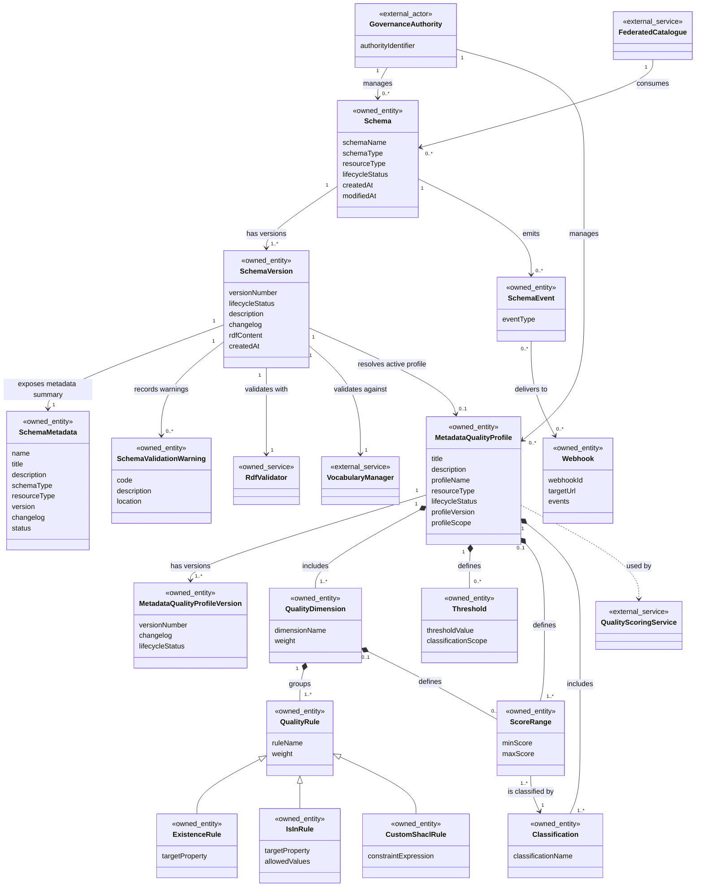

## Purpose

This document defines the Conceptual Data Model (CDM) for the Schema Manager component (simpl-schema-manager).

API definitions:
- [Schema API](../../../openapi/schema_openapi.yaml)
- [Tier 1 Gateway API](../../../openapi/tier1-gateway/t1-schema-openapi.yaml)
- [Tier 2 Gateway API](../../../openapi/tier2-gateway/t2-schema-openapi.yaml)

Business scope included:
- Resource Description Schema governance: creation, versioning, publication, revocation, and lifecycle management.
- Schema semantic validation: validation of schema definitions against vocabularies maintained by Vocabulary Manager.
- Metadata Quality Profile governance: creation, versioning, listing, status update, and soft-deletion (revocation) by authorized Governance Authority.
- Event notification: webhook subscriptions and event delivery for schema lifecycle events.

### Service Boundary

Owned within Schema Manager CDM boundary:
- Schema
- SchemaVersion
- SchemaMetadata
- MetadataQualityProfile
- MetadataQualityProfileVersion
- QualityDimension
- QualityRule
- ExistenceRule
- IsInRule
- CustomShaclRule
- Threshold
- ScoreRange
- Classification
- SchemaValidationWarning
- RdfValidator
- Webhook
- SchemaEvent

Referenced external concepts:
- VocabularyManager (authoritative vocabulary registry; provides vocabulary metadata and validation dependencies)
- FederatedCatalogue (consumes published schemas)
- QualityScoringService (resolves MetadataQualityProfile for quality assessment of self-descriptions)
- GovernanceAuthority (manages schema lifecycle)

### External Actors

| Actor | Role |
|---|---|
| GovernanceAuthority | External actor that manages schema and metadata quality profile lifecycle. |

### External Service Dependencies

| Service | Role |
|---|---|
| VocabularyManager | Provides vocabulary metadata and namespace validation dependencies. |
| FederatedCatalogue | Consumes published schemas for resource description validation and discovery. |
| QualityScoringService | Resolves metadata quality profiles for quality assessment. |

## CDM Traceability

### External CDMs referenced

| External CDM | Referenced concepts |
|---|---|
| [Vocabulary Manager CDM](https://code.europa.eu/simpl/simpl-open/data/semantics-and-vocabulary/vocabulary-hub/vocabulary-manager/vocabulary-manager-be/-/blob/feature/add-cdm/documents/architecture/cdm/simpl-vocabulary-manager-cdm.md?ref_type=heads) | VocabularyManager component |
| [Federated Catalogue CDM](https://code.europa.eu/simpl/simpl-open/integration/resource-discovery/resource-catalogue/federated-catalogue/catalogue-be/-/blob/feature/add-cdm/documents/architecture/cdm/federated-catalogue-cdm.md?ref_type=heads) | FederatedCatalogue component |
| [Quality Scoring Service CDM](https://code.europa.eu/simpl/simpl-open/data/data-governance/data-quality-rules/-/blob/feature/add-cdm/documents/architecture/cdm/quality-scoring-service-cdm.md?ref_type=heads) | QualityScoringService component |

### CDMs referencing this CDM

| Referencing CDM | Referenced concepts from this CDM |
|---|---|
| [Vocabulary Manager CDM](https://code.europa.eu/simpl/simpl-open/data/semantics-and-vocabulary/vocabulary-hub/vocabulary-manager/vocabulary-manager-be/-/blob/feature/add-cdm/documents/architecture/cdm/simpl-vocabulary-manager-cdm.md?ref_type=heads) | Schema Manager as the consumer of vocabulary definitions |
| [Federated Catalogue CDM](https://code.europa.eu/simpl/simpl-open/integration/resource-discovery/resource-catalogue/federated-catalogue/catalogue-be/-/blob/feature/add-cdm/documents/architecture/cdm/federated-catalogue-cdm.md?ref_type=heads) | Schema, SchemaVersion, SchemaEvent, MetadataQualityProfile, and MetadataQualityProfileVersion |
| [Quality Scoring Service CDM](https://code.europa.eu/simpl/simpl-open/data/data-governance/data-quality-rules/-/blob/feature/add-cdm/documents/architecture/cdm/quality-scoring-service-cdm.md?ref_type=heads) | Schema, SchemaVersion, MetadataQualityProfile, QualityDimension, QualityRule, ExistenceRule, IsInRule, CustomShaclRule, Threshold, ScoreRange, and Classification |
| [Schema Sync Adapter CDM](https://code.europa.eu/simpl/simpl-open/data/semantics-and-vocabulary/schema-management/schema-manager/schema-sync-adapter-be/-/blob/feature/add-cdm/documents/architecture/cdm/schema-sync-adapter.md?ref_type=heads) | Schema, SchemaVersion, SchemaEvent, and Webhook |
| [Catalogue Client BE CDM](https://code.europa.eu/simpl/simpl-open/integration/resource-discovery/search-engine/catalogue-search/catalogue-client-be/-/blob/feature/add-cdm/documents/architecture/cdm/xfsc-advsearch-be.md?ref_type=heads) | Schema |
| [SD Tooling BE CDM](https://code.europa.eu/simpl/simpl-open/governance/resource-management/metadata-description/resource-description-tooling/sd-tooling-be/-/blob/feature/add-cdm/documents/architecture/cdm/sdtooling-api-be.md?ref_type=heads) | Schema |

## Conceptual Model

### State/value sets used in this model

- Schema.schemaType: *RESOURCE*, *SEARCH*
- Schema.lifecycleStatus: *PUBLISHED*, *REVOKED*
- SchemaVersion.lifecycleStatus: *PUBLISHED*, *REVOKED*
- SchemaMetadata.status: *PUBLISHED*, *REVOKED*
- SchemaMetadata.schemaType: *RESOURCE*, *SEARCH*
- SchemaEvent.eventType: *SchemaPublished*, *SchemaRevoked*
- Webhook.events: Set of event types (schema events only): *SchemaPublished*, *SchemaRevoked*
- MetadataQualityProfile.lifecycleStatus: *PUBLISHED*, *REVOKED*
- MetadataQualityProfile.profileScope: dynamically defined by the active MetadataQualityProfile (default bundled profile example: *Offering*)
- MetadataQualityProfileVersion.lifecycleStatus: *PUBLISHED*, *REVOKED*
- QualityRule.ruleName: open value set naming the rule within a profile dimension
- Threshold.classificationScope: *overall*, *dimension*
- Classification.classificationName: dynamically defined by the active MetadataQualityProfile (e.g., *Green*/*Yellow*/*Red* or *Poor*/*Medium*/*Good*)
- resourceType: open value set; contract allows PascalCase strings from 3 to 64 characters, e.g. *Application*, *DataOffering*

## Concept Descriptions

| Entity | Description | Ownership |
|---|---|---|
| GovernanceAuthority | External system role representing the Governance Authority that creates, versions, and revokes schemas and metadata quality profiles. | External actor; no owning CDM |
| Schema | A schema in RDF/Turtle format that defines structural constraints and semantic rules either for a specific resource type (`schemaType=RESOURCE`) or for the common federated search profile (`schemaType=SEARCH`). Versioned and managed through a lifecycle (PUBLISHED or REVOKED). The contract field `schemaName` identifies the schema, while `SchemaMetadata.name` is the metadata summary field returned in list responses. For `SEARCH`, the schema contains only the common attributes available across federated catalogues. | Schema Manager |
| SchemaVersion | Immutable version snapshot of a Schema, containing the complete RDF/Turtle definition, version metadata, lifecycle status, and validation warnings. Each new version supersedes the previous for creating new resource descriptions. For `SEARCH` schemas, the version represents the shared federated-search profile rather than a resource-specific offering definition. The contract returns version-level metadata summaries (including changelog and status) and validation warnings during creation; the validation status itself is transient and not persisted as metadata. | Schema Manager |
| SchemaMetadata | Version-scoped metadata summary returned by schema listing endpoints, including `name`, title, description, `schemaType`, resource type, version, changelog, and status. This is the read model used for schema discovery and list responses. For `SEARCH` schemas, `resourceType` is either absent or treated as the common federated search context, while the schema still uses the same conceptual model as resource schemas. | Schema Manager |
| SchemaValidationWarning | Validation issue or non-fatal warning generated during schema creation or versioning, capturing code, description, and location information. Named for the Schema Manager boundary; aligns with the contract field `SchemaValidationIssue`. | Schema Manager |
| RdfValidator | Internal Schema Manager validation service, implemented with Apache Jena for RDF/Turtle parsing and SHACL validation. Semantic validation is provided through the integrated semantic-validation SDK. | Schema Manager |
| VocabularyManager | External authoritative vocabulary registry service providing internal and external vocabularies for schema semantic validation. Maintains separate vocabularies from schemas and provides batch search and namespace resolution capabilities via REST API. | External (Vocabulary Management Domain) |
| FederatedCatalogue | External service that consumes and stores published schemas to enable resource description validation and discovery. | External (Federated Catalogue Service) |
| QualityScoringService | External service that resolves the active metadata quality profile for self-description quality assessment. | External (Quality Scoring Service) |
| MetadataQualityProfile | Governance template owned and managed by Schema Manager, defining quality rules, weighting, and score-to-classification mapping for a specific resource type. Versioned and managed through a lifecycle (PUBLISHED or REVOKED). Carries a `profileVersion` and a business `profileScope` in addition to the management-side `profileName`/`resourceType`/`lifecycleStatus`. It is consumed by the Quality Scoring Service for self-description quality assessment and referenced as a shared external concept by the Federated Catalogue. | Schema Manager |
| MetadataQualityProfileVersion | Immutable version snapshot of a MetadataQualityProfile containing the full quality profile definition. Each new version supersedes the previous for quality assessment of newly published resource descriptions. | Schema Manager |
| QualityDimension | A quality perspective that groups rules and contributes weighted impact to the overall assessment of a metadata quality profile for a specific resource type. | Schema Manager |
| QualityRule | Abstract quality expectation evaluated against a resource description during validation. It carries the rule name and its weight within the owning dimension. | Schema Manager |
| ExistenceRule | Rule specialization requiring the target property path to be present in the resource description. | Schema Manager |
| IsInRule | Rule specialization requiring the target property path value to belong to an approved value set. | Schema Manager |
| CustomShaclRule | Rule specialization expressed through a custom SHACL constraint expression. | Schema Manager |
| Threshold | Decision boundary declared at profile level and scoped by `classificationScope` (for example, overall or a specific dimension). | Schema Manager |
| ScoreRange | Score interval mapped to a Classification. Scope is determined by the owning relationship: profile-level ranges are defined directly by the MetadataQualityProfile, dimension-level ranges by a QualityDimension. | Schema Manager |
| Classification | Quality label assigned from a score range; labels are profile-defined and may vary by active profile, such as Green/Yellow/Red or Poor/Medium/Good. | Schema Manager |
| Webhook | Event subscription storing a target URL and the set of subscribed event types. The contract field is `events`; a generated `webhookId` is a technical identifier only. | Schema Manager |
| SchemaEvent | Lifecycle signal emitted for a schema action such as publication or revocation. The contract exposes the event type as the actionable payload; no additional event payload or callback data is modeled. | Schema Manager |

### Relationship Notes

- A GovernanceAuthority manages zero or more Schemas over time.
- A Schema is classified by `schemaType`: `RESOURCE` for the current resource-definition schemas and `SEARCH` for the single federated search schema used across catalogues. The `SEARCH` schema reuses the same conceptual model but contains only the common attributes available in all federated catalogues for that schema.
- A Schema has one or more SchemaVersion entries; a new version transitions the previous version to implicit *unavailable* status for new resource descriptions.
- Schema metadata summaries are version-level views returned by list endpoints, not a separate concept that overlaps the Schema and SchemaVersion model. They expose `schemaType` so clients can distinguish resource schemas from the federated search schema.
- Each SchemaVersion is validated by the internal RdfValidator capability using Apache Jena for RDF/Turtle parsing and SHACL validation, and by Vocabulary Manager service through the semantic-validation SDK for semantic validation. Validation warnings are recorded as SchemaValidationWarning entries instead of a persisted validationStatus flag.
- A Schema may emit SchemaEvent instances for publication and revocation transitions; version creation does not emit a lifecycle event.
- Each SchemaEvent is delivered to zero or more Webhook subscriptions matching the event type; event delivery is synchronous.
- A Webhook subscription targets exactly one URL and includes zero or more event types; the operational uniqueness of a subscription is defined by the combination of target URL and events.
- The FederatedCatalogue consumes published schemas to support Resource Description validation and discovery.
- A SchemaVersion may resolve zero or one active MetadataQualityProfile; the Quality Scoring Service uses this link to determine the applicable quality profile for self-description assessments.
- A MetadataQualityProfile includes one or more QualityDimension entries, each grouping one or more QualityRule instances.
- A QualityRule is specialized as ExistenceRule, IsInRule, or CustomShaclRule, and each rule has a weight that contributes to its dimension score.
- A MetadataQualityProfile defines zero or more Threshold entries and one or more profile-level ScoreRange entries; a QualityDimension may additionally define zero or more dimension-level ScoreRange entries. These are used to derive classifications and validation gate outcomes.
- Each ScoreRange is classified by exactly one Classification; its scope (profile-level or dimension-level) is determined by which concept defines it, not by an attribute on ScoreRange itself. Thresholds are scoped by `classificationScope` to either the overall assessment or a specific dimension.
- Each ScoreRange is defined by exactly one of MetadataQualityProfile or QualityDimension, never both. The two optional owner multiplicities are mutually exclusive and collectively required.
- Each Classification classifies one or more ScoreRange entries. Labels are owned by the profile, not by individual ranges.
- A MetadataQualityProfile is used by the external QualityScoringService for assessment. The dependency represents profile consumption, not a scoring call initiated by Schema Manager.
- A MetadataQualityProfile has one or more MetadataQualityProfileVersion entries; a new version supersedes the previous for quality assessment of new resource descriptions.
- A GovernanceAuthority may soft-delete a MetadataQualityProfile by transitioning its lifecycleStatus to REVOKED; the profile is not physically removed.
- Deletion of a MetadataQualityProfile is rejected (409 Conflict) if it is the sole PUBLISHED profile for its resourceType; a replacement must be published first.
- Revoked MetadataQualityProfiles remain readable for audit and compliance purposes but are excluded from the active quality assessment pipeline.
- The Vocabulary Manager provides the authoritative vocabulary registry used by Schema Manager during semantic validation of schema definitions. Schema Manager calls Vocabulary Manager to resolve vocabulary references and validate namespace URIs.

### Alignment to API Endpoints

#### Schema Management Endpoints

| Endpoint | Concepts | Short Description |
|---|---|---|
| GET /schemas | SchemaVersion, SchemaMetadata | Lists schema metadata summaries for the latest published or revoked version of each schema, with optional filtering by status, `schemaType`, and resource type. |
| POST /schemas | GovernanceAuthority, Schema, SchemaVersion, SchemaValidationWarning | Creates a new schema from an uploaded RDF/Turtle file. Supports the new `schemaType` parameter with values `RESOURCE` and `SEARCH`, where `SEARCH` identifies the federated search schema. Triggers validation and generates SchemaPublished event. |
| GET /schemas/{schemaName}/{version} | Schema, SchemaVersion | Retrieves a specific version of a schema in RDF/Turtle format. |
| PATCH /schemas/{schemaName} | GovernanceAuthority, Schema, SchemaEvent | Revokes an existing schema by name. Generates SchemaRevoked event. |
| GET /schemas/{schemaName}/versions | SchemaVersion, SchemaMetadata | Lists all versions of a specific schema with pagination support. |
| GET /schemas/{schemaName}/qualityProfiles/active | SchemaVersion, MetadataQualityProfile | Returns the active Metadata Quality Profile for the resource type of the given schema's latest published version. Materialises the "resolves active profile" relation. |
| POST /schemas/{schemaName}/versions | GovernanceAuthority, Schema, SchemaVersion, SchemaValidationWarning | Creates a new version of an existing schema. No lifecycle event is generated for version creation; events are only emitted for SchemaPublished and SchemaRevoked transitions. |

#### Note on Vocabulary Management in Schema Manager

Historical `/vocabularies` endpoints in Schema Manager OpenAPI are **legacy** and provided for backward compatibility. The authoritative vocabulary registry is the Vocabulary Manager. Schema Manager consumes it for semantic validation of schema definitions during schema creation and versioning operations.

New vocabulary management workflows should use the Vocabulary Manager directly.

#### Metadata Quality Profile Management Endpoints

| Endpoint | Concepts | Short Description |
|---|---|---|
| GET /metadataQualityProfiles | MetadataQualityProfile | Lists Metadata Quality Profile metadata with optional filtering by status and resource type, with pagination support. Returns metadata summaries only. |
| POST /metadataQualityProfiles | GovernanceAuthority, MetadataQualityProfile, MetadataQualityProfileVersion | Creates a new Metadata Quality Profile from an uploaded RDF/Turtle file. |
| PATCH /metadataQualityProfiles/{metadataQualityProfileName} | GovernanceAuthority, MetadataQualityProfile | Updates the lifecycleStatus of an existing Metadata Quality Profile. |
| DELETE /metadataQualityProfiles/{metadataQualityProfileName} | GovernanceAuthority, MetadataQualityProfile | Soft-deletes a Metadata Quality Profile by transitioning its lifecycleStatus to REVOKED. Rejected with 409 if the profile is the sole PUBLISHED profile for its resourceType. |
| GET /metadataQualityProfiles/{metadataQualityProfileName}/versions | MetadataQualityProfile, MetadataQualityProfileVersion | Lists all versions of a specific Metadata Quality Profile with pagination support. |
| POST /metadataQualityProfiles/{metadataQualityProfileName}/versions | GovernanceAuthority, MetadataQualityProfile, MetadataQualityProfileVersion | Creates a new version of an existing Metadata Quality Profile. |

#### Webhook Management Endpoints

| Endpoint | Concepts | Short Description |
|---|---|---|
| GET /webhooks | Webhook | Lists all webhook subscriptions. Returns webhook IDs, target URLs, and subscribed event types. |
| POST /webhooks | Webhook, SchemaEvent | Creates a new webhook subscription to one or more schema event types. Event delivery begins immediately upon subscription. |
| DELETE /webhooks/{webhookId} | Webhook | Deletes a webhook subscription by ID. Stops event delivery to the target URL. |

## Assumptions and Open Questions

### Assumptions

- `SchemaValidationWarning` entries are generated transiently during schema creation and versioning and returned in the API response; they are not persisted as a separate queryable resource.
- The active MetadataQualityProfile resolved by `GET /schemas/{schemaName}/qualityProfiles/active` is determined by the resource type of the schema's latest published version.
- access-policy scoping is applied by the platform at the gateway layer using the participant identity in the access token; the CDM records only the interaction concept required for the Schema Manager domain.
