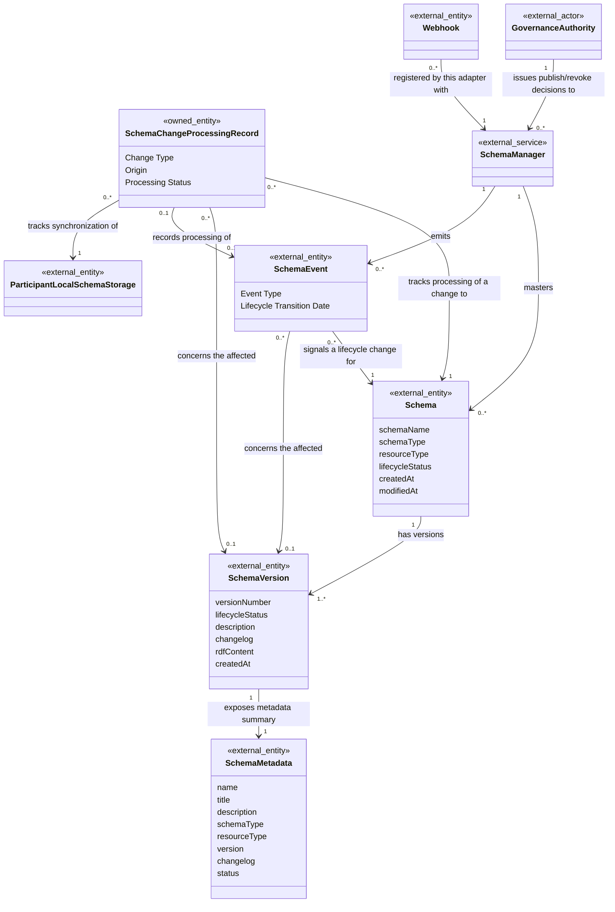

# Conceptual Data Model — Schema Sync Adapter

## Purpose

The Schema Sync Adapter is a middleware component within the SIMPL platform responsible for maintaining up-to-date schema registries on the participant (provider/consumer) side. Its business scope covers three complementary capabilities:

1. **Proactive scheduled synchronization** — a recurring background job (`SyncSchemaManagerJob`) periodically polls the SchemaManager for the current set of `PUBLISHED` and `REVOKED` schemas, compares it against the local schema registry, and initiates processing for every detected change (new schema, new version, or revocation). Each change is tracked by an adapter-owned `SchemaChangeProcessingRecord` with `origin = INTERNAL`, not by an adapter-owned `SchemaEvent`. The polling interval is configurable (`job.sync-schema-manager.interval-seconds`).
2. **Reception and processing of schema lifecycle events** — `SchemaEvent` notifications emitted by the SchemaManager are received asynchronously and tracked by adapter-owned `SchemaChangeProcessingRecord` concepts with `origin = MANAGER_NOTIFICATION`. Both notified and polling-detected changes are processed to update the local schema registry: on publication, the corresponding schema content is fetched from the SchemaManager and persisted locally; on revocation, the locally stored schema content is removed.
3. **On-demand schema retrieval with read-through caching** — participant applications can request a specific schema version directly; the adapter fetches the content live from the SchemaManager and, as a side effect, (re)caches it in local storage, so this is not a pure "serve from local storage" read but a read-through/cache-refresh operation.

Together, these capabilities ensure that provider-side and consumer-side applications always have access to the correct and current schema versions they need to operate, whether the freshness is achieved proactively (scheduled sync), reactively (event processing), or on-demand (read-through retrieval).

**API definition:** not linked in the ticket. This component exposes two OpenAPI contracts — [openapi-schema-sync-adapter-v1.yaml](../../../openapi/openapi-schema-sync-adapter-v1.yaml) (tier1, client-facing) and [openapi-schema-sync-adapter-tier2-v1.yaml](../../../openapi/openapi-schema-sync-adapter-tier2-v1.yaml) (tier2, internal event reception) — neither of which is referenced from the ticket's "API Definition Contract" link, nor from the row in `cdm-register/cdm-index.md`.

---

## CDM Traceability

### External CDMs referenced

| External CDM | Referenced concepts |
|---|---|
| [SchemaManager CDM](https://code.europa.eu/simpl/simpl-open/data/semantics-and-vocabulary/schema-management/schema-manager/schema-manager-be/-/blob/feature/add-cdm/documents/architecture/cdm/simpl-schema-manager-cdm.md?ref_type=heads) | Schema, SchemaVersion, SchemaMetadata, SchemaEvent, Webhook |

### CDMs referencing this CDM

None found at the time of writing.

---

## Service Boundary

### Owned within schema-sync-adapter CDM boundary

- **SchemaChangeProcessingRecord** — local record of a publication or revocation processed by the adapter, with change type, origin and processing status.

### Referenced external concepts

- **Schema (SchemaManager)** — schema identity, classification and lifecycle.
- **SchemaVersion (SchemaManager)** — a specific revision, including the RDF/Turtle content fetched and returned by the adapter.
- **SchemaMetadata (SchemaManager)** — version-scoped metadata summary returned by schema listing endpoints.
- **SchemaEvent (SchemaManager)** — lifecycle notification emitted when a schema is published or revoked.
- **GovernanceAuthority** — the external actor/role that originates schema lifecycle decisions (publish/revoke); no owning CDM exists.
- **SchemaManager** — the upstream SIMPL service that masters `Schema` and `SchemaVersion` data and generates/dispatches schema lifecycle notifications to the adapter; owned and operated externally.
- **ParticipantLocalSchemaStorage** — the local schema registry on the provider or consumer side that this adapter keeps synchronised; managed by the host participant; no owning CDM exists.
- **Webhook (SchemaManager)** — subscription registered by the adapter to receive schema lifecycle notifications.

---

## Conceptual Model

> **Modelling intent:** referenced schema concepts retain the entity names, attribute names and relationship names of the SchemaManager CDM on its `feature/add-cdm` branch. The model includes business data consumed or returned by the APIs even when it is transient or cached rather than stored as an independent local entity. Transport fields and persistence mechanics do not define conceptual ownership.

**Schema (referenced)** — the owner's schema identity and governance concept:
- `schemaName` — the business identifier, used in the schema retrieval path.
- `schemaType` — the owner's schema classification: `RESOURCE` or `SEARCH`.
- `resourceType` — the resource domain for `RESOURCE` schemas; for `SEARCH` schemas, either absent or treated as the common federated search context.
- `lifecycleStatus` — the owner's publication/revocation state.
- `createdAt`, `modifiedAt` — the owner's dates of schema creation and modification, retained with their source names.

**SchemaMetadata (referenced)** — the owner's version-scoped summary:
- `name`, `title`, `description` — schema identity and human-readable documentation in metadata responses.
- `schemaType`, `resourceType` — the owner's classification attributes, with the same `RESOURCE`/`SEARCH` meaning as on Schema; for `SEARCH`, `resourceType` is either absent or treated as the common federated search context.
- `version`, `changelog`, `status` — the summarized revision, its changes and publication/revocation state. `version` denotes the latest published or revoked version in the polled listing; it is not renamed to `latestVersion` in this CDM.

**SchemaVersion (referenced)** — the owner's revision and schema definition:
- `versionNumber` — the revision label, scoped to `Schema.schemaName`; notification field `version` maps to this concept.
- `lifecycleStatus`, `description`, `changelog` — revision state and documentation.
- `rdfContent` — the RDF/Turtle schema definition, including its SHACL constraints; this is the content of the specified TTL file returned by `GET /schemas/{schemaName}/{version}`, not a new adapter-owned concept.
- `createdAt` — when the revision was created by SchemaManager; notification field `created` maps to this attribute.

**SchemaEvent (external)** — the business fact that a schema was published or revoked, emitted and owned by the SchemaManager as defined in its CDM and [SIMPL-21836](https://jira.simplprogramme.eu/browse/SIMPL-21836). Its meaning is independent of whether this adapter has processed it:
- `eventType` — the kind of transition that occurred (publication or revocation).
- `lifecycleTransitionDate` — the business date of the upstream publication or revocation (the notification's `timestamp`, called `eventTimestamp` in the SchemaManager CDM).

**SchemaChangeProcessingRecord (owned)** — the adapter's processing of a schema lifecycle change, distinct from the upstream event:
- `changeType` — the publication or revocation being processed, whether learned from a `SchemaEvent` or detected by polling.
- `origin` — how the adapter learned about the change: polling (`INTERNAL`) or an upstream notification (`MANAGER_NOTIFICATION`).
- `processingStatus` — whether the change is awaiting processing, being processed, applied, ignored or failed; current implementation usage is documented in the state/value sets below.

The record's associations identify the affected `Schema`, optional `SchemaVersion` and, for notifications only, the originating `SchemaEvent`; no foreign-key attributes duplicate these links. `eventId` is excluded from both conceptual attribute sets: it is a technical identifier used for transport and idempotency, not a business identifier. Its presence in the API or persistence model does not justify including it in the CDM under the [Data Modeling Guidelines](https://code.europa.eu/simpl/simpl-open/foundations/architecture/-/blob/main/data-modeling-guidelines.md?ref_type=heads).

> **Note on diagram notation:** no data types or UML visibility markers are shown. Referenced schema attributes retain the owner's exact spelling, including `createdAt`; they are not renamed to adapter field names or display labels. The source relationships `has versions` and `exposes metadata summary` are retained unchanged.

> **Note on ownership:** only `SchemaChangeProcessingRecord` is owned here. SchemaManager concepts remain referenced when cached; selecting the newest observed version does not transfer ownership.

---

## State/value sets used in this model

**SchemaStatus**

Applies to the owner's `Schema.lifecycleStatus`, `SchemaVersion.lifecycleStatus` and `SchemaMetadata.status`; these values are referenced, not governed by the adapter.

| Value | Meaning |
|---|---|
| PUBLISHED | The schema is active and available for use by participant applications |
| REVOKED | The schema has been withdrawn and is no longer valid |

**SchemaType**

Applies to the owner's `Schema.schemaType` and `SchemaMetadata.schemaType`.

| Value | Meaning |
|---|---|
| RESOURCE | Defines structural constraints and semantic rules for a resource type |
| SEARCH | Defines the common federated-search profile |

**SchemaEventType**

| Value | Meaning |
|---|---|
| SchemaPublished | A new schema or schema version has been published by the Governance Authority |
| SchemaRevoked | An existing schema has been revoked by the Governance Authority |

> **Note:** `SchemaStatus` and `SchemaEventType` describe states/decisions that belong to the SchemaManager's domain (what it publishes/revokes); this component only observes and reacts to them. `SchemaChangeProcessingRecord.changeType` uses the same publication/revocation values as `SchemaEventType`, including when the change is detected by polling rather than notified. The two value sets below belong to the adapter-owned processing record, not to the external event.

**SchemaChangeProcessingStatus**

| Value | Meaning |
|---|---|
| TO_BE_PROCESSED | The change has been recorded locally but not yet applied to the schema registry |
| PROCESSING | Reserved for a change currently being applied; declared in code but no current code path sets this value |
| PROCESSED | The change was successfully applied: for a publication, its content was fetched and cached; for a revocation, the local content was removed |
| IGNORED | The change was found inconsistent with (or superseded by) the current local state — e.g. an older version, or a mismatch with the observed publication/revocation status — and was deliberately not applied |
| FAILED | Reserved for a failed processing attempt; declared in code but no current code path sets this value |

**SchemaChangeOrigin**

| Value | Meaning |
|---|---|
| INTERNAL | The change was detected by the adapter's scheduled polling of the SchemaManager; the record has no originating `SchemaEvent` association |
| MANAGER_NOTIFICATION | The change was learned from a lifecycle notification emitted by the SchemaManager; the record links to that external `SchemaEvent` |

> The implementation currently names these enums `SchemaEventProcessingStatus` and `SchemaEventOrigin`, and uses event-shaped objects for both paths. These technical names do not change conceptual ownership: polling creates local change-processing records, not SchemaManager-owned events. This CDM update does not rename code, database objects or API fields.

**resourceType (open value set — not a closed enum)**

For `RESOURCE` schemas, `resourceType` identifies the resource domain. For `SEARCH` schemas, it is either absent or treated as the common federated search context, as defined by SchemaManager.

Unlike `SchemaStatus`/`SchemaEventType` (closed enums) and `SchemaChangeProcessingStatus`/`SchemaChangeOrigin` (also closed value sets), `resourceType` is **not** a closed value set in this component: it is declared as a free-form string (`minLength: 1`, no `enum`, no pattern — see `SchemaEventInfo.resourceType`/`openapi-schema-sync-adapter-tier2-v1.yaml`) and is not validated against any list of allowed values at runtime. Per the SchemaManager's own contract it is governed as an **open value set constrained to PascalCase strings, 3 to 64 characters** (e.g. `Application`, `DataOffering`) — but this repository does not enforce or check that constraint locally, and its own examples do not follow it:
- `openapi-schema-sync-adapter-tier2-v1.yaml` examples use lowercase `application` and `data`.
- `SchemaController.java`'s Javadoc/OpenAPI examples use the same lowercase `"application"`/`"data"`.

This is a **documentation/example inconsistency** worth flagging, not a local validation gap this component is responsible for closing (since `resourceType` is a replicated/observed attribute, not one this component masters — see Service Boundary); it does mean any consumer relying on this repository's examples to learn the expected casing would be misled.

---

## Concept Descriptions

| Entity | Description | Ownership |
|---|---|---|
| Schema | A versioned schema definition governed by SchemaManager. | Referenced (SchemaManager) |
| SchemaMetadata | Version-scoped discovery/listing summary; the polled listing returns the latest published or revoked version of each schema. | Referenced (SchemaManager) |
| SchemaVersion | A specific revision containing the RDF/Turtle definition (`rdfContent`) fetched, cached and returned by the adapter. | Referenced (SchemaManager) |
| SchemaEvent | Lifecycle notification emitted when a schema is published or revoked. | Referenced (SchemaManager) |
| SchemaChangeProcessingRecord | Local record of a publication or revocation processed by the adapter, with change type, origin and processing status. | Owned (Schema Sync Adapter) |
| GovernanceAuthority | Actor/role that originates schema publication and revocation decisions; no owning CDM exists. | Referenced (external actor) |
| SchemaManager | Upstream service polled for schema metadata and content and subscribed to for lifecycle notifications. | Referenced (external service) |
| ParticipantLocalSchemaStorage | Participant-side schema registry kept synchronised by the adapter; no owning CDM exists. | Referenced (host participant) |
| Webhook | Subscription registered with SchemaManager to receive schema lifecycle notifications. | Referenced (SchemaManager) |

---

## Relationship Notes

- **Schema → SchemaVersion (1 to 1..\*, as mastered by the SchemaManager)**
  This multiplicity formalises the SchemaManager's own domain — where a Schema does accumulate one or more versioned snapshots over its lifecycle, queryable there via `GET /schemas/{schemaName}/versions` — **not** what schema-sync-adapter itself persists. Locally, there is no `SchemaVersion` table: `schema.s_latest_version` holds exactly one value per `Schema` row, replaced (not appended to) whenever a newer version is detected. Read this relationship as documentation of the upstream concept this component observes, not as this component's own storage shape.

- **SchemaVersion → SchemaMetadata (1 to 1, `exposes metadata summary`)**
  Each version exposes one metadata summary, as modelled by SchemaManager. The adapter polls summaries of the latest published or revoked versions; `SchemaMetadata.version` is the upstream version represented by that summary. Comparing or caching it does not make the version adapter-owned.

- **SchemaEvent → Schema (0..\* to 1)**
  Each external SchemaEvent signals a publication or revocation concerning exactly one Schema. A Schema may be the subject of multiple events over its lifecycle.

- **SchemaEvent → SchemaVersion (0..\* to 0..1)**
  Each SchemaVersion may be concerned by zero or more SchemaEvents, including publication and subsequent revocation. Each event concerns at most one specific version: the version reference is present for `SchemaPublished` events and may be absent when a whole schema (all versions) is revoked. The `0..1` multiplicity accommodates both event types; it does not make the version optional for publication.

  Multiplicities are read at the opposite endpoint: `0..*` next to `SchemaEvent` is the number of events for one Schema or SchemaVersion, while `1` next to `Schema` and `0..1` next to `SchemaVersion` describe what one event concerns. These associations describe the event's business meaning, not the adapter's processing record or any version information recovered locally during processing.

- **SchemaChangeProcessingRecord → Schema (0..\* to 1) and → SchemaVersion (0..\* to 0..1)**
  Every local record concerns exactly one Schema and optionally the version affected by the change. These associations apply to both polling-detected and notification-origin changes.

- **SchemaChangeProcessingRecord → SchemaEvent (0..1 to 0..1)**
  A notification-origin record references exactly one external SchemaEvent; a polling-origin record has no such reference. Within this adapter's boundary, an external event has at most one processing record, and may have none if it has not been received or was dismissed before recording. Processing origin and outcome belong to the record, not to the event.

---

## Alignment to API Endpoints

> **Note:** the Schema Sync Adapter exposes **two separate OpenAPI contracts**:
> - `openapi-schema-sync-adapter-v1.yaml` (tier1) — client-facing schema retrieval API
> - `openapi-schema-sync-adapter-tier2-v1.yaml` (tier2) — internal event-reception API used by the SchemaManager

### Exposed (this component is the server)

| Endpoint | OpenAPI Contract | Concepts | Short Description |
|---|---|---|---|
| POST /schemas/events | openapi-schema-sync-adapter-tier2-v1.yaml | SchemaEvent (external), SchemaChangeProcessingRecord (owned), Schema, SchemaVersion, SchemaMetadata | Receives a SchemaManager-owned lifecycle notification and metadata; records the change with `origin = MANAGER_NOTIFICATION` and processes it to update local schema storage |
| GET /schemas/{schemaName}/{version} | openapi-schema-sync-adapter-v1.yaml | Schema, SchemaVersion (`rdfContent`) | Returns the content of the specified TTL file: SchemaVersion.rdfContent, fetched live from SchemaManager and re-cached locally (read-through) |

> **Producer-side ticket evidence (SIMPL-21836, SIMPL-24515) supports the richer payload — a previously-flagged "producer models only `eventType`" concern is not confirmed by these tickets:** [**SIMPL-21836**](https://jira.simplprogramme.eu/browse/SIMPL-21836) ("[API Definition] Schema Management Webhook Notification (Catalog)", resolution: Done, resolved 27/Mar/26) is the API-definition ticket for this exact producer-side webhook, and its own "Data Model" section distinguishes `Schema`, `Schema Version` and `Schema Event` as separate concepts and gives a worked `SchemaPublished` example payload carrying `eventId`, `eventType`, `timestamp` and a full `data.schema`/`data.version` block — the same shape this adapter's own `openapi-schema-sync-adapter-tier2-v1.yaml` implements. [**SIMPL-24515**](https://jira.simplprogramme.eu/browse/SIMPL-24515) ("Add \"name\" parameter to Schema Event data sent from SchemaManager to subscribers", resolution: Done, all 8 linked merge requests merged) corroborates this further: it is a small, already-merged change that adds a `name` field onto the *existing* `data.schema` object of this same event payload — it introduces no new operation and presupposes the richer `data`-bearing payload was already in place on the producer side. Together, both tickets are consistent with the producer sending the full `data` block described throughout this document, not just a bare `eventType`.
>
> Neither ticket is fully settled, however: SIMPL-24515's dev-side resolution (27/Mar/26) was followed by a PSO reviewer comment (30/Mar/26) noting that the SchemaManager's own `CreateSchemaResponsePayload` still uses `schemaName`/`schemaVersion` rather than the newly-introduced `name`, and recommending that ticket **SIMPL-18201** be used to formally document ("upload") the CDM for this change — a recommendation that, per three further reminder comments (16/Apr, 30/Jun, 17/Jul/26) with no reply on record, remains open as of this writing. Until SIMPL-18201 is actioned, the SchemaManager's own CDM for `SchemaEvent`/`CreateSchemaResponsePayload` should still be treated as unverified against this adapter's contract for that specific naming detail, even though the overall `data`-bearing shape is corroborated.

> **Conceptual versus API detail:** the payload evidence above describes the transport contract, not conceptual attributes or ownership. In particular, the API's `eventId` remains an API/LDM/PDM concern and is not included in this CDM's entities. The notification is the external `SchemaEvent`; the adapter's processing of it is the owned `SchemaChangeProcessingRecord`.

> **Note:** the scheduled `SyncSchemaManagerJob` is not exposed via an OpenAPI contract but is part of the business scope: it compares upstream SchemaMetadata with the local cache and creates `INTERNAL` SchemaChangeProcessingRecords for detected changes, not upstream SchemaEvents.

### Consumed (this component is the client, via `SchemaManagerClient`)

The two exposed operations above are only half of the picture: this component also actively **calls** the SchemaManager. These outbound calls are not published as an OpenAPI contract of this component (they consume the *SchemaManager's* contract), but they are essential to the CDM's business scope and are the origin of most of the data described elsewhere in this document.

| Client Call | Purpose | Concepts | Note |
|---|---|---|---|
| `GET /schemas` (by `schemaType`/`status`, paginated) | Polls metadata for the latest published or revoked version of each schema | SchemaMetadata (`schemaType`), Schema, SchemaVersion, SchemaChangeProcessingRecord | The adapter polls PUBLISHED and REVOKED metadata separately for RESOURCE and SEARCH, passing schemaType/status and omitting resourceType. SchemaMetadata.version supplies the latest version in this listing context. Each detected change creates an `INTERNAL` processing record with no originating SchemaEvent link. |
| `GET /schemas/{schemaName}/{version}` (with `schemaType`) | Fetches SchemaVersion.rdfContent (TTL/SHACL content) | Schema (`schemaType`), SchemaVersion (`rdfContent`) | The adapter passes schemaType to retrieve the identified RESOURCE or SEARCH revision. Called by on-demand retrieval and publication-change processing; content remains owned by SchemaManager. |
| `POST /webhooks` (body: `WebhookRegistration{events, targetUrl}`) | **Subscribes** this adapter with the SchemaManager, so that publish/revoke notifications are pushed back to it | Webhook — a concept **owned by the SchemaManager's own CDM**, only referenced here as the mechanism this adapter depends on | Executed once at application startup (`WebhookRegistrationScheduler.registerWebhookOnStartup()`, with retry). The registered `targetUrl` is this adapter's own `POST /schemas/events` endpoint (`{target-url}/v1/schemas/events`). This enables receipt of external `SchemaEvent` notifications and creation of `MANAGER_NOTIFICATION` processing records; without notifications, synchronization creates only `INTERNAL` records from polling. |

> Read together, exposed and consumed operations close the loop: this adapter **subscribes** (`POST /webhooks`) once at startup → the SchemaManager later **calls back** the adapter's own `POST /schemas/events` (`origin = MANAGER_NOTIFICATION`) *or* the adapter itself **polls** (`GET /schemas`, `origin = INTERNAL`) → in both cases the actual content is **fetched** (`GET /schemas/{schemaName}/{version}`) and cached → participants **retrieve** it on demand via the adapter's own `GET /schemas/{schemaName}/{version}`.

---

## Assumptions and Open Questions

- **No API definition link in the ticket:** neither the ticket's own "API Definition Contract" link, nor the row in `cdm-register/cdm-index.md`, points to either of this component's two actual OpenAPI contracts (`openapi-schema-sync-adapter-v1.yaml`, `openapi-schema-sync-adapter-tier2-v1.yaml`), listed in Purpose.
- **`resourceType` casing inconsistency:** the SchemaManager's own contract governs `resourceType` as an open value set constrained to PascalCase strings (3–64 characters, e.g. `Application`), but this repository's own OpenAPI examples and Javadoc use lowercase (`application`, `data`). Not enforced or validated locally, since the attribute is replicated, not mastered, here.
- **SIMPL-18201 still open:** per the note in "Alignment to API Endpoints", the PSO recommendation to formally document the SchemaManager's own CDM for the `SchemaEvent`/`CreateSchemaResponsePayload` naming detail (`name` vs. `schemaName`/`schemaVersion`) has three reminder comments on record with no reply, and remains open as of this writing.

---
