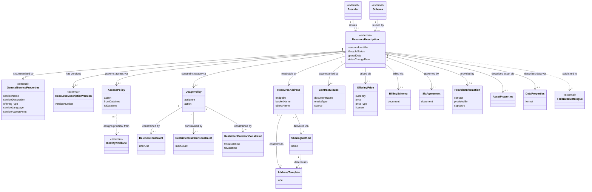

# sd-tooling-be — Conceptual Data Model

## Purpose

The **SD Tooling Backend** (`sd-tooling-be`) manages the full provider-side lifecycle of **Resource Descriptions** in a federated European data space. It enables resource providers to author, enrich, validate, digitally sign, publish, and revoke self-descriptions on the federated catalogue. The service orchestrates the definition of access and usage policies in ODRL format, the specification of resource addresses against reusable templates, and the attachment of contract clauses and sharing methods — producing a versioned, auditable record of every published offering.

**API definition:** the service is split across three tier-1 contracts — [openapi-sdtooling-tier1-v1.yaml](../../openapi/openapi-sdtooling-tier1-v1.yaml), [openapi-sdtooling-tier1-v2.yaml](../../openapi/openapi-sdtooling-tier1-v2.yaml) and [openapi-sdtooling-tier1-v3.yaml](../../openapi/openapi-sdtooling-tier1-v3.yaml).

---

## CDM Traceability

### External CDMs referenced

| External CDM                                                                                                                                                                                                                                      | Referenced concepts |
|---------------------------------------------------------------------------------------------------------------------------------------------------------------------------------------------------------------------------------------------------|---|
| [Federated Catalogue CDM](https://code.europa.eu/simpl/simpl-open/integration/resource-discovery/resource-catalogue/federated-catalogue/catalogue-be/-/blob/feature/add-cdm/documents/architecture/cdm/federated-catalogue-cdm.md?ref_type=heads) | ResourceDescription, ResourceDescriptionVersion, GeneralServiceProperties; CDM of the FederatedCatalogue service |
| [Schema Manager CDM](https://code.europa.eu/simpl/simpl-open/data/semantics-and-vocabulary/schema-management/schema-manager/schema-manager-be/-/blob/feature/add-cdm/documents/architecture/cdm/simpl-schema-manager-cdm.md?ref_type=heads)       | Schema |
| [Security Attributes Provider CDM](https://code.europa.eu/simpl/simpl-open/security/access-control-and-trust/security-attribute-provider-federation/security-attributes-provider/security-attributes-provider-be)                                 | IdentityAttribute |

### CDMs referencing this CDM

| Referencing CDM                                                                                                                                                                                                                              | Referenced relationship |
|----------------------------------------------------------------------------------------------------------------------------------------------------------------------------------------------------------------------------------------------|---|
| [Search Client BE CDM](https://code.europa.eu/simpl/simpl-open/integration/resource-discovery/search-engine/catalogue-search/catalogue-client-be/-/blob/feature/add-cdm/documents/architecture/cdm/xfsc-advsearch-be.md?ref_type=heads)      | OfferingPrice, ProviderInformation, AssetProperties, DataProperties as sub-components of ResourceDescription |
| [Query Mapper CDM](https://code.europa.eu/simpl/simpl-open/integration/resource-discovery/search-engine/catalogue-search/query-mapper-adapter-be/-/blob/feature/add-cdm/documents/architecture/cdm/query-mapper-cdm.md?ref_type=heads)       | References this service (sd-tooling-be) |
| [SD Validation BE CDM](https://code.europa.eu/simpl/simpl-open/governance/resource-management/metadata-description/validation/validation-be/-/blob/feature/add-cdm/documents/architecture/cdm/sdtooling-validation-api-be.md?ref_type=heads) | ResourceAddress and AddressTemplate (called `JSONSchemaTemplate` there) |

---

## Service Boundary

### Owned within sd-tooling-be boundary

| Concept | Role |
|---|---|
| **OfferingPrice** | Price terms attached to the offering (currency, price, price type, license) |
| **BillingSchema** | Reference to the billing schema document governing the offering |
| **SlaAgreement** | Reference to the SLA document governing the offering |
| **ProviderInformation** | Provider contact, identity and signature information attached to the offering |
| **AssetProperties** | Asset-level properties of the offering |
| **DataProperties** | Data-level properties of the offering |
| **AccessPolicy** | ODRL-based rule governing who (assignee) may perform which action on the resource |
| **UsagePolicy** | ODRL-based rule constraining how a consumer may use the resource after access is granted |
| **DeletionConstraint** | Usage constraint expressing an after-use deletion obligation |
| **RestrictedNumberConstraint** | Usage constraint capping the number of allowed uses |
| **RestrictedDurationConstraint** | Usage constraint bounding the validity window of use |
| **ResourceAddress** | Resolved endpoint value for the resource, bound to a specific template |
| **SharingMethod** | Named protocol/mechanism through which the resource is made available |
| **AddressTemplate** | Reusable schema defining the fields required to fill a ResourceAddress |
| **ContractClause** | Attached legal/contractual document associated with a ResourceDescription |

### External references (not owned by this service)

| Concept | Source |
|---|---|
| **ResourceDescription** | Federated Catalogue CDM |
| **ResourceDescriptionVersion** | Federated Catalogue CDM |
| **GeneralServiceProperties** | Federated Catalogue CDM |
| **Schema** | Schema Manager CDM |
| **IdentityAttribute** | Security Attributes Provider CDM — principal attributes assigned as AccessPolicy assignees |
| **FederatedCatalogue** | External service — receives and hosts published ResourceDescriptions. Its CDM is the Federated Catalogue CDM |
| **Provider** | Identity/Access domain — the actor named as the contract's first Key Actor: "Creates and publishes Resource Descriptions, defines policies, and manages validation" |

> **Ownership of ResourceDescription and ResourceDescriptionVersion:** both are owned by the Federated Catalogue CDM, which "manages its lifecycle status (including revocation)". Referenced here with the owner's names, attributes and lines: the attributes previously shown on ResourceDescription are in `GeneralServiceProperties` (`serviceName`, `serviceDescription`, `offeringType`, `serviceLanguage`, `serviceAccessPoint`), and the identifier of a resource description is `resourceIdentifier`.
>
> **Ownership of Schema:** `Schema` (previously `ValidationSchema`) is owned by the Schema Manager CDM; the Federated Catalogue CDM describes it as "The schema definition owned by Schema Manager."

---

## Conceptual Model

---

## State/value sets used in this model

| Value Set | Values | Used By |
|---|---|---|
| **OfferingType** | `data`, `infrastructure`, `application` (values of the owner, the Federated Catalogue CDM) | `GeneralServiceProperties.offeringType` — the `GET /resourceAddresses/sharingMethods` and `/templates` query parameter enum is upper-case (`DATA`, `APPLICATION`, `INFRASTRUCTURE`), while the `GET /resourceDescriptions` responses return lower case; the owner's lower-case values are used here. |
| **LifecycleStatus** | `active`, `revoked` | `ResourceDescription.lifecycleStatus` — `active` after publishing, `revoked` after revoking; `statusChangeDate` records the date of each change. |
| **AccessPolicyAction** | `SEARCH`, `CONSUME`, `RESTRICTED_CONSUME` | `AccessPolicy.action` |
| **UsagePolicyAction** | `USE` | `UsagePolicy.action` |
| **SharingMethodId** | `HTTPDATA_PUSH`, `IONOS_S3` | `SharingMethod.name` — the `sharingMethodId` enum of the contract (`GET /resourceAddresses/sharingMethods`, `GET /resourceAddresses/sharingMethods/{sharingMethodId}/templates`). |
| **UsageConstraintKind** | `Deletion`, `RestrictedNumber`, `RestrictedDuration` | Discriminator (`type`) of the constraint attached to a `UsagePolicy`. |

---

## Concept Descriptions

| Entity | Description | Ownership |
|---|---|---|
| **ResourceDescription** | The provider's self-description of a data, application, or infrastructure resource published in the federated catalogue. Identified by `resourceIdentifier`; carries `lifecycleStatus` (`active`, `revoked`), `uploadDate` and `statusChangeDate`. | External — Federated Catalogue CDM |
| **GeneralServiceProperties** | High-level summary properties of a resource description: `serviceName`, `serviceDescription`, `offeringType`, `serviceLanguage`, `serviceAccessPoint`. | External — Federated Catalogue CDM |
| **ResourceDescriptionVersion** | A version snapshot of a ResourceDescription, carrying a `versionNumber`; the claims graph URI(s) are the `resourceIdentifier` of the ResourceDescription. | External — Federated Catalogue CDM |
| **OfferingPrice** | Price terms attached to the offering: currency, price, price type (e.g. free), license (`simpl:offeringPrice`). | Owned |
| **BillingSchema** | Reference to the billing schema document governing the offering (`simpl:billingSchema`). | Owned |
| **SlaAgreement** | Reference to the SLA document governing the offering (`simpl:slaAgreements`). | Owned |
| **ProviderInformation** | Provider contact, identity and signature information attached to the offering (`simpl:providerInformation`: contact, providedBy, signature). | Owned |
| **AssetProperties** | Asset-level properties of the offering (`simpl:assetProperties`). | Owned |
| **DataProperties** | Data-level properties of the offering, currently just format (`simpl:dataProperties.format`). | Owned |
| **AccessPolicy** | An ODRL-aligned rule that specifies which principal, taken from an IdentityAttribute, is permitted to perform a given action (SEARCH, CONSUME, RESTRICTED_CONSUME) on the resource, optionally bounded by a time window. | Owned |
| **UsagePolicy** | An ODRL-aligned rule that constrains how an authorized consumer may use the resource after access is granted, via one or more typed constraints (Deletion, RestrictedNumber, RestrictedDuration). | Owned |
| **DeletionConstraint** | A usage constraint expressing an after-use deletion obligation (`afterUse` flag). | Owned |
| **RestrictedNumberConstraint** | A usage constraint capping the number of allowed uses (`maxCount`). | Owned |
| **RestrictedDurationConstraint** | A usage constraint bounding the validity window of use (`fromDatetime`/`toDatetime`). | Owned |
| **ResourceAddress** | The concrete endpoint value for the resource — endpoint, bucket name, object name for object-storage-based sharing methods — typed by a SharingMethod and conforming to the field schema defined by an AddressTemplate. | Owned |
| **SharingMethod** | A named protocol or transfer mechanism (`HTTPDATA_PUSH`, `IONOS_S3`) through which the resource is delivered to consumers. | Owned |
| **AddressTemplate** | A reusable schema that defines the required fields for a ResourceAddress. Determined by the combination of SharingMethod and offering type. | Owned |
| **ContractClause** | A reference to a legal or contractual document (PDF, HTML, etc.) attached to the ResourceDescription, including its storage location (`source`, a URI) alongside documentId, documentName and mediaType. | Owned |
| **Provider** | The resource-owning organisation that creates and publishes Resource Descriptions, defines policies, and manages validation — the contract's first Key Actor. | External |
| **Schema** | A SHACL shape used to validate ResourceDescription fields before publication; retrieved through the v2 schema operations. | External — Schema Manager CDM |
| **IdentityAttribute** | "A definition of an identity attribute recognised by the dataspace (e.g. Consumer, Data Provider)", returned by the contract as the identity attributes assigned to the CONSUMER type by the Governance Authority and used as the assignee in AccessPolicy rules. | External — Security Attributes Provider CDM |
| **FederatedCatalogue** | The external service that receives and hosts published ResourceDescriptions, making them discoverable to consumers across the data space. | External — Federated Catalogue CDM |

---

## Relationship Notes

1. **Provider → ResourceDescription (1 : 0..*)** — A Provider issues zero or more ResourceDescriptions, aligned with the Federated Catalogue CDM's own `issues` relationship.

2. **ResourceDescription → GeneralServiceProperties (1 : 1)** — "is summarized by", from the owner: the summary attributes (name, description, offering type, language, access point) are held by GeneralServiceProperties.

3. **ResourceDescription → ResourceDescriptionVersion (1 : 0..*)** — "has versions", from the owner: each publication or update appends a version.

4. **ResourceDescription → AccessPolicy (1 : 0..*)** — A ResourceDescription may carry zero or more AccessPolicy entries. Each policy independently scopes a principal-action pair; multiple policies allow differentiated access tiers (e.g., SEARCH vs CONSUME).

5. **ResourceDescription → UsagePolicy (1 : 0..*)** — A ResourceDescription may carry zero or more UsagePolicy entries.

6. **ResourceDescription → ResourceAddress (1 : 1)** — The contract carries a single `resourceAddress` object per publication (`POST /selfDescriptions/finalized`, `POST /selfDescriptions/enriched`).

7. **ResourceDescription → ContractClause (1 : 0..*)** — A ResourceDescription may reference zero or more ContractClause documents, uploaded independently via `POST /contractClauses` and referenced by `documentId`.

8. **ResourceDescription → OfferingPrice / BillingSchema / SlaAgreement / ProviderInformation / AssetProperties / DataProperties (1 : 0..1 each)** — Sub-components of the `simpl:DataOffering` submitted to `POST /selfDescriptions/finalized`.

9. **UsagePolicy → DeletionConstraint / RestrictedNumberConstraint / RestrictedDurationConstraint (1 : 0..* each)** — The contract's `UsagePolicyPermission.constraints` is an array (`minItems: 1`) of constraint objects discriminated by `type`: at least one constraint is required, but of any kind, hence `0..*` on each line.

10. **ResourceAddress → AddressTemplate (0..* : 1)** — Many ResourceAddresses may conform to the same AddressTemplate.

11. **ResourceAddress → SharingMethod (0..* : 1)** — Many ResourceAddresses may reference the same SharingMethod.

12. **SharingMethod → AddressTemplate (1 : 0..*)** — The contract exposes it as `GET /resourceAddresses/sharingMethods/{sharingMethodId}/templates`.

13. **AccessPolicy ⇢ IdentityAttribute (0..* : 1)** — Reference dependency, not ownership: each access permission requires one assignee, taken from an IdentityAttribute. The assignee is therefore not an attribute of AccessPolicy.

14. **Schema → ResourceDescription (1 : 0..*)** — "is used by", from the owner of ResourceDescription (Federated Catalogue CDM). The `schemaId` identifies the Schema against which a self-description is validated.

15. **ResourceDescription ⇢ FederatedCatalogue** — Outbound integration point; the service is not owned by sd-tooling-be.

> **Removed:** `templateId` as an attribute of `ResourceAddress` and `assignee` as an attribute of `AccessPolicy`: both duplicate a connector already drawn in the diagram.

---

## Alignment to API Endpoints

| Endpoint | Primary Concepts | Short Description |
|---|---|---|
| `GET /resourceDescriptions` | ResourceDescription, GeneralServiceProperties, Provider | Lists all ResourceDescriptions for the authenticated provider |
| `GET /resourceDescriptions/{resourceDescriptionId}` | ResourceDescription, GeneralServiceProperties | Retrieves a single ResourceDescription by ID from the federated catalogue |
| `GET /resourceDescriptions/{resourceDescriptionId}/versions` | ResourceDescription, ResourceDescriptionVersion | Lists all version snapshots for a ResourceDescription (also covered by open ticket SIMPL-21645) |
| `POST /resourceDescriptions/{resourceDescriptionId}/revoke` | ResourceDescription | Revokes a published ResourceDescription: `lifecycleStatus` becomes `revoked` and `statusChangeDate` records the date of the change |
| `POST /selfDescriptions/enriched` *(v2, v3)* | ResourceDescription, ResourceAddress, Schema | Enriches and validates a self-description with the provided metadata and resource address, against the schema identified by `schemaId` |
| `POST /selfDescriptions/finalized` | ResourceDescription, Schema, OfferingPrice, BillingSchema, SlaAgreement, ProviderInformation, AssetProperties, DataProperties, AccessPolicy, UsagePolicy, ContractClause, ResourceAddress | Enriches, validates (against the schema identified by `schemaId`) and digitally signs a self-description, producing the immutable payload ready for publication |
| `POST /selfDescriptions/publications` | ResourceDescription, AccessPolicy, UsagePolicy, ResourceDescriptionVersion | Publishes a finalized ResourceDescription to the FederatedCatalogue; `lifecycleStatus` is `active` after publication |
| `POST /policies/access` | AccessPolicy, IdentityAttribute | Generates an access policy in ODRL format from a list of access permissions, each with one assignee |
| `POST /policies/usage` | UsagePolicy, DeletionConstraint, RestrictedNumberConstraint, RestrictedDurationConstraint | Generates a usage policy in ODRL format from a list of usage permissions and constraints |
| `GET /policies/actions` | AccessPolicy (action value set) | Lists all supported access policy actions (SEARCH, CONSUME, RESTRICTED_CONSUME) |
| `GET /policies/identityAttributes` | IdentityAttribute | Returns the identity attributes assigned to the CONSUMER type by the Governance Authority |
| `POST /contractClauses` | ContractClause | Uploads a contractual document and returns its metadata (documentId, documentName, mediaType, source) |
| `GET /resourceAddresses/assets/{assetId}` | ResourceAddress | Retrieves the resource address registered for a given asset (also covered by open ticket SIMPL-25143) |
| `GET /resourceAddresses/sharingMethods` | SharingMethod | Lists all supported sharing methods for a given offering type |
| `GET /resourceAddresses/sharingMethods/{sharingMethodId}/templates` | SharingMethod, AddressTemplate | Lists the address templates mapped to a given sharing method and offering type |
| `GET /resourceAddresses/templates/{templateId}/schema` | AddressTemplate | Returns the JSON schema describing the fields of a given address template |
| `GET /resourceAddresses/templates/{templateId}/uiSchema` | AddressTemplate | Returns the UI schema for the form representation of a given address template |
| `GET /schemas` *(v2)* | Schema | Lists the available schemas |
| `GET /schemas/{schemaId}/content` *(v2)* | Schema | Returns the content of a specific schema (`getSchemaContent`) |
| `GET /schemas/{schemaId}/{version}` *(v2)* | Schema | Returns the content of a specific version of a schema (`getSchemaByVersion`) |

---

## Assumptions and Open Questions

- **Removed operations:** `POST /resourceDescriptions/{resourceDescriptionId}/validateContractAccessPolicies` (SIMPL-30815, cancelled), `POST /contractClauses/sourceDocument` (SIMPL-29021, whose operation is `POST /contractClauses`) and `GET /contractClauses/sourceDocument/{documentId}` (SIMPL-29048, which belongs to the Search Client BE as `GET /contractClauses/documents/{documentId}`) are not in any of the three contracts and have been removed.

