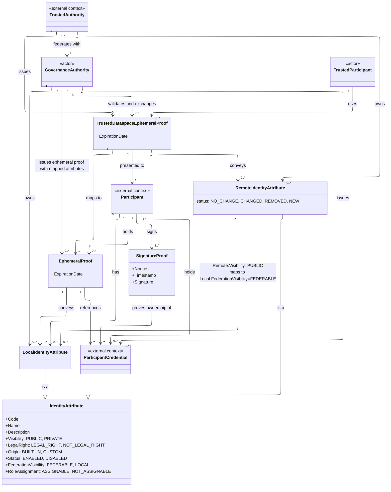

## Purpose

This document defines the Conceptual Data Model (CDM) for the Security Attributes Provider component.

Business scope includes:
- Management of the dataspace's catalogue of identity attributes (e.g. Consumer, Data Provider), including their visibility, status, and eligibility for role assignment or federation.
- Assignment of identity attributes to participants, forming the basis for attribute-based access control (ABAC) across the dataspace.
- Maintenance of federation mappings with trusted external authorities, matching their remote identity attributes to local equivalents and surfacing any that have no local counterpart yet.
- Issuance and exchange of ephemeral proofs: short-lived tokens that convey a participant's identity attributes for fast, secure ABAC enforcement, including translating proofs issued by trusted authorities into locally recognised ones.

See OpenAPI definition files: 
- [Tier 1 APIs](../../../openapi/securityattributesprovider-tier1-v2.yaml)
- [Tier 2 APIs](../../../openapi/securityattributesprovider-tier2-v2.yaml)

## Service boundary and CDM traceability

### Owned concepts

- IdentityAttribute
- LocalIdentityAttribute
- RemoteIdentityAttribute
- SignatureProof
- EphemeralProof
- TrustedDataspaceEphemeralProof 

### Referenced concepts, by owning CDM

| Owning CDM | Concepts used here |
|---|---|
| [Identity Provider](https://code.europa.eu/simpl/simpl-open/security/access-control-and-trust/identity-provider-federation/identity-provider/identity-provider-be/-/blob/develop/documents/architecture/cdm/identity-provider-cdm.md?ref_type=heads) | Participant, TrustedAuthority, ParticipantCredential | 

### CDMs that reference this one

- [Identity Provider](https://code.europa.eu/simpl/simpl-open/security/access-control-and-trust/identity-provider-federation/identity-provider/identity-provider-be/-/blob/develop/documents/architecture/cdm/identity-provider-cdm.md?ref_type=heads)
- [Onboarding](https://code.europa.eu/simpl/simpl-open/governance/participant-management/onboarding/onboarding/onboarding-be/-/blob/develop/documents/architecture/cdm/onboarding-cdm.md?ref_type=heads) 
- [Authentication Provider](https://code.europa.eu/simpl/simpl-open/security/access-control-and-trust/authentication-provider-federation/authentication-provider/authentication-provider-be/-/blob/develop/documents/architecture/cdm/authentication-provider-cdm.md?ref_type=heads)
- [Users and Roles](https://code.europa.eu/simpl/simpl-open/governance/participant-management/user-roles/user-roles/users-roles-be/-/blob/develop/documents/architecture/cdm/users-roles-cdm.md?ref_type=heads)

## Conceptual Data Model

_NOTE: some labels may not render correctly in GitLab. Please open the link below in Mermaid Live for a clearer rendering._
 

Open in [Mermaid live](https://mermaid.live/view#pako:eNqlVtFu4joQ_RXLj3cDIoWF1mKRKGRZpBQqoL3SFVLlJgasG-LIdtqy3f77jgkJpCQt7OYlHmfmeObMeDKv2BM-wwRXKpW5nIeeCBd8ScwSoYBuRKwJYsH_ZiNVCahSfU6Xkq4TPZ9L5mkuQjTrJzto90JbZTSTsdLM78Z6JSTXG_SafjdPu81eNJMhDRAcr0HodNLvb4V4Q5-FGnC6Wkv-GGuWB_zSg5hyGyO6zm_0mfIkj4zTuf17rvgjDwCboNu7a3fYs9DtZHjfnTk5PZctaTDhyxXQ4zqDrvswGQ5-zCw0Gs8eDjZyRmPJlzwk6Ppu6M4ehiML9e6ms_FNTmmqqY4VQc6oe-06fQv1h9PtKqf1nflMUuP-ocffnb4zMcoWcse9rpszmYiAdZXiy3AN7BHUnU6Hg1GibbzeyznyEyHh3RUeDUrJP1K_pVJzj0c01PsElWf7yH7C1kKzD5KtdlyNxg-9H93RACJJ3kDbxLkZ35vFyPm3BN-JVmwNNAa3UojFHvaL8xLxhN0-1azEelfUoEFVRD32d2gD8WRICT1WcEvabeppIUuJmkJSgQnJ3h89EgCYSTO-ZkDZOsp2MsPPM9iTbJsIyNuf5HLHVklJlIWH3udoju05RpVKB1a1avUfEEqKkhiXnthGnYBkVoWhEiTZgkkGLGY4RZkqcKsEjysVn41VHCJB4jk8F-rjqiXoiQbchzJViIY-Yi_eiobLsx1-x3UaNmLpPoq2H565XqE1jSLmI5rGlR12WCwZ9Gm5X9ESlFPztBKBfyrEUbQnGduJcf7uEmQadGb77mKfWLPA7ROQDdXBpFrxCIlFCvhJ0yoIrqQJH12vM5DtI86IKQKFtPhDtEOOTfxMgbtQU0eAh1WbKyiDUlDcBC2SPy3waYr1A7hTmUP5e3sK0meXNt9UClrt2ZjgZKz2kCX3rFL51UEFpcGhe6SmZSz8je2ZzSCBqe4npW_JaNd-lJ208NBW2EJUi4arb9lshS0MPK0p92FsfjWOzrE23M0xgWVghsI5nodvoEhjLaab0MNEy5hZWIp4ucJkQQMFUhyZTrsbpVMVyNd_QmQi8zn8Gm-SIX07q1t4Kc3ZO0QWgrM9EYcaE_vr1h6TV_wCUr1RrTfti1qjYdt1u3nZtPAGk6tqrd5o2vUr-8K-uKi1mm8W_rk9sVa9atUu7Uaj1rxs2a2rr62331k3Aj4)

## Concept descriptions

| Entity | Description |
|---|---|
| **SignatureProof** | Used by the participant to prove its identity. |
| **TrustedDataspaceEphemeralProof** | An ephemeral proof issued by a Trusted Authority. During Tier 2 communication, it is exchanged for an ephemeral proof that can be validated within the data space.  |
| **IdentityAttribute** | A definition of an identity attribute recognised by the dataspace (e.g. Consumer, Data Provider), including its visibility, status, origin, federation eligibility, role-assignment eligibility, and whether it represents a legal right. |
| **LocalIdentityAttribute** | An identity attribute defined and owned by the Governance Authority. It can be mapped to one or more remote identity attributes during federation setup. |
| **RemoteIdentityAttribute** | An identity attribute owned by a trusted authority, mapped to one or more local identity attributes. This component keeps track of the status of the remote identity attributes. If the Trusted Authority updates, removes, or creates a remote identity attribute, this component keeps track of the changes and the attribute is labelled as `CHANGED`, `REMOVED`, `NEW`. If nothing has changed, the attribute is labelled as `NO_CHANGE`. |
| **EphemeralProof** | A short-lived, verifiable proof issued to a participant, conveying its identity attributes for attribute-based access control (ABAC) enforcement. |
| **GovernanceAuthority** | *(actor)* The Governance Authority that holds the identity attributes of a dataspace and issues ephemeral proofs. |
| **Participant** | *(external context, see [Identity Provider](https://code.europa.eu/simpl/simpl-open/security/access-control-and-trust/identity-provider-federation/identity-provider/identity-provider-be/-/blob/develop/documents/architecture/cdm/identity-provider-cdm.md?ref_type=heads))* An organisation onboarded into the dataspace. Identity attributes are assigned to it, and it can hold ephemeral proofs. Managed outside this component. |
| **TrustedAuthority** | *(external context, see [Identity Provider](https://code.europa.eu/simpl/simpl-open/security/access-control-and-trust/identity-provider-federation/identity-provider/identity-provider-be/-/blob/develop/documents/architecture/cdm/identity-provider-cdm.md?ref_type=heads))* An external, federated authority with which a mapping of identity attributes is maintained. Managed outside this component. |
| **ParticipantCredential** | *(external context, see [Identity Provider](https://code.europa.eu/simpl/simpl-open/security/access-control-and-trust/identity-provider-federation/identity-provider/identity-provider-be/-/blob/develop/documents/architecture/cdm/identity-provider-cdm.md?ref_type=heads))* A credential issued by the Governance Authority and held by a Participant. Used for Tier 2 communication between participants. |
| **TrustedParticipant** | *(actor)* A participant whose governance authority is trusted by the participant's Governance Authority. The trusted Governance Authority issues a TrustedDataspaceEphemeralProof, which is exchanged for an internal EphemeralProof during Tier 2 communication. |

## Assumptions and open questions

- `TrustedParticipant` and `TrustedDataspaceEphemeralProof` are not covered by any contract. They have been added to outline that there are ephemeral proofs coming from a trusted dataspace and that are exchanged for internal `EphemeralProofs`.
 
