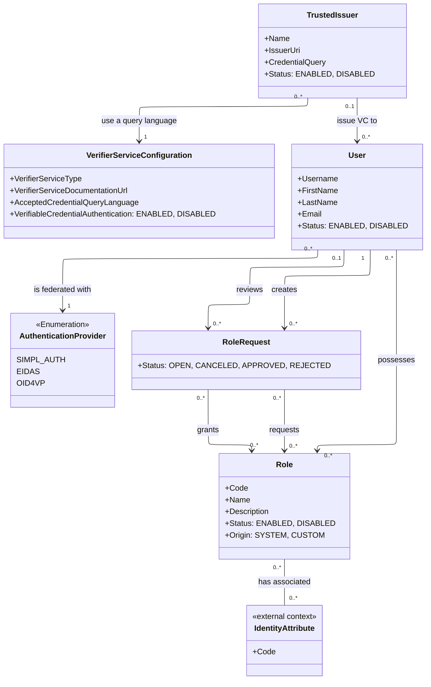

## Purpose

This document defines the Conceptual Data Model (CDM) for the Users and Roles component.

Business scope includes:
- creation, updating, search, and lifecycle management of users, roles, role requests, and assignment of identity attributes
- configuration and management of trusted issuers and accepted verifiable credentials when SSI Tier 1 is enabled within a Simpl-Open agent.

See OpenAPI definition files: 
- [usersroles-tier1-v2.yaml](../../../openapi/usersroles-tier1-v2.yaml)

## Service boundary and CDM traceability

### Owned concepts

- VerifierServiceConfiguration
- TrustedIssuer
- AuthenticationProvider
- User
- Role
- RoleRequest

### Referenced concepts, by owning CDM

| Owning CDM | Concepts used here |
|---|---|
| [Security Attribute Provider](https://code.europa.eu/simpl/simpl-open/security/access-control-and-trust/security-attribute-provider-federation/security-attributes-provider/security-attributes-provider-be/-/blob/develop/documents/architecture/cdm/security-attributes-provider-cdm.md?ref_type=heads) | IdentityAttribute |

### CDMs that reference this one

- [Consent Management](https://code.europa.eu/simpl/simpl-open/governance/consent-management/consent-management/consent-management-service/consent-management-be/-/blob/develop/documents/architecture/cdm/consent-management-cdm.md?ref_type=heads)
- [Infrastructure](https://code.europa.eu/simpl/simpl-open/infrastructure/provisioning/infrastructure-provisioning/infrastructure-provisioning/infrastructure-be/-/blob/develop/documents/architecture/cdm/infrastructure-be-cdm.md)

## Conceptual Data Model

_NOTE: some labels may not render correctly in GitLab. Please open the link below in Mermaid Live for a better rendering._

Open in [Mermaid live](https://mermaid.live/view#pako:eNqlVW1v2jAQ_iuWP26AeGtJo6pSGjKNibcRQNqENLmJCdZCTP3SliH--86haZPAIlVDfDifn7vn7nF8PuCAhxTbuF6vr8QqCXiyZpFtTIRisuda2YjGv40jg8REyj4jkSDbEw6hkAkaKMYTNL83vsyfYtGSCrZmVPhUPLGAuimHFiQNOGRY8_tcgs73O1q13-eB3tJEpakWIi5gnSCgO0VDV9AQMIzE3zUV-yFJIk2iS3nJQ0zf0Y5WG2MFaXYbeWPnfuj1a6g_8FMry3A8b3kutATqgZRAWepxTLZF8hNqIVjBWyq7sOdDx1p-rKRiO1PBn1hYru321ktA0NPR3N3lt_zBaDr85SzmX_Neb9B3_LxjMuh3l9OKMhbyTBDjSsqifGFCqjOphuSC09sSFv-3PjMe01JhLtyN6qPrUxkItjNyfayAFDURLGLwZfk__Lk3qiF34c8no4oaB-kXofaOUoI9aEXLx0dflNEyRnCRFSyKZ1ho6JgZ5zLM6KOmUpXUyHqaTL0x1OqMXS9tzZlOZ5OlsWbeN8-dl1TOU6SHv8KtFUb1-h1YzUbjEyzypDYKBCWKylIQQE1cVaCgT4w-Xwj8dIkQAnZcSmr-WUjqz4W82-fS22hDJALNeMCg3jCfI6upkl2cQPLDgTB6E1XZplHqHxfeRkyiNcwWYYpGz0xtskzFqfUmuUn5TmDoTA7AoKWLFK-ILhZU9Q7YSEuKCHo0sw5entOMxjUM0wiudwhP1MHQrDA0BZcQ22DGLNqoFV4lRwASrbi_TwJsK6FpDQuuow221ySWsNK7ENp9fbYyyI4kPzl_W9KQKS5GpwcxfRdrOBKG-zUjTUA1l-tEYbvTTuOxfcAv2G71Og2r2e41r7rtbq_Z7Vg1vMd2u9e4ubFaV9Z1u9dudltW91jDf1LKZsO6sa6urZ513em1u53W8S_22U2l)

## Concept descriptions

| Entity                           | Description                                                                                                                                                                                                                                                                                                                                                                                                                                                                                         |
|----------------------------------|-----------------------------------------------------------------------------------------------------------------------------------------------------------------------------------------------------------------------------------------------------------------------------------------------------------------------------------------------------------------------------------------------------------------------------------------------------------------------------------------------------|
| **VerifierServiceConfiguration** | The configuration settings for the verifier service when authentication via Verifiable Credentials is enabled                                                                                                                                                                                                                                                                                                                                                                                       |
| **TrustedIssuer**                | An entity responsible for issuing Verifiable Credentials that is trusted within a Simpl-Open agent. Its issued credentials can be used for end-user authentication                                                                                                                                                                                                                                                                                                                                  |
| **User**                         | Represents an end user of the Simpl-Open agent                                                                                                                                                                                                                                                                                                                                                                                                                                                      |
| **Role**                         | Assigned to user to define their specific access rights and permissions within a Simpl-Open agent                                                                                                                                                                                                                                                                                                                                                                                                   |
| **IdentityAttribute**            | *(external context, see [Security Attribute Provider](https://code.europa.eu/simpl/simpl-open/security/access-control-and-trust/security-attribute-provider-federation/security-attributes-provider/security-attributes-provider-be/-/blob/develop/documents/architecture/cdm/security-attributes-provider-cdm.md?ref_type=heads))* Assigned to dataspace participants and roles to specify and control access to specific functionalities or services during Tier 2 (agent-to-agent) communication |
| **RoleRequest**                  | Represents a request related to role management or assignment within the system                                                                                                                                                                                                                                                                                                                                                                                                                     |
| **AuthenticationProvider**       | Specifies the origin of an end user, indicating whether they are authenticated from an external identity provider such as eIDAS or OID4VP                                                                                                                                                                                                                                                                                                                                                           |

## Assumptions and open questions

Any assumptions or open questions arising later will be recorded here.