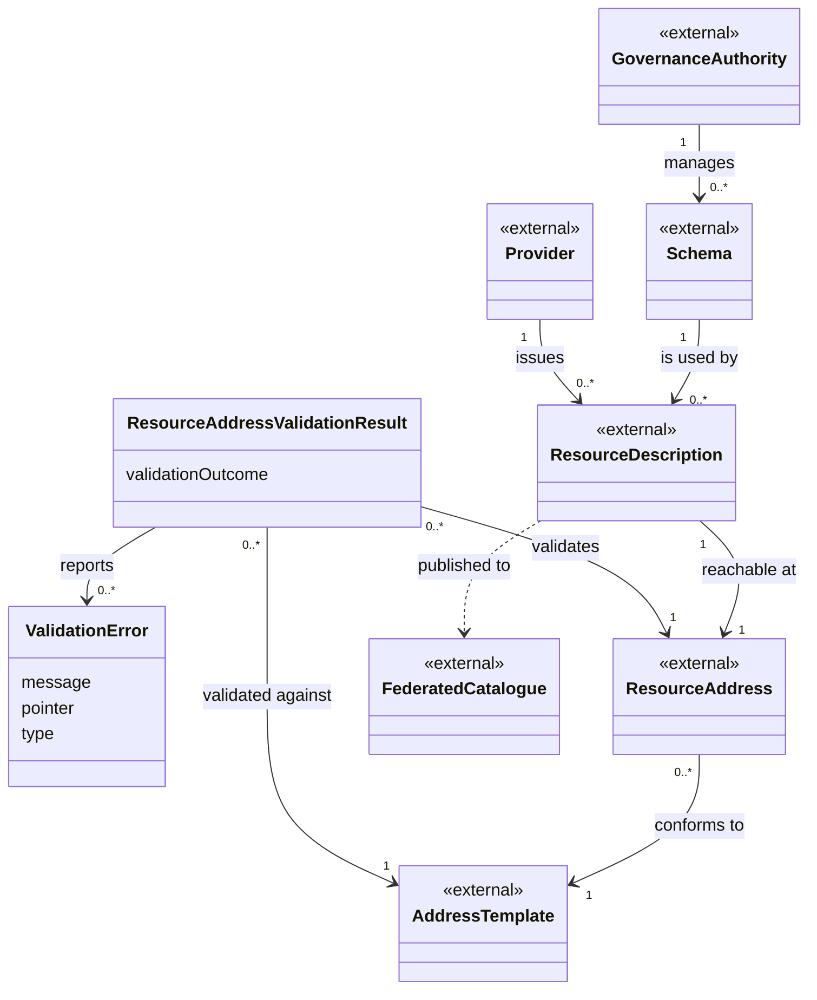

# Conceptual Data Model — sdtooling-validation-api-be

## Purpose

The **sdtooling-validation-api-be** (Validation Service API) provides syntactic validation of Resource Descriptions prior to their publication on the SIMPL federated catalogue. Its business scope covers two complementary validation domains:

- **Self-Description validation**: verifies that a JSON-LD Resource Description (the Self-Description of the contract) conforms to structural constraints expressed in a SHACL shape file (Schema).
- **Resource Address validation**: verifies that a Resource Address JSON document satisfies the structural rules defined by a JSON Schema template (AddressTemplate).

The service supports Providers in detecting non-conformances before catalogue submission, reducing publication errors and promoting interoperability across the SIMPL data space. Validation rules and conformance criteria are defined by the Governance Authority. As stated by the contract, "The Validation Service performs syntactic checks and returns validation results."

**API definition:** [openapi-validation-v1.yaml](../../../openapi/openapi-validation-v1.yaml). The ticket's own "API Definition Contract" link, and the row in `cdm-register/cdm-index.md`, both point instead to `development/data1/sdtooling-validation-api-be`, which is archived — this must be corrected to the contract above.

Semantic and quality assessment is a separate concern, scoped to `quality-scoring-service` (SIMPL-27613).

---

## CDM Traceability

### External CDMs referenced

| External CDM | Referenced concepts |
|---|---|
| [SD Tooling BE CDM](https://code.europa.eu/simpl/simpl-open/governance/resource-management/metadata-description/resource-description-tooling/sd-tooling-be/-/blob/feature/add-cdm/documents/architecture/cdm/sdtooling-api-be.md?ref_type=heads) | ResourceAddress, AddressTemplate, Provider (owner — see Service Boundary) |
| [Federated Catalogue CDM](https://code.europa.eu/simpl/simpl-open/integration/resource-discovery/resource-catalogue/federated-catalogue/catalogue-be/-/blob/feature/add-cdm/documents/architecture/cdm/federated-catalogue-cdm.md?ref_type=heads) | ResourceDescription, FederatedCatalogue |
| [Schema Manager CDM](https://code.europa.eu/simpl/simpl-open/data/semantics-and-vocabulary/schema-management/schema-manager/schema-manager-be/-/blob/feature/add-cdm/documents/architecture/cdm/simpl-schema-manager-cdm.md?ref_type=heads) | Schema, GovernanceAuthority |

### CDMs referencing this CDM

None found at the time of writing.

---

## Service Boundary

### Owned within sdtooling-validation-api-be CDM boundary

- ResourceAddressValidationResult
- ValidationError

### Referenced external concepts

- **ResourceDescription** — the provider's self-description of a data, application, or infrastructure resource, as a JSON-LD document (the Self-Description of the contract). Owned by the Federated Catalogue CDM; submitted here only as validation input, not stored or managed.
- **Schema** — a SHACL shape defining the structural constraints for a given resource type. Owned by the Schema Manager CDM; used here only as a validation input.
- **ResourceAddress** — owned by SD Tooling BE (`sd-tooling-be`), which lists it under its own boundary together with `AddressTemplate`; submitted here only as validation input.
- **AddressTemplate** — a reusable schema that defines the required fields for a ResourceAddress (the JSON Schema template of the contract). Owned by SD Tooling BE; submitted here only as validation input.
- **FederatedCatalogue** — the external service where validated Resource Descriptions are ultimately published. Its CDM is the Federated Catalogue CDM.
- **Provider** — the data-space actor that issues Resource Descriptions and initiates validation requests; defined and managed externally.
- **GovernanceAuthority** — the actor that defines validation rules and data-model conformance criteria, and manages Schemas; external to this service.

---

## Conceptual Model

---

## State/value sets used in this model

| Value Set | Values | Applied To |
|---|---|---|
| **ValidationOutcome** | `VALID`, `INVALID` | ResourceAddressValidationResult.validationOutcome — `VALID` when the Resource Address conforms to the AddressTemplate; `INVALID` when at least one ValidationError is reported. |

---

## Concept Descriptions

| Entity | Description | Ownership |
|--------|-------------|-----------|
| ResourceAddressValidationResult | The outcome of the validation of a ResourceAddress against an AddressTemplate: a `validationOutcome` (`VALID` or `INVALID`) and, when invalid, a list of ValidationError items. | Owned |
| ValidationError | An individual non-conformance detected during Resource Address validation, carrying `message`, `pointer` (the location within the submitted JSON) and `type`. | Owned |
| ResourceDescription | The provider's self-description of a data, application, or infrastructure resource, as a JSON-LD document; it is the Self-Description of the contract, submitted to this service as validation input. Not stored or lifecycle-managed here. | External — Federated Catalogue CDM |
| Schema | A SHACL shape file used to validate a ResourceDescription, managed by the Governance Authority. Not stored by this service. | External — Schema Manager CDM |
| ResourceAddress | A JSON document containing the field values of a resource address, submitted to this service as validation input. | External — SD Tooling BE CDM |
| AddressTemplate | A reusable schema that defines the required fields for a ResourceAddress; it is the JSON Schema template of the contract. | External — SD Tooling BE CDM |
| FederatedCatalogue | The external service where validated Resource Descriptions are ultimately published. | External — Federated Catalogue CDM |
| Provider | The data-space actor that issues Resource Descriptions and initiates validation requests. | External — SD Tooling BE CDM |
| GovernanceAuthority | The actor that defines validation rules and data-model conformance criteria, and manages Schemas. | External — Schema Manager CDM |

---

## Relationship Notes

- **ResourceAddressValidationResult → ValidationError (1 : 0..*)** — `POST /resourceAddresses/validation` evaluates a `ResourceAddress` against an `AddressTemplate` and returns a `ResourceAddressValidationResult`. When the outcome is `INVALID`, zero or more `ValidationError` entries describe the non-conformances found (`message`, `pointer`, `type`).

- **ResourceAddressValidationResult → ResourceAddress (0..* : 1) / AddressTemplate (0..* : 1)** — each result states which address was validated and against which template.

- **ResourceAddress → AddressTemplate (0..* : 1)** — "conforms to", the line of the SD Tooling BE CDM, which owns both.

- **`POST /selfDescriptions/validation` has no equivalent outcome object.** The implementation (`SDValidationControllerImpl.validateSelfDescription`) returns an HTTP 200 in both the valid and invalid case: an empty string when the ResourceDescription conforms to the Schema, and the serialized SHACL validation report when it does not — confirmed by the unit test assertion "Validation result should be empty for valid JSON file". No structured issue list is returned on success or failure.

- **Provider → ResourceDescription (1 : 0..*)** — "issues", the line of the owner CDMs.

- **ResourceDescription → ResourceAddress (1 : 1)** — "reachable at", the line of the SD Tooling BE CDM, which owns ResourceAddress.

- **GovernanceAuthority → Schema (1 : 0..*)** — "manages", the line of the Schema Manager CDM, which owns Schema.

- **Schema → ResourceDescription (1 : 0..*)** — "is used by", the line of the Federated Catalogue CDM, which owns ResourceDescription: it shows which resource descriptions the shape validates.

- **ResourceDescription ⇢ FederatedCatalogue** — outbound publication after validation. These external relationships are shown for boundary context only.

---

## Alignment to API Endpoints

| Endpoint | Concepts | Short Description |
|----------|----------|-------------------|
| `POST /selfDescriptions/validation` | ResourceDescription, Schema | Submits a JSON-LD ResourceDescription (the Self-Description) together with a SHACL shape file (Schema). Returns HTTP 200 with an empty body when conformant, or the serialized SHACL validation report when not — see Relationship Notes for the discrepancy with the contract's stated description. |
| `POST /resourceAddresses/validation` | ResourceAddress, AddressTemplate, ResourceAddressValidationResult, ValidationError | Submits a Resource Address JSON together with a JSON Schema template (AddressTemplate). Returns a `ResourceAddressValidationResult` with a `validationOutcome` (`VALID`/`INVALID`) and, when invalid, a list of `ValidationError` entries (`message`, `pointer`, `type`). |

---

## Assumptions and Open Questions

- **Naming:** `ResourceAddressValidationResult` is the business name of the response object that the contract calls `ResourceAddressResponse`; `validationOutcome` replaces the contract's boolean `valid` flag. The contract field names are unchanged.
- **`AddressTemplate`, `Schema`, `ResourceDescription`:** these are the names used by the owner CDMs for what this service previously called `JSONSchemaTemplate`, `SHACLShape` and `SelfDescription`.

