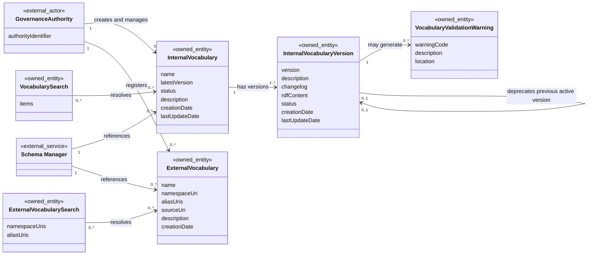

## Purpose

This document defines the Conceptual Data Model (CDM) for the Vocabulary Manager component (simpl-vocabulary-manager).

API definition: [openapi/vocabulary_openapi-tier1.yaml](../../../openapi/vocabulary_openapi-tier1.yaml)

Business scope included:
- Internal vocabulary governance: creation, versioning, status management, and lifecycle control.
- External vocabulary caching: registration of copied external vocabularies as validation dependencies.
- Semantic search and validation: vocabulary metadata resolution by name or namespace, RDF syntax validation, and OWL semantic consistency checking.

### Service Boundary

Owned within Vocabulary Manager CDM boundary:
- InternalVocabulary
- InternalVocabularyVersion
- ExternalVocabulary
- VocabularyValidationWarning
- VocabularySearch
- ExternalVocabularySearch

Referenced external concepts:
- GovernanceAuthority (manages vocabulary lifecycle)
- Schema Manager (consumes vocabularies for reference validation in schema definitions)

### External Actors

| Actor | Role |
|---|---|
| GovernanceAuthority | External actor that manages vocabulary lifecycle. |

### External Service Dependencies

| Service | Role |
|---|---|
| SchemaManager | Consumes vocabulary definitions for schema reference validation. |

## CDM Traceability

### External CDMs referenced

| External CDM | Referenced concepts |
|---|---|
| [Schema Manager CDM](https://code.europa.eu/simpl/simpl-open/data/semantics-and-vocabulary/schema-management/schema-manager/schema-manager-be/-/blob/feature/add-cdm/documents/architecture/cdm/simpl-schema-manager-cdm.md?ref_type=heads) | Schema Manager component |

### CDMs referencing this CDM

| Referencing CDM | Referenced relationship |
|---|---|
| [Schema Manager CDM](https://code.europa.eu/simpl/simpl-open/data/semantics-and-vocabulary/schema-management/schema-manager/schema-manager-be/-/blob/feature/add-cdm/documents/architecture/cdm/simpl-schema-manager-cdm.md?ref_type=heads) | Vocabulary Manager as the authoritative vocabulary registry |

## Conceptual Model

### State/value sets used in this model

- InternalVocabulary.status: *ACTIVE*, *DEPRECATED*
- InternalVocabularyVersion.status: *ACTIVE*, *DEPRECATED*
- VocabularyValidationWarning.warningCode: *syntaxError*, *semanticError*, *externalReferenceSkipped*, *semanticReasoningSkipped*
- ExternalVocabulary registration: Canonical namespace URI + zero or more alias URIs

## Concept Descriptions

| Entity | Description | Ownership |
|---|---|---|
| GovernanceAuthority | External system role representing the Governance Authority authorized to create, update, and manage vocabularies. | External actor |
| InternalVocabulary | A reusable knowledge base in Turtle format defining concept schemes, hierarchies, or controlled vocabularies. Versioned and managed through a lifecycle (ACTIVE or DEPRECATED). Managed by the Governance Authority. Identified by a unique `name`; `latestVersion` identifies the most recently created version; `status` is the vocabulary-level lifecycle status; `creationDate` and `lastUpdateDate` are ISO-8601 timestamps. | Owned |
| InternalVocabularyVersion | Immutable version snapshot of an InternalVocabulary, containing the complete Turtle RDF definition (`rdfContent`), a human-readable `description`, a `changelog` entry, a version-level lifecycle `status` (ACTIVE or DEPRECATED), and timestamps (`creationDate`, `lastUpdateDate`). Versions are numbered sequentially (1, 2, 3, ...). Validation issues are recorded separately as VocabularyValidationWarning entries; there is no `validationStatus` field. | Owned |
| ExternalVocabulary | A cached copy of an external vocabulary (e.g., DCAT, W3C standards) registered for validation dependency resolution. Identified by a canonical namespace URI and zero or more alias URIs. Not versioned; a single registration represents the external vocabulary state at registration time. Can be deleted and re-registered with newer content; immutability is not enforced. | Owned |
| VocabularyValidationWarning | A validation issue or non-fatal problem detected during Turtle syntax check, semantic validation, or OWL consistency reasoning. May include external namespace resolution warnings. | Owned |
| VocabularySearch | Read-only batch search request to resolve metadata for multiple InternalVocabulary entries by name and optional version, used for semantic reference resolution in schemas and other services. Missing vocabulary names or versions are omitted from results. | Owned |
| ExternalVocabularySearch | Read-only batch search request to resolve metadata for ExternalVocabulary entries by canonical namespace URI or registered alias URIs, used during validation dependency lookup. | Owned |
| Schema Manager | External service that consumes InternalVocabulary and ExternalVocabulary definitions to resolve namespace references in schema definitions and perform semantic validation. | Referenced |

### Relationship Notes

- A GovernanceAuthority may create zero or more InternalVocabulary entries and zero or more ExternalVocabulary registrations over time.
- An InternalVocabulary has one or more InternalVocabularyVersion entries; updating the vocabulary-level `status` or the version-level `status` does not create a new version.
- An InternalVocabularyVersion may generate zero or more VocabularyValidationWarning entries during creation.
- Creating an InternalVocabularyVersion makes it ACTIVE and deprecates the previous active version.
- An ExternalVocabulary registration includes exactly one canonical namespace URI and zero or more alias URIs for normalization during validation lookups.
- VocabularySearch is a read-only operation that resolves InternalVocabulary metadata; missing or invalid vocabulary names are silently omitted from results.
- ExternalVocabularySearch is a read-only operation that resolves ExternalVocabulary entries by canonical or alias namespace URIs; no match returns an empty result set.
- Schema Manager references both InternalVocabulary and ExternalVocabulary during namespace validation in schema definitions.
- Validation results are computed during version creation but not persisted as metadata. Validation warnings are stored as VocabularyValidationWarning entries and are only returned inline in the creation response, not by any metadata retrieval endpoint.

### Alignment to API Endpoints

#### Health Endpoint

| Endpoint | Concepts | Short Description |
|---|---|---|
| GET /health | (No data concepts) | Returns health status (UP, DEGRADED, DOWN). Used by orchestration for liveness/readiness probes. |

#### Internal Vocabulary Management Endpoints

| Endpoint | Concepts | Short Description |
|---|---|---|
| GET /vocabularies | InternalVocabulary, InternalVocabularyVersion | Lists latest version metadata for all internal vocabularies with optional filtering by name, status, creation date, last-update date, and sorting. Pagination support. |
| POST /vocabularies | GovernanceAuthority, InternalVocabulary, InternalVocabularyVersion, VocabularyValidationWarning | Creates a new internal vocabulary from an uploaded Turtle file. Performs Turtle syntax and semantic validation as part of creation. Automatically creates version 1 in ACTIVE status. Generates validation warnings if applicable. |
| GET /vocabularies/{vocabularyName} | InternalVocabulary, InternalVocabularyVersion | Retrieves the latest metadata for an internal vocabulary. |
| PATCH /vocabularies/{vocabularyName} | GovernanceAuthority, InternalVocabulary | Updates the lifecycle status of an internal vocabulary (e.g., ACTIVE to DEPRECATED). |
| GET /vocabularies/{vocabularyName}/versions | InternalVocabulary, InternalVocabularyVersion | Lists all versions of an internal vocabulary with pagination support. |
| POST /vocabularies/{vocabularyName}/versions | InternalVocabulary, InternalVocabularyVersion, VocabularyValidationWarning | Creates a new ACTIVE version of an existing internal vocabulary from an uploaded Turtle file and deprecates the previous active version. Performs Turtle syntax and semantic validation as part of creation. Version number is auto-assigned sequentially; manual version assignment is rejected. Generates validation warnings if applicable. |
| GET /vocabularies/{vocabularyName}/versions/{version} | InternalVocabulary, InternalVocabularyVersion | Retrieves metadata for a specific version of an internal vocabulary. |
| PATCH /vocabularies/{vocabularyName}/versions/{version} | GovernanceAuthority, InternalVocabularyVersion | Updates the lifecycle status of a specific vocabulary version (e.g., ACTIVE to DEPRECATED). |
| GET /content/{vocabularyName} | InternalVocabularyVersion | Downloads the latest internal vocabulary content in Turtle format (text/turtle). |
| GET /content/{vocabularyName}/versions/{version} | InternalVocabularyVersion | Downloads a specific internal vocabulary version content in Turtle format (text/turtle). |

#### Internal Vocabulary Search Endpoint

| Endpoint | Concepts | Short Description |
|---|---|---|
| POST /vocabularies/searches | VocabularySearch, InternalVocabulary, InternalVocabularyVersion | Batch search for internal vocabulary metadata by name and optional version for semantic reference resolution. Missing entries are omitted from results. Read-only operation. |

#### External Vocabulary Management Endpoints

| Endpoint | Concepts | Short Description |
|---|---|---|
| GET /external-vocabularies | ExternalVocabulary | Lists cached external vocabularies with pagination support. Returns metadata only (name, namespace URI, aliases, source URI, description, creator, creation date). |
| POST /external-vocabularies | GovernanceAuthority, ExternalVocabulary | Creates a new cached external vocabulary from an uploaded Turtle file after checking its Turtle syntax. External vocabularies are not semantically validated on import and are used as validation dependencies for resolving external namespace references. |
| GET /external-vocabularies/{name} | ExternalVocabulary | Retrieves metadata for a cached external vocabulary by name. |
| DELETE /external-vocabularies/{name} | GovernanceAuthority, ExternalVocabulary | Hard deletes a cached external vocabulary and its content. |
| GET /external-vocabularies/{name}/content | ExternalVocabulary | Downloads cached external vocabulary content in Turtle format (text/turtle). |

#### External Vocabulary Search and Content Endpoints

| Endpoint | Concepts | Short Description |
|---|---|---|
| POST /external-vocabulary/searches | ExternalVocabularySearch, ExternalVocabulary | Batch search for cached external vocabulary metadata by canonical namespace URI or registered alias URIs. Used for validating external namespace references in vocabularies and schemas. No match returns empty results. Read-only operation. |
| POST /external-vocabularies/content | ExternalVocabularySearch, ExternalVocabulary | Downloads cached external vocabulary content by namespace URI (canonical or alias). Used as legacy/fallback endpoint for namespace-based content lookup. Returns Turtle content in text/turtle format. |

## Assumptions and Open Questions

- Assumption: the Vocabulary Manager manages the vocabulary governance and validation lifecycle.
- Assumption: vocabulary operations are scoped to the requesting participant by platform access policies.
- Open question ([SIMPL-18201](https://jira.simplprogramme.eu/browse/SIMPL-18201)): the status update endpoints (`PATCH /vocabularies/{vocabularyName}` and `PATCH /vocabularies/{vocabularyName}/versions/{version}`) are expected to include reason and effective date if available; neither the contract nor the model currently carries these attributes.
- Open question ([SIMPL-18201](https://jira.simplprogramme.eu/browse/SIMPL-18201)): internal vocabulary creation is expected to optionally publish (system-driven or flag-controlled); neither the contract nor the model currently reflects this responsibility.
