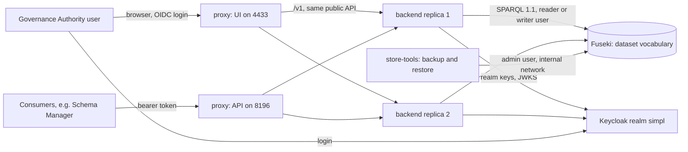
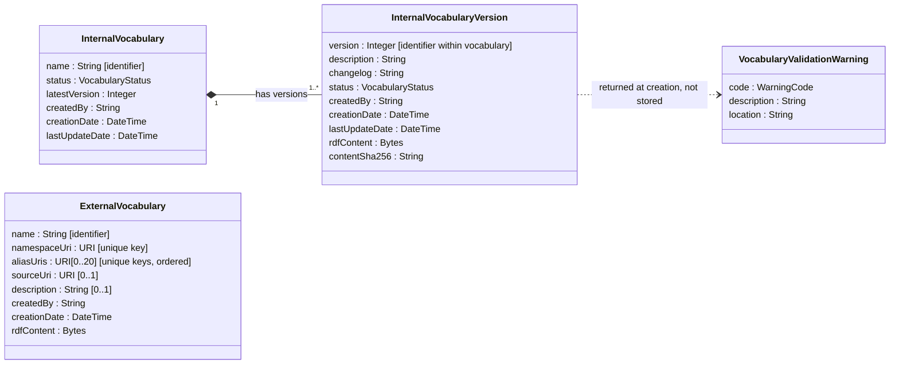

# Architecture overview

## Context

Networks: `front` (proxy and backends), `idp` (backends and Keycloak), `store` (internal only: backends, Fuseki,
store tools). Only the proxy ports (8196, 4433) and Keycloak (127.0.0.1:8193) are published.

## Backend layers

| Package | Responsibility |
|---|---|
| `web` | `ApiOperation` (the operation table: method, path, role rule, body kind, media type), `RoutingFilter` (405), `MediaTypeFilter` (404 unknown path, 406, 415), `CorrelationFilter`, outbound trace headers |
| `security` | `TokenValidator` (Nimbus JWS verification, issuer, audience, expiry), `RealmKeyProvider` (key cache, 10 s refetch cooldown, circuit breaker), `TokenAuthenticationFilter`, `OperationAuthorizationManager` (default deny) |
| `api` | Controllers per tag, request checks (`Checks`), wire representations (`Dtos`, `Representations`) |
| `request` | Query parameters, multipart form, JSON body, field rules, paging links |
| `validation` | `TurtleSyntaxValidator` (Jena RIOT), `SemanticValidator` (S1 to S6), `ReferenceChecker` (S7 and warnings) |
| `service` | `VocabularyService` (lifecycle, conditional writes with retry), `ExternalVocabularyService`, `SearchService`, `ContentValidation`, `UploadLimiter` |
| `store` | `SparqlStore` (SPARQL protocol client with timeouts, retries, circuit breaker), repositories, RDF names |
| `error` | `ProblemException` (the one exception base class, D104), `Problems` (all problem types), `ProblemHandler` |

## Request flow and order of checks

Servlet filters, in order:

1. Micrometer Tracing observation filter (W3C `traceparent`), then `CorrelationFilter` (`X-Correlation-Id`).
2. Spring Security firewall (encoded slash, control characters: 400 problem, D67).
3. `RoutingFilter`: unknown method or a method the path does not offer: 405 with `Allow` (D67, D77).
4. `TokenAuthenticationFilter`: bearer token check: 401, or 503 when the realm keys cannot be fetched (D17, D44).
5. `OperationAuthorizationManager`: no token on a secured operation: 401; missing role: 403; unknown path with a
   token: passes to step 6 (D16, D84).
6. `MediaTypeFilter`: unknown path 404 (D67), Accept 406 (D63), Content-Type 415 (D15).
7. Controller: upload limiter 503 (D92), body size 413 (D15, D76, D110), request shape 400 (path, query, unknown
   fields, field rules, version field: D49, D52, D37, D7), then the service: 404, 409 (duplicate name, same status,
   identical version), then content validation 400 (syntax, then semantic) (D51).

## Concurrency (D43, D82, D92)

No lock state in the service. Every write is a conditional SPARQL update in one store transaction: the first
operation sets a fresh change token on the vocabulary only when the state read before is still current (latest
version number, status, or "no vocabulary with this name ignoring case"); the next operations of the same request
(insert the version and its content, deprecate older ACTIVE versions) run only when the token was set. The service
reads the token back: its own token means success; otherwise it reads again and retries, at most 5 times, then 503.
Validation runs once, before the retry loop. Several backend instances can run on one store; the own test
`ConcurrencyApiTest` runs two instances on one store. At most 4 uploads run at the same time per instance.

## Failure handling (D44, D71, D88, D103)

| Dependency | Timeouts | Retries | Breaker | Caller sees |
|---|---|---|---|---|
| Store reads | connect 2 s, response 10 s | 2 (200 ms, 400 ms) on connection failure or timeout | `store`: 50 % of last 20 calls (min 10), open 10 s, 3 probes | 503 `The vocabulary store is not available. Retry later.`, Retry-After 5 |
| Store updates | connect 2 s, response 45 s | none | same breaker | 503 as above; store holds all or nothing |
| Store errors (non-2xx) | | none | not counted | 500 |
| Realm keys | 2 s | none in a request; one refetch per 10 s for an unknown key id | `realmKeys` | 401 for an unknown key id; 503 `The identity provider is not available. Retry later.` when keys cannot be fetched |

`GET /v1/health`: 503 DOWN when the store does not answer an ASK in 2 s; 200 DEGRADED when no realm keys are cached
and a fetch failed and fails again; else 200 UP.

## Observability (D86, D96)

JSON log lines (Spring Boot structured logging, logstash layout) with `traceId`, `spanId`, `correlationId`,
`operationId`, and `vocabularyName` and `version` when known. Logs carry the token subject, never email, name or
token (D80). Prometheus metrics on the management port: `http_server_requests_seconds` per operation (uri template,
status, outcome), `resilience4j_circuitbreaker_*` for both breakers, JVM metrics. The trace context and correlation
id are forwarded to the store and to Keycloak.

## Logical data model (D87, D97, D117)

| Entity (CDM class) | Identifier | Attributes | Relations | Store (physical) |
|---|---|---|---|---|
| InternalVocabulary | `name` (unique ignoring case) | status (ACTIVE, DEPRECATED), latestVersion, createdBy (of version 1), creationDate, lastUpdateDate | 1 to 1..* InternalVocabularyVersion | `vm:InternalVocabulary` in graph `...:graph:internal`, plus `vm:nameKey` and `vm:changeToken` |
| InternalVocabularyVersion | (vocabulary name, version) | description, changelog, status, createdBy, creationDate, lastUpdateDate, rdfContent, contentSha256 | belongs to one InternalVocabulary | `vm:InternalVocabularyVersion` in the same graph; content in graph `...:content:<Name>:<n>` as base64 chunks |
| ExternalVocabulary | `name` (unique ignoring case) | namespaceUri, aliasUris, sourceUri, description, createdBy, creationDate, rdfContent | none | `vm:ExternalVocabulary` with `vm:AliasUri` nodes in graph `...:graph:external`; content in `...:external-content:<Name>` |
| VocabularyValidationWarning | none (value object) | code, description, location | returned with a created version | not stored (D10) |

Differences with the CDM snapshot (D2, D117), listed for the CDM owner:

1. `InternalVocabulary.description` is not stored; the vocabulary shows its latest version's description (D28).
2. `createdBy` added to InternalVocabularyVersion and ExternalVocabulary, and on InternalVocabulary (creator of
   version 1) (D27).
3. `VocabularyValidationWarning.warningCode` is `code` on the wire and the closed set is externalReferenceSkipped,
   deprecatedVocabularyReference, semanticReasoningSkipped; syntaxError and semanticError are validation errors, not
   warnings (D10).
4. Warnings are not stored (the CDM says "stored as entries"; D10 and the CDM's own last relationship note say not).
5. `VocabularySearch` and `ExternalVocabularySearch` are queries, not entities; they are left out (D117).
6. Typed attributes and timestamp names creationDate and lastUpdateDate as in the glossary (D117).
7. `contentSha256` is a physical helper for the identical-version check (D46), not a business attribute.
8. "Creating a version deprecates the previous active version" in the CDM reads as one version; the build
   deprecates every older ACTIVE version (D4).

The physical model of each named graph is in `physical-model-shapes.ttl`; `PhysicalModelShapesTest` runs it against
data stored through the API.

## UI

Vue 3, Vite, TypeScript, vue-router, keycloak-js (authorization code with PKCE), N3.js for the browser syntax check.
Screens: Vocabulary list (`/vocabularies`), Vocabulary details with the version history (`/vocabularies/<Name>`),
create form (`/vocabularies/new`), new version form (`/vocabularies/<Name>/versions/new`). Texts, roles and
labels follow D60, D72, D75, D90, D100, D101, D109, D114 and D115. The UI calls the same public API through the proxy.
