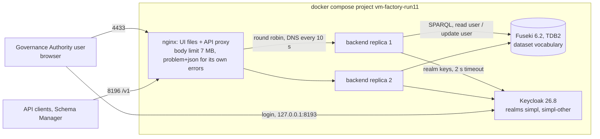
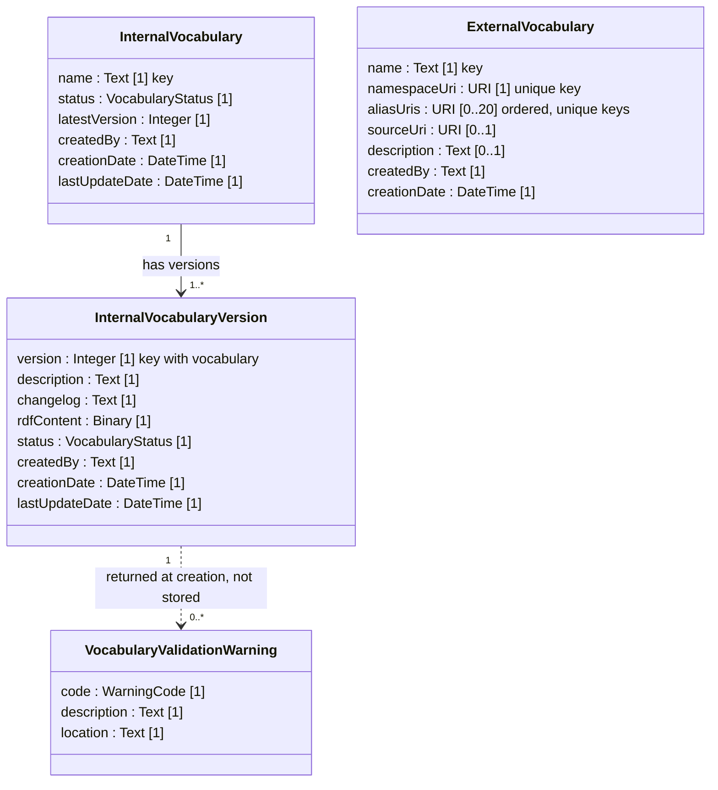

# Architecture

## Components

- **backend** (Java 21, Spring Boot 4.1.3): stateless (MACH-06). It validates bearer tokens itself
  (D17) with Nimbus (signature, issuer, audience, expiry, D132) and the realm keys of Keycloak
  (own fetch timing of D88 and D129 around Nimbus JWKSet, D108). Every operation has an explicit
  role rule in Spring Security from one route table (`ApiRoutes`); the application refuses to start
  when a handler has no rule (D84). No lock state: writes are conditional SPARQL updates (D82), so two
  replicas run on one store (D102).
- **Fuseki** (Apache Jena Fuseki 6.2.0, plain server without admin endpoints): three users (reader,
  updater, backup) from the environment (D83), internal network only.
- **Keycloak** 26.8.2 in dev mode with the realm import of E1 and E7; port on 127.0.0.1 only (D98).
- **UI** (Vue 3, Vite, TypeScript, plain components): served by nginx, which also proxies the API.
  The UI uses the public API only (MACH-04), logs in with keycloak-js (PKCE).

## Request pipeline (order of checks, D51, D63, D67, D133, D139)

| Order | Where | Check | Result |
|---|---|---|---|
| 1 | `MethodGuardFilter` | unknown method, or a method the path does not declare (HEAD, OPTIONS included) | 405 with Allow |
| 2 | Spring Security firewall | encoded slash, control characters, `//`, `;` | 400 badRequest |
| 3 | `JwtAuthenticationFilter` | token signature, issuer, audience, expiry; realm keys fetchable | 401, or 503 when keys cannot be fetched |
| 4 | Spring Security rules | role per operation (D16) | 403; unknown path with token: 404 |
| 5 | `NegotiationFilter` | Accept | 406 |
| 6 | `NegotiationFilter` | Content-Type | 415 |
| 7 | `NegotiationFilter` / container | declared size: JSON 1 MB, multipart 6 MB, file part 5 MB | 413 |
| 8 | `UploadLimiter` (create and new version) | more than 4 uploads in progress on this instance (D92) | 503 |
| 9 | controllers (`RequestChecks`, `QueryParameters`, `SearchRequests`) | path values, unknown or repeated parameters and fields, field rules, version field | 400 with one issue per problem |
| 10 | services | vocabulary or version not found | 404 |
| 11 | services | duplicate name, same status, identical version | 409 |
| 12 | `ContentValidator` | Turtle syntax, then S1 to S7 | 400 validation report |
| 13 | repositories | conditional store update, at most 5 attempts in the 30 s budget | 201 / 200, or 503 |

## Write flow of a new version (D4, D8, D43, D46, D82, D92)

1. Read the vocabulary (latest version n), compare the upload with version n (identical: 409).
2. Validate the content once (base IRI `<contentBase>/content/<Name>/versions/<n+1>`, D57); the
   reference check is one store query (Q5).
3. One SPARQL update request (one TDB2 write transaction): set `latestVersion` to n+1 only where it
   is still n, deprecate every ACTIVE version of that vocabulary, insert version n+1 and its content.
   The later operations of the request depend on the write id the first one set, so either all
   apply or none.
4. Ask whether version n+1 carries this request's creation write id. If not, another writer won:
   read the latest number again and repeat step 3 (at most 5 attempts, D82), else 503.

## Logical data model (D87, D97, D117)

Traced to the CDM `vocabulary-manager-be.md` (snapshot 70f951f). Class names are the CDM's.

| Entity | Identifier | Attributes (type, multiplicity) | Relations |
|---|---|---|---|
| InternalVocabulary | name (unique, case-insensitive) | status (ACTIVE, DEPRECATED) 1; latestVersion integer 1; createdBy text 1; creationDate date-time 1; lastUpdateDate date-time 1 | has 1..* InternalVocabularyVersion |
| InternalVocabularyVersion | (vocabulary name, version) | description text 1; changelog text 1; rdfContent bytes 1; status 1; createdBy 1; creationDate 1; lastUpdateDate 1 | belongs to 1 InternalVocabulary |
| ExternalVocabulary | name (unique, case-insensitive among external vocabularies) | namespaceUri 1 and aliasUris 0..20 (each unique after removing a trailing '#' or '/'); sourceUri 0..1; description 0..1; createdBy 1; creationDate 1 | none |
| VocabularyValidationWarning | none (transient) | code (externalReferenceSkipped, deprecatedVocabularyReference, semanticReasoningSkipped); description; location | returned in the 201 of a creation |

Differences with the CDM (owner questions, D2):

| CDM | This build | Decision |
|---|---|---|
| InternalVocabulary.description | not stored; the vocabulary shows the latest version's description | D28 |
| no creator | createdBy on versions and external vocabularies | D27 |
| VocabularyValidationWarning.warningCode with syntaxError, semanticError | code with the closed set above; errors are a separate, transient concept (the 400 report) | D10 |
| VocabularyValidationWarning stored per version | not stored, only in the 201 response | D10 |
| VocabularySearch, ExternalVocabularySearch as owned entities | left out of the domain model: they are queries | D117 |
| untyped attributes | typed as in the table above | D117 |
| "deprecates previous active version" (0..1) | deprecates every older ACTIVE version | D4 |
| GovernanceAuthority | not stored; the token subject and createdBy stand for the user | D16, D27, D80 |

## Physical model (RDF store)

Four named graphs in the TDB2 dataset `vocabulary`; SHACL shapes in
[physical-model.ttl](physical-model.ttl), checked by `StoredDataShapesIT`.

| Graph | Subjects | Notes |
|---|---|---|
| `urn:simpl:vm:graph:internal` | `urn:simpl:vm:vocabulary:<Name>` (vm:InternalVocabulary), `urn:simpl:vm:vocabulary:<Name>:version:<n>` (vm:InternalVocabularyVersion) | `vm:nameKey` = lower-case name for the uniqueness check; write ids for the conditional updates (`vm:writeId`, `vm:creationWriteId`, `vm:statusWriteId`) |
| `urn:simpl:vm:graph:internal-content` | version IRIs | `vm:content` the uploaded bytes as `xsd:base64Binary` (bytes exactly as uploaded, D29, D106), `vm:contentLength` |
| `urn:simpl:vm:graph:external` | `urn:simpl:vm:external:<Name>` | URIs stored as sent (D73); `vm:lookupKey` normalised namespace and alias keys; aliases as nodes with `vm:index` to keep their order |
| `urn:simpl:vm:graph:external-content` | external IRIs | `vm:content`, `vm:contentLength` |

Every list query runs ORDER BY, LIMIT (at most 101) and OFFSET in the store, with a COUNT query for
the total (D85). Queries and updates are built with Jena `ParameterizedSparqlString` (D94).

## Patterns used

See REUSE.md, section "Named patterns".
