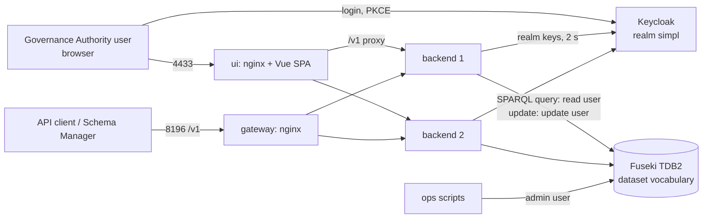

# Architecture overview

## Components

Networks: `front` (gateway, ui, keycloak, backends) and `store` (internal, backends and Fuseki
only). Fuseki publishes no port (D83, D107); the backend management port 9090 is never published
or proxied (D67, D98, D120).

## Backend layers

| Package | Role |
|---|---|
| `api` | Filters (correlation id, method check, negotiation), controllers, request parsing (query, multipart, JSON), DTOs, problem handler, route table `Routes` |
| `security` | Bearer token filter, `TokenVerifier` (Nimbus JWKSet, JWSVerifier, DefaultJWTClaimsVerifier, own fetch timing) |
| `config` | Security chains (management, API), filter order, start-up rule check, Tomcat error valve, properties |
| `domain` | `VocabularyService`, `ExternalService`, `SearchService`, `UploadLimiter`, `WriteRetry`, model records |
| `validation` | `ParsedTurtle` (Jena RIOT), `SemanticRules` (S1 to S6), `References` and `ContentValidator` (S7, warnings) |
| `store` | `StoreClient` (SPARQL over HTTP, timeouts, retries, circuit breaker), `VocabularyStore`, `ExternalStore`, `ReferenceStore`, `Rdf`, `Content` |

## Request pipeline (order of checks)

1. Micrometer observation and tracing (W3C `traceparent`), then `CorrelationFilter` (X-Correlation-Id, MDC, access log).
2. `RouteGuardFilter`: an undeclared or unknown method, HEAD, OPTIONS, TRACE get 405 with Allow, before any token check (D67, D126, D139).
3. Spring Security: firewall (encoded slash, control characters: 400 problem), bearer token (401, or 503 when no keys can be fetched), role rule per operation (403). Unknown paths need a token and then get 404 (D67, D84).
4. `NegotiationFilter`: 406 (Accept), 415 (Content-Type), 413 (Content-Length above 1 MB JSON or 6 MB multipart) (D51, D63).
5. Controller: upload limiter 503 (D92), multipart read (413 for a file part above 5 MB), path values 400, query parameters 400, body shape and field rules 400.
6. Service: 404, 409 (duplicate name, same status, identical version), content validation (syntax, semantic), conditional write.

Container-level rejections (bad request line, encoded slash) are answered by `ProblemErrorReportValve` with problem+json (D158).

## Store model

Four named graphs in one TDB2 dataset (shapes in `physical-model-shapes.ttl`):
`urn:simpl:vm:graph:internal` (vocabularies and versions), `...:content` (version bytes in base64
chunks of 1 MB, D106), `...:external` (external vocabularies and aliases), `...:external-content`.
The content is stored as uploaded and served byte for byte (D29); SHA-256 and size are kept for
the identical-version check (D46).

## Concurrency (patterns: optimistic concurrency, idempotency token)

No lock state in the service (D82). Each write is one SPARQL Update request (one store
transaction) whose operations are conditional:

- create: insert only when no vocabulary has the same lower-case name key;
- new version: insert version n+1 only when the latest version is still n and n+1 does not exist; then deprecate every other ACTIVE version, insert the content chunks; all later operations are conditioned on the new version's create token;
- status change: change only when the status is still the one read.

After the update the service asks whether its token is stored. If not, the condition failed: it
reads again and retries after 50, 100, 200, 400, 800 ms with up to 50 % jitter (D157), within
30 s (D71), then 503. Validation runs once, before the loop (D92). This holds for several
backend instances on one store; the stack runs two (D102), and `TwoInstancesTest` proves it.

## Resilience (patterns: timeout, retry with backoff, circuit breaker, fail closed, bulkhead)

- Store: connect 2 s, query 10 s, update 45 s; reads retried twice (200, 400 ms) on connection failure or timeout; updates never retried; 503 with Retry-After 5 when unreachable (D44, D71).
- Resilience4j circuit breakers on store calls and on the key fetch: 50 % of the last 20 calls (at least 10), open 10 s, 3 probes; open gives 503 at once (D103, D134). Breaker state is in the metrics.
- Identity provider: keys fetched lazily, at most once per 10 s, 2 s timeout; cached keys keep working while Keycloak is down; no keys at all gives 503, never an unchecked token (D44, D88, D108, D129).
- Uploads: at most 4 create or new-version requests per instance at once, a fifth gets 503 (D92).
- GET /v1/health is the readiness view (store ping 2 s, cached key state); the container health check uses the liveness probe on the management port (D152).

## Security

Keycloak OIDC (E1, D40). The service validates every token itself (issuer, audience
`vocabulary-manager-be`, expiry, not-before, signature) and the realm roles (D17). Default deny:
every route in `Routes.ALL` has a role rule; the service refuses to start when a handler has no
rule (D84). Store access with a read user and an update user; the admin user is for the ops
scripts only (D83). Containers run as non-root, `no-new-privileges`, backend root filesystem
read-only. Logs carry the token subject, never e-mail or token (D80); the store's per-request
log is off because it would print SPARQL text with creator e-mails.

## Observability

JSON log lines (Spring Boot structured logging, logstash format) with traceId, spanId,
correlationId, operationId, vocabularyName, version and userId (sub) from the MDC (D86, D96).
Prometheus metrics on the management port at `/actuator/prometheus`: `http_server_requests`
with an `operationId` tag (count, status, duration) and the circuit breaker metrics.
