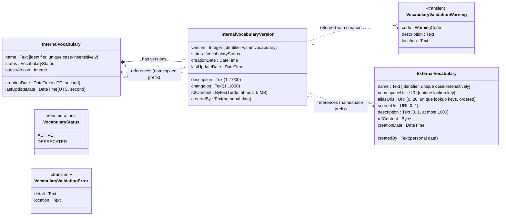

# Logical data model

Traced to the CDM `input/cdm/vocabulary-manager-be.md` (snapshot of decision D2) and the decided
glossary. Class names are the CDM names (D97). Attribute names follow the glossary (D117), which
uses lowerCamelCase as the API does.

## Entities

| Entity | Identifier | Attributes | Relations |
|---|---|---|---|
| InternalVocabulary | `name` (3 to 64, `^[A-Z][a-zA-Z0-9]*$`), unique compared in lower case | status, latestVersion, creationDate, lastUpdateDate; createdBy shown is version 1's | 1 to many InternalVocabularyVersion (aggregate root) |
| InternalVocabularyVersion | (`name`, `version`) | description, changelog, rdfContent, status, createdBy, creationDate, lastUpdateDate | belongs to one InternalVocabulary |
| ExternalVocabulary | `name`; `namespaceUri` and each alias are unique keys after removing a trailing '#' or '/' | sourceUri, description, rdfContent, createdBy, creationDate | none stored; referenced by namespace |
| VocabularyValidationWarning | none (transient, D10) | code (externalReferenceSkipped, deprecatedVocabularyReference, semanticReasoningSkipped), description, location | returned only in the 201 of a creation |
| VocabularyValidationError | none (transient, D10, D14) | detail, location | returned only in a 400 validation report |

## Differences with the CDM (owner questions, D2, D117)

| CDM | Build | Decision |
|---|---|---|
| `InternalVocabulary.description` | not stored; the vocabulary shows the latest version's description | D28 |
| `InternalVocabulary` has no creator | createdBy of version 1 shown on the vocabulary | D27 |
| no `createdBy` on versions and external vocabularies | added; marked as personal data, not logged | D27, D80, D165 |
| `VocabularyValidationWarning.warningCode` with syntaxError, semanticError | split: VocabularyValidationError (blocking, transient) and VocabularyValidationWarning with code in {externalReferenceSkipped, deprecatedVocabularyReference, semanticReasoningSkipped}; nothing stored | D10 |
| `VocabularySearch`, `ExternalVocabularySearch` as owned entities | queries, not part of the domain model | D117 |
| "deprecates previous active version" (0..1) | a new version deprecates every older ACTIVE version | D4 |
| `latestVersion` identifies the most recently created version | latest = highest version number, whatever its status | D5 |
| one status | vocabulary status and version status are separate; "effectively deprecated" is derived | D3 |
| attribute types untyped | typed (Text, Integer, URI, DateTime, Bytes) | D117 |

## Physical model

RDF in Fuseki (TDB2), four named graphs; the SHACL shapes in
[physical-model-shapes.ttl](physical-model-shapes.ttl) describe each graph and are run against
stored data by `ShaclShapesTest` (D87). Technical properties that are not in the logical model:
`nameKey` (lower-case name for uniqueness), `namespaceKey` and alias `key` (normalised URIs),
`contentSha256` and `contentSize` (identical-version check), `createToken` and `statusChange`
(conditional write tokens, D82), content chunks (`chunkOf`, `index`, `data` as xsd:base64Binary,
D106).
