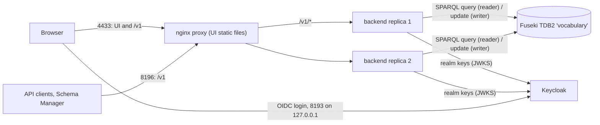

# Architecture overview

## Components

| Component | Image | Networks | Host port |
|---|---|---|---|
| proxy (nginx with the built UI) | `vm-factory-run13-ui:1.0.0` | front | 8196 (API), 4433 (UI) |
| backend, 2 replicas (Spring Boot 4.1.3, Java 21) | `vm-factory-run13-backend:1.0.0` | front, store | none (API 8080, management 8081 inside) |
| fuseki (Apache Jena Fuseki 6.2.0) | `vm-factory-run13-fuseki:6.2.0` | store (internal) | none (D83, D107) |
| keycloak (26.8.2, dev mode) | `quay.io/keycloak/keycloak:26.8.2@sha256:...` | front | 127.0.0.1:8193 (D98) |
| backend-store-down (profile) | same backend image, store URL on a closed port | front, store | 8199 |

The backend is stateless (MACH-06). Concurrency control lives in the store: every write is a conditional SPARQL update (D82), so the two replicas never need a shared lock.

## Backend packages

| Package | Role |
|---|---|
| `web` | `RequestGateFilter` (405, firewall 400, 401/503, 403, 406), `OperationCatalog` (one access rule per operation, D84), `HandlerRuleCheck` (start fails when a handler has no rule), `ApiExceptionHandler`, Tomcat error valve, trace headers, metrics tag |
| `api` | Spring MVC controllers, request rules (D19 to D22, D37, D49, D52, D91, D112), multipart and JSON readers, wire representations and paging links |
| `service` | lifecycle rules (D3 to D8, D43, D46), conditional write retry (D82, D157), external vocabulary rules (D30, D56, D147) |
| `validation` | Turtle syntax (Jena RIOT), semantic rules S1 to S6, reference analysis and S7 (D9 to D12, D47) |
| `store` | SPARQL protocol client with timeouts, retries and circuit breaker (D44, D103), repositories, content codec |
| `security` | Nimbus token verification (D132), realm key cache with the D88 and D129 timing |
| `error` | problem types (D48, D104), RFC 9457 bodies |

## Request path and order of checks

1. Correlation id read or created; W3C trace context from Micrometer Tracing (D86).
2. Unknown method: 405 (D67). Firewall (encoded slash, control characters): 400.
3. Declared path, undeclared method (also HEAD, OPTIONS, TRACE): 405 with Allow (D126, D139).
4. Token (except GET /health): 401, or 503 when realm keys cannot be fetched (D17, D44). Unknown path: 401 without a token, 404 with one (D67, D84).
5. Role: 403 (D16).
6. Accept: 406 (D63, D127).
7. Content type: 415 (Spring MVC `consumes`).
8. Size: 413 (file part 5 MB, multipart request 6 MB, JSON body 1 MB; D15, D76, D150).
9. Request shape: 400 (query, path, fields, D21, D49, D52, D7).
10. 404, 409 (duplicate name, same status, identical version), then content validation (D51, D162).
11. Upload bulkhead: at most 4 create or new-version requests per replica, else 503 (D92).

## Quality mechanisms

- Timeouts: store connect 2 s, read 10 s, update 45 s, health 2 s; key fetch 2 s (D44, D71).
- Read retries 200 ms and 400 ms on connection failure or timeout; updates never retried by the client; conditional write retries 50 to 800 ms with jitter within 30 s (D44, D157).
- Circuit breakers on the store and the key fetch: half of the last 20 calls (at least 10) failed, open 10 s, 3 probes (D103).
- Graceful shutdown: `server.shutdown=graceful`, 30 s per phase, container stop grace 40 s.
- Health: container liveness on the management port; `GET /v1/health` readiness view (UP, DEGRADED, DOWN) (D44, D152).

## Threat model (short, OWASP-05)

| Threat | Control |
|---|---|
| Unauthenticated or forged access | Nimbus signature check with realm keys, issuer and audience check, expiry; fails closed (503) when keys cannot be fetched; never accepts an unsigned or HMAC token |
| Privilege escalation (viewer writes) | Role rule per operation, default deny, start-up check that every handler has a rule |
| Injection into SPARQL | Values bound as typed RDF nodes with Jena (no string joining); names restricted to `^[A-Z][a-zA-Z0-9]*$` before they become IRIs |
| Malicious uploads (huge files, parser bombs) | 5 MB file limit, 6 MB request, 7 MB at the proxy, at most 64 parts, at most 4 parallel uploads per replica, report capped at 1000 issues |
| Mass assignment | Unknown fields and properties refused (D52); responses built from explicit records |
| Information leakage | Problem details without stack traces or internals; 500 detail is generic |
| Store credential misuse | Separate read, update and admin users; store on an internal network without host port |
| Denial of service on dependencies | Timeouts, circuit breakers, bulkhead; call-rate limiting is the Tier 1 gateway's (D46, D164) |
| Personal data in logs | Logs carry the token subject only; createdBy (email) never logged (D80, D165) |
| Server-side request forgery | The service never fetches a URL given by a client (sourceUri and namespace URIs are stored, not fetched, E3) |
