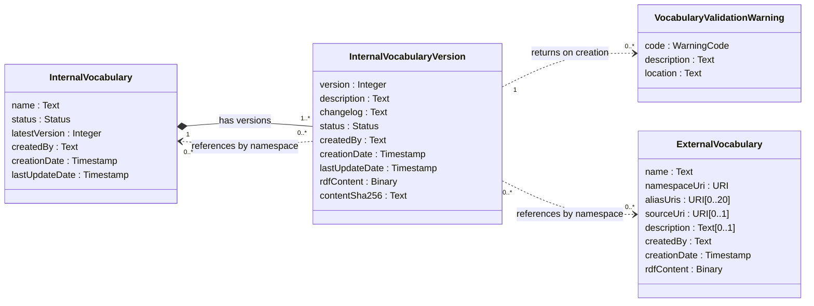

# Logical data model (D87, D97, D117)

Traced to the CDM `input/cdm/vocabulary-manager-be.md` (snapshot 70f951f, D2). Class names are the CDM names; attribute names follow the glossary. Search request classes (`VocabularySearch`, `ExternalVocabularySearch`) are queries, not stored entities, and are left out of the domain model (D117). The physical form in the RDF store is in `physical-model-shapes.ttl` and `physical-model.md`.

## Entities

### InternalVocabulary

| Attribute | Logical type | Key | Notes |
|---|---|---|---|
| name | Text (3 to 64, `^[A-Z][a-zA-Z0-9]*$`) | primary key; unique case-insensitively (candidate key `lower(name)`) | D30, D37, D54 |
| status | Code: ACTIVE, DEPRECATED | | vocabulary status, changed only by PATCH (D3) |
| latestVersion | Integer >= 1 | | number of the latest version (D5); also the number of versions, as none is ever deleted |
| createdBy | Text | | creator of version 1; personal data (D27, D165) |
| creationDate | Timestamp (UTC, seconds) | | creation of version 1 (D25, D58) |
| lastUpdateDate | Timestamp (UTC, seconds) | | last change of the vocabulary or any version (D25, D160) |

### InternalVocabularyVersion

| Attribute | Logical type | Key | Notes |
|---|---|---|---|
| vocabulary | reference to InternalVocabulary | primary key part 1 | |
| version | Integer >= 1 | primary key part 2 | 1 at creation, then highest + 1 (D7) |
| description | Text (1 to 1000, trimmed) | | D28, D37 |
| changelog | Text (1 to 1000, trimmed) | | D32, D37 |
| status | Code: ACTIVE, DEPRECATED | | version status (D3, D4) |
| createdBy | Text | | personal data (D27, D165) |
| creationDate | Timestamp | | |
| lastUpdateDate | Timestamp | | set by status changes (D160) |
| rdfContent | Binary (Turtle, at most 5 MB) | | stored as uploaded (D29, D106) |
| contentSha256 | Text (64 hex) | | technical: identical-version check (D46) |

### ExternalVocabulary

| Attribute | Logical type | Key | Notes |
|---|---|---|---|
| name | Text (D37 rules) | primary key; unique case-insensitively among external vocabularies | D30, D56 |
| namespaceUri | URI (absolute, as sent) | unique lookup key after removing a trailing '#' or '/' | D30, D73 |
| aliasUris | ordered list of URI (0 to 20) | each a unique lookup key | D56, D73 |
| sourceUri | URI, optional | | |
| description | Text (at most 1000), optional | | blank means absent (D148) |
| createdBy | Text | | personal data |
| creationDate | Timestamp | | |
| rdfContent | Binary (Turtle) | | cached copy |

### VocabularyValidationWarning (transient)

| Attribute | Logical type | Notes |
|---|---|---|
| warningCode (wire `code`) | Code: externalReferenceSkipped, deprecatedVocabularyReference, semanticReasoningSkipped | D10 |
| description | Text | D11, D47 |
| location | Text | D65 |

Returned only in the 201 response; never stored (D10). The validation report (400) is transient too (D14).

## Relations

References between versions and vocabularies are not stored: they are derived from the prefix declarations of the content at validation time (D12).

## Differences with the CDM (owner questions)

| CDM | This model | Decision |
|---|---|---|
| `InternalVocabulary.description` | removed; the vocabulary shows the latest version's description | D28 |
| no `createdBy` | `createdBy` on versions and external vocabularies (personal data) | D27, D165 |
| `VocabularyValidationWarning.warningCode` with syntaxError, semanticError | closed set of three warning codes; errors are a separate transient concept | D10 |
| `VocabularyValidationWarning` "stored as entries" (relationship notes) | not stored | D10 |
| `VocabularySearch`, `ExternalVocabularySearch` as owned entities | queries, not entities | D117 |
| "Creating a version deprecates the previous active version" | deprecates every older ACTIVE version | D4 |
| untyped attributes | typed attributes | D117 |
| no content hash | `contentSha256` (technical attribute) | D46 |
