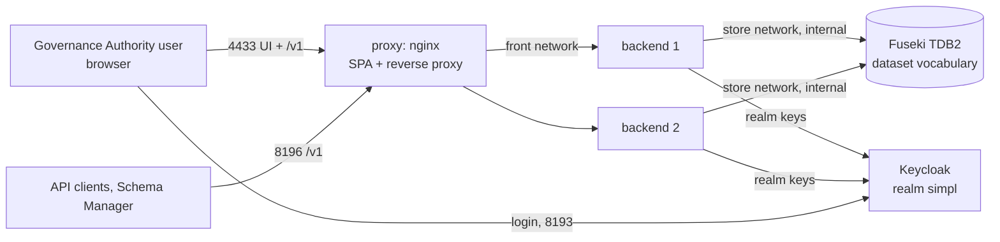

# Architecture overview

## Containers

| Container | Role | Networks | Host port |
|---|---|---|---|
| proxy | nginx: serves the UI on 4433, proxies `/v1` to the backends on both ports; answers 405 (TRACE), 413 (above 7 MB), 414, 431 itself as problem+json (D122, D178) | front | 127.0.0.1:8196, 127.0.0.1:4433 |
| backend (2 replicas, D102) | Spring Boot API; management port 8081 (health probes, Prometheus) on no host port and never proxied (D120) | front, store | none |
| fuseki | Apache Jena Fuseki 6.3.0 "main" without UI and admin modules; users read, update, admin; no anonymous access (D83) | store (internal) | none (D107) |
| keycloak | Keycloak 26.8.2 dev mode with the imported realms (E1, E7, E8) | front | 127.0.0.1:8193 |
| backend-store-down (profile) | Same backend image with the store URL on a closed port (D44 tests) | front | 127.0.0.1:8199 |

## Backend layers

| Package | Responsibility |
|---|---|
| `web` | `GatekeeperFilter`: decided order of checks before any handler (405, firewall 400, 401/404, 403, 406, 415, 413, upload slot 503). `Operation` table (D84, D206). Controllers, strict query and multipart and JSON readers, paging links. |
| `security` | `JwtAuthenticator` (Nimbus processor and claims verifier) and `RealmKeyCache` (fetch timing of D88, D129, D174). |
| `service` | Use cases: create, new version, status changes, search, external vocabularies; conditional-write retry (D82, D157); upload slots (D92). |
| `validation` | Turtle syntax (Jena RIOT), rules S1 to S6, references S7 and warnings (D9 to D12, D47, D65). |
| `store` | SPARQL over HTTP to Fuseki with timeouts, read retries and a circuit breaker (D44, D103); repositories with conditional updates. |
| `error` | One exception (`ApiException`) carrying the problem type; one handler; a Tomcat valve for container-level errors (D104, D158). |

## Patterns (REUSE-06)

Microservice with its own store (MSV-02); stateless service with conditional store updates instead of locks
(D82), so several instances run on one store; retries with backoff and circuit breakers (D44, D103); graceful
degradation (health DEGRADED, cached keys keep working); fail closed on missing keys (503, never accept unsigned);
least privilege (three store users, non-root containers, read-only file systems, dropped capabilities); defence in
depth (proxy limits, service limits, store users, internal store network); default deny (operation table).

## Main flows

Create (POST /vocabularies): gatekeeper checks; multipart read; field rules; duplicate name (409); syntax then
semantic validation and the reference check (one store query); one SPARQL update that writes a receipt only if no
vocabulary has the name (case-insensitively), then the vocabulary, version 1 and its content, all in one
transaction; the receipt is read back to know whether this request won. New version: the same with the condition
"latest version is still n"; on a lost race the service re-reads and retries with n+1 (D43, D82).
