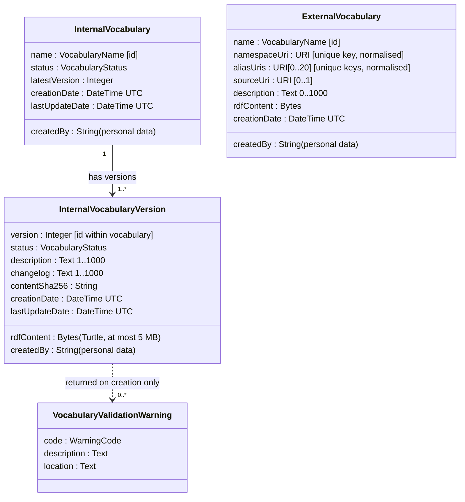

# Logical and physical data model (D87, D97, D117)

Traced to the CDM `input/cdm/vocabulary-manager-be.md` (snapshot 70f951f, D2). Class names follow the CDM where
the glossary does not decide otherwise.

## Logical data model

| Entity | Identifier | Attributes | Relations |
|---|---|---|---|
| InternalVocabulary | name (unique case-insensitively, D37; paths match exactly, D54) | status (ACTIVE, DEPRECATED), latestVersion, createdBy, creationDate, lastUpdateDate | 1 to many InternalVocabularyVersion |
| InternalVocabularyVersion | (name, version) | status, description, changelog, rdfContent, contentSha256, createdBy, creationDate, lastUpdateDate | belongs to one InternalVocabulary |
| ExternalVocabulary | name (unique case-insensitively among externals, D56) | namespaceUri and aliasUris (each a unique lookup key after removing one trailing `#` or `/`, D30), sourceUri, description, rdfContent, createdBy, creationDate | none (references from content are by namespace, not stored) |
| VocabularyValidationWarning | none (transient) | code (externalReferenceSkipped, deprecatedVocabularyReference, semanticReasoningSkipped), description, location | returned in the 201 body only (D10) |

Value sets: VocabularyStatus = ACTIVE, DEPRECATED (same in CDM, API and criteria, DDD-04). Timestamps are UTC to
the second (D58).

## Differences with the CDM (D117, D207)

| CDM | Build | Reason |
|---|---|---|
| InternalVocabulary.description | not stored; the vocabulary shows the latest version's description | D28 |
| InternalVocabulary has no creator | createdBy of version 1 | D25, D27 |
| InternalVocabularyVersion has no creator | createdBy added (personal data, never logged) | D27, D165 |
| VocabularyValidationWarning.warningCode with syntaxError, semanticError | `code` with the closed set of D10; syntax and semantic problems are validation errors (400), not warnings | D10, D207 |
| VocabularyValidationWarning entries stored | not stored, returned only in the 201 body | D10 |
| VocabularySearch, ExternalVocabularySearch as owned entities | queries, not part of the domain model | D117 |
| Validation report not named | transient 400 body `VocabularyValidationProblem` | D14 |
| attributes untyped | typed as above | D117 |
| no content hash | contentSha256 for the identical-version check | D46, D194 |

## Physical model (RDF store)

Dataset `vocabulary` (TDB2). Vocabulary namespace `vm: <https://w3id.org/simpl/vocabulary-manager#>`.

| Named graph | Content |
|---|---|
| `urn:simpl:vm:graph:meta` | `urn:simpl:vm:vocabulary:<Name>` a `vm:InternalVocabulary`; `urn:simpl:vm:vocabulary:<Name>:v<n>` a `vm:InternalVocabularyVersion`; `urn:simpl:vm:external:<Name>` a `vm:ExternalVocabulary` |
| `urn:simpl:vm:graph:content:<Name>:v<n>` | one triple: version IRI `vm:rdfContent` base64 of the uploaded bytes (D106: content in the store, one transaction with the metadata) |
| `urn:simpl:vm:graph:external-content:<Name>` | one triple with the external content |
| `urn:simpl:vm:graph:receipts` | receipts of conditional writes (D82), removed after one hour (D176) |

Denormalised on the vocabulary node for list queries without joins: `vm:latestVersion`, `vm:latestDescription`,
`vm:nameKey` (lower-case name for uniqueness and the contains filter). The SHACL shapes of every graph are in
`docs/shapes.ttl`; the backend test `StoreBehaviourTest.storedDataConformsToTheShapes` validates the stored data
against them.
