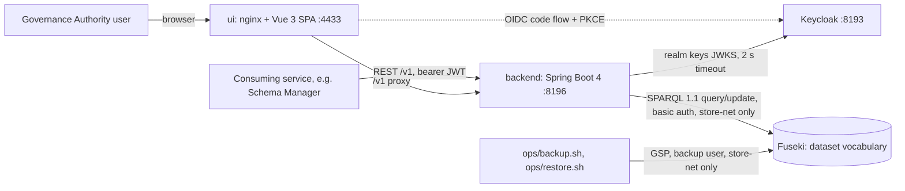

# Architecture overview

## Components

- **backend** (one Maven project `backend/`, Java 21, Spring Boot 4.1.2): the API of `specs/api` under `/v1` (E2),
  token and role checks (D17), validation (D9), lifecycle (D3, D4), store access. Stateless: no session, no lock
  state, so several instances can share one store (D82).
- **ui** (`ui/`, Vue 3 + Vite + TypeScript, served by nginx): list, details and history, create and new version
  forms, status change. nginx serves the static build and proxies `/v1` to the backend, so the browser talks to one
  origin. Login with keycloak-js (code flow with PKCE). The browser checks Turtle syntax with the N3 parser (D13).
- **keycloak**: realms `simpl` and `simpl-other` imported at start (E1, E7).
- **fuseki**: Apache Jena Fuseki 6.2.0 (FusekiMainCmd, no admin UI), TDB2 datasets `vocabulary` and
  `vocabulary-restore` (staging of the restore). Three users from the environment: read, update, backup (D83). Only on
  the internal network `store-net`; no host port.

## Backend packages (`eu.simpl.vocabularymanager`)

| Package | Content |
|---|---|
| `web.trace` | `CorrelationFilter` (first filter: traceparent and X-Correlation-Id, MDC, access log line), `TraceContext` |
| `web.routing` | `OperationCatalogue` (every contract operation with its role rule, query parameters, body kind), `RoutingGuardFilter` (405), `RequestShapeInterceptor` (406, 415, 413, 400 for path and query) |
| `security` | `SecurityConfig` (default-deny chain, management chain), `TokenAuthenticationFilter`, `TokenValidator` (Nimbus JOSE), `RealmKeySource` (JWKS cache), `AuthenticatedUser` |
| `web.body` | `MultipartForm`, `JsonBody`: strict body readers (unknown fields D52, repeated fields, empty part names D70) |
| `web.api` | controllers (`VocabularyController`, `ContentController`, `ExternalVocabularyController`, `HealthController`), `Representations` (wire records), `Paging` (links D22, D59, D78), `ListQuery` |
| `web.problem` | `Problems` (every problem body, types per D48), `ProblemWriter`, `ApiExceptionHandler`, `ProblemErrorController` |
| `service` | `VocabularyService`, `ExternalVocabularyService`, `ConditionalWrite` (optimistic retry, D82) |
| `validation` | `TurtleParser` (Jena RIOT, first error only), `SemanticRules` (S1 to S6), `ReferenceRules` (S7, D11, D12, D47, D69), `VocabularyContentValidator` |
| `store` | `SparqlStore`, `HttpSparqlStore` (timeouts and retries D44, D71), `VocabularyRepository`, `ExternalVocabularyRepository`, `StoreModel` (IRIs, escaping) |
| `domain` | `Vocabulary`, `VocabularyVersion`, `ExternalVocabulary`, `VocabularyStatus`, `FieldRules` (D37, D56, D73), `Page` |
| `config` | properties (all from the environment, E4), `WebConfig`, `TomcatConfig` (problem+json for Tomcat-level errors), `HandlerRuleVerifier` (D84) |

## Request pipeline

Every request on the API port passes these steps in this order; the first failure answers.

1. `CorrelationFilter`: reads or creates `traceparent` and `X-Correlation-Id`, returns `X-Correlation-Id`.
2. `RoutingGuardFilter`: unknown method (for example QUERY) or a method the path does not declare gives **405**
   (D67, D77). A fixed segment wins over a path parameter (`/vocabularies/searches`, D77).
3. Spring Security firewall: encoded slash, control characters and similar give **400** `belgif:badRequest` without
   issues (D67). Errors Tomcat answers itself (bad request line) also get a problem+json body (`TomcatConfig`).
4. `TokenAuthenticationFilter`: bearer token validated locally (signature with the cached realm keys, issuer, audience
   `vocabulary-manager-be`, expiry). Invalid token **401**; unknown key id and keys not obtainable **503** (fail closed,
   D44). No token: the request continues anonymous.
5. Authorisation, default deny (D84): the operation the path and method address decides. No operation: **401**
   without a token, **404** with one (D67). Public: only `GET /health`. Read operations need either role, write
   operations GA_VOCABULARY_ADMIN; otherwise **401** (no token) or **403**. `HandlerRuleVerifier` stops the start when
   a handler exists without a rule or a rule without a handler.
6. `RequestShapeInterceptor` (D51, D63): Accept **406**, Content-Type **415**, declared size **413** (file part 5 MB,
   request 6 MB, JSON 1 MB), path values **400** (D49), unknown and repeated query parameters **400** (D21, D52).
7. Controller body reading: unknown fields, field rules, version field (**400**, D7, D37, D52, D70).
8. Service: **404** vocabulary or version, **409** duplicate name, same status, identical version (D46), then
   validation of the content: syntax (one issue, stop), then semantic rules S1 to S7, all errors in one **400**.
9. Conditional store write (D82), **201** or **200** with the body; warnings in `validationWarnings` (D10).

The management port 8081 has its own security chain (permit all) and serves `/actuator/health/{liveness,readiness}`
and `/actuator/prometheus` only; it is never published outside the deployment (D67, D86).

## Store design

One Fuseki dataset `vocabulary` with named graphs (physical model: [physical-model.shacl.ttl](physical-model.shacl.ttl)):

- `urn:simpl:vocabulary-manager:graph:vocabularies`: one `vm:Vocabulary` per vocabulary (name, lower-case name key,
  vocabulary status, latest version number, creator, dates) and one `vm:VocabularyVersion` per version (number, version
  status, description, changelog, creator, dates, SHA-256 and length of the content, IRI of its content graph).
- `urn:simpl:vocabulary-manager:graph:external-vocabularies`: one `vm:ExternalVocabulary` per registration, with one
  `vm:lookupKey` per normalised URI (namespace and aliases, trailing '#' or '/' removed, D30).
- `urn:simpl:vocabulary-manager:graph:changes`: one `vm:Change` per applied write (operation, target, actor = token
  subject, time): the confirmation of conditional updates and an audit trail without personal data (D80).
- one content graph per version and per external vocabulary, holding the uploaded bytes as one `xsd:base64Binary`
  literal, so downloads return the bytes exactly as uploaded (D29, D70). The content is parsed only for validation.

Every value goes into SPARQL through Jena's `FmtUtils` escaping (`StoreModel`), never by plain concatenation of input.
Every list query runs filter, sort and paging in the store with ORDER BY, LIMIT and OFFSET, the total comes from a
COUNT query, and every query has a LIMIT (D85). The reference check of an upload is one UNION query (Q5).

## Concurrency (D43, D82)

Writes use optimistic concurrency with a store-side condition (pattern: optimistic offline lock, conditional update):

- create: `INSERT ... WHERE { FILTER NOT EXISTS { ?x vm:nameKey "<lower-case name>" } }`;
- new version: `DELETE/INSERT ... WHERE { voc vm:latestVersion ?l FILTER(?l = <read value>) }`, which also deprecates
  every older ACTIVE version in the same update (D4);
- status changes: the `WHERE` requires the status the request read.

Each update also inserts a change record with a random token; the service asks for that token afterwards to learn
whether its condition held. When it did not, `ConditionalWrite` reads again and retries, at most 5 times within the
30 s budget (D71), then 503. So five parallel new versions get numbers n+1 to n+5, two creations with the same name
give one 201 and one 409, and identical PATCH requests give 200 then 409. One SPARQL update is one Fuseki transaction,
so a failed write stores nothing (D8).

## Failure handling (D44, D71)

- Store: connect timeout 2 s, response timeout 10 s for queries and 45 s for updates. Queries are retried twice
  (200 ms, 400 ms) on a connection failure or timeout; updates never. Unreachable or timed out: **503**
  `belgif:serviceUnavailable`, `Retry-After: 5`. Other store errors: **500**.
- Identity provider: keys fetched at start and on an unknown key id (2 s, no retry inside a request, cooldown 10 s);
  cached keys keep working while Keycloak is down; unknown key id and no keys: **503** (fail closed).
- `GET /v1/health`: 503 DOWN when the store does not answer within 2 s; 200 DEGRADED when the store answers but no keys
  are loaded and Keycloak does not answer; otherwise 200 UP.
- Graceful shutdown: Spring `server.shutdown=graceful` with 25 s per phase; compose `stop_grace_period: 30s`.

## Patterns used

| Pattern | Where |
|---|---|
| Microservice with its own store, stateless service | backend; Fuseki dataset owned by it |
| API gateway in front, defence in depth | production: Tier 1 gateway; build: same rules in `SecurityConfig` |
| Default deny, least privilege | `OperationCatalogue` + `SecurityConfig.decide`, `HandlerRuleVerifier`; store users per purpose (D83) |
| Chain of responsibility (filter chain) | request pipeline above |
| Optimistic concurrency with conditional update and retry | `ConditionalWrite`, repository updates |
| Retry with backoff, timeout | `HttpSparqlStore` reads |
| Fail closed, graceful degradation | `RealmKeySource`, `TokenAuthenticationFilter`, health DEGRADED |
| Repository | `VocabularyRepository`, `ExternalVocabularyRepository` |
| Cache-aside (key cache) | `RealmKeySource` |
| Problem details (RFC 9457) | `Problems`, `ProblemWriter` |
| Correlation identifier, W3C trace context | `CorrelationFilter`, forwarded by `HttpSparqlStore` and `RealmKeySource` |
| Backend for frontend proxy (same origin) | nginx in `ui/` proxies `/v1` |
| Backup, verify, swap (staging dataset) | `ops/restore.sh` |
