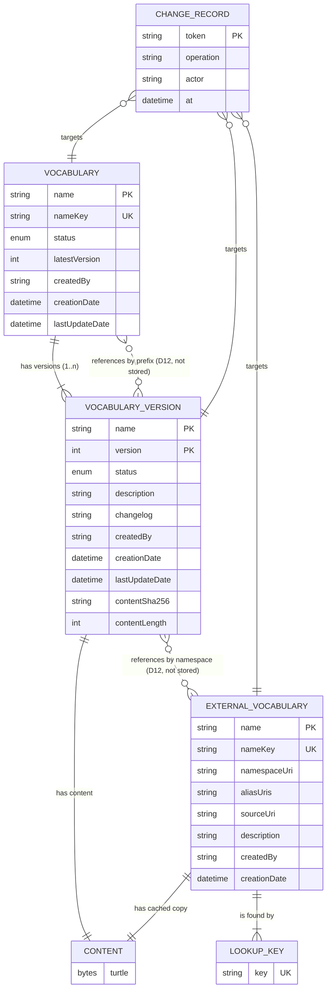

# Logical data model

Traced to the CDM snapshot `vocabulary-manager-be.md` (commit 70f951f, D2). Where the decisions change the CDM, the
decision is cited. The physical form in the RDF store is [physical-model.shacl.ttl](physical-model.shacl.ttl).

## Entities

### Vocabulary (CDM InternalVocabulary, D25)

| Attribute | Type | Rule | Source |
|---|---|---|---|
| name | string | identifier; 3 to 64, `^[A-Z][a-zA-Z0-9]*$`; paths match exactly (D54) | CDM InternalVocabulary.name, D37 |
| nameKey | string | lower-case name; unique, so names are unique case-insensitively | D37, D43 |
| status | ACTIVE, DEPRECATED | vocabulary status, ACTIVE at creation, changed only by PATCH | D3, D6 |
| latestVersion | integer | highest version number; condition of conditional writes | D5, D82 |
| createdBy | string | creator of version 1 | D27 |
| creationDate | date-time | creation of version 1 | D25 |
| lastUpdateDate | date-time | last change of the vocabulary or any version | D25 |

Derived on the wire (VocabularyCategory): `version` = latestVersion, `description` = latest version's description
(D28; the CDM attribute InternalVocabulary.description is not stored), `href`, `contentHref`.

### Vocabulary version (CDM InternalVocabularyVersion, D26)

| Attribute | Type | Rule | Source |
|---|---|---|---|
| vocabulary + version | string + integer | identifier; version 1 at creation, then highest plus 1 | CDM InternalVocabularyVersion.version, D7 |
| status | ACTIVE, DEPRECATED | version status; a new version deprecates every older ACTIVE version | D4 |
| description | string | 1 to 1000 after trimming | D28, D37 |
| changelog | string | 1 to 1000 after trimming; 'Initial version.' from the UI on creation | D32, D37 |
| createdBy | string | email or preferred_username of the requester | D27 |
| creationDate, lastUpdateDate | date-time | UTC to the second | D58 |
| content | bytes | the uploaded Turtle, unchanged; never changes after creation | D29, D45 |
| contentSha256, contentLength | string, integer | for the identical-version check | D46 |

'Effectively deprecated' (D3) is derived: version status DEPRECATED or vocabulary status DEPRECATED. Validation
warnings (D10) and the validation report (D14) are transient and not stored.

### External vocabulary (CDM ExternalVocabulary, D30)

| Attribute | Type | Rule | Source |
|---|---|---|---|
| name | string | identifier; D37 rules; unique case-insensitively among external vocabularies only | D30, D56 |
| namespaceUri | URI | absolute, stored as sent; unique lookup key after removing a trailing '#' or '/' | D30, D73 |
| aliasUris | list of URI | 0 to 20, order as sent, each a unique lookup key | D56, D73 |
| sourceUri | URI, optional | absolute | CDM, D73 |
| description | string, optional | at most 1000 | D56 |
| createdBy, creationDate | string, date-time | registering user and time | D27, D41 |
| content | bytes | cached copy, syntax-checked Turtle | D30 |

Lookup keys are stored as their own values so that uniqueness and search (D38) are one indexed match.

### Change record (no CDM class; build addition)

| Attribute | Type | Rule | Source |
|---|---|---|---|
| token | string | random, identifier; written in the same update as the change | D82 |
| operation | string | createVocabulary, createVocabularyVersion, updateVocabularyStatus, updateVocabularyVersionStatus, createExternalVocabulary, deleteExternalVocabulary | D82 |
| target | IRI | the vocabulary, version or external vocabulary changed | D82 |
| actor | string | token subject, not email or name | D80 |
| at | date-time | time of the change | D58 |

## Relations

| From | To | Cardinality | Note |
|---|---|---|---|
| Vocabulary | Vocabulary version | 1 to 1..n | versions are never deleted (D1) |
| Vocabulary version | Content | 1 to 1 | separate named graph per version |
| External vocabulary | Content | 1 to 1 | removed together on DELETE (D41) |
| Vocabulary version | Vocabulary, External vocabulary | n to m, derived | references are namespace prefixes in the content (D12); not stored, checked at upload |
| Change record | any entity | n to 1 | kept after an external vocabulary is deleted (audit) |
