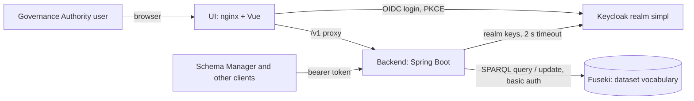

# Architecture

## Context

The backend is stateless (D82): every write is a conditional SPARQL update checked through a write token, so several
instances may run on one store. The store and the management port sit on an internal Docker network (D83, D98).

## Backend layers

| Package | Responsibility |
|---|---|
| `web` | Route table with one role rule per operation (D84), 405 filter before security (D67), correlation id and access log (D86, D96), container error pages as problem+json. |
| `security` | Token validation with Spring Security's resource server; realm keys with the fetch rules of D44 and D88; roles from `realm_access.roles`. |
| `api` | Controllers, request checks in the order of D51, multipart and JSON readers, wire representations, problem responses. |
| `service` | Lifecycle rules: create, new version, status changes, search; retries of D82; upload slots of D92. |
| `validation` | Turtle parsing (Jena RIOT), rules S1 to S6, reference analysis and rule S7 with the warnings (D9 to D12, D47). |
| `store` | SPARQL over HTTP with the timeouts and retries of D44 and D71; repositories built with Jena's ParameterizedSparqlString and update model (D94). |
| `domain` | Records and exceptions of the domain. |

## Main flows

**Create a vocabulary.** Security (401, 403) → Accept (406) → Content-Type (415) → multipart read with limits
(413) → request shape (400) → upload slot (503 when busy) → case-insensitive name check (409) → syntax, then
semantic validation with one store query for the references (400) → one conditional update that stores the
vocabulary, version 1 and its content chunks in one transaction (409 when another request won the name) → 201
with Location and `validationWarnings`.

**New version.** As above, then: vocabulary exists (404) → identical content and description (409, D46) →
validation once → conditional update "latest version is still n": inserts version n+1, its content, moves
`latestVersion`, and deprecates every older ACTIVE version in the same request. When the condition fails the
service reads the latest number again and retries, at most 5 times within 30 s (D82), then 503.

**Status change.** Conditional update "status is still the one read"; same status gives 409 (D4).

## Patterns used

Named in REUSE.md (REUSE-06): optimistic concurrency with conditional updates, retries with backoff, timeouts and
fail-closed (graceful degradation to 503), defence in depth (gateway in production plus own token checks),
least privilege (three store users), stateless service, problem details, bulkhead (upload slots).

## Threat model (STRIDE, short)

| Threat | Where | Control |
|---|---|---|
| Spoofing: forged or foreign token | API | Signature with realm keys only, issuer and audience checked (E5, E7), expiry; unknown key id refetch at most once per 10 s (D88); fail closed with 503 when keys cannot be fetched (D44). |
| Tampering: injection into SPARQL | store | All queries and updates built with Jena `ParameterizedSparqlString` (D94); no value is joined into a query string. |
| Tampering: lost or duplicated versions under concurrency | store | Conditional updates with a write token (D82); one transaction per write (D8). |
| Repudiation | writes | `createdBy` on every version and external vocabulary (D27); log lines with the token subject and correlation id (D80, D96). |
| Information disclosure | logs, errors, store | No email, name or token in logs; problem responses never carry stack traces; store and management port on an internal network, no host port (D83, D98). |
| Denial of service: large or many uploads | API | 5 MB file and 6 MB request limits (D76), 64 parts, 1 MB JSON, 4 concurrent uploads (D92), page size 100 (D22), bounded store queries (D85); call-rate limit at the Tier 1 gateway (D46). |
| Denial of service: hostile Turtle | validation | Parsed once with Jena RIOT inside the size limit; no network fetch of referenced namespaces (E3, OWA-API7: the service calls no URL from input). |
| Elevation of privilege | API, UI | One role rule per operation, default deny (D84); the UI hides actions but the API decides (D18). |
| Store credentials | store | Three users (read, update, admin), passwords from the environment, no anonymous access (D83). |
