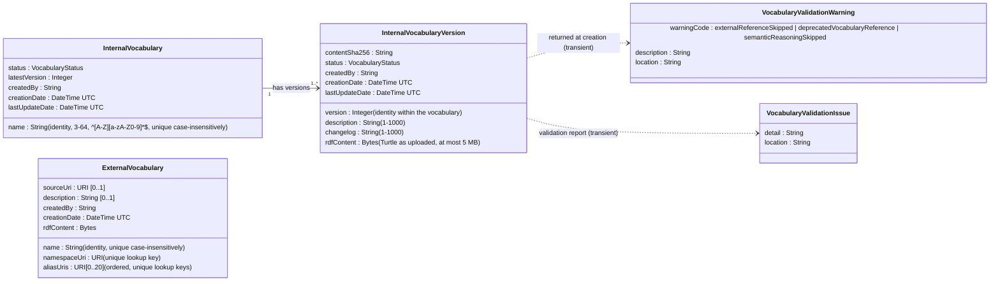

# Logical data model (D87, D97)

Traced to the CDM `input/cdm/vocabulary-manager-be.md` (snapshot 70f951f, D2). CDM class names are used where the
glossary does not decide otherwise; every difference is listed below.

## Entities

| Entity | Identifier | Attributes | Relations | CDM class |
|---|---|---|---|---|
| InternalVocabulary (term: vocabulary) | name | status, latestVersion, createdBy, creationDate, lastUpdateDate | 1 to 1..* InternalVocabularyVersion | InternalVocabulary |
| InternalVocabularyVersion (term: vocabulary version) | (name, version) | description, changelog, rdfContent, contentSha256, status, createdBy, creationDate, lastUpdateDate | belongs to 1 InternalVocabulary | InternalVocabularyVersion |
| ExternalVocabulary | name | namespaceUri, aliasUris, sourceUri, description, createdBy, creationDate, rdfContent | none | ExternalVocabulary |
| VocabularyValidationWarning | none (transient) | warningCode, description, location | returned with a created version | VocabularyValidationWarning |
| VocabularyValidationIssue (term: validation error) | none (transient) | detail, location | the validation report | not in the CDM (D10 splits it from the warning) |
| VocabularySearch, ExternalVocabularySearch | none (queries) | items / URIs | resolve vocabularies | VocabularySearch, ExternalVocabularySearch |

## Differences from the CDM

| CDM | This build | Decision |
|---|---|---|
| `InternalVocabulary.description` | not stored; the latest version's description is shown | D28 |
| no creator | `createdBy` on versions and external vocabularies; the vocabulary shows version 1's creator | D27 |
| `warningCode` holds syntaxError, semanticError | those are validation errors (VocabularyValidationIssue), not warning codes; closed set of three codes | D10 |
| warnings recorded per version | warnings and the validation report are transient, never stored | D10, D14 |
| `latestVersion` "most recently created" | highest version number | D5 |
| `rdfContent` | stored as base64 chunks of 48 KiB in a content graph (physical choice) | D29, D71 |
| ExternalVocabulary identified by namespace URI | identified by name; namespace and aliases are unique lookup keys | D30 |
| none | `contentSha256` for the identical-version check | D46 |

## Wire names (D25, D26)

`VocabularyCategory` is the vocabulary; `VocabularyMetadata` and `VocabularyVersionMetadataResponse` are the
vocabulary version; `VocabularySearchItem` is a search result. Wire names stay as published.
