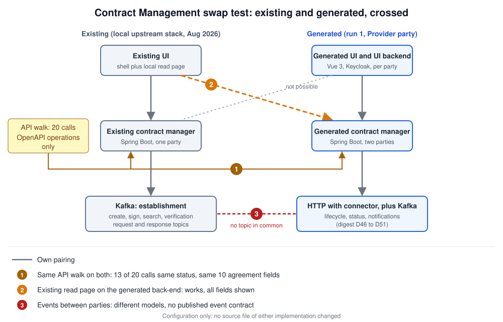

# Contract Management: fourth factory candidate

Status: **run 1.1 done** (2026-10-29). Run 1 passed 339 of 345 black-box API scenarios and 36 of 38 UI scenarios; after six written clarifications (digest section 7), **run 1.1 passes 383 of 383**. The local upstream stack (backend at the 7 Aug 2026 commit, one party, dependencies stripped): 1 of 93 runnable scenarios. Swap tests: 13 of 20 API calls give the same status on both and the upstream read page works on the build, but the events between the parties share nothing. PSO tests: 7 of 14 on both build and upstream, the same 7. Details: [`findings.md`](./findings.md).

## Why this candidate

Chosen as the non-common component with the most business logic. A usage contract is requested, offered, signed at both parties, validated, stored in two wallets and then managed (suspend, reactivate, revoke, terminate, expiry), with a signer, a wallet, a VC issuer, Kafka and the connector around it.

## Summary

- **Input:** published or to-be-published material only: 36 stories without review comments, three OpenAPI files, BP07 and BP10 ([`specs/`](./specs/README.md)).
- **Digest:** 83 decisions and five appendices ([`spec-digest.md`](./spec-digest.md)). The main gaps are everything between the parties: no event contract, no signer or wallet contract, no lifecycle API or state machine.
- **Build:** two backends, a UI per party, one stub service, Keycloak, Kafka and PostgreSQL ([`generated/run1/`](./generated/run1/), the run 1.1 state). 383 of 383 scenarios after the clarifications.
- **Lesson:** buildable from the specs plus a long decision list, as for the earlier candidates. Here most decisions define the contracts between components that the published material leaves out.

## Layout

| Path | What |
|---|---|
| [`specs/`](./specs/README.md) | Frozen input set and story index |
| [`spec-digest.md`](./spec-digest.md) | Step 1: component map, scope, decisions D1 to D83, clarifications C1 to C6, appendices A to E |
| [`tests/`](./tests/README.md) | Steps 2 and 4: 383 API and 38 UI scenarios (behave, requests, Kafka, Playwright), fixtures, reports |
| [`pipeline/`](./pipeline/) | The briefs for steps 1 to 4 as used |
| [`generated/run1/`](./generated/run1/) | Step 3: the build, with `TRACEABILITY.md`, `BUILD-LOG.md` and `docs/`. The keys and passwords in it are the throwaway test values of the digest (D67, D77, appendix E) |
| [`experiments/swap/`](./experiments/swap/README.md) | Step 5: swap experiments |
| [`experiments/pso/`](./experiments/pso/README.md) | Step 6: the PSO test suite on the build and upstream |
| [`findings.md`](./findings.md) | Findings per step |

Run the build with `cd generated/run1 && docker compose -p cm-factory up -d --build --wait`.
