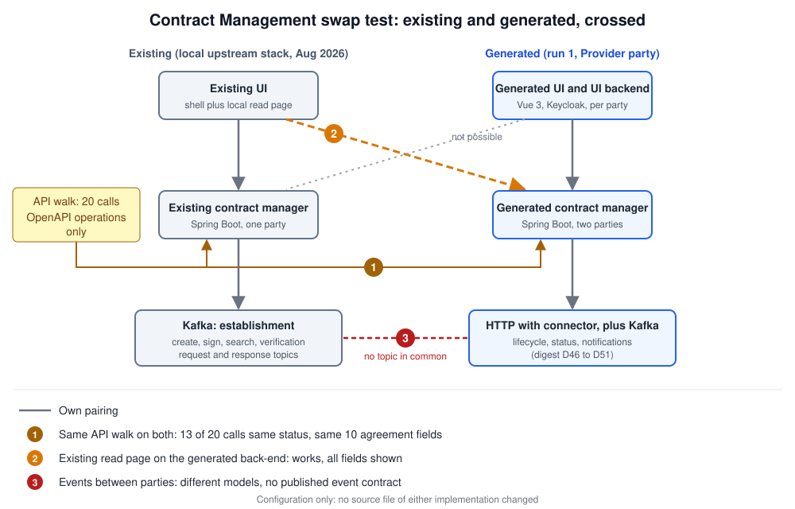

# Swap experiments: Contract Management

Run on 29 Oct 2026, after run 1 of the build and the UI browser steps. Configuration only: no source file of either implementation was changed. Upstream is the local stack `simpl-contract`: the backend at commit `63c6749` (7 Aug 2026), one party in Provider mode, no Keycloak, no signer, wallet or connector, no UI backend; its UI is the upstream shell with a small read page the local stack adds (`ui-overlay/`). It needs six inert catalogue settings to boot (`../pso/upstream-inert-catalog.override.yml`). The build is the factory stack `cm-factory` (Provider contract manager on 19101).

Upstream has only one party and none of the services around it, so three joints were crossed: the contract manager API, the UI read page on the other backend, and the events between the parties.



## Summary

| Joint | Result |
|---|---|
| **1.** Same API walk on both contract managers, 20 calls over the OpenAPI operations | **13 of 20 give the same status**; an agreement has the same 10 fields on both |
| **2.** Upstream UI read page on the build's contract manager | works: a contract the build negotiated end to end shows with all 10 fields, through the same call |
| **3.** Events between the parties | **no common joint**: the two implementations use different event models |
| Build UI on upstream | not possible: the build UI reads through operations the digest added (overview, details, lifecycle), which upstream does not have (25 suite failures in the baseline) |

## 1. API walk

```
S=~/src/simpl-local/simpl-spec-factory/contract-management/experiments/swap
python3 $S/api_walk.py http://localhost:8086/contract/v1 apikey <seeded agreement id> upstream
python3 $S/api_walk.py http://localhost:19101/contract/v1 test-cm-provider-key <agreement id> build
```

Results: `results/walk-upstream.tsv`, `results/walk-build.tsv`, `results/walk-compare.txt`.

- **Same on both (13):** health, reading an agreement and its file, 404 on an unknown agreement, 400 on a malformed id, 401 without a key or with a wrong key, 405 on a method the path does not have, the search by negotiation id, and 400 on issue and create without a body. The problem types differ in name throughout (`urn:error:*` against `urn:problem-type:simpl:*`, D11).
- **Different (7):**
  - `POST /agreements/search`: upstream 405, build 200. The operation is in the OpenAPI; upstream does not have it.
  - `PATCH .../status` with unknown ids: upstream 200, build 400. Upstream applies no rule here (D32, D12).
  - `PUT /verifications/{nid}` without a body: upstream 200, build 400.
  - The three `/contractOffers/{nid}` operations with an unknown negotiation: upstream 404, build 400. The OpenAPI lists no 404 for them, so the digest chose 400 (D12). Upstream answers the undocumented 404, as PSO also expects (see `../pso/`).
  - `Accept: application/xml`: upstream 500, build 406.

## 2. Upstream UI read page on the build

```
$S/upstream-ui-on-build/run.sh        # second container of the upstream UI image on 19601
P=../../tests/.venv/bin/python
$P $S/walk_upstream_ui.py http://localhost:19601 <agreement id of the build>
$P $S/walk_upstream_ui.py http://localhost:4323 11111111-1111-1111-1111-111111111111   # baseline
docker rm -f swap-upstream-ui-on-build-cm
```

Only the proxy target and the API key in the UI's nginx file change (`upstream-ui-on-build/nginx.conf`). Results: `results/upstream-ui-on-build-walk.txt`, `results/base-upstream-ui-walk.txt`. On both, the page makes one `GET /agreements/{id}` and shows agreement id, status, definition, negotiation, asset, provider, consumer, offer and both signature dates. On the build it first asks for its built-in sample id, which the build does not have (404).

## 3. Events between the parties

Upstream drives contract establishment over Kafka: request and response topic pairs for create, sign, search and verification, plus a status topic (local stack documentation, `docs/architecture.md`). The digest, with no published event contract to follow, drives establishment over HTTP calls with the connector and uses Kafka only for lifecycle messages, status events and notifications (D46 to D51, appendix D). The two have no topic in common. A build party and an upstream party could not complete a negotiation with each other.

## What this shows

- **Where a contract exists, the two are close.** The read path of the OpenAPI, its errors and its security behave the same, and a client written for one works on the other.
- **Where the OpenAPI is silent, they go apart.** The differences sit on undocumented codes (404 on offers), on rules the contract does not state (the status change), and on an operation upstream has not built.
- **The missing event contract is the real interoperability gap.** It is the biggest gap of the digest, and here it is visible as two event models that share nothing.
