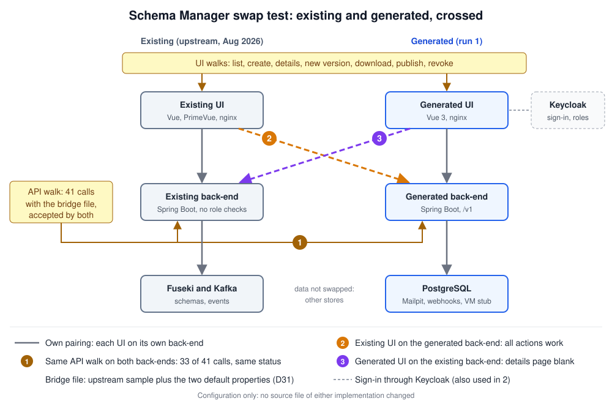

# Swap experiments: Schema Manager

Run on 28 Oct 2026, after run 1 of the build. Configuration only: no source file of either implementation was changed. Upstream is the local stack of August 2026 (backend `e1862b6`, UI `329924b`), with Fuseki and Kafka. The build uses PostgreSQL and HTTP webhooks, so only the API contract and the UIs are swapped, not the data.



## Summary

| Experiment | Result |
|---|---|
| 1. Same API walk on both backends | 33 of 41 calls give the same status. The 8 others are known decisions or role checks. |
| 2. Upstream UI on the build backend | Every user action works, with the same calls and statuses as on upstream. The "Latest version" column stays empty. |
| 3. Build UI on the upstream backend | Create, new version, download, publish and revoke work. The details page stays blank, three list columns stay empty. |

The two implementations are close at the API level. The gaps come from three places: each side rejects the other's schema files, upstream does not follow its own OpenAPI on two payloads, and upstream checks no roles itself.

The black-box suite says less here than for the Vocabulary Manager: upstream rejects every suite fixture (step 2 of [`../../findings.md`](../../findings.md)). Hand walks with a file both sides accept say more.

## The bridge file

Neither backend accepts the other's schema files:

- Upstream wants the eight Gaia-X prefixes (`gax-validation`, `simpl`, `sh`, ...), a shape named `<Type>OfferingShape` from which it reads the resource type, and its own SHACL checks. No spec states this.
- The build wants the two default properties of D31 (`uuid`, `version`). The real default property list is not published either.

`make_bridge.sh` takes the three upstream sample schemas and adds the two default properties under a separate prefix `dp:` (upstream reserves `simpl:` for the Gaia-X namespace). Both backends accept the result. The output is gitignored, like the upstream samples it is made from.

## Paths and setup

```
UP=~/src/simpl-local/simpl-schema-manager           # upstream local stack
B=~/src/spec-factory-build-sm/build                  # build working copy (images built)
S=~/src/simpl-local/simpl-spec-factory/schema-manager/experiments/swap
P=$S/../../tests/.venv/bin/python

$UP/start.sh
cd $B && docker compose up -d --wait
$S/make_bridge.sh
```

Both backends keep one PUBLISHED schema per resource type, and the first one wins (D16). Before a walk, `$P $S/api_walk.py free-slots <upstream|build>` revokes the published Data and Application schemas, so the walk's own schema is published on create.

## 1. API walk (`api_walk.py`)

```
$P $S/api_walk.py upstream     # http://localhost:8085, self-made token (upstream only decodes it)
$P $S/api_walk.py build        # http://localhost:8098/v1, Keycloak token
$P $S/api_walk.py compare      # results/api-compare.txt
```

41 calls: every in-scope operation of the canonical OpenAPI, plus `GET /schemas/{name}`. Per call it records the status, the content type, the field names and a few values. Results: `results/api-{upstream,build}.json`, `results/api-compare.txt`.

Same on both (33 calls): create, duplicate name (409), invalid name and missing resource type (400), the slot rule on create, versions, content as Turtle, unknown schema or version (404), new version without changelog (400), revoke, revoke twice (409), PATCH back to PUBLISHED (200 on both), webhook create, duplicate (409), list, delete and delete twice (404), 406 for an XML list. Both also serve `GET /schemas/{name}` as Turtle, which the OpenAPI does not list.

Different status (8 calls):

| Call | Upstream | Build | Why |
|---|---|---|---|
| Create without a token | 201 | 401 | Upstream checks no roles itself, see below |
| Create as viewer | 201 | 403 | Same |
| Revoke as viewer | 200 | 403 | Same |
| Create a Data file as resource type Application | 400 | 201 | Upstream reads the type from the shape name, a closed set of three. D13 made it a free string, as in the OpenAPI |
| List with page size 1000 | 200 | 400 | D26 sets a maximum; no spec gives one |
| Version content with `Accept: application/json` | 406 | 200 | D8 and D10 |
| Webhook with an unknown event | 400 | 406 | D41 (the digest already asks to confirm 406) |
| Delete a webhook with a malformed id | 400 | 404 | D41 |

Same status, other content:

- **List items:** the OpenAPI gives `version` and `changelog`. The build follows it. Upstream returns `latestVersion` and no changelog. Upstream's own UI reads `latestVersion`.
- **Version items:** the OpenAPI gives name, title, description, resource type, version, changelog and status. Upstream returns only name, version, changelog and creation date.
- **Problem types:** `belgif:` and `iana:` upstream, `simpl:` in the build (D63, known from step 2).
- **Status after a new version:** upstream answers `PUBLISHED` while the schema stays REVOKED in the list, also when no other schema of the type is published. The build follows D16: the version takes a free slot and is published, and the answer matches the list.
- **No roles upstream:** the backend has a `RoleUtil` class, but nothing calls it. The role check presumably sits in a gateway in front of it, which the local stack does not have. The OpenAPI lists a 403 answer for create and PATCH, and SIMPL-17066 gives the roles (D5), so a reader of the specs expects the service to check them.

## 2. Upstream UI on the build backend (`exp2-upstream-ui-on-build/`)

```
$S/exp2-upstream-ui-on-build/run.sh             # container swap-upstream-ui-on-build, port 4325
$P $S/api_walk.py free-slots build
$P $S/walk_upstream_ui.py http://localhost:4325 $S/fixtures/bridge-data-offering.ttl
docker rm -f swap-upstream-ui-on-build
```

`run.sh` starts the local upstream UI image with a copy of the stack's nginx. Two changes: `/v1/` goes to the build backend, and nginx injects a real `ga-admin` token instead of the fixed fake one (the build validates tokens). For that run the realm's access token lifespan is raised to 4 hours through the admin API; reset it to 900 seconds afterwards or recreate Keycloak. The proxy also passes `Host` with the port: without it, the build's Spring rejects the browser's `Origin` as cross-origin (403). The walk sets the cookie `token`, from which the upstream UI reads the roles.

- **Walk** (`results/exp2-walk.txt`, `exp2-walk-slot-free.txt`): list, create, details, new version, download, publish (409 when the slot is taken, as on upstream) and revoke all work. The calls and statuses are the same as on upstream's own stack (`results/base-upstream-ui-walk.txt`).
- **Visible gap:** the "Latest version" column is empty, because the build follows the OpenAPI (`version`). The "Creator" column is empty on both backends: the UI reads a field `creator` that no backend and no OpenAPI has.
- **Black-box UI suite:** 2 of 36 (upstream UI on its own backend: 0 of 36). The API setup now works; the failures are the upstream UI's own (no `data-testid` values, no `schemaType`, no `/schemas/new` route).

## 3. Build UI on the upstream backend (`exp3-build-ui-on-upstream/`)

```
$S/exp3-build-ui-on-upstream/run.sh             # replaces the build's ui on port 4334
$P $S/api_walk.py free-slots upstream
$P $S/walk_build_ui.py http://localhost:4334 $S/fixtures/bridge-data-offering.ttl
$S/exp3-build-ui-on-upstream/run.sh restore
```

`default.conf` is the build UI's nginx with `/v1/` sent to upstream (which has no `/v1` prefix). The UI keeps signing in on the build's Keycloak (its client only allows port 4334); upstream only decodes the token.

- **Walk** (`results/exp3-walk.txt`, baseline `results/base-build-ui-walk.txt`): create, new version, download and revoke work, with the success texts.
- **Details page stays blank:** the UI stops with `TypeError: Cannot read properties of undefined (reading 'toLowerCase')`. Upstream's version items carry no `status`; the build UI trusts the OpenAPI, which lists it. A build robustness gap and an upstream contract gap at once.
- **List:** schema type, version and creator columns are empty (upstream has no `schemaType`, no `version`, no `createdBy`). The downloaded file is called `<name>-undefined.ttl` for the same reason.
- **Black-box UI suite:** 7 of 36 (build UI on its own backend: 36 of 36). 21 fail in setup on upstream's resource type rule, 3 on the missing `schemaType`, 5 on create through the form with suite fixtures that upstream rejects.

## Compared with the Vocabulary Manager

For the Vocabulary Manager, upstream's own Postman collection gave the same status on both backends (11 of 11), and each UI largely worked on the other backend (13 and 21 of 22 suite scenarios). Here both UIs work for every user action on the other backend, but the suite cannot show it: the schema files themselves are not interchangeable, because the rules for a valid file (Gaia-X shapes on one side, default properties on the other) are not in the published specs.
